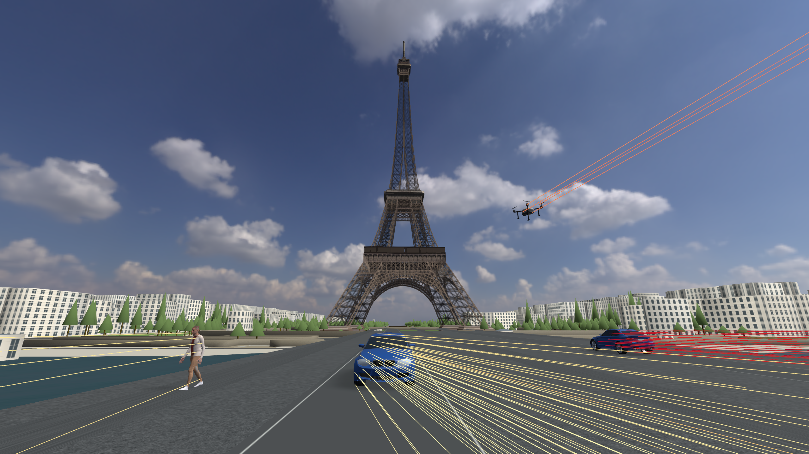
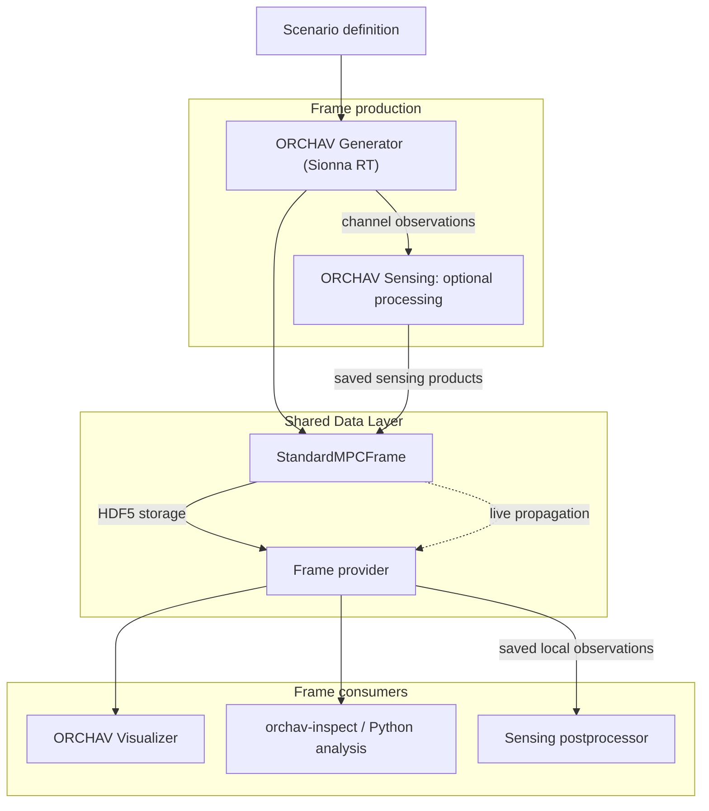

<h1 align="center">
  <picture>
    <source media="(prefers-color-scheme: dark)" srcset="visualizer/resources/branding/orchav-wordmark-on-dark.svg">
    <source media="(prefers-color-scheme: light)" srcset="visualizer/resources/branding/orchav-wordmark-on-light.svg">
    
  </picture>
</h1>

<p align="center">
  <a href="https://www.python.org/downloads/"></a>
  <a href="LICENSE"></a>
  <a href="https://github.com/psf/black"></a>
</p>

ORCHAV (Orchestrated Ray-Tracing / Channel Analysis & Visualization) is a
framework for simulating, visualizing and analyzing radio propagation channels.
It uses NVIDIA’s [Sionna RT](https://nvlabs.github.io/sionna/) to compute
propagation through 3D [scenes](docs/reference/glossary.md#scene) with moving
radios and [targets](docs/reference/glossary.md#target). Its interactive
[Visualizer](docs/visualizer/README.md) lets you inspect and filter [multipath components (MPCs)](docs/reference/glossary.md#propagation-path-mpc),
explore [coverage maps](docs/reference/glossary.md#coverage-map) and channel metrics, and relate the results to scene geometry
and motion.

[ORCHAV Sensing](docs/sensing/README.md) lets you test [detection](docs/reference/glossary.md#detection) and [tracking](docs/reference/glossary.md#tracking)
algorithms using simulated channel observations. You can examine range,
[Doppler](docs/reference/glossary.md#doppler) and direction estimates, inspect how processing settings affect the
results, and evaluate detections and tracks against the known target motion.



*ORCHAV's desktop Visualizer displays an Eiffel Tower scene with vehicles, a
pedestrian, a drone, and multipath returns colored by
[delay](docs/reference/glossary.md#delay).
Map data: © [OpenStreetMap contributors](https://www.openstreetmap.org/copyright).*

[Watch the ORCHAV visual demos](docs/visualizer/demo_video.md).

## Main Components

The **[Generator](docs/generator/README.md)** creates reusable channel recordings from a [scenario](docs/reference/glossary.md#scenario) that defines scene geometry, radio settings and [actor](docs/reference/glossary.md#actor) motion. It coordinates Sionna RT throughout the simulation.

The **[Shared Data Layer](docs/shared/README.md)** connects simulation, visualization and analysis through a common data format. It handles storage and retrieval so the same recording can be explored in the application, inspected from a terminal or analyzed in Python.

The **[Visualizer](docs/visualizer/README.md)** provides the interactive workspace for exploring those results. Playback, path selection and linked plots let you move between a return's geometry and its delay, power, direction or evolution over time. [Interactive recomputation](docs/visualizer/interactive_recomputation.md) also lets you test supported changes to actor positions and [ray-tracing](docs/reference/glossary.md#ray-tracing) settings.

**[ORCHAV Sensing](docs/sensing/README.md)** provides signal processing, detection, tracking and evaluation across these components. Processing can run during generation or use retained observations later. Its maps, detections and tracks are saved with the channel data for inspection in the Visualizer and analysis in Python.

## ORCHAV Big Picture

These components share a [frame contract](docs/reference/glossary.md#frame-contract):
each [frame](docs/reference/glossary.md#frame) brings together actor state and
propagation paths for one simulation step.

The Generator is the main [producer](docs/reference/glossary.md#producer) of
these frames. The Shared Data Layer stores them and provides
[frame providers](docs/reference/glossary.md#frame-provider), which retrieve
the data for [consumers](docs/reference/glossary.md#consumer) such as the
Visualizer, `orchav-inspect` and Python analysis tools.
The ORCHAV Sensing [postprocessor](docs/sensing/reprocessing.md#run-processing)
is another frame consumer.



With [HDF5](docs/reference/glossary.md#hdf5) recordings, you can
return to the same simulation for further inspection and analysis without
repeating the ray tracing. The [data-mode guide](docs/shared/README.md#choose-a-data-mode)
explains local, live and remote access.

Saved sensing observations also let you compare sensing processing choices
**without rerunning ray tracing**. The postprocessor can produce new maps,
detections or tracks from an existing [acquisition](docs/reference/glossary.md#acquisition), depending on the [data retained](docs/sensing/reprocessing.md#what-can-be-changed-afterwards).
It writes each result to a separate recording so you can compare processing
variants while keeping the original acquisition.

## Install

Activate a Python 3.12 environment in the repository root, then run:

```text
python -m pip install -e .
```

Linux is the main development platform. Selected workflows are also tested on
Windows and Apple Silicon macOS. For platform-specific setup and ray-tracing
requirements, see [Installation](docs/getting_started/installation.md).

The base installation includes sensing with [3D mesh/material targets](docs/sensing/target_models.md#choose-a-representation).
For targets defined by a radar cross section (RCS), a feature introduced in
[Sionna RT 2.2](https://github.com/NVlabs/sionna-rt/releases/tag/v2.2.0), use the
[native RCS installation option](docs/getting_started/installation.md#native-rcs-targets).

## First Run

From the repository root with the ORCHAV environment active, generate the
included Hello World scenario:

```bash
orchav-generator scenarios/getting_started/hello_world/
```

Then open its generated frame in the Visualizer:

```bash
orchav-visualizer --scenario scenarios/getting_started/hello_world
```

Before tracing paths, the Generator checks that the scenario settings follow
the configuration schema. The [Quickstart](docs/getting_started/quickstart.md)
shows how to check a scenario separately and inspect the frames it produces.
Run `orchav-generator` without arguments to list the included scenarios.

## Included Scenarios

The [scenario catalog](scenarios/README.md) groups runnable experiments by task.
Start with [Getting Started](scenarios/getting_started/README.md). Choose a
[Generator scenario](scenarios/generator/README.md) to change how a scene is
simulated or a [Visualizer scenario](scenarios/visualizer/README.md) to
explore the results.

For ORCHAV Sensing, the [sensing scenarios](scenarios/sensing/README.md) cover
range and velocity estimation, target detection and tracking, and micro-Doppler.

## Documentation

Use the [documentation home](docs/README.md) to find a guide by task.
The [examples](examples/README.md) provide scripts and notebooks you can adapt
to connect your own data, simulation logic, and visualizations to ORCHAV.

<details>
<summary>Repository layout</summary>

| Folder | Contents |
| --- | --- |
| [`docs/`](docs/README.md) | User guides, workflows, and technical references. |
| [`scenarios/`](scenarios/README.md) | Runnable scenario definitions and instructions. |
| [`examples/`](examples/README.md) | Scripts, notebooks, and Visualizer experiments. |
| [`libraries/`](libraries/README.md) | Scene geometry, target meshes, textures, and lighting assets. |
| [`config/`](config/app.toml) | Default application settings. |
| [`generator/`](generator/README.md) | Scenario execution and ray tracing. |
| [`shared/`](shared/README.md) | Frame storage, transport, and analysis. |
| [`visualizer/`](visualizer/README.md) | The desktop application, renderers, and [brand assets](visualizer/resources/branding/README.md). |
| [`scripts/`](scripts/README.md) | Documentation tools and repository checks. |
| [`tests/`](tests/README.md) | Test suites and fixtures. |

</details>

## Validation And Contributing

Use [`orchav-validate`](docs/reference/scenario_validation.md) to check scenario
configuration without running a simulation. Contributors should follow
[CONTRIBUTING.md](CONTRIBUTING.md) for the development environment, quality
checks, and pull-request checklist.

## License, Disclaimer, And Third-Party Notices

ORCHAV source code is distributed under the GNU General Public License version
3 unless a file states otherwise. NIST-developed software is provided with the
terms and warranty disclaimer in
[NIST_SOFTWARE_DISCLAIMER.md](NIST_SOFTWARE_DISCLAIMER.md).

Third-party dependencies, optional datasets, and bundled assets are covered by
their own terms. See [THIRD_PARTY_NOTICES.md](THIRD_PARTY_NOTICES.md) for the
dependency and asset summary. Python dependencies are installed from the
user's environment and are not bundled as binary artifacts in this source tree.

The mention of commercial products, their sources, or their use in connection
with material reported herein is not to be construed as either an actual or
implied endorsement of such products by the Department of Commerce.

## Use Of Generative AI

This software and its documentation were developed and edited with assistance from generative AI tools, including ChatGPT and Codex, developed by OpenAI. These tools were used to draft and revise documentation, suggest code changes, write and update tests, perform functional code review, and support refactoring in accordance with the authors' instructions. All source code, documentation, scientific claims, and conclusions have been reviewed and verified by the authors to ensure accuracy, originality, and suitability for release.

## Citation

To cite ORCHAV, use the SIMULTECH 2026 paper:

```bibtex
@inproceedings{ropitault2026orchav,
  title={ORCHAV: Connecting Ray-Traced Wireless Simulation and Interactive Propagation Analysis},
  author={Ropitault, Tanguy and Caromi, Raied and Golmie, Nada},
  booktitle={Proceedings of SIMULTECH 2026},
  year={2026},
  pages={39--51},
  publisher={SciTePress},
  doi={10.5220/0014911600004094}
}
```

For ORCHAV Sensing, also cite the IEEE ISAC 2026 paper.

Tanguy Ropitault, Steve Blandino, Raied Caromi, Samuel Berweger, Jack Chuang,
Camillo Gentile, and Nada Golmie, “ORCHAV Sensing: An Open-Source Framework for
Ray-Traced and Mesh-Based Wireless Sensing,” accepted at IEEE ISAC 2026.

```bibtex
@inproceedings{ropitault2026orchav_sensing,
  title={ORCHAV Sensing: An Open-Source Framework for Ray-Traced and Mesh-Based Wireless Sensing},
  author={Ropitault, Tanguy and Blandino, Steve and Caromi, Raied and Berweger, Samuel and Chuang, Jack and Gentile, Camillo and Golmie, Nada},
  booktitle={IEEE ISAC 2026},
  year={2026},
  note={Accepted}
}
```


## Acknowledgments

- Built on [Sionna RT](https://nvlabs.github.io/sionna/) for ray tracing.
- Uses [pygfx](https://github.com/pygfx/pygfx) with
  [wgpu-py](https://github.com/pygfx/wgpu-py) for the default, notebook, and
  offscreen visualization workflows,
  [PySide6](https://doc.qt.io/qtforpython-6/) for the desktop UI, and
  [Open3D](http://www.open3d.org/) for the Open3D/Filament renderer path.
