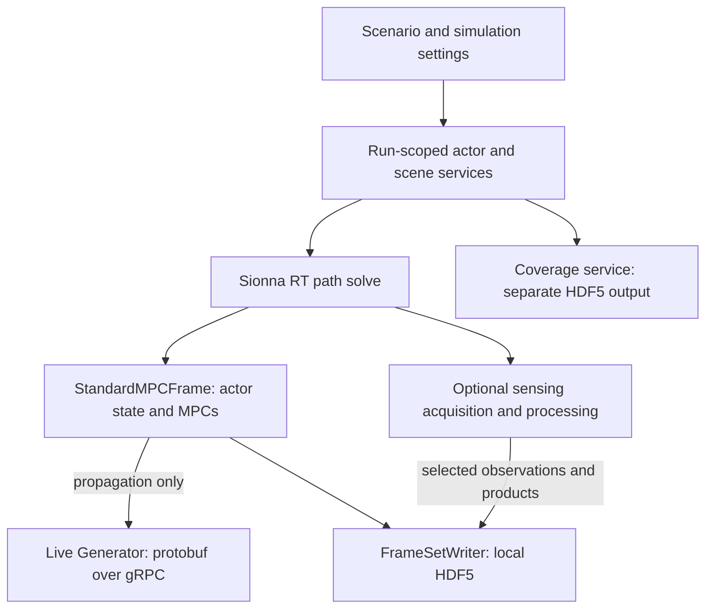

# Developer Architecture

The Generator orchestrates propagation solves with NVIDIA
[Sionna RT](https://nvlabs.github.io/sionna/rt/). It hands the resulting frames
to the Shared Data Layer so the Visualizer and other consumers can use them
independently of the ray tracer.

ORCHAV Sensing spans these components.
The Generator samples the channel, local frames carry the selected observations
and products, and the Visualizer displays the results alongside the scene.

## Component Boundaries

| Component | Responsibility | Stable boundary |
|-----------|----------------|-----------------|
| Generator | Prepare the scene and actors, solve propagation, and publish frames. | `ScenarioConfiguration`, `SimulationConfig`, and normalized frame records. |
| Shared Data Layer | Validate scenario and frame contracts, write and retrieve local frames, and encode propagation frames for transport. | `ScenarioModel`, `StandardMPCFrame`, `FrameSetWriter`, and `DataProvider`. Coverage has its own HDF5 schema. |
| ORCHAV Sensing | Acquire channel observations, process them into detections and tracks, evaluate results, and reprocess saved data. | Resolved acquisition and processing contracts, typed sensing products, and the local frame extension. |
| Visualizer | Combine scene assets with frame data, display propagation or coverage, and export views. | Frame providers, the coverage reader, and `RendererProtocol`. |

## Generator Boundary

Scenario loading validates YAML as `ScenarioModel`, resolves paths into
`ScenarioConfiguration`, and adapts generator settings into
`SimulationConfig`. Both configurations reach `perform_pipeline`, while
`PipelineContext` owns run-scoped services from `SimulationConfig`.

`perform_pipeline` dispatches file generation or a live Generator session.
In file mode, sensing can use solved complex path coefficients and delays
while they are still available. The recording configuration selects which
channel observations, radar products, detections, and tracks to retain.

Remote HDF5 playback serves existing propagation frames through a separate
read-only service. See [data modes](../shared/README.md#choose-a-data-mode).

## Shared Data Boundary

The stable persisted-frame path is `producer -> StandardMPCFrame ->
FrameSetWriter -> HDF5 frame set`. The stable retrieval path is
`DataProvider -> consumer`. A provider can return a `StandardMPCFrame` or a selected-field
[`FrameProjection`](../shared/frame_reference.md#standard-frames-and-selected-field-views).
Local HDF5 can satisfy a projection with selective dataset reads. Live and
remote providers receive a `StandardMPCFrame` over protobuf before projecting
it in memory.

Provider ownership is divided by responsibility:

| Boundary | Owner |
|----------|-------|
| `DataProvider`, `Hdf5Provider`, and `RemoteHdf5Provider` | Shared Data Layer |
| Live `GrpcProvider` and Visualizer `FrameSource` adapters | Visualizer |
| Read-only frame-file gRPC service over generated HDF5 | Generator transport adapter |
| HDF5 layout parsing below `Hdf5Provider` | Shared format reader |

## ORCHAV Sensing Boundary

ORCHAV Sensing connects channel acquisition to processing, detection, tracking
and evaluation. Its numerical processing lives in shared code so generation and
reprocessing can use it independently of the Visualizer.

| Responsibility | Owner and boundary |
|---|---|
| Acquire observations and assign result timing | [`generator/core/sensing/`](../../generator/core/sensing/__init__.py) resolves the acquisition and processing settings. The Generator runs the selected strategy against Sionna RT results and attaches products to the appropriate output frame. |
| Process and evaluate observations | [`shared/sensing/`](../../shared/sensing/__init__.py) provides signal processing, detection, tracking, evaluation and fusion. Its numerical routines support generation and saved-data workflows. |
| Describe, save and retrieve results | [`shared/extensions/sensing.py`](../../shared/extensions/sensing.py) defines the frame-extension contract. Shared sensing products declare axes, units and timing, while shared loaders and writers connect them to local HDF5 frames. |
| Inspect results in the scene | The Visualizer's [`SensingService`](../../visualizer/src/services/sensing_service.py) loads selected products and uses their saved scene binding. Its dashboards and renderer overlays present those results. |

During generation, acquisition can use complex path gains and delays before
the raw solver result is converted into a propagation frame. The
[postprocessor](../sensing/reprocessing.md#run-processing) instead starts from saved
observations and writes a separate result frame set linked to its source.
[Recording profiles](../sensing/reprocessing.md#choose-a-profile) determine which
processing choices can be revisited.

The [sensing payload](../shared/frame_reference.md#sensing-payloads) is a local,
file-backed extension. Live and remote propagation transport does not carry it.
A result's acquisition time and display scene can differ from the output frame's
step. Consumers use the saved timing and scene binding described in
[acquisition modes and timing](../sensing/concepts.md#result-timing).

## Visualizer Boundary

The Visualizer loads scene assets through its scene service and retrieves
propagation frames through a `FrameSource` adapter and `DataProvider`. Coverage uses its own reader and loading path.

For a local sensing run, the dashboard can load selected products on demand and use
their saved scene binding to display the corresponding actor state.

`FramePipeline` can request a projection directly from a provider.
`FrameLoaderService` supplies complete-frame caching and fallback loading when
that path is needed. The pipeline derives application-owned `ViewModel` state,
projects frame-heavy data into `FrameRenderPacket`, and submits the packet
through `RendererProtocol`. Renderer-specific objects stay inside the backend
packages. See [Renderers](../visualizer/renderers.md) for supported backend
behavior.

## Chart rendering

Interactive 2D charts use PyQtGraph and the application's shared theme. These
chart widgets are separate from the pygfx or Open3D scene renderer. Their
source calculations and exported PNG/PDF figures are independent of this GUI
backend. Theme changes restyle existing data rather than rerunning analysis.

Most interactive charts use PyQtGraph. Saved report previews and the 3D
spectrum surface embed Matplotlib canvases. Standalone figure export also uses
Matplotlib. These chart backends are independent of the scene renderer.

For implementation entry points, see the
[3D spectrum surface](../../visualizer/src/sensing/spectrum_surface.py),
[saved-report preview](../../visualizer/src/sensing/inspection_figure.py) and
[path-analysis service](../../visualizer/src/experiments/path_analysis.py).
User-facing selection and interpretation belong in the
[Path inspection guide](../visualizer/path_inspection.md).

## Extension Seams

- Change core scenario fields in the shared scenario model and parsers, then
  regenerate the [Scenario YAML Reference](../reference/scenario_yaml.md).
  Optional feature sections should use the registered scenario-extension
  boundary.
- Add Generator behavior behind run-scoped services and the existing frame or
  coverage publication boundaries.
- Add a producer by converting solved records to `StandardMPCFrame`. Use
  `FrameSetWriter` when the result should be persisted.
- Add a retained frame format through a shared format reader and file provider.
  Add another delivery route through `DataProvider` and a Visualizer
  `FrameSource` adapter.
- Add renderer behavior through `RendererProtocol`, explicit
  `RendererCapabilities`, and `FrameRenderPacket`. Keep backend-native objects
  inside the renderer package.
- Add optional Visualizer frame behavior through the runtime-extension
  registry instead of branching the core frame pipeline on a private feature.

## Implementation Entry Points

| Area | Start here |
|------|------------|
| Generator dispatch and lifecycle | [`generator/core/pipeline/dispatch.py`](../../generator/core/pipeline/dispatch.py), then [`offline_pipeline.py`](../../generator/core/pipeline/offline_pipeline.py) or [`streaming.py`](../../generator/core/pipeline/streaming.py) |
| Sensing reprocessing | [`shared/sensing/postprocessor.py`](../../shared/sensing/postprocessor.py) |
| Shared package orientation | [`shared/README.md`](../../shared/README.md) |
| Frame contract, providers, and writing | [`shared/frames/types.py`](../../shared/frames/types.py), [`provider_base.py`](../../shared/frames/provider_base.py), and [`frame_set_writer.py`](../../shared/frames/frame_set_writer.py) |
| Visualizer scenario loading | [`visualizer/src/app/scenario_workflow.py`](../../visualizer/src/app/scenario_workflow.py) |
| Visualizer frame processing | [`visualizer/src/pipeline/frame_pipeline.py`](../../visualizer/src/pipeline/frame_pipeline.py) |
| Renderer contract | [`visualizer/src/renderers/protocol.py`](../../visualizer/src/renderers/protocol.py) |

---

Home: [Documentation](../README.md) | Related: [Frame Data Reference](../shared/frame_reference.md) | [Scenario Authoring](../generator/scenario_authoring.md)
