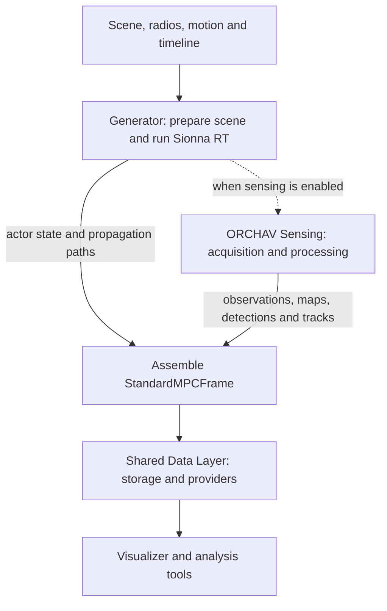

# Generator

The Generator is ORCHAV's main [frame producer](../reference/glossary.md#producer).
It turns a [scenario](../reference/glossary.md#scenario)'s scene, radios,
[actors](../reference/glossary.md#actor) and timeline into reusable
[frames](../reference/glossary.md#frame). It prepares the geometry and motion,
orchestrates NVIDIA's [Sionna RT](https://nvlabs.github.io/sionna/rt/) to compute
propagation paths, and combines the results with actor poses in the shared
[`StandardMPCFrame` contract](../shared/frame_reference.md).

The [Shared Data Layer](../shared/README.md) stores and serves these frames to
the [Visualizer](../visualizer/README.md), inspection commands and Python
analysis. Saved recordings can be reopened without rerunning ray tracing.

When a scenario enables [ORCHAV Sensing](../sensing/README.md), the Generator
also acquires complex channel observations and can save range–Doppler maps,
detections and tracks with the frames. Retained observations can be reprocessed
with different settings.

The dashed branch is included only when sensing is enabled. Both routes use
the same frame contract for storage and downstream inspection.

## Start here

Start with [Hello World](../../scenarios/getting_started/hello_world/README.md)
to define and run a scenario in YAML. The
[Generator scenarios](../../scenarios/generator/README.md) then show how to add
motion, change reflection and scattering settings, place mesh targets, and
compute coverage.

In the default `files` mode, generation writes HDF5 chunks and their manifest
under `frames/`, and standalone scene, motion and diagnostic figures under
`summary/`, both beside the scenario. See [generated figures](generated_figures.md)
for the available outputs.

The Generator can also serve propagation frames on demand through `live_grpc`.
That route keeps session caches rather than writing a durable HDF5 recording.
Use the [data-mode guide](../shared/README.md#choose-a-data-mode) to choose how
frames reach a consumer.
Sensing playback and reprocessing use saved local frames.

## Choose a task

| Goal | Start here |
| --- | --- |
| Run my first scenario | [Quickstart](../getting_started/quickstart.md) |
| Place radios and edit their motion on screen | [Scenario Builder](scenario_builder.md) |
| Write a scenario or add Python-generated actors | [YAML and Python authoring](scenario_authoring.md#choose-an-authoring-surface) |
| Choose a scene, antennas, materials, or ray-tracing settings | [Simulation configuration](configuration.md) |
| Define a route, orientation, or moving group | [Mobility and orientation](mobility_and_orientation.md) |
| Plot scene geometry, motion, or coverage | [Summary and coverage figures](generated_figures.md) |
| Find a runnable example | [Generator scenarios](../../scenarios/generator/README.md) |
| Look up a flag or field | [CLI reference](cli_reference.md) · [Scenario YAML reference](../reference/scenario_yaml.md) |

## Geography, animated targets and sensing

| Goal | Start here |
| --- | --- |
| Build a city scene from OpenStreetMap | [Generate from YAML](geography/osm_scene_generation.md) · [Select an area in the Builder](geography/osm_scenario_builder.md) |
| Use existing scene files or recover a partial download | [Local geographic inputs](geography/osm_scene_generation.md#local-scene-inputs) · [Acquisition and recovery](geography/osm_scene_generation.md#reuse-and-recovery) |
| Animate a folder of PLY poses | [Direct PLY sequence](motion/animated_targets.md#simple-example-a-folder-of-ply-poses) · [Mesh Targets scenario](../../scenarios/generator/targets/mesh_targets/README.md) |
| Import external body motion with explicit timing | [SMPL or AMASS](motion/smpl_mesh_generation.md) · [Kimodo or SOMA](motion/kimodo_motion_import.md) |
| Generate and inspect a sensing acquisition | [First sensing scenario](../../scenarios/sensing/cube_radar/stationary/README.md) · [Sensing guide](../sensing/README.md) |

For the implementation layout, see [Generator source](../../generator/README.md).
For storage, streaming, and reading frames from another application, see the
[Shared Data Layer](../shared/README.md).
