# Summary and Coverage Figures

Generate standalone figures of a scenario's geometry, motion, coverage and
sensing results. Generation saves these images under `summary/`, where they
can be viewed without opening the Visualizer. Saved frames and coverage arrays
can also supply new figures after generation.

## Topology

The topology figure combines orthographic 3D and top views of the scene,
with actor trajectories, orientations, and material colors. Target close-ups
show the mesh geometry; animated targets include the first, middle, and final
sampled poses.

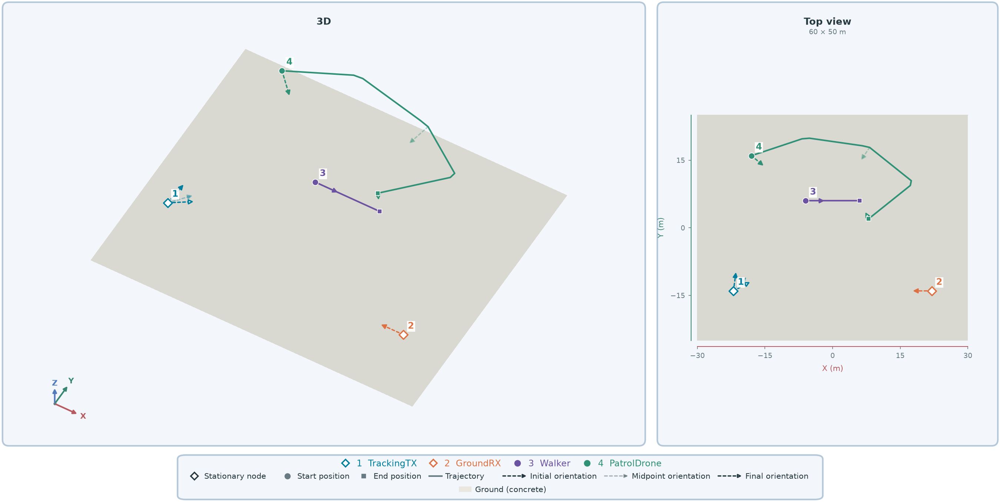

Request it in the scenario YAML:

```yaml
generator_summary:
  enabled: true
  create: [topology, speed]
```

The Generator writes `summary/topology.png` and `summary/topology.json`.

Set `generator_summary.visualization.topology_pose_samples: 5` to show five poses of an animated target. The default shows the first, middle and final poses. `topology_motion_detail` can add a close-up of a short rigid-target trajectory.

For a YAML-authored scenario, create the figure without running ray tracing:

```bash
python -m generator.figures.topology --scenario scenarios/getting_started/hello_world
```

Use `--output path/to/figure.png` to choose the destination, or `--view top`
or `--view 3d` to export an individual panel. The combined view is the default.
Use `--motion-detail true` to include sampled poses and displacement for
this figure; `auto` and `false` are also accepted. `--pose-samples 5` selects
five animation snapshots for a standalone export; `3` retains three.
The command requires the referenced scene and target meshes.

## Motion Figures

Add the products relevant to the experiment:

| `create` key | Result | Output |
| --- | --- | --- |
| `topology` | Scene, actors, trajectories, and sampled orientations | `summary/topology.<format>` |
| `speed` | Speed magnitude in meters per second | `summary/velocity/speed_evolution.<format>` |
| `orientation` | Yaw, pitch, and roll at each output step | `summary/angular/*_orientation_evolution.<format>` |
| `angular_velocity` | Euler-angle change in degrees per output step | `summary/angular/*_angular_velocity_evolution.<format>` |

Orientation products write separate figures for each populated transmitter,
receiver, or target role. `angular_velocity` measures change per output step,
not degrees per second.

These motion figures use the same
[Actor Orientation](../../scenarios/generator/mobility_and_orientation/actor_orientation/README.md)
scenario shown above:

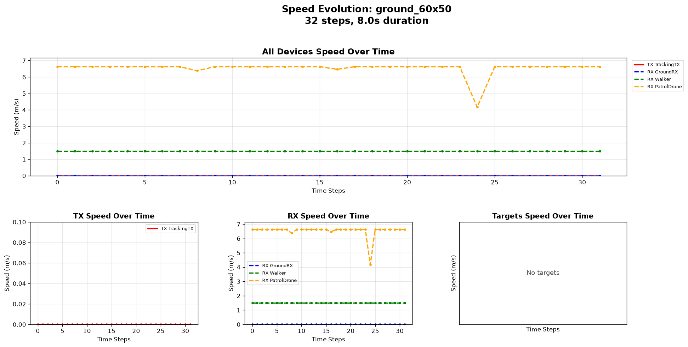

| Receiver orientation | Receiver orientation change |
| --- | --- |
| 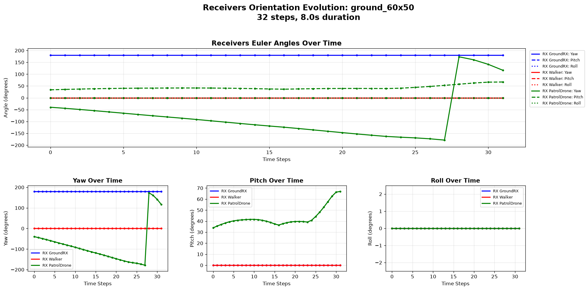 | 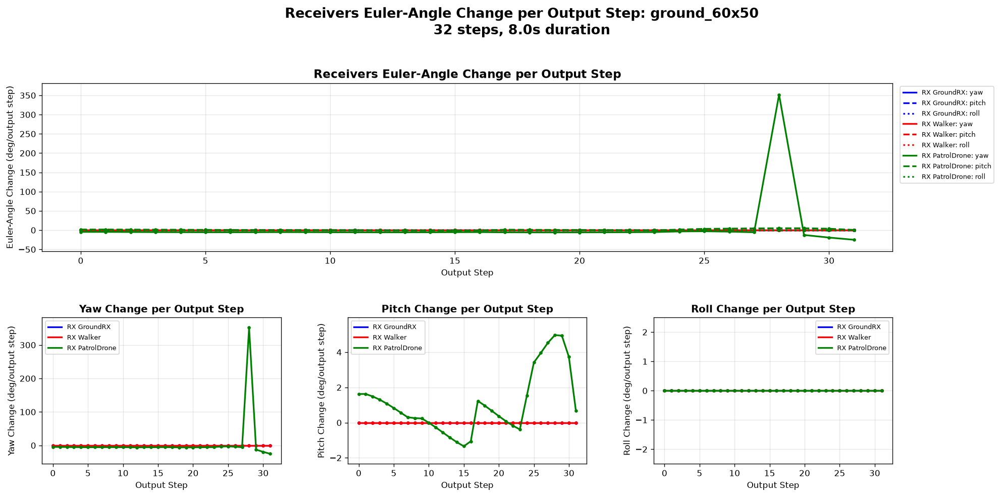 |

## Output and Regeneration

PNG is the default format. Use SVG or PDF when vector output is preferable:

```yaml
generator_summary:
  enabled: true
  create: [topology, speed, orientation, angular_velocity]
  output:
    format: svg
```

When the YAML is unchanged and a complete summary exists, the Generator reuses
it. Set `generator_summary.force: true` for one run after changing external
meshes, scene files, or scripted actors. A rebuild replaces the summary only
when every requested figure succeeds; a failed figure leaves the previous
complete summary and simulation frames intact.

For all configuration fields, see the
[Scenario YAML Reference](../reference/scenario_yaml.md#generator-summary-settings).

## Sensing Figures

Enable sensing summaries in the scenario YAML to generate them automatically
after acquisition:

```yaml
generator_summary:
  enabled: true
  create: [topology, sensing]
  sensing:
    figures: [range_profile, range_doppler, doppler, detection, tracking]
    history_time_axis: time
    range_profile_views: [zoom_to_data, full]
    range_doppler_views: [zoom_to_data, full]
```

The figures appear in `summary/sensing/`. Choose products saved by the scenario.
A tracking plot needs recorded tracks, and a range–Doppler snapshot needs a
complete acquisition window.

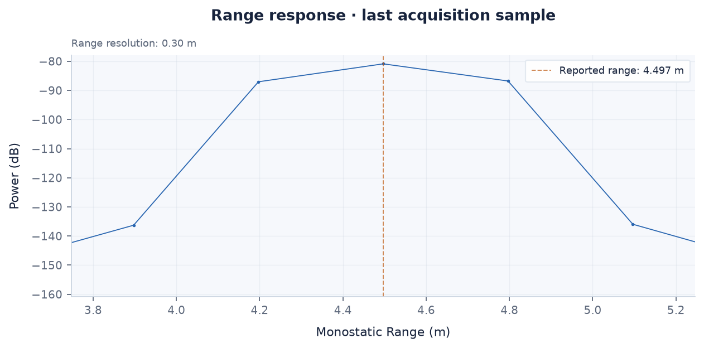

This range profile comes from the
[stationary cube](../../scenarios/sensing/cube_radar/stationary/README.md).
The response is concentrated around the cube's nearest reflecting face.
Its width and sidelobes depend on bandwidth and the selected processing window.


### Sensing Figures From Saved Results

Plot the last complete result and its detection history from an existing recording. Choose a fresh output directory:

```bash
python -m generator.figures.summary.saved_sensing scenarios/sensing/cube_radar/stationary -o analysis/cube-radar-stationary-summary --figure range_profile --figure range_doppler --figure detection_history
```

The command reads the saved products and writes plots under the output directory's `sensing/` folder. Use `--frame-index N` to end the history at a particular complete frame. To compare plots across recordings, give them matching `--range-limits`, `--velocity-limits` and `--power-limits`. See `--help` for all figure types.

To reproduce the [stationary cube](../../scenarios/sensing/cube_radar/stationary/README.md)
range–Doppler and range-profile figures with the selected final frame and fixed
zoom and power limits, use:

```bash
python -m generator.figures.summary.saved_sensing scenarios/sensing/cube_radar/stationary -o analysis/stationary-cube-summary --frame-index 63 --figure range_doppler --figure range_profile --range-limits 3 6 --velocity-limits -2 2 --power-limits -140 -60
```

The source recording is not modified, and figure generation does not repeat ray
tracing or detection.

To change the detection or tracking algorithm, [reprocess the recording](../sensing/reprocessing.md#run-processing) before plotting it.

## Coverage Figures

Coverage-map figures are separate from `generator_summary.create`. They require
coverage generation and are controlled by `coverage.save.figure`. The images
are written under `summary/coverage`:

```yaml
coverage:
  enabled: true
  save:
    figure:
      enabled: true
      format: png
      filename: coverage_maps
      metrics: [best_path_loss_db, best_rss_dbm, sinr_db]
      metric_filename: coverage_metrics
      distribution:
        enabled: true
        metrics: [best_path_loss_db, best_rss_dbm, sinr_db]
        filename: coverage_distributions
```

| YAML control | Figure | Goal |
| --- | --- | --- |
| `figure.enabled: true` | Quick-look coverage map | Inspect the coverage field at every configured height. |
| Non-empty `figure.metrics` | Metric guide | Compare selected metrics at every configured height. |
| `distribution.enabled: true` with non-empty `distribution.metrics` | Histograms and CDFs | Compare value ranges and distributions at every configured height. |

These examples show both configured heights from
[Single-Transmitter Coverage](../../scenarios/generator/coverage/single_tx/README.md):

| Output | 1.5 m | 30 m |
| --- | --- | --- |
| Quick-look map | [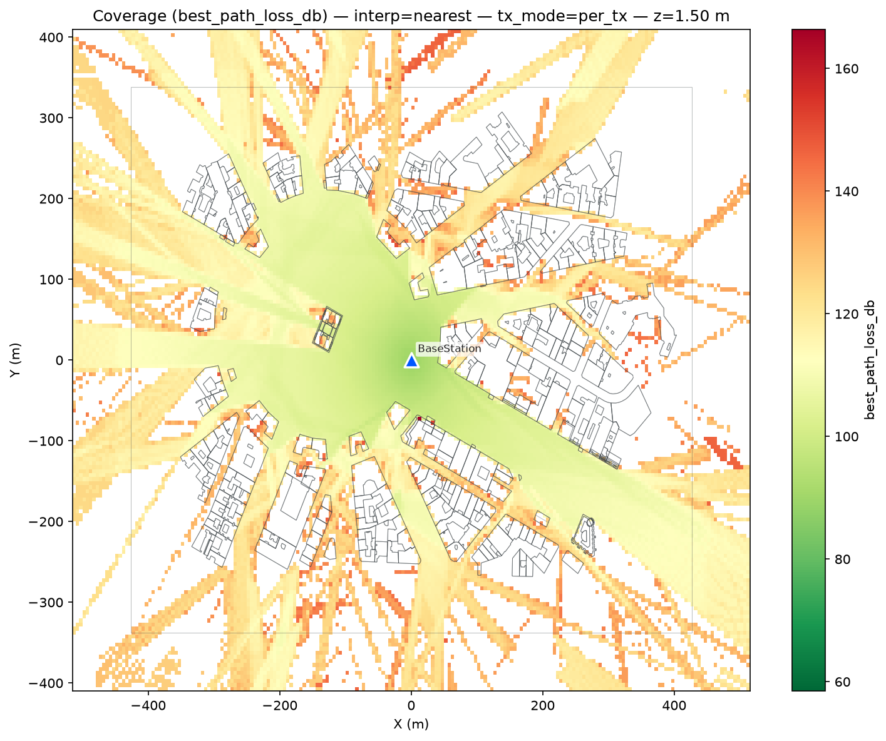](../assets/scenarios/scenarios_generator_coverage_single_tx_coverage_height-01_1.5m.png) | [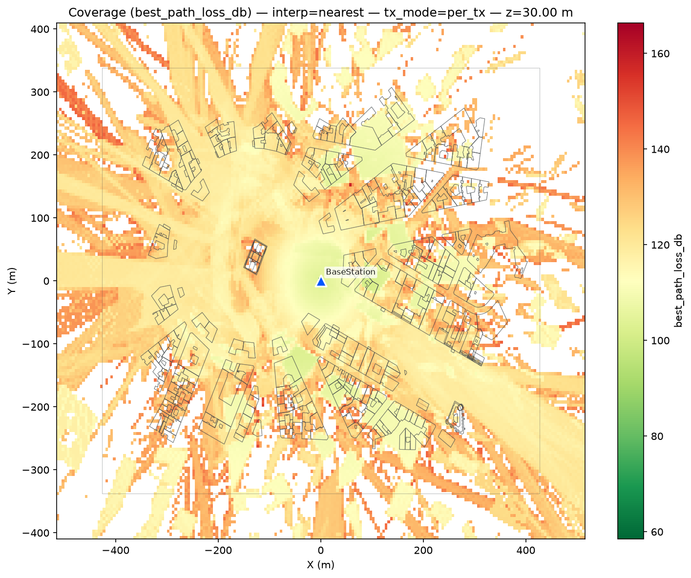](../assets/scenarios/scenarios_generator_coverage_single_tx_coverage_height-02_30m.png) |
| Metric guide | [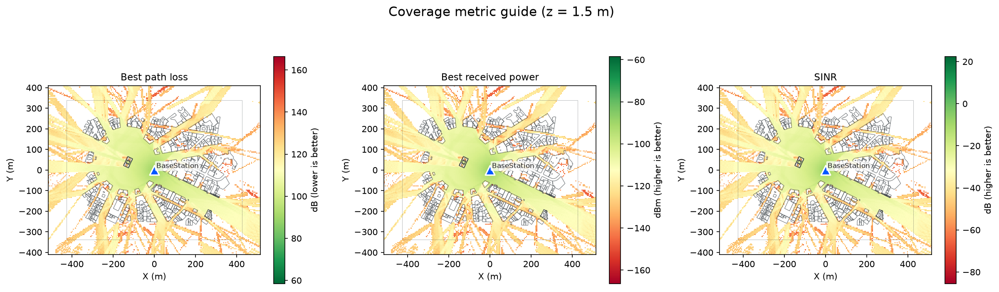](../assets/scenarios/scenarios_generator_coverage_single_tx_metrics_height-01_1.5m.png) | [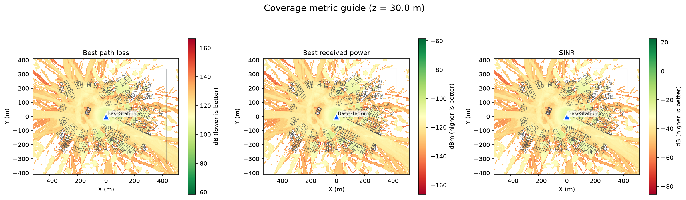](../assets/scenarios/scenarios_generator_coverage_single_tx_metrics_height-02_30m.png) |
| Distribution | [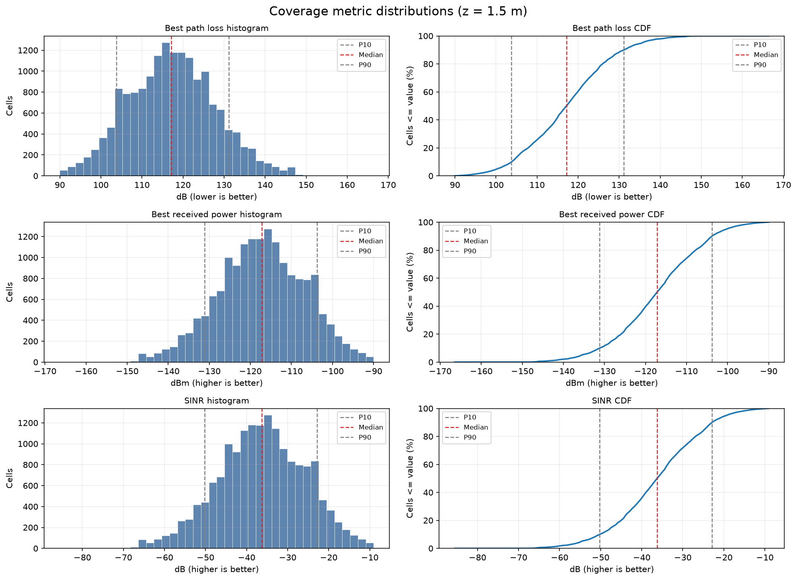](../assets/scenarios/scenarios_generator_coverage_single_tx_distributions_height-01_1.5m.png) | [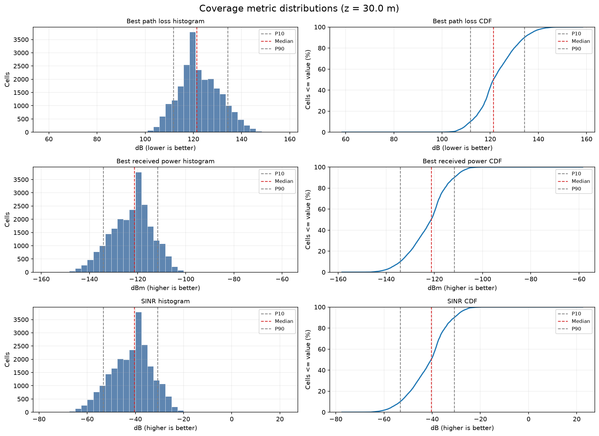](../assets/scenarios/scenarios_generator_coverage_single_tx_distributions_height-02_30m.png) |

Each figure uses one file per height, such as `coverage_maps_height-01_1.5m.png`. Metric-specific color limits are shared across heights. Use `metric/TXName` to select an individual transmitter.

### Standalone 3D Coverage Slices

Export a saved height slice together with the scene meshes without opening the
Visualizer or rerunning ray tracing:

```bash
python -m generator.tools.coverage_figure --scenario scenarios/generator/coverage/single_tx --output coverage_3d.png
```

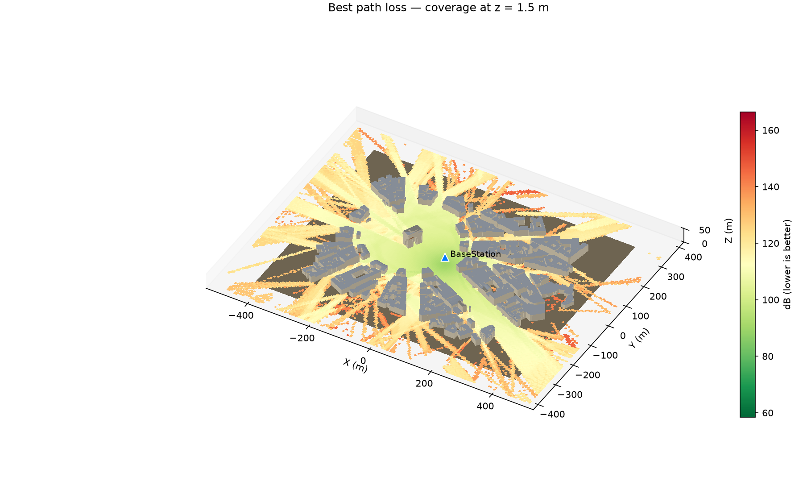

The command reads `coverage/coverage_maps.h5` from the scenario and writes the
requested PNG, PDF, or SVG using a CPU renderer. It requires existing coverage
data and scene meshes, with no display or GPU requirement. It runs only when
requested, so it adds no work to normal scenario generation or playback.

`--height-index 0` selects the first saved height; `--height-index 1` selects
the second. Use `--metric best_rss_dbm`, `--metric serving_tx`, or a named
transmitter such as `--metric path_loss_db/BaseStation`. `--elevation 40` and
`--azimuth -60` set the orthographic camera angles in degrees. Use
`--coverage-file path/to/coverage_maps.h5` to render another saved recording
with its matching scenario.

The figure preserves cell footprints, physical heights, and missing-data gaps.
Color limits cover all stored heights for the selected metric, as in the 2D
metric guides. This export draws one horizontal slice; volumetric and isosurface
inspection remain available in the Visualizer.

---

Up: [Generator](README.md) | Previous: [Mobility and Orientation](mobility_and_orientation.md) | Continue: [Shared Data Layer](../shared/README.md)
