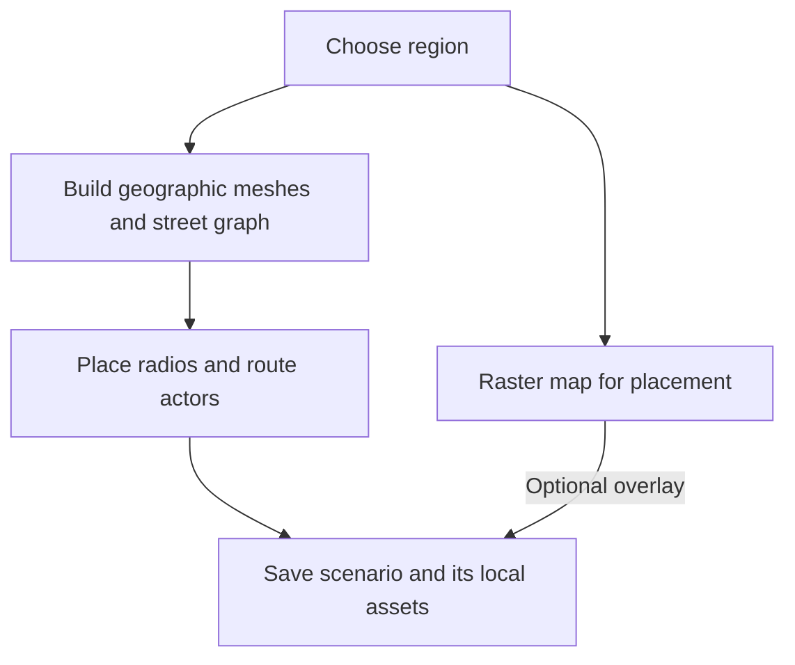

# OpenStreetMap in Scenario Builder

Select a geographic region on a map, build a radio scene for that region, then place actors on its streets. For a repeatable region with exact coordinates, use the [YAML recipe](../../../scenarios/generator/paris_opera_osm/README.md).



The map provides a placement reference, while the build produces the actual
meshes and street graph. Saving the scenario keeps those generated inputs
with the actor configuration. The map overlay is optional.

## Select and build a region

1. Install the [OSM extra](../../getting_started/installation.md#openstreetmap-osm-scenarios) in your ORCHAV environment, then launch the Builder:

   ```bash
   orchav-visualizer --author --no-resume
   ```

2. Choose **OpenStreetMap** as the scene source. Enter latitude and longitude or paste an OSM link containing `#map=zoom/latitude/longitude`. Choose **Show map**.
3. Drag a rectangle and check its dimensions in metres. Each side must be between 20 m and 5 km. Under **Scene options**, enable terrain or additional height data if needed. Both start disabled for a new Builder region.
4. Choose **Build selected region**. When the geometry appears, inspect the buildings and roads. Use **Cancel job** to stop a build and keep the current environment.
5. Add a transmitter and receiver. For a street route, use **Choose named streets…** and preview the path. When replacing an existing environment, check each actor's placement: its local coordinates carry over, while routes use the new graph.
6. **Validate** and **Save As**. The scenario directory now contains the YAML, scene XML, meshes, street graph and metadata. A complete saved scene can reopen offline.

**Keep 2D map as a scene overlay** saves the map image for visual reference. Ray tracing uses the constructed geometry. Map tiles and geographic features come from separate services, so unavailable tiles can leave the coordinates usable for a build. For network failures or partial results, see [acquisition and recovery](osm_scene_generation.md#reuse-and-recovery).

The [Scenario Builder guide](../scenario_builder.md) shows the resulting
workspace and a selected street route.

[Scenario Builder](../scenario_builder.md) · [OSM scene generation](osm_scene_generation.md) · [Map attribution and terms](https://www.openstreetmap.org/copyright)
