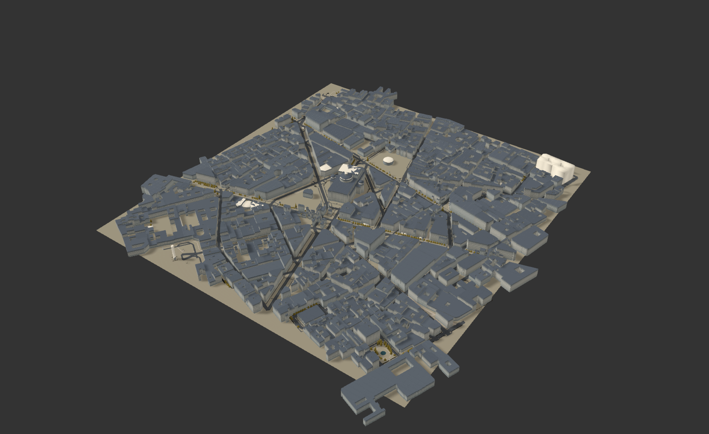
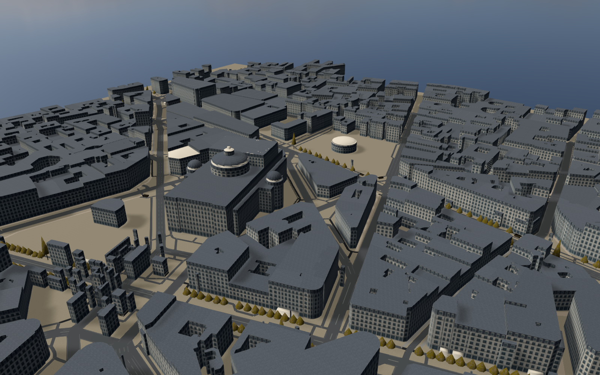
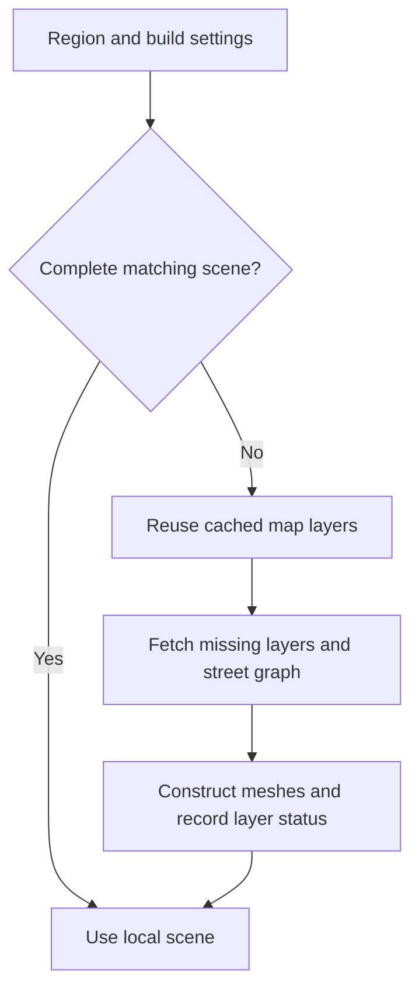

# OpenStreetMap scene generation

Use [OpenStreetMap (OSM)](https://www.openstreetmap.org/) to build streets,
approximate building volumes and a street graph in local metric coordinates.
[Sionna RT](https://nvlabs.github.io/sionna/rt/) uses the resulting XML scene and
meshes for propagation. Actors can follow the graph with
[road-network trajectories](../mobility_and_orientation.md#road-network-trajectories).

| Generated district | Street-level detail |
| --- | --- |
|  |  |

The [Paris Opéra OSM example](../../../scenarios/generator/paris_opera_osm/README.md)
produces this district. Building volumes and streets follow the map data.
Facade textures and road markings illustrate appearance and do not add radio
geometry. The example owns the generation and inspection commands.

Install the [OSM dependencies](../../getting_started/installation.md#openstreetmap-osm-scenarios)
before building a new region. The first build needs network access.

## Choose an authoring path

| Goal | How |
| --- | --- |
| Generate a repeatable scene with a scenario | Copy the recipe and edit `scene.osm` in its YAML. Keep the actors in the scene's local coordinate frame. |
| Select the area by eye | [Build a region in Scenario Builder](osm_scenario_builder.md). |
| Build just the geometry | Run the standalone command below, then reference the generated XML through `scene.source: local`. |
| Load previously prepared meshes and streets | Use [local scene inputs](#local-scene-inputs) below. |

To build geometry without acquiring channel frames, run the standalone command:

```bash
python -m generator.osm --center 48.8738 2.2950 --size 500 --output scenarios/local_osm/etoile
```

For a YAML scenario, replace the scene block with your own region. The following example selects a 300 m square in Washington, DC:

```yaml
scene:
  id: dc_mall_osm
  source: osm
  osm:
    center: [38.8887, -77.0261]
    size_m: 300
    terrain: false
    height_enrichment: false
```

Use `terrain` for elevation tiles or `height_enrichment` to estimate missing building heights. Options such as barriers, vegetation and bridges affect the geometry that is built. Canopy heights and land-cover gap filling need additional datasets. See `python -m generator.osm --help` for the standalone options.

### Geometry assumptions

Map tags do not always specify dimensions. For barriers without an explicit
height, walls use 2 m and fences or hedges use 1.5 m. Solid barriers use a 0.3 m
width, while explicitly tagged railings use 0.08 m. The `barrier_features`
metadata records these choices. Inspect them when barrier geometry matters to
the propagation study.

## Inspect the generated files

| File | What to check |
| --- | --- |
| `scene.xml` and `mesh/` | Keep the material-grouped meshes with the XML. Inspect building heights, ground clearance and radio placement. |
| `street_network.graphml` | Use as the local graph for [network-route mobility](../../reference/scenario_yaml.md#mobility-network-route). Choose node IDs from this graph. |
| `osm_metadata.json` | Check layer completeness, source attribution and coordinate information before using the scene. |

## Local scene inputs

`scene.source: local` loads an existing XML scene. It resolves `scene.id`
relative to the scenario directory:

```yaml
scene:
  source: local
  id: scene/scene.xml
```

Keep every XML-referenced mesh in its expected relative location. The
[local building-appearance example](../../../scenarios/generator/building_appearance/README.md)
demonstrates this layout without a network download.

| Input | When it is needed |
| --- | --- |
| Scene XML and referenced meshes | Always, for the radio geometry and materials. |
| `building_visuals.json` | Optional display metadata. It does not change radio geometry or materials. |
| `street_network.graphml` | For road-network trajectories. Stationary actors do not need it. |

For geographic inputs, use the XML, meshes and graph from the same build.
Check metre units, axis directions, projected origin and ground elevation.
Replacing the graph can change node IDs or move streets relative to the radios.
Inspect actor clearance before interpreting the channel results.

## Reuse and recovery



A complete matching scene can be reused offline. In `osm_metadata.json`, check
`acquisition.complete` and the individual layer outcomes. A partial build retries
missing data on the next load while reusing successful layers. A failed rebuild
preserves the previous scene and records the attempt in `osm_acquisition_attempt.json`.

| Symptom | Action |
| --- | --- |
| HTTP 429 or a busy service | Respect the provider's retry interval and reuse a saved scene while waiting. |
| Requests time out | Try a smaller region. `scene.osm.acquisition_timeout` sets the overall network budget (default 180 s) and `overpass_timeout` sets a request timeout (default 45 s). A longer timeout does not guarantee admission. |
| Wrong or incomplete scene reappears | Check bounds and layer outcomes. Set `scene.osm.refresh_cache: true` for an explicit refresh, then return it to `false`. |
| A custom service is required | Set `scene.osm.osm_server`. Each endpoint has its own query cache. |

Set `ORCHAV_CACHE_DIR` before starting Python to move query and optional dataset
caches together. The standalone `--cache-dir` option moves only the OSM query
cache. Preserve working caches during an outage.

Map data is © [OpenStreetMap contributors](https://www.openstreetmap.org/copyright). Keep attribution with derived scenes and images. Optional terrain, height and land-cover sources have separate terms. [Source notices](../../../generator/osm/NOTICE.md) · [OSM installation](../../getting_started/installation.md#openstreetmap-osm-scenarios)

Up: [Generator](../README.md) | Related: [Select a region in Scenario Builder](osm_scenario_builder.md)
