# Mobility and Orientation

Every actor pose combines two independent specifications:

| Specification | Controls |
|---|---|
| Mobility | Position and velocity at each timeline sample |
| Orientation | The direction the actor faces at each timeline sample |

ORCHAV samples both specifications on the shared scenario timeline. Generation,
Scenario Builder preview, and motion plots therefore use the same positions and
orientations. Position-like values are meters, speed is meters per second, time
is seconds, and authored angles are degrees.

## Mobility Models

Use the thumbnails to choose a path shape. Each shows the samples used by the Generator and Scenario Builder.

| Type | Example | Behavior |
|---|---|---|
| `stationary` | 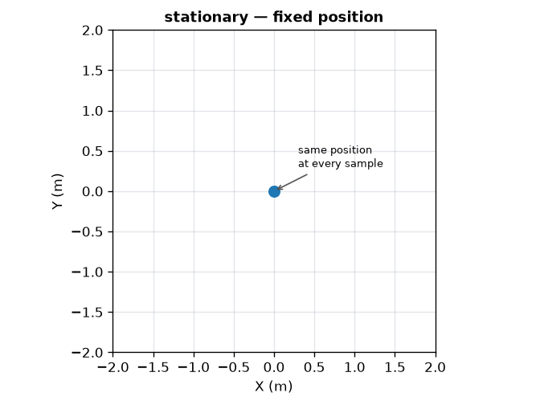 | Fixed `position_m`. |
| `linear` | 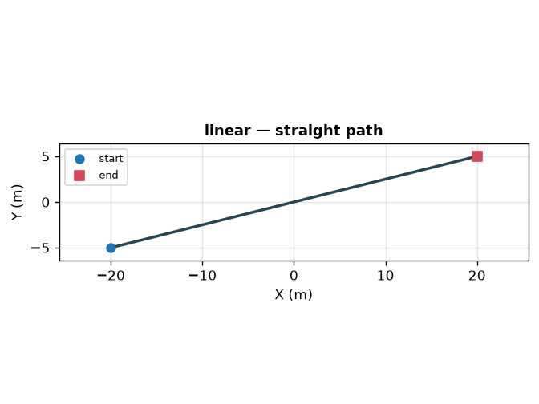 | Straight path from `start_m` to `end_m`. |
| `waypoint` | 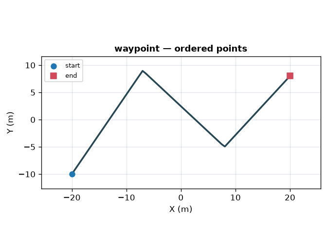 | Ordered `points_m`, with `linear` or `catmull_rom` interpolation. |
| `circular` | 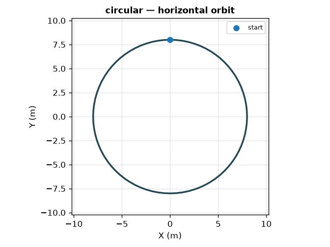 | Horizontal circle with radius, start angle, direction, and turns. |
| `survey` | 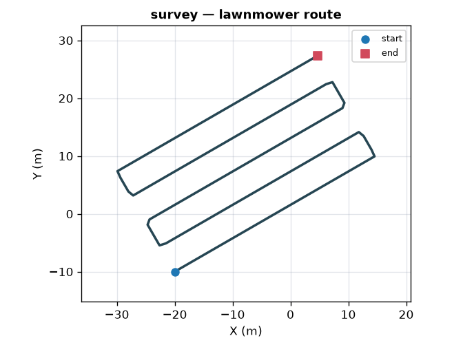 | Rotated lawnmower path over a rectangular area. |
| `grid_scan` | 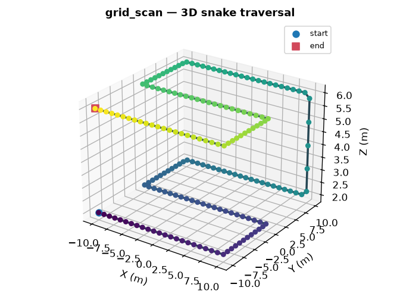 | Raster or snake traversal through a 3D grid. |
| `oscillating` | 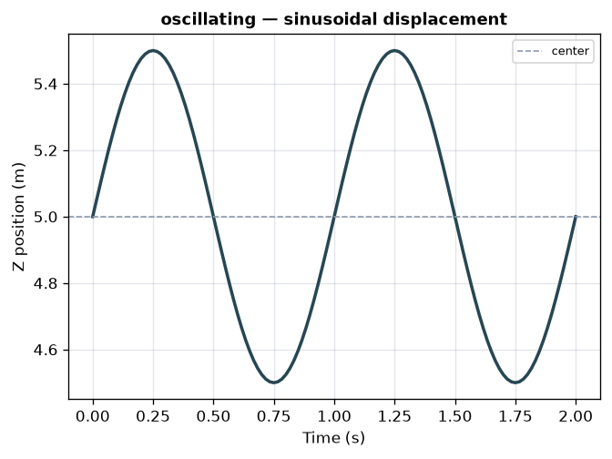 | Sinusoidal displacement along an arbitrary axis. |
| `pendulum` | 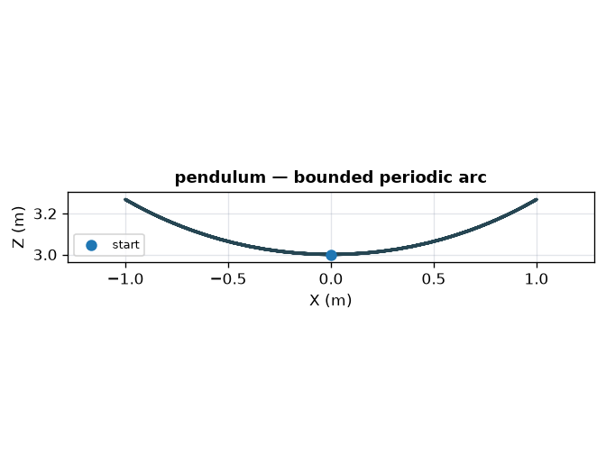 | Periodic arc around a pivot in a selected plane. |
| `figure8` | 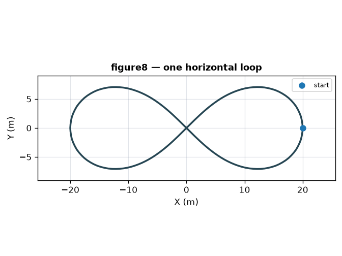 | Figure-eight path in the `xy`, `xz`, or `yz` plane. |
| `spiral` | 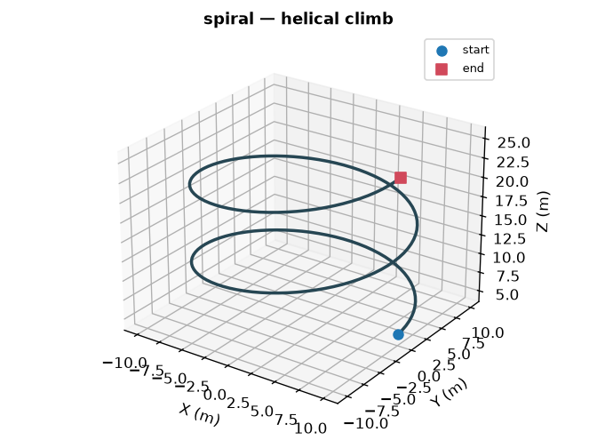 | Helical path between two altitudes. |
| `random_sampling` | 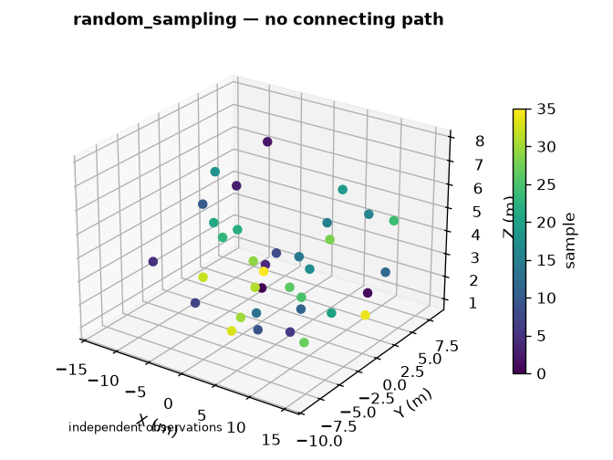 | Independent uniform or Poisson-disk samples, with an optional exact first observation and no physical velocity. |
| `sampled` | 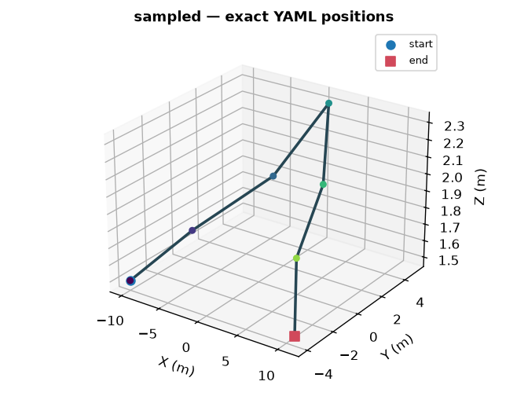 | Exact `positions_m` authored in YAML, one for each timeline step. |
| `gauss_markov` | 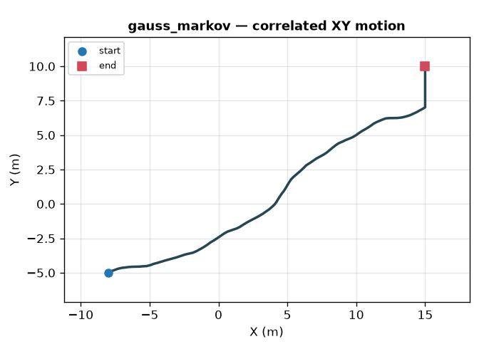 | Seeded correlated motion in XY. Z remains at the initial altitude. |
| `random_waypoint` | 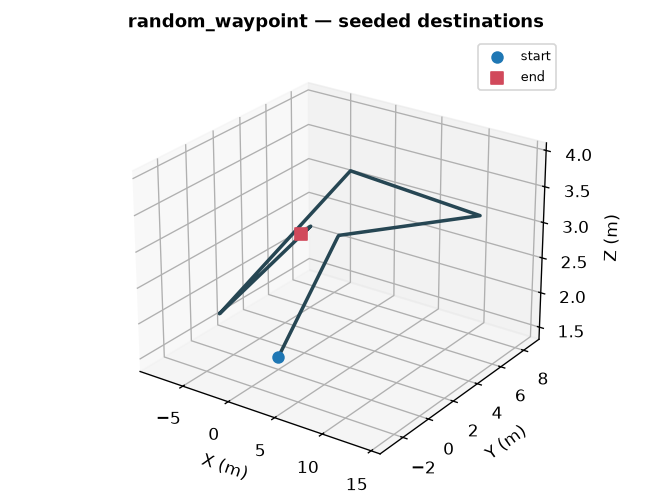 | Seeded destinations, speeds, and optional pauses inside bounds. |
| `manhattan_grid` | 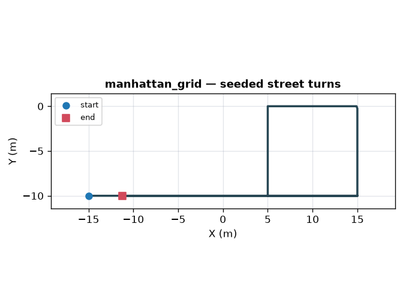 | Seeded movement and turns on a rectangular street grid. |
| `network_route` | 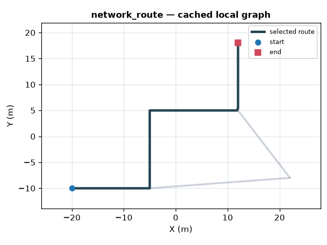 | Route sampled from a cached local network graph. |
| `mesh_sequence` | 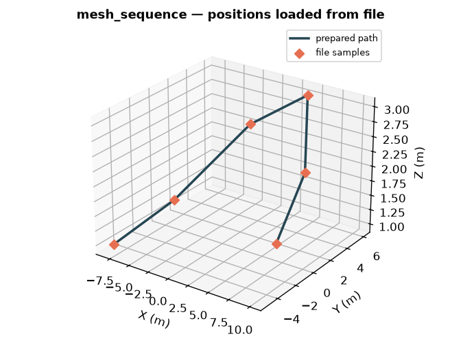 | Target-only positions loaded from a local data file. Target mesh geometry is configured separately. |
| `group_member` | 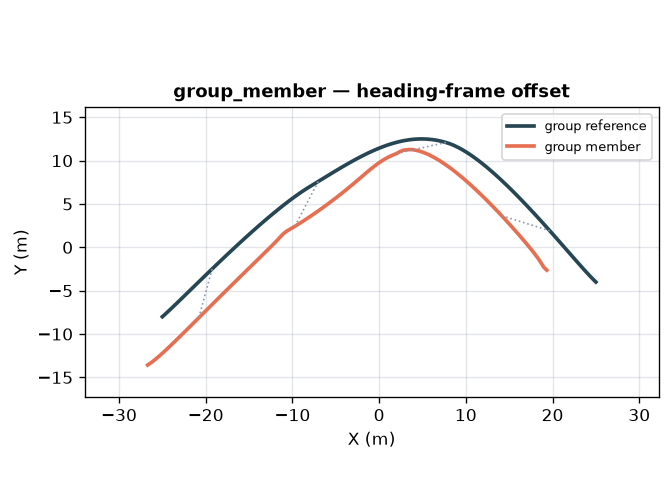 | A named group trajectory plus a local heading-frame offset. |

## Configure a route

For a receiver walking along a curved path, set its mobility to `waypoint`. The points use scene coordinates in metres:

```yaml
mobility:
  type: waypoint
  interpolation: catmull_rom
  points_m: [[0.0, 0.0, 1.5], [4.0, 3.0, 1.5], [9.0, 1.0, 1.5]]
```

Use a seed for stochastic models so preview and generation reproduce the same positions. For externally sampled positions use `sampled`, one position per timeline step. Choose a `network_route` with a local graph for street-constrained travel. Field names and constraints for every model are in the [mobility reference](../reference/scenario_yaml.md#mobility).

## Timeline

The root timeline determines when every mobility and orientation model is
sampled:

```yaml
timeline:
  steps: 61
  duration_s: 6.0
```

Samples include both endpoints. A moving scenario requires at least two
samples and positive duration. A fully stationary scenario may use one sample
and zero duration.

## Traversal

Finite path models traverse the complete authored path over
`timeline.duration_s` by default. Add `constant_speed` only when physical speed
should determine progress:

```yaml
mobility:
  type: waypoint
  points_m:
    - [0.0, 0.0, 1.5]
    - [10.0, 0.0, 1.5]
    - [10.0, 8.0, 1.5]
  traversal:
    type: constant_speed
    speed_mps: 1.4
    after_end: ping_pong
```

`after_end` is `hold`, `loop`, or `ping_pong`. Periodic and stochastic models
define their own time behavior.

## Optional Groups

A group owns a standalone reference mobility. An actor joins only by choosing
`group_member`. Ordinary actors do not declare a group.

```yaml
groups:
  - name: Convoy
    mobility:
      type: waypoint
      points_m:
        - [-30.0, 0.0, 2.0]
        - [0.0, 15.0, 2.0]
        - [30.0, 0.0, 2.0]

actors:
  rx:
    - name: LeadRX
      mobility:
        type: group_member
        group: Convoy
    - name: FollowRX
      mobility:
        type: group_member
        group: Convoy
        offset_m:
          right: 3.0
          forward: -5.0
          up: 0.0
```

Offsets are expressed as right, forward, and up in the group's local heading
frame. A group may add bounded seeded deviation. Groups require at least two
members and cannot reference another group.

## Orientation Models

Orientation is optional and defaults to fixed zero yaw, pitch, and roll.
Angles follow [Sionna RT](https://nvlabs.github.io/sionna/rt/)'s right-handed
Z/Y/X convention. The actor's forward axis
is +X and world up is +Z, so positive pitch turns +X toward -Z while negative
pitch turns it toward +Z.

The examples show the actor's +X forward direction or its yaw, pitch and roll
angles over time.

| Type | Example | Behavior |
|---|---|---|
| `fixed` | 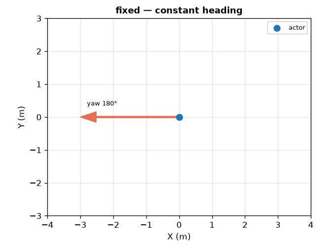 | Constant yaw, pitch, and roll. |
| `keyframes` | 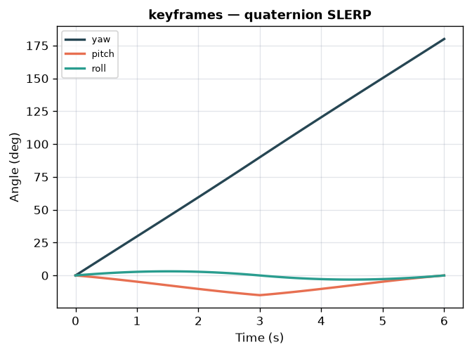 | Time-stamped orientations joined by smooth rotation. |
| `align_motion` | 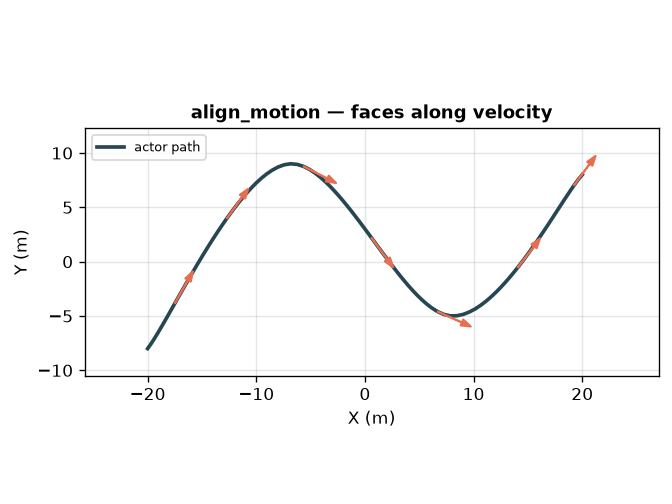 | Points the actor's +X forward axis along physical velocity. |
| `look_at` | 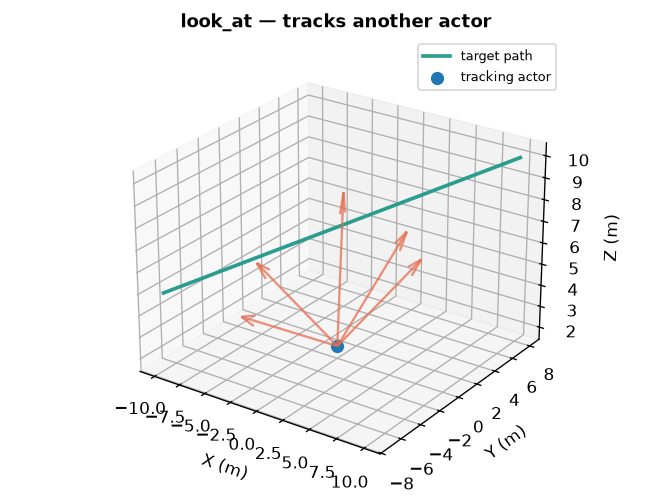 | Points +X toward another actor or a fixed point. |
| `spin` | 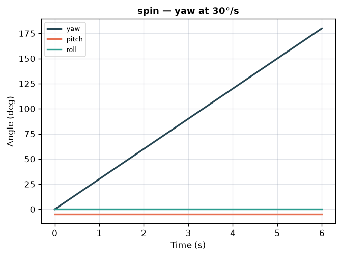 | Rotates one selected yaw, pitch, or roll axis at a constant rate. |
| `random` | 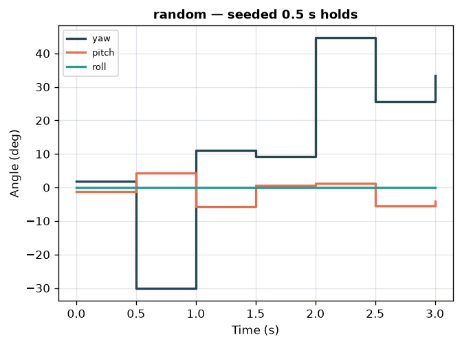 | Seeded bounded samples, optionally held for `update_interval_s`. |

Keyframes use spherical linear interpolation (SLERP) to rotate smoothly
between the authored orientations. Configure their yaw, pitch and roll in degrees.

Choose `align_motion` when the actor should face its direction of travel. Set `allow_pitch: false` to keep it level. Use `fixed` to hold a heading, or `keyframes` to interpolate between orientations at named times.

### Look At

Track another actor by globally unique name:

```yaml
orientation:
  type: look_at
  actor: PatrolTarget
  allow_pitch: true
```

Or track a fixed point:

```yaml
orientation:
  type: look_at
  point_m: [0.0, 0.0, 10.0]
```

Exactly one of `actor` and `point_m` is required. Smoothing, rate limits,
offsets, and yaw/pitch limits are optional.

For optional smoothing, angular-rate limits, spin rates and random-orientation seeds, see the [orientation reference](../reference/scenario_yaml.md#orientation).

## Target Asset Alignment

A catalog target can declare its modeled front direction in
`target_metadata.json`. ORCHAV combines that asset alignment with the actor's
orientation before generation or preview. Keep asset-specific corrections with
the mesh metadata, as in the
[bundled walking target](../../libraries/targets/digital_twin_update1/README.md).
For imported animated assets, use the
[world and body conventions](motion/animated_targets.md#world-and-body-coordinates).

## Road-network Trajectories

Use `network_route` to follow a cached OpenStreetMap street graph instead of
interpolating a straight line between arbitrary world coordinates. Obtain
`street_network.graphml` through [OSM scene preparation](geography/osm_scene_generation.md)
and select node IDs present in that graph:

```yaml
mobility:
  type: network_route
  graph_path: street_network.graphml
  travel_mode: car
  start_node: '1749655963'
  end_node: '1749656095'
  altitude_m: 1.0
  traversal:
    type: constant_speed
    speed_mps: 10.0
orientation:
  type: align_motion
  allow_pitch: false
```

The example node IDs illustrate the syntax. Use nodes from your own graph.
`travel_mode` selects permitted edges, `altitude_m` sets the actor's height,
and `constant_speed` samples the route at 10 m/s on the scenario timeline.
`align_motion` follows the route tangent while `allow_pitch: false` keeps the
actor level. The graph must use the scene's coordinate frame. Choose distinct
routes for multiple actors, then configure sensing through the same scenario settings used for other
mobility models.

## Runnable Examples

- [Actor Mobility](../../scenarios/generator/mobility_and_orientation/actor_mobility/README.md)
- [Actor Orientation](../../scenarios/generator/mobility_and_orientation/actor_orientation/README.md)
- [Mesh Targets](../../scenarios/generator/targets/mesh_targets/README.md)
- [Multi-Device Trajectory](../../scenarios/visualizer/multi_device_trajectory/README.md)

---

Up: [Generator](README.md) | Previous: [Simulation Configuration](configuration.md) | Next: [Summary and Coverage Figures](generated_figures.md)
