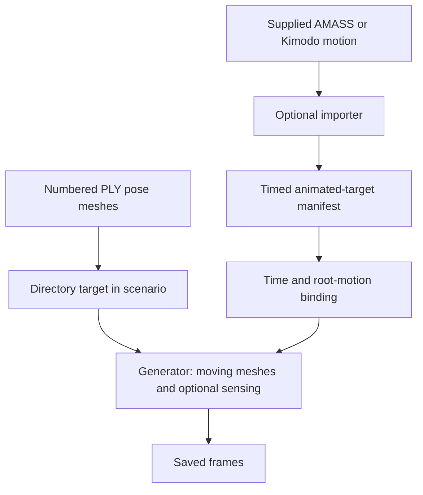
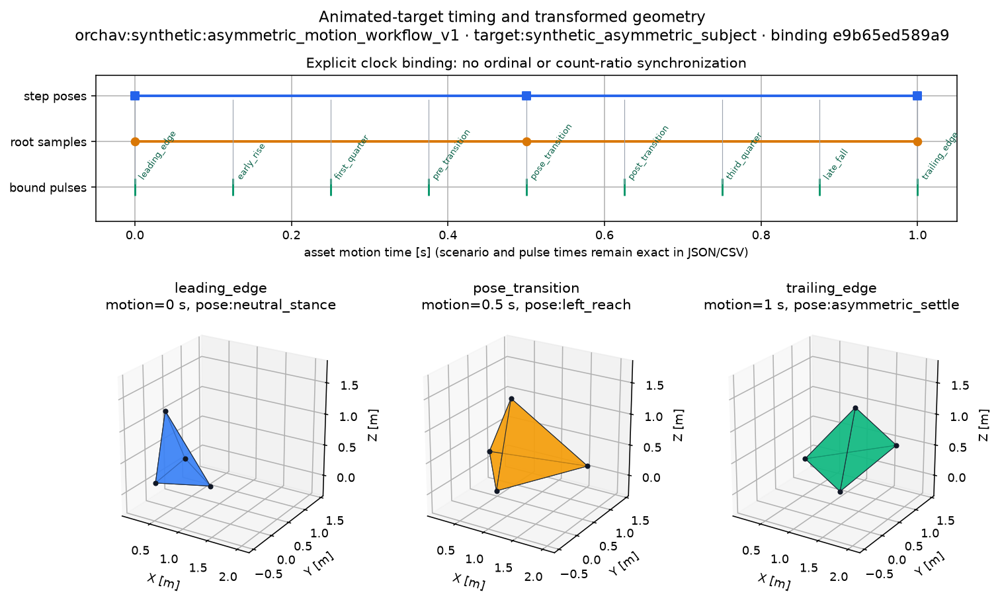

# Animated mesh targets

<a id="animated-targets"></a>

ORCHAV supports two input workflows for animated mesh targets: an ordered
sequence of PLY files or a timed motion manifest. **Directory-backed PLY
sequences are supported directly**, without an `animated_target.json`
manifest or an SMPL/Kimodo import step.

A mesh *pose* is a snapshot of the target's surface geometry. In an
articulated walking sequence, successive meshes encode different arm and
leg configurations. This is distinct from *rigid motion*, which changes an
unchanged mesh's position or orientation. ORCHAV reads the supplied poses;
it does not infer skeletal motion or generate missing poses.

<a id="when-do-you-need-an-animated-asset"></a>

## Select an animation input

| Input or requirement | Supported approach |
|---|---|
| One PLY mesh, stationary or moving rigidly | Ordinary target asset and [mobility](../mobility_and_orientation.md), without mesh animation |
| A folder of numbered PLY meshes, one per pose | `source: directory` with a filename pattern |
| AMASS/SMPL parameters or Kimodo/SOMA motion not yet exported as meshes | An [importer](#choose-a-source) to create a timed manifest |
| An existing `animated_target.json` with pose times and root motion | The [timed-manifest workflow](#inspect-timing-before-generation) |
| A Sionna RT 2.2 native RCS scattering-point target | [Target representations](../../sensing/target_models.md); this is a different target model |

Both mesh workflows can drive the Generator and Visualizer, and ORCHAV Sensing
can use their ray-traced channels. They are not sensing-only features.

<a id="simple-example-a-folder-of-ply-poses"></a>

## Configure a PLY mesh sequence

The repository includes [38 NIST walking meshes sampled at 7 poses/s](../../../libraries/targets/digital_twin_update1/README.md),
with filenames such as `DT_Pjh_02_00001.ply` and
`DT_Pjh_02_00002.ply`. The following configuration is taken from the
runnable [Mesh Targets scenario](../../../scenarios/generator/targets/mesh_targets/README.md):

```yaml
timeline:
  steps: 38
  duration_s: 5.285714285714286  # 37 time intervals at 7 poses/s

actors:
  targets:
    - name: Pedestrian
      asset:
        source: directory
        path: libraries/targets/digital_twin_update1
        pattern: "DT_Pjh_02_*.ply"
        switch_meshes: true
        mesh_end_behavior: hold_last
      mobility:
        type: linear
        start_m: [-0.938, 5.0, 0.98]
        end_m: [0.938, 5.0, 0.98]
      orientation:
        type: align_motion
        allow_pitch: false
```

The YAML excerpt includes the relevant timeline and target configuration.
Generate and inspect the complete scenario from the repository root:

```bash
orchav-generator scenarios/generator/targets/mesh_targets
```

```bash
orchav-visualizer --scenario scenarios/generator/targets/mesh_targets
```

The `pattern` selects the mesh files. With `switch_meshes: true` (the
directory default), ORCHAV advances through their ordered poses;
`hold_last` avoids looping back to the first pose. The `mobility` path
moves the whole person through the scene, while the PLY files change the
shape of their limbs. `orientation` controls which way the person faces.
The bundled NIST meshes have alignment metadata; your own may need a
different actor position or orientation.

PLY filenames do not encode physical timestamps. The scenario timeline
determines the step duration, and directory-backed meshes normally advance
once per step. Use `raytracing.mesh_update_interval_s` only
if the mesh should update less often than the scene. Optional `start_index`,
`frame_stride`, and `mesh_end_behavior` select which poses to use and what
happens at the end. See the [directory-asset reference](../../reference/scenario_yaml.md#directory-target-asset).

<a id="alternative-a-timed-motion-manifest"></a>

## Timed-motion manifests

A timed manifest is appropriate when the input includes independent pose
timestamps, root motion, source coordinate conventions or import provenance.
For example, an AMASS clip contains body pose parameters rather than a PLY
sequence. An importer evaluates the geometry and writes an
`animated_target.json` manifest.

An *already-deformed surface* is mesh geometry whose vertex positions have
been evaluated for a particular pose by an upstream tool. When those poses
are available as PLY files, they can be loaded directly using the directory
asset above. The SMPL importer's "already-deformed surfaces" option accepts
numeric NPZ arrays containing mesh geometry, root transforms and timing.



## Choose A Source

| Input | Import guide |
|---|---|
| AMASS clip with compatible SMPL model, or numeric NPZ of already-posed mesh vertices | [SMPL Motion Import](smpl_mesh_generation.md) |
| Exported Kimodo/SOMA motion and its compatible skin | [Kimodo Motion Import](kimodo_motion_import.md) |
| An existing ORCHAV animated-target V1 manifest | Use the binding and scenario steps below |

These importers prepare timed assets from user-supplied motion or numerical
surface arrays. Directory-backed PLY sequences do not require an import step.

The source adapters export code-compatible assets from user-supplied inputs.
Models, motion clips, skins, checkpoints, and governed derivatives retain
their own terms and are not bundled with ORCHAV. The supplied adapters mark
their outputs `user_supplied_only`.

## World And Body Coordinates

The following coordinate-conversion rules apply to timed-motion manifests.
Directory-backed PLY sequences use ordinary actor placement and orientation.

Source-world axes describe the frame containing root translation and rotation.
Body-local axes describe mesh coordinates before that rotation. They can differ:
SMPL has a +Y-up model body while AMASS walking motion can use a +Z-up world.
The SMPL model adapter declares its body convention automatically. Numeric
surface and SOMA imports accept paired local-axis declarations when needed.

The shared exporter re-expresses declared body coordinates in the source-world
basis and compensates root rotations. Full world animation, physical times and
root travel remain unchanged. A scenario that deliberately replaces root motion
can then use the same upright, forward-facing body convention. Such preparation
still owns any explicit centering or grounding. The generic importer does neither.
The adapter provenance records this basis change. Reimport older SMPL assets
before using their motion with a replaced root transform.

## Inspect Timing Before Generation

The following binding diagnostics apply to timed-motion manifests.
Directory-backed PLY sequences use the scenario timeline and do not require
a binding request.

The optional CPU-only demo illustrates the timing check with a small synthetic
mesh, without motion-model dependencies:

```bash
orchav-animated-target demo --output-dir analysis/animated-target-demo
```

Its `binding_request.json` shows how to name the target, scenario/motion/pulse
clocks, playback policy, and requested sample times. Adapt that request to
inspect your imported asset:

```bash
orchav-animated-target bind \
  --manifest path/to/animated_target.json \
  --request path/to/binding_request.json \
  --output-dir analysis/animated-target-binding
```

The commands write `alignment_and_geometry.png` for checking facing, height
and root trajectory. Compare pose selection with `binding_samples.csv`. Binding
does not run ray tracing.



The top panel aligns pose changes and root samples with the requested observation
times. The three lower views show the transformed mesh at selected times. This
ORCHAV-authored synthetic mesh makes timing and orientation changes visible
without suggesting a human motion model.

| Output | Meaning |
|---|---|
| `binding_request.json` | Target identity, clocks, playback policy and requested sample times |
| `binding.json` | Selected samples, resolved transforms and geometry identities |
| `binding_samples.csv` | The same timing and geometry selection in a table |
| `artifact_manifest.json` | Output inventory and hashes |

The demo also creates `asset/animated_target.json`. For an imported asset,
retain its manifest and resources with the binding outputs. Derived geometry
illustrations retain any source redistribution restrictions.

## Add The Asset To A Scenario

The following `source: animated_asset` configuration applies to a timed
manifest. Directory-backed sequences use the `source: directory`
configuration above.

Use this target entry inside an otherwise complete scenario. Set `path` to
your manifest and choose a timeline that lies within its motion interval.

```yaml
actors:
  targets:
    - name: Person
      asset:
        source: animated_asset
        path: assets/person/animated_target.json
        material_type: glass
        playback:
          scenario_clock_id: scene:main
          motion_clock_id: motion:person
          playback_rate: 1.0
          playback_offset_s: 0.0
      mobility:
        type: stationary
        position_m: [0.0, 0.0, 0.0]
      orientation:
        type: fixed
        yaw_deg: 0.0
        pitch_deg: 0.0
        roll_deg: 0.0
```

The manifest owns geometry, root translation, root orientation, and scale.
Keep target mobility at the origin and orientation zero so those transforms
are applied once. Position the target through the source motion/manifest
rather than adding a second actor transform. `material_type` chooses the RT
material. The example's `glass` is a configurable material choice, not a
calibrated human-body model.

Playback maps exact scenario times to asset times:

```text
motion_time_s = playback_rate * scenario_time_s + playback_offset_s
```

A rate of `1.0` preserves source speed. Changing it changes motion speed and
therefore the experiment. Pose selection is a step function. Root translation
is interpolated linearly. Root rotation uses spherical linear interpolation
(SLERP), which smoothly interpolates the recorded orientations. The asset
specifies whether out-of-range time is an error or a held endpoint. The
source adapters default to an error and do not create a loop automatically.

Run the completed scenario using the normal command:

```bash
orchav-generator path/to/scenario
```

The Generator caches prepared RT geometry under the scenario's
`.orchav/animated_targets/` directory. Keep this generated cache with local
scenario output and respect the source asset's redistribution terms. Mesh
resources are checksummed. Saved frames can continue to use their existing
cache without conversion.

## Choose Sensing Cadence

Both ordinary PLY sequences and timed manifests can supply changing target
surfaces. For sensing, choose whether geometry can remain fixed within an observation
window or must be solved at every pulse. Coherent acquisition freezes articulation
and root rotation within each solve. Sequential acquisition follows their
changes at the configured pulse times. Repeated poses between source samples
are expected and do not add independently observed motion.

For the **manifest** route, its physical clock controls pose selection:
ordinary PLY-directory `frame_stride` and `raytracing.mesh_update_interval_s`
do not retime the manifest. For the **PLY-directory** route, the scenario
timeline and optional mesh-update interval control pose selection. See
[acquisition modes and timing](../../sensing/concepts.md#acquisition-modes-and-timing)
for sampling settings, supported arrays and phase-consistency limits.

## Keep Source Provenance

For importer-generated timed manifests, both import commands accept `--source-metadata path/to/source_metadata.json`
for an existing generation run. It can record a portable `source_id`,
`generator_version`, `upstream_revision`, `checkpoint_sha256`,
`redacted_prompt_sha256`, and nonnegative integer `seed`. Only the applicable
fields are needed. Revision/hash fields use lowercase hexadecimal digests.
Raw prompts and local filenames are not accepted by this metadata record.

The record accompanies input and adapter hashes. It describes the source run.
Setting a seed here does not generate new motion.

## Common Problems

| Observation | Check |
|---|---|
| PLY folder does not animate | Confirm the filename pattern selects multiple files, `switch_meshes` is enabled, and the scene timeline has multiple steps |
| PLY animation moves too quickly or slowly | Match the timeline to the pose rate; check `mesh_update_interval_s` and `frame_stride` |
| Target is rotated or scaled incorrectly | For PLY sequences check placement, units and asset alignment; for manifests check source axes and transforms |
| Target moves twice or starts in the wrong place | Root ownership. Native actor mobility/orientation must stay at the origin/zero |
| Generation rejects a late sample | Timeline, playback offset/rate, and the asset's out-of-range policy |
| Body-axis conversion rejects a 180-degree root turn | Supply an explicit intermediate source sample to resolve the rotation path |
| Animation holds a pose | Source timestamps and step interpolation. Stride reduces retained pose samples without retiming them |
| Cached geometry fails verification | Use the reported binding/cache identity to inspect the local cache and source before retrying |

---

Home: [Documentation](../../README.md) | Up: [Generator](../README.md) |
Related: [SMPL Motion Import](smpl_mesh_generation.md), [Kimodo Motion Import](kimodo_motion_import.md)
