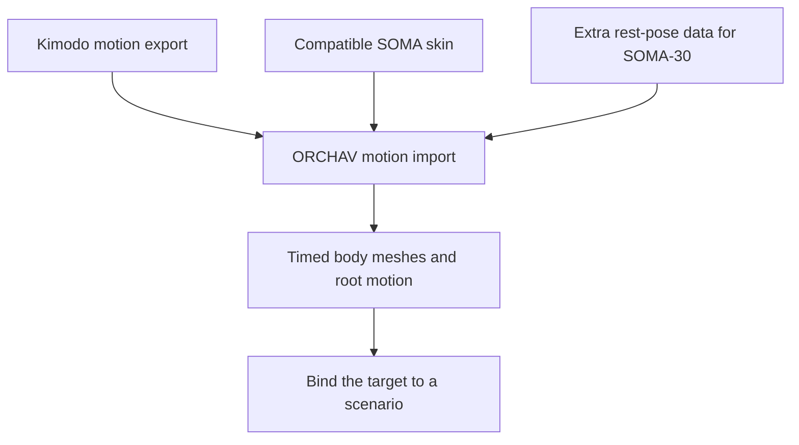

# Kimodo motion import

Use this importer only when you have **an existing Kimodo motion export and a
compatible SOMA skin** and want an animated mesh target in ORCHAV. Kimodo
produces motion in its own environment; ORCHAV applies it to the skin, prepares
timed body poses and saves a manifest for a scenario. This is not required for
stationary or rigidly moving targets and does not generate motion from prompts.
See [Animated target assets](animated_targets.md) for when to use a timed mesh,
how to inspect its timing, and how sensing can consume it.



The imported motion and skin must describe compatible joints. SOMA-30 motion
needs the additional rest-pose data shown in the figure to supply joints that
its export omits. Both input forms produce the same ORCHAV manifest.

## Use an existing supplied motion

Start with an existing numeric motion and its compatible skin. Import and
playback do not require a prompt, inference, or a model checkpoint download.
The official [Kimodo repository](https://github.com/nv-tlabs/kimodo) at revision
`1aece8c124d73d255ceff5086d983b844c9f4e94` contains the SOMA-30 demonstration
`kimodo/assets/demo/examples/kimodo-soma-rp/01_single_text_prompt/motion.npz`.
Obtain that repository and review its input terms separately. These payloads
are not bundled with ORCHAV. Keep its adjacent `meta.json` as source provenance.

From that same revision, use the compatible SOMA-77 files under
`kimodo/assets/skeletons/somaskel77/`: `skin_standard.npz`,
`relaxed_hands_rest_pose.npy`, and the neutral joint tensor `joints.p`.
Copy the first two to `inputs/soma_skin.npz` and
`inputs/relaxed_local_rotations.npy`. Copy the motion to `inputs/motion30.npz`.
In the source environment, export the trusted numeric neutral joint tensor
without changing axes, units or joint order:

```python
import numpy as np
import torch
joints = torch.load("kimodo/assets/skeletons/somaskel77/joints.p",
                    map_location="cpu", weights_only=True)
np.save("neutral_joints.npy", joints.numpy(), allow_pickle=False)
```

Copy that NPY to `inputs/neutral_joints.npy` and follow
[Import the motion](#import-the-motion) below with `--source-fps 30`:
this supplied five-second example contains 150 poses. Its metadata describes
running and leaping over an obstacle.
The NPZ has no timestamp field, so the rate is explicit. Preserve the upstream
revision, adjacent metadata and source hashes.

| Input | Expected contents |
| --- | --- |
| Motion NPZ | Joint positions in metres (`posed_joints`) and global rotations (`global_rot_mats`), with 77 or 30 joints. Provide timestamps (`time_s`) or the actual source FPS. |
| Skin NPZ | Bind vertices, triangle faces, joint names and connections, bind transforms, blend indices and weights. The adapter expects a 77-joint, `Hips`-rooted rig in metres with matching joint order. |
| SOMA-30 only | Neutral joint positions (77 × 3) and relaxed local rotations (77 × 3 × 3) for the full skeleton. These supply joints missing from the motion export. |

The upstream `SOMA_neutral.npz` uses a different rig representation. Export a compatible numeric skin from the source environment. If you already have posed surfaces, use the [deformed-surface import](smpl_mesh_generation.md#import-already-deformed-surfaces).

## Import the motion

For a SOMA-77 export sampled at 30 Hz:

```bash
orchav-kimodo-import --motion-npz inputs/motion77.npz --skin-npz inputs/soma_skin.npz --source-fps 30 --asset-id person:supplied-motion --output-dir assets/person
```

For SOMA-30, include the two full-skeleton inputs:

```bash
orchav-kimodo-import --motion-npz inputs/motion30.npz --skin-npz inputs/soma_skin.npz --neutral-joints inputs/neutral_joints.npy --relaxed-pose inputs/relaxed_local_rotations.npy --source-fps 30 --asset-id person:supplied-motion30 --output-dir assets/person30
```

Use a new output directory. The importer retains physical timestamps and root motion.

The adapter expects right-handed +Z-front, +Y-up source-world coordinates in
metres and maps them to ORCHAV's +X-front, +Z-up frame. Body-local coordinates
are preserved by default. A compatible skin with a different body basis can
use paired `--root-local-front-axis` and `--root-local-up-axis` declarations.
These flags do not repair an incompatible skeleton or change units. See
[world and body coordinates](animated_targets.md#world-and-body-coordinates)
for their meaning and [common problems](animated_targets.md#common-problems)
for import checks.

The output contains `animated_target.json`, pose meshes and adapter provenance.
Use the [animated-target guide](animated_targets.md#inspect-timing-before-generation)
to check placement and timing, then add the manifest to a scenario.

<a id="obtain-and-generate-upstream-inputs"></a>

## Optional new upstream generation

Creating a new motion is a separate upstream workflow. Follow the official
[installation guide](https://research.nvidia.com/labs/sil/projects/kimodo/docs/getting_started/installation_virtual_env.html)
and the selected [model terms](https://github.com/nv-tlabs/kimodo#kimodo-models).
Retain the actual upstream revision, model, seed and source FPS with a newly
exported motion. The [source-provenance fields](animated_targets.md#keep-source-provenance)
record that information during import.

Up: [Generator](../README.md) | Related: [Animated targets](animated_targets.md) |
[Upstream motion format](https://research.nvidia.com/labs/sil/projects/kimodo/docs/user_guide/output_formats.html)
