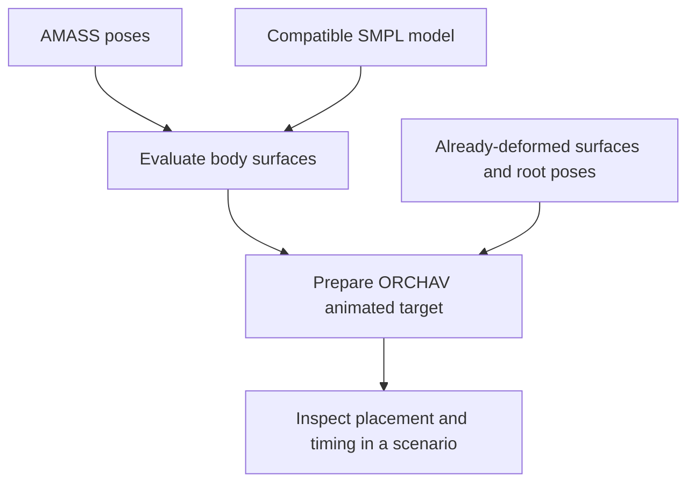

# SMPL motion import

This guide covers importing AMASS/SMPL pose parameters or numerical mesh
arrays into timed ORCHAV target assets. Existing PLY pose sequences can be
loaded as [directory-backed targets](animated_targets.md#simple-example-a-folder-of-ply-poses)
without an import or manifest conversion step.

A *deformed surface* is a mesh with vertex positions already evaluated for
a specific pose, such as a bent knee. The importer accepts motion parameters
or numeric NPZ mesh arrays when the workflow requires explicit pose timing
and root transforms. It does not generate human motion or perform sensing.



Both input paths produce the same animated-target manifest. The model route
evaluates body surfaces from motion parameters, while the surface route starts
with geometry already evaluated by another tool.

## Import AMASS with a SMPL model

Obtain the model and clip from the [SMPL](https://smpl.is.tue.mpg.de/) and
[AMASS](https://amass.is.tue.mpg.de/) projects under their respective terms.
Activate the Python environment used for ORCHAV, then install the optional
body-model runtime from the repository root:

```bash
python -m pip install -e ".[smpl]"
```

### Prepare The Model

Supply a model matching the clip's `gender`. The marching-person example uses
the **male SMPL model**, not a neutral model. The original
`SMPL_python_v.1.0.0.zip` download contains these files:

| Original archive member | Model filename used by ORCHAV |
| --- | --- |
| `smpl/models/basicmodel_m_lbs_10_207_0_v1.0.0.pkl` | `smpl/SMPL_MALE.pkl` |
| `smpl/models/basicModel_f_lbs_10_207_0_v1.0.0.pkl` | `smpl/SMPL_FEMALE.pkl` |

These original files contain Chumpy objects. Renaming them is insufficient:
the `smpl` extra does not install the legacy Chumpy runtime. Convert the selected
model once to numeric arrays, as required by the
[SMPL-X model-loading instructions](https://github.com/vchoutas/smplx#smpl-and-smplh-setup).
For the original male model, run the following from the repository root,
replacing `/path/to/SMPL_python_v.1.0.0.zip` with your downloaded archive.

Extract your downloaded SMPL archive:

```bash
python -m zipfile -e /path/to/SMPL_python_v.1.0.0.zip inputs/smpl_download
```

Install the build tools for the conversion dependency:

```bash
python -m pip install setuptools wheel
```

Install the pinned conversion dependency:

```bash
python -m pip install --no-build-isolation "chumpy==0.70"
```

Convert your trusted model into the canonical local file:

```bash
python -m generator.tools.prepare_smpl_model --model-file inputs/smpl_download/smpl/models/basicmodel_m_lbs_10_207_0_v1.0.0.pkl --output inputs/models/smpl/SMPL_MALE.pkl --trusted-model
```

The conversion command supplies the Python/NumPy compatibility aliases needed
by Chumpy 0.70. It preserves the model parameters, leaves the source unchanged,
prints source/output hashes, and refuses to overwrite an existing output.
Chumpy is needed only for conversion. Subsequent imports use the converted
model. For a female clip, convert the female archive member to
`inputs/models/smpl/SMPL_FEMALE.pkl` instead. A genuine neutral model must be
obtained separately. Renaming a male or female model does not change its gender.

If you already have a compatible Chumpy-free model, place it at the matching
`inputs/models/smpl/SMPL_*.pkl` path and skip conversion.

### Prepare The Motion

For the marching-person example, obtain the CMU subset from AMASS and extract
`CMU/08/08_03_poses.npz`. With the model directory prepared above, the following
extracts only that clip from the original CMU archive:

```bash
tar -xjf /path/to/CMU.tar.bz2 -C inputs CMU/08/08_03_poses.npz
```

The resulting paths are `inputs/CMU/08/08_03_poses.npz` and
`inputs/models/smpl/SMPL_MALE.pkl`. This clip declares male gender and a 120 Hz
source rate. Its 353 poses cover approximately 2.93 s.

The AMASS NPZ must include `poses`, `trans`, `betas`, `gender` and source timing
(normally `mocap_framerate`). The importer supports SMPL poses and
156-parameter AMASS SMPL-H poses evaluated with the SMPL model, which omits
finger articulation.

### Import The Clip

For the prepared male model and CMU clip:

```bash
orchav-smpl-import --amass-npz inputs/CMU/08/08_03_poses.npz --model-file inputs/models/smpl/SMPL_MALE.pkl --trusted-model --front-axis +X --up-axis +Z --asset-id person:walk --output-dir inputs/person
```

`--trusted-model` permits deserialization of the selected model file. Use a file
from a source you trust. The front/up flags describe the +X-front, +Z-up source
world used by the CMU AMASS walking clips. Use the actual world convention for
other inputs. The SMPL adapter handles its +Z-front, +Y-up body convention
automatically, so do not pass body-local axis overrides for this model route.
See [world and body coordinates](animated_targets.md#world-and-body-coordinates)
for the distinction. Keep licensed inputs and derived assets locally under the
ignored `inputs/` directory.

This general import preserves the captured root motion. To run the
[marching-person scenario](../../../scenarios/sensing/targets_motion/marching_person/README.md#prepare-the-user-supplied-motion),
use that scenario's preparation command after preparing the model and clip.
It supplies the explicit approach trajectory and 4 kHz pose sampling used by
both acquisition modes.

## Import already-deformed surfaces

This option expects **numeric NPZ arrays**, not a directory of PLY files.
Each pose has already been evaluated into vertex coordinates. To animate a
folder of exported PLY poses, use the
[simple directory workflow](animated_targets.md#simple-example-a-folder-of-ply-poses)
instead; no conversion to NPZ or manifest is necessary.

A numeric NPZ can supply the body geometry directly without the optional SMPL runtime:

| Field | Shape | Meaning |
| --- | --- | --- |
| `vertices` | N × V × 3 | Vertex positions in metres for each pose |
| `faces` | F × 3 | Triangle indices shared across the poses |
| `root_translation`, `root_rotation_xyzw` | N × 3, N × 4 | Root position and active unit quaternion |
| `time_s` | N | Increasing source times in seconds. Supply the actual source FPS if timing metadata is absent. |

```bash
orchav-smpl-import --surface-npz inputs/person_surfaces.npz --geometry-space world --front-axis +Z --up-axis +Y --asset-id person:walk --output-dir assets/person
```

Choose `world` if vertices already include the root transform, or `root_local`
if root motion is stored separately. The front/up flags describe the source
world. When body-local coordinates use another basis, declare both
`--root-local-front-axis` and `--root-local-up-axis`. Omitting both preserves the
input body basis. See the common [coordinate conventions](animated_targets.md#world-and-body-coordinates)
and [import checks](animated_targets.md#common-problems) before changing it.

## Inspect the result

Choose a new output directory. It contains `animated_target.json`, root-local
pose meshes and `adapter_provenance.json`, which records source hashes and timing.
`--stride N` keeps every Nth pose at its original physical time.

Follow [animated-target authoring](animated_targets.md) to inspect facing,
height, trajectory and time coverage, then bind the manifest to a scenario.
That guide shows the timing-check figure and explains older-asset reimport when
replacing root motion. For optional skin or clothing appearance, see
[animated-target textures](../../visualizer/visual_assets.md#texture-an-animated-target).

Up: [Generator](../README.md) | Related: [Animated targets](animated_targets.md) |
[Marching person](../../../scenarios/sensing/targets_motion/marching_person/README.md)
