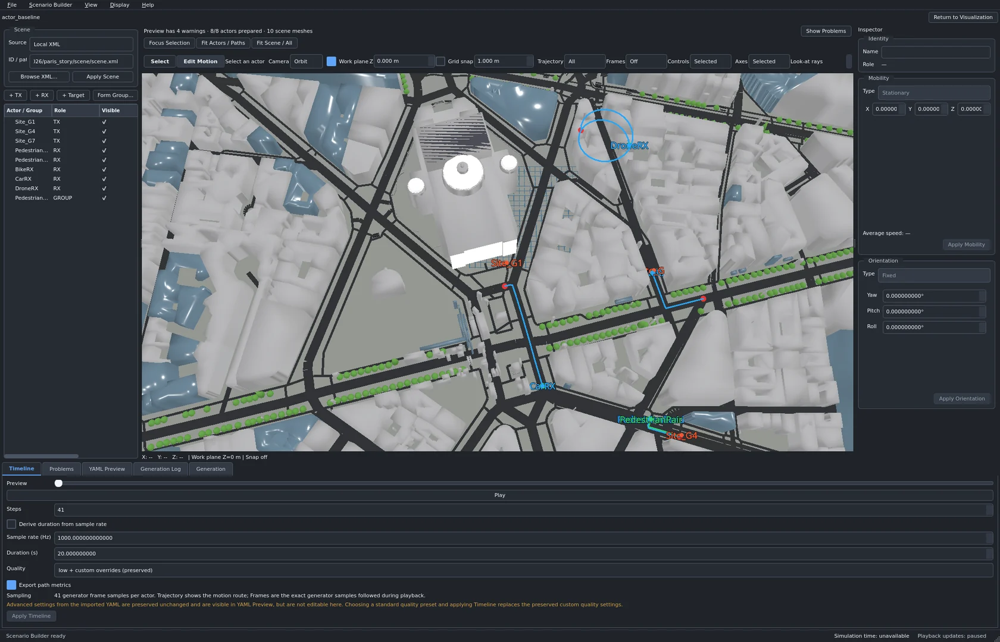
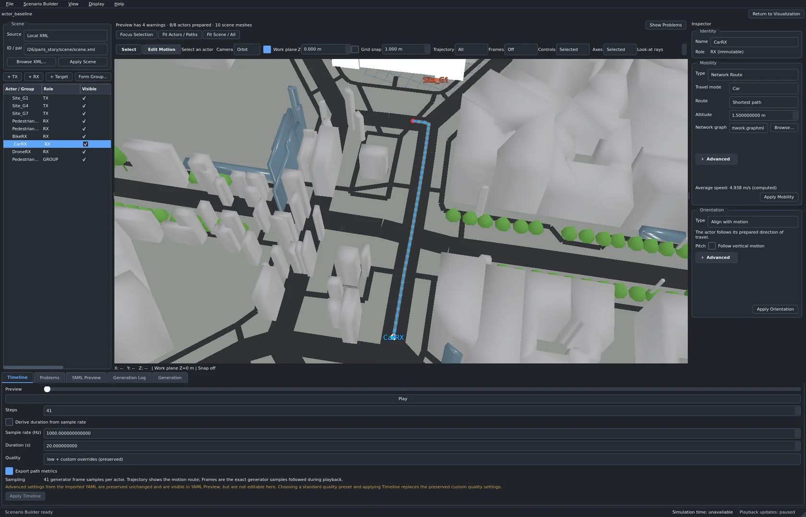

# Scenario Builder

Place transmitters, receivers and targets in a scene, preview their motion, and save a Generator-ready `scenario.yaml`. Open **Scenario Builder** from the Visualizer menu, or launch the pygfx workspace directly:

```bash
orchav-visualizer --author
```

To edit an existing scenario, add `--scenario path/to/scenario`. New documents start with an empty environment, without buildings or other
static obstacles. Add radios for a free-space experiment, or choose scene
geometry before configuring a study of its propagation. The tree lists actors and groups, the central viewport shows their placement, and the inspector edits the selected actor.



*An authored Paris scene. Select an actor in the tree to inspect its path. Geographic data © [OpenStreetMap contributors](https://www.openstreetmap.org/copyright).*

## Build a first scenario

1. **Choose a scene.** Keep the default empty scene to try placement, or select a library scene or local XML file.
2. **Add two radios.** Choose **Add actor**, select **TX**, and click a position in the viewport. Add an **RX** the same way.
3. **Give the receiver a route.** Select the RX, choose **Waypoint**, and use **Draw Waypoints** to mark its path. Apply the changes. For motion, set at least two timeline steps and a positive duration.
4. **Preview the motion.** Press **Play** or scrub the timeline. **Fit Actors / Paths** shows the full route. Use **Check placement** to find actors outside the scene, below ground or inside a building at the selected step.
5. **Validate and save.** Apply pending edits, choose **Validate**, and open **Show Problems** for the affected actor or field. **Save As** writes the YAML and required local inputs to a scenario directory.
6. **Generate and inspect.** **Generate** runs the saved revision. Choose **Preview Generated Result** to open its frames in the Visualizer.

If the scenario uses an ORCHAV library scene or catalog target, save it inside the active ORCHAV project. Builder generation uses local HDF5 files in `frames/` and requires ray tracing or saved coverage. For another output mode, save the scenario and run `orchav-generator path/to/scenario`.

## Edit an existing scene

| Goal | Action |
| --- | --- |
| Move several actors together | Select two or more actors and choose **Form Group**. Edit the shared path and each actor's offset. |
| Follow a street | Select a network route and choose named streets from the scene's local graph. Preview the route before applying it. |
| Branch an experiment | Use **Save As** for the current draft, or **Copy Current Scenario and Edit** from playback. A copy carries required local inputs. Generate fresh frames in the copy. |
| Reuse just the environment | Open **Environment library…** to save or apply geometry, textures and road data independently of actors. |
| Replace an imported person's route while preserving its poses | Prepare the root trajectory in the source motion, then bind the new [animated target](motion/animated_targets.md#add-the-asset-to-a-scenario). |
| Change antennas, materials or custom ray tracing | Edit the [scenario YAML](configuration.md). The Builder preserves recognized fields outside its controls. |



*The selected car receiver follows a turn in the street graph. The inspector shows its travel mode, route and altitude. Geographic data © [OpenStreetMap contributors](https://www.openstreetmap.org/copyright).*

For geographic scenes, [select an OpenStreetMap region](geography/osm_scenario_builder.md) before placing actors. Imported sensing scenarios expose their settings in **Sensing (read-only)**. **Sensing guides** shows radio boresights and configured range or angular limits. Edit sensing parameters in YAML.

## When a document opens read-only

The Builder edits a canonical `scenario.yaml`. It records its format as `visualizer.scenario_builder.document_version: 2`. Invalid YAML, newer document versions, and alternate filenames open read-only. A locked field in an otherwise editable scenario identifies a value owned by an imported asset or another authoring tool.

For a recorded-pose viewer profile, choose **Inspect recording** to play the saved result, or **Create editable variant…** to open a copy of its acquisition inputs.

[Generator guide](README.md) · [Scenario authoring](scenario_authoring.md) · [Mobility and orientation](mobility_and_orientation.md)
