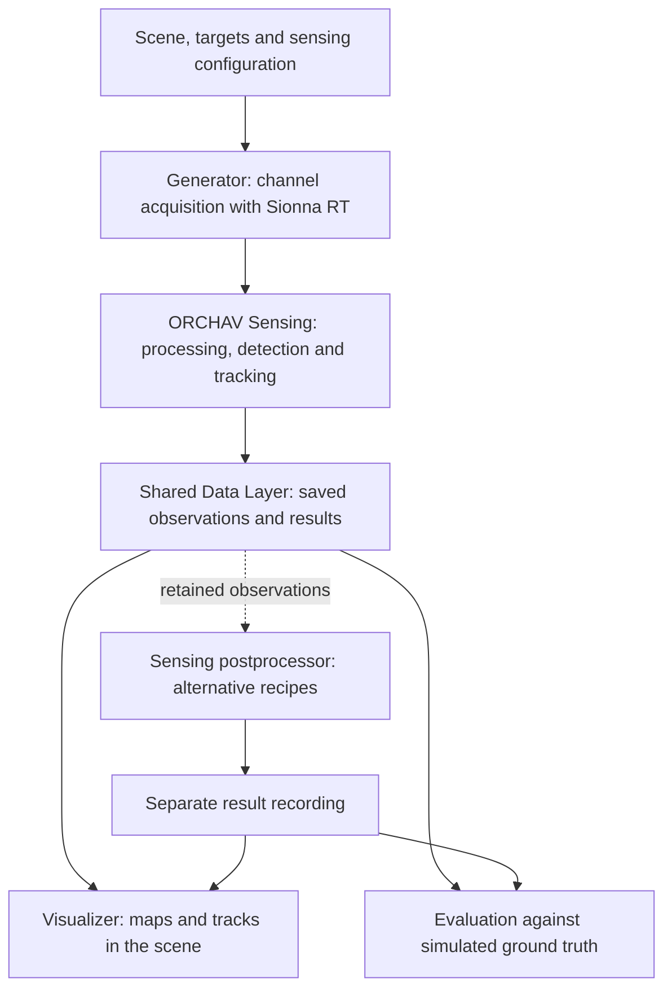

# ORCHAV Sensing

ORCHAV Sensing uses channels simulated with [Sionna RT](https://nvlabs.github.io/sionna/rt/)
to study target detection and tracking. It turns channel observations into
range, Doppler and direction
estimates, then applies the configured detector and tracker. The saved results
can be inspected alongside the 3D scene and evaluated against known target motion.

The dashed branch uses the [postprocessor](reprocessing.md#run-processing) to
apply another recipe to retained observations, without rerunning ray tracing.
It writes a separate recording for comparison against the same target motion;
[recording profiles](reprocessing.md#choose-a-profile) determine which changes
are possible.

## Start here

Start with the [stationary cube](../../scenarios/sensing/cube_radar/stationary/README.md)
to see how a known reflecting surface becomes a range profile and a reported
detection. Next, the [filtering exercise](../../scenarios/sensing/cube_radar/stationary_filtering/README.md)
shows why the *same* range–Doppler map can yield different detection reports.
The [cube-radar learning path](../../scenarios/sensing/cube_radar/README.md)
then adds motion, coherent-versus-sequential acquisition, angular measurements
and tracking.

## Understand the processing

[Concepts and products](concepts.md) explains how ray-traced propagation
becomes sampled channels, range–Doppler maps and directional estimates.
[Detection and tracking](detection_and_tracking.md#what-orchav-implements)
summarizes the detection and tracking methods implemented by ORCHAV, rather
than only their configuration fields. For precise fields and defaults, use
[Parameters](parameters.md).

Target scattering is another choice: ORCHAV can process returns from ordinary
mesh/material propagation or the native RCS target models introduced in
Sionna RT 2.2. These are **different ways to model the return**, not different
detectors. [Target representations](target_models.md) explains the distinction,
including which types of target motion each route supports.

## Choose a task

The [Sensing Dashboard](../visualizer/sensing_dashboard.md#open-the-example)
has **2D maps, plots, tables and histories** for understanding saved results.
Its optional 3D overlays add scene context; they are not the only way to
inspect detections or tracks.

| Task | Guide | Runnable example |
|---|---|---|
| See where a return appears and whether it became a detection | [Current-result 2D maps, detections and tables](../visualizer/sensing_dashboard.md#current-result) | [Stationary cube](../../scenarios/sensing/cube_radar/stationary/README.md) |
| Understand why a candidate passed or failed detector stages | [Detector decisions and saved stage evidence](detection_and_tracking.md#inspect-or-change-a-decision) | [Filtering the same acquisition](../../scenarios/sensing/cube_radar/stationary_filtering/README.md) |
| Learn which detectors and trackers ORCHAV implements | [Built-in processing choices](detection_and_tracking.md#what-orchav-implements) | [Cube-radar curriculum](../../scenarios/sensing/cube_radar/README.md) |
| Follow detections, track identities and associations over time | [2D Motion and Tracking views](../visualizer/sensing_dashboard.md#motion-and-tracking) and [tracking decisions](detection_and_tracking.md#read-one-update) | [Radial tracking](../../scenarios/sensing/cube_radar/moving_tracking/README.md), then [3D-position tracking](../../scenarios/sensing/cube_radar/moving_tracking_3d/README.md) |
| Compare detections or tracks with ground truth | [Evaluation measures and their limits](evaluation.md) | [Two-target tracking](../../scenarios/sensing/cube_radar/two_moving/README.md) |
| Combine observations from multiple sensors | [Detection-level fusion](detection_and_tracking.md#multi-sensor-fusion) | [Munich drone fusion](../../scenarios/sensing/applications/drone_tracking/README.md) |
| Re-run compatible processing without repeating ray tracing | [Recording profiles and reprocessing](reprocessing.md#run-processing) | [Stationary cube filtering](../../scenarios/sensing/cube_radar/stationary_filtering/README.md) |
| Choose surface-based mesh sensing or a native RCS model | [What each representation actually computes](target_models.md#choose-a-representation) | [Articulated/rigid mesh](../../scenarios/sensing/targets_motion/marching_person/README.md) or [native RCS examples](../../scenarios/sensing/foundations/RCS/README.md) |
| Animate a mesh from existing PLY poses, or import timed human motion | [PLY folders versus optional manifests](../generator/motion/animated_targets.md#when-do-you-need-an-animated-asset) | [Mesh Targets](../../scenarios/generator/targets/mesh_targets/README.md), then [marching person](../../scenarios/sensing/targets_motion/marching_person/README.md) |

For a larger example after the fundamentals, the
[Paris Opéra multi-target scene](../../scenarios/showcases/paris_opera_multitarget/README.md)
combines several targets, while the Munich example above shows multiple radars.

## Reference

| Reference | Purpose |
|---|---|
| [Parameters](parameters.md) | Configuration fields, defaults and processing constraints |
| [Recording profiles](reprocessing.md#choose-a-profile) | What to save for inspection and later processing |
| [Glossary](../reference/glossary.md#sensing-terms) | Sensing terms in the shared ORCHAV glossary |
| [Custom tracker integration](custom_tracker.md) | Replace tracking while reusing data and evaluation |
| [Current timings](timings.md) | Recorded example runtimes and commands for measuring another run |
