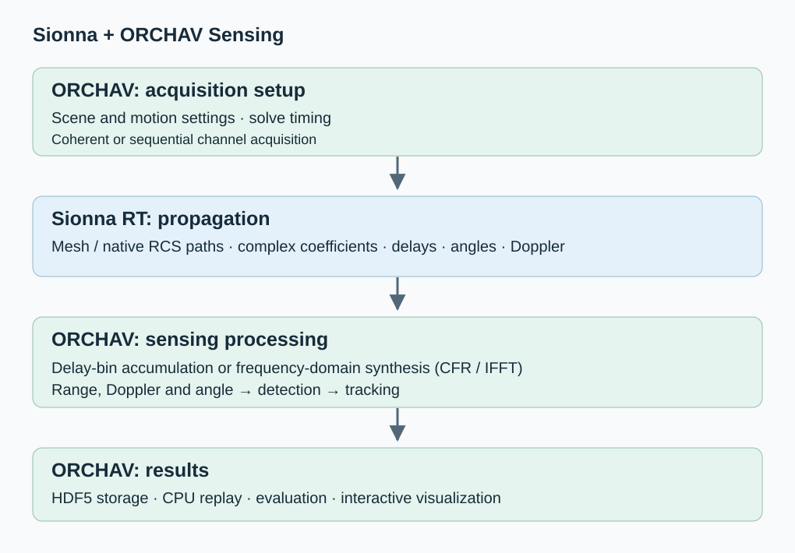
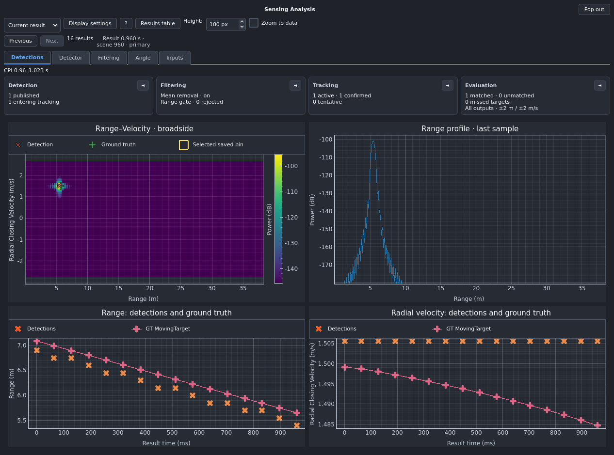
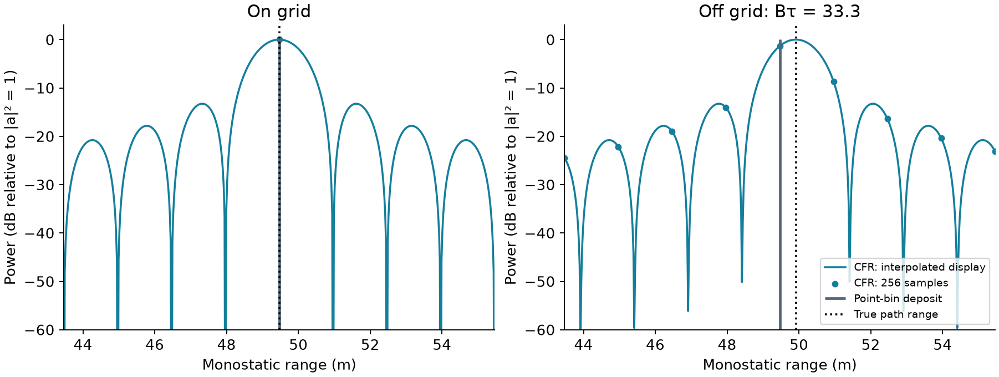
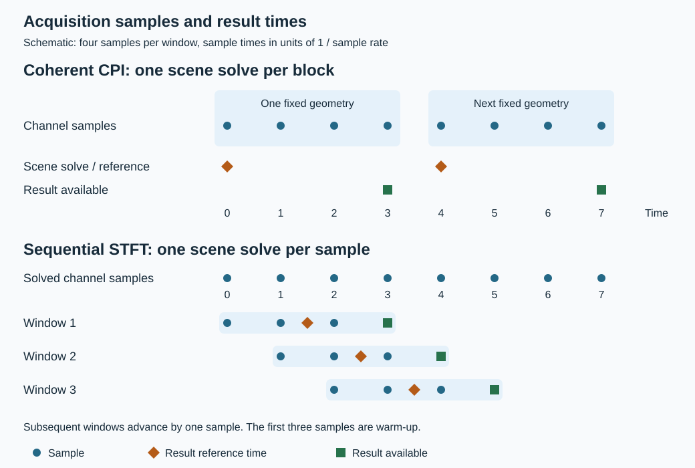

# Sensing concepts and products

ORCHAV turns simulated [propagation paths](../reference/glossary.md#propagation-path-mpc)
into complex channel samples, then estimates range, Doppler and direction.
Detectors select observations from these products. Trackers connect the
observations over time. The [stationary cube](../../scenarios/sensing/cube_radar/stationary/README.md)
is the first runnable example.

## From Sionna RT to sensing results

[Sionna RT](https://nvlabs.github.io/sionna/rt/) computes the paths, including
complex gains, delays and motion information. ORCHAV schedules acquisition,
forms the sampled channel and runs sensing processing.

The figure separates propagation from sensing processing. In the
[mesh/material route](target_models.md#choose-a-representation), Sionna RT
traces target surface interactions using mesh geometry and radio materials.
The **native RCS route**, available with Sionna RT 2.2, uses its `RCSSolver`
and scattering-point models, potentially alongside background paths from
`PathSolver`. Those approaches produce different propagation inputs, but
ORCHAV can apply the same acquisition, range–Doppler processing, detection
and tracking workflow to their saved channels.

ORCHAV's `cfr_ifft` processing forms frequency observations from the solved
paths and computes the range and Doppler products; it does **not** invoke the
radar processor from Sionna PHY. A target's movement (stationary, rigid
trajectory or animated mesh deformation) is a separate configuration
decision from its scattering model. See
[target representations](target_models.md#choose-how-the-target-moves).
Retained observations may support [another processing recipe](reprocessing.md#run-processing).

## Range and range profiles

A path with delay $\tau$ has total propagation length $L=c\tau$. The reported
range depends on the sensor geometry:

| Geometry | Range convention | Positions compatible with range alone |
|---|---|---|
| Monostatic: collocated transmitter and receiver | $L/2$ | Circle in 2D, sphere in 3D |
| Bistatic: separate transmitter and receiver | $L$ | Ellipse in 2D, ellipsoid in 3D |

Range alone does not determine position. Directional observations are also
needed for [Cartesian tracking](detection_and_tracking.md#tracking).
Indirect reflections can increase path length. Extended targets can return
energy from surfaces offset from the target-center truth marker.

A **range profile** shows power by range. ORCHAV saves the last valid sample
of the acquisition, before slow-time clutter suppression and Doppler windowing,
with the declared receive-element combination. It is not a sum over Doppler bins.

In this recorded view, the upper-left map separates power by range and closing
velocity. The upper-right profile shows the last sample's power by range.
The lower plots follow detections and ground truth over time. The detector can
separate returns by velocity or beam, so a reported range can differ
from the peak locations in the last-sample profile. This capture illustrates the products
using an earlier cube recording, rather than the current example's values.

## Range-response models

Both models produce discrete range samples from complex path gains and delays:

| Model | Response | Main configuration choices |
|---|---|---|
| Delay-bin accumulation (`point_bin_floor`) | Coherently adds each path to one cell selected by `floor(bandwidth × delay)`. | `sensing.processing.range.fft_size` sets the retained delay-bin count. |
| Frequency-domain channel synthesis (`cfr_ifft`) | Synthesizes a channel frequency response (CFR), then uses an inverse fast Fourier transform (IFFT) to form the delay response. Off-grid paths spread across samples. | `acquisition.frequency_samples`, `processing.range.frequency_window` and `processing.range.fft_size` set frequency sampling, weighting and IFFT length. |

The left panel places the isolated path on the delay grid. In the right panel,
the true range falls between samples and its power spreads across them.
The curve interpolates the sampled CFR response, while the vertical bar shows
the single-cell delay-bin model.

Hann frequency weighting lowers sidelobes and broadens the main lobe.
Zero-padding the IFFT samples the same response more densely. It adds neither bandwidth nor physical
resolving power. When changing the grid, preserve physical detector guard and
reference widths rather than copying cell counts unchanged.

The [windowing example](../../scenarios/sensing/foundations/windowing/README.md)
compares these effects on one saved acquisition. Exact settings and defaults
are in the [parameter reference](parameters.md#optional-finite-bandwidth-response).

## Doppler and velocity

A [fast Fourier transform (FFT)](../reference/glossary.md#fft) estimates Doppler
from phase progression across uniformly spaced channel samples, often called
pulses. With wavelength $\lambda$, approach-positive
Doppler is $f_D=-\dot L/\lambda$. Direct monostatic closing velocity is
$\lambda f_D/2$. In bistatic geometry, Doppler measures the rate of change of
the sum of both path legs. ORCHAV still labels velocity in monostatic-equivalent
units, $\lambda f_D/2$, which is not the target's world speed.

For $N$ samples at pulse repetition frequency (PRF), Doppler-bin spacing is
$\mathrm{PRF}/N$. A longer window gives finer frequency spacing over a longer
motion interval. A shorter sliding-window hop gives more frequent results
without improving that spacing. Acquisition determines how those samples
are generated.

## Acquisition modes and timing

Choose an acquisition mode according to how much geometry changes during the
observation window. Both modes process uniformly spaced complex channel samples
and require a complete window for a Doppler estimate.

| Mode | Channel acquisition | Suitable motion | Receive array |
|---|---|---|---|
| Analytical Doppler (`coherent_cpi`) | One ray-tracing solve per coherent processing interval (CPI). Path velocities evolve phase while geometry stays fixed within the interval. | Translation with little change in geometry or visibility within a CPI | Single element, linear or planar array |
| Simulated Doppler (`sequential_stft`) | Solve the updated scene at every pulse, then process a sliding window of samples. | Oscillation, articulation or changing visibility within a window | One transmit and one receive element (SISO) |

The [oscillating-cube comparison](../../scenarios/sensing/cube_radar/oscillating_comparison/README.md)
uses the same motion to illustrate the difference.

### Timing settings

| Setting | Meaning |
|---|---|
| `sensing.acquisition.mode` | Select `coherent_cpi` or `sequential_stft`. |
| `sensing.acquisition.sample_rate_hz` | Sample rate, also called pulse repetition frequency (PRF). |
| `sensing.acquisition.samples_per_cpi` | Coherent sample count and Doppler-transform length. |
| `sensing.processing.doppler.fft_size` | Sliding-window length for sequential acquisition. |
| `timeline.sample_rate_hz` | Scene sampling rate. For sequential acquisition, it must equal the acquisition rate. |

For coherent acquisition, the grouped sensing settings configure ray-tracer
[channel impulse response (CIR)](../reference/glossary.md#cir) sampling together.
For sequential acquisition, each solve supplies one sample. Omit separate ray-tracer CIR sampling overrides. See
[parameters](parameters.md#grouped-configuration) for defaults and
configuration constraints.

### Result timing

The schematic uses four samples per window. Coherent acquisition solves the
scene at the first sample of each block and saves a complete result at its
last sample. Its result reference remains the solve-start time. Sequential
acquisition solves every sample and produces a result after each complete
window. Its reference time is the window midpoint. The highlighted midpoint
is a time reference, not an additional acquired sample.

At $N$ samples and rate $f_s$, a coherent block spans $N/f_s$ in the acquisition
schedule, while its first and last sample timestamps differ by $(N-1)/f_s$.
Sequential acquisition has $N-1$ warm-up samples before its first complete
spectrum. Neighboring windows reuse their overlapping samples, including the
same sampled noise.

A storage-frame index, result timestamp and display-scene binding serve different
purposes. Intermediate frames can update the scene before another spectrum is
ready. Use the recorded timing and binding when comparing estimates with motion.
A missing pulse breaks the uniform sequence and is rejected. Processing does
not close gaps by compressing timestamps or inventing samples.

### Motion and phase consistency

Choose a pose cadence that captures the motion of interest. Repeated poses
between source samples hold the same mesh. Interpolating poses or increasing
the pulse rate adds no independently observed motion. In coherent acquisition,
articulation and root rotation remain fixed within each solve. Sequential
acquisition includes their evolution in the independently solved channels.

For phase-sensitive studies, check stability as ray budget and path cap increase.
Changing visibility and sampled diffuse interactions can affect the spectrum
alongside actual surface motion. A wider time–Doppler distribution does not by
itself identify individual limbs or establish convergence. The
[marching-person example](../../scenarios/sensing/targets_motion/marching_person/README.md)
explains these limits for its supplied motion and material model.

### After acquisition

[Recording profiles](reprocessing.md#what-can-be-changed-afterwards)
select which observations and products survive for inspection or reprocessing.
Changing geometry, motion, materials, carrier or acquired bandwidth requires a
new acquisition. Compatible processing changes can reuse retained observations
through the [postprocessor](reprocessing.md#run-processing).

## Power, clutter and detections

Range–Doppler maps store relative power. Use matching axes, normalization and
decibel scales when comparing them. A bright cell, a published detection and
a confirmed track are separate products.

Slow-time mean removal suppresses stationary components but can also attenuate
slow targets. The Visualizer labels saved spectra **Before clutter suppression**
and **After clutter suppression**. Their storage variants are `raw` and `primary`.
Here, `raw` is already a processed spectrum. With suppression disabled, the two
agree. Detection and ordinary summaries use the saved primary spectrum.

Changing plot contrast does not change detection results. The
[detection guide](detection_and_tracking.md#detection) explains thresholding and
filtering. The [static-clutter example](../../scenarios/sensing/foundations/static_and_moving_cubes/README.md)
compares suppression on fixed observations.

## Beamforming and angles

Receive elements observe different phases for an arriving wave. Combining
those samples into beams adds direction to range and Doppler. A linear array
measures direction along its array axis. A planar array supports azimuth and
elevation. Aperture and element spacing limit angular resolution.
See the [azimuth and elevation example](../../scenarios/sensing/cube_radar/azimuth/README.md).

## Saved products

| Product | Read it as |
|---|---|
| Complex observations | Samples with frequency or delay, slow-time and optional receive-element axes |
| Range profile | Power at the last acquisition sample |
| Range–Doppler or angular map | Power over a complete processing window and declared directions |
| Detection | An observation selected by the detector and filters |
| Track | An estimated state with an identity across result times |

Use the saved axes, timestamps and scene binding to interpret each product.
Independent coherent CPIs must not be concatenated into one phase-coherent FFT.
The ordinary time–Doppler summary sums each saved RD map over range. It adds no
clutter suppression or temporal FFT and cannot reveal motion absent from the
acquisition. [Recording profiles](reprocessing.md#choose-a-profile) determine
what can be inspected or processed again. [Generated figures](../generator/generated_figures.md#sensing-figures)
explains the available summary outputs.

The workflow is described in Tanguy Ropitault et al., “ORCHAV Sensing: An
Open-Source Framework for Ray-Traced and Mesh-Based Wireless Sensing,” accepted
at IEEE ISAC 2026.

Up: [Sensing](README.md) · Continue: [Detection and tracking](detection_and_tracking.md) · Reference: [Parameters](parameters.md)
