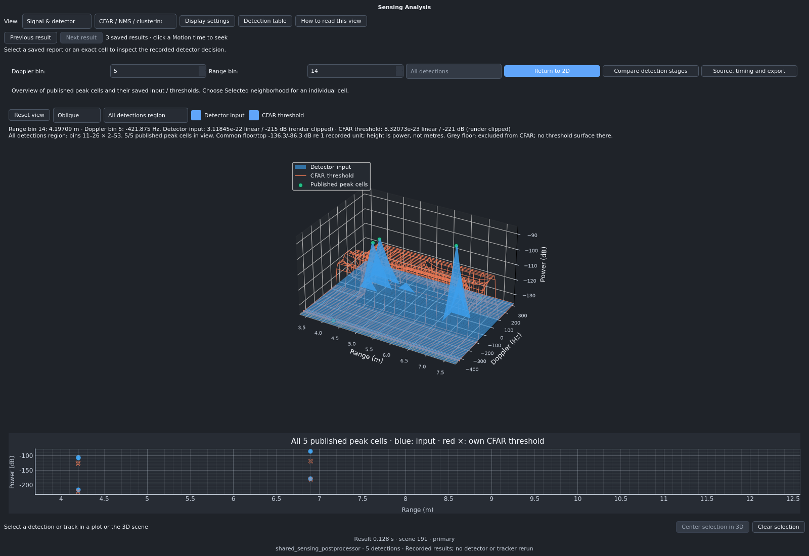
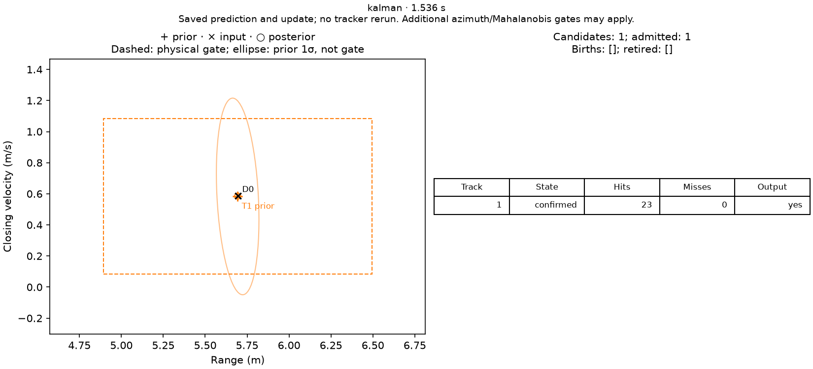
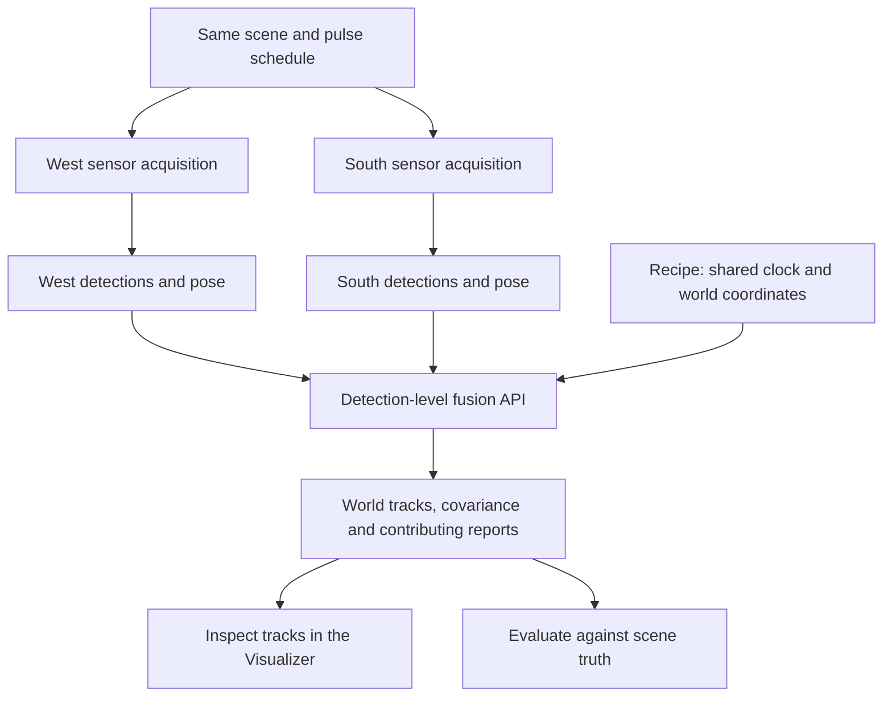

# Detection and tracking

This guide answers two questions: **which detection and tracking methods
are implemented**, and **how can you inspect the decisions they make**?
Sionna RT supplies simulated propagation; ORCHAV performs the sensing
processing, detection, tracking and evaluation. Start with the
[cube-radar scenarios](../../scenarios/sensing/cube_radar/README.md)
for runnable results, or use the [Sensing Dashboard](../visualizer/sensing_dashboard.md)
to inspect saved observations in 2D plots, tables and the 3D scene.

## What ORCHAV implements

| Stage | Built-in capabilities | Where to investigate |
|---|---|---|
| Detection | Range–Doppler detection with cell-averaging (CA) or ordered-statistics (OS) CFAR; eligibility guards, local peak selection, clustering and output filters | [Detector stages](#what-each-stage-decides) and [2D inspection](#inspect-or-change-a-decision) |
| Array-assisted detection | Optional per-beam detection and angular association with compatible receive arrays; the ordinary range–Doppler mode remains available | [Beamwise detection](#beamwise-detection) |
| Tracking | M-of-N association/confirmation, radial Kalman, receiver-local Cartesian 2D/3D Kalman and joint probabilistic data association (JPDAF), with lifecycle controls | [Tracker choices](#association-and-confirmation) and [tracking views](#inspect-tracks-and-associations) |
| Multiple sensors | Detection-level fusion of compatible, time-aligned sensor reports into world-coordinate tracks | [Multi-sensor fusion](#multi-sensor-fusion) |

These are available algorithms, not promises of a particular detection
probability or localization accuracy. A selected recording may contain only
some of their input maps or diagnostic products. [Recording profiles](reprocessing.md#choose-a-profile)
and optional diagnostic retention determine what can be inspected afterward;
[parameter reference](parameters.md) owns exact settings and defaults.

## Detection

A detector selects observations from range–Doppler or angular power maps.
A bright cell is not automatically a detection, and several detections can
come from one extended target. [Tracking](#tracking) connects reports across
time. [Evaluation](evaluation.md) compares them with truth after processing.

### What each stage decides

| Stage | Purpose |
|---|---|
| Eligibility | Select the input map and configured range, Doppler and edge regions. |
| Constant false alarm rate (CFAR) | Compare each eligible cell's power with a threshold estimated from neighboring cells. |
| Non-maximum suppression (NMS) | Keep separated local peaks. |
| Clustering | Group nearby peaks into representative observations. |
| Output filtering | Apply range, local-contrast and other configured report filters. |

The blue surface is the detector input, the orange mesh is its CFAR threshold,
and the green markers identify published peaks. The lower plot compares each
published peak with its own threshold. Cells can pass CFAR without becoming
reports after peak selection and grouping. Cluster labels belong to one update,
rather than a persistent object identity.

CFAR compares **linear power**, with a strict greater-than threshold test.
Its multiplier is not a guaranteed false-alarm probability. The reported
signal-to-background ratio measures local contrast, rather than calibrated
receiver signal-to-noise ratio (SNR). Ground truth never selects a candidate.

### Inspect or change a decision

The [Cartesian cube example](../../scenarios/sensing/cube_radar/moving_tracking_3d/README.md#running)
contains range–Doppler, angular, detection-stage and tracking evidence. Open
its saved recording in the Visualizer, then **Sensing → Result graphs**.
Most detector investigation happens in **2D views**, not in the 3D scene:

| View | What you can learn |
|---|---|
| **Current result → Detections** | Compare the range–Doppler power map, range profile, detection markers and **Results table** for one acquisition. A bright echo can remain below the detector threshold or be excluded by its filters. |
| **Current result → Detector** | Inspect the saved detector input, CFAR threshold and intermediate peak/grouping evidence, where recorded. Select a cell or detection to see how it was treated. |
| **Current result → Angle** | Inspect the angular response and the direction attached to reports when the recording contains compatible array products. |
| **Motion** | Follow detections and their range/velocity changes across result times. This shows observations before persistent track identity is considered. |

Use **Previous** and **Next** to change the acquisition, and check the result
timestamp. For the detailed controls and their 2D figures, follow the
[Sensing Dashboard walkthrough](../visualizer/sensing_dashboard.md#open-the-example).
The optional **Selection & 3D explanation** and range shell give geometric
context for a selected cell; they do not replace its CFAR or filtering evidence.

For a direct comparison of a detector decision, use
[stationary-cube filtering](../../scenarios/sensing/cube_radar/stationary_filtering/README.md).
It reprocesses the *same saved map* with three recipes and produces one, five
or no reports. The echo remains present even when a configured range filter
rejects it. Display contrast and marker visibility do not rerun detection.

To make detailed stage inspection possible, set
`sensing.recording.detection_stages: true` on a new acquisition. For saved data,
use `orchav-sensing --save-stage-artifacts` when
[reprocessing](reprocessing.md#run-processing). Request
`--figure detection_stages` for a standalone summary. If only final
detections were retained, the Visualizer cannot reconstruct which intermediate
stage rejected a candidate.

### Match settings to the response

[CFR/IFFT processing](concepts.md#range-response-models) spreads
returns across range samples. Guard, reference and peak-suppression widths must
cover the intended physical distances. Preserve those distances when changing
IFFT padding. Clustering and tracking gates already use physical units.

CFAR retains zero-valued power cells. A plotted dB floor changes only the image.
The saved threshold margin is a power difference in dB, not a confidence score.
A peak-relative power floor can make the effective threshold constant, and a
report may lie below the displayed color range.

### Beamwise detection

With a compatible array, `detection.mode: beam_scan` tests angular beams before
merging compatible range, Doppler and angular reports. The broadside RD display
may differ from the beam that produced a detection. Inspect the contributing
beam when interpreting that report. A scalar RD map cannot supply direction.

Grouping uses power-weighted physical coordinates, the shortest azimuth
separation and nonperiodic Doppler boundaries. Exact controls and defaults are
in [parameters](parameters.md#cfar-detection).

## Tracking

A track connects detections across result times. The tracker predicts a state,
associates compatible reports, updates its estimate and decides whether the
track is tentative, confirmed, coasting or retired. This is distinct from
[detection](#detection), which acts on each observation window, and from
[evaluation](evaluation.md), which uses ground truth only after estimation.
Begin with the [single-target tracking example](../../scenarios/sensing/cube_radar/moving_tracking/README.md).

### Inspect tracks and associations

Open **Sensing → Result graphs → Tracking** for the saved 2D time-history
and trajectory views. In the [radial tracking example](../../scenarios/sensing/cube_radar/moving_tracking/README.md),
follow estimated range and closing velocity as detections are associated
across CPIs. In the [Cartesian cube example](../../scenarios/sensing/cube_radar/moving_tracking_3d/README.md),
switch between XY, XZ and YZ projections and compare the track with the
measurement histories. These plots do not require viewing a 3D overlay.

Use **Motion** to compare the underlying detection history, and
**Run summary** or [Evaluation](evaluation.md) to assess matches and misses
against ground truth. A detection is a measured report for one result; a
track has an estimated state and persistent identity. Predictions during
missed updates are not new detections.

To understand *why* a track was associated, confirmed or retired, inspect
**Association decisions** when tracking diagnostics were saved. The 2D
decision figure below shows predictions, candidate measurements, gates and
updates. Without retained diagnostics, the Visualizer can show final tracks
but cannot recover the intermediate association decisions. See the
[Sensing Dashboard's tracking walkthrough](../visualizer/sensing_dashboard.md#motion-and-tracking).

### Read One Update

The [sensing panel](../visualizer/sensing_dashboard.md#motion-and-tracking)
connects track histories to the 3D scene. Its **Association decisions** view
shows the native tracker's prediction and update when diagnostics were retained.

Follow one update in this order:

1. Compare the predicted states with the available detections.
2. Inspect the association gates and accepted candidates.
3. Compare the updated estimate (posterior) with its prediction (prior).
4. Check confirmation, missed updates and retirement.

The plus marks the predicted state, the cross is the accepted measurement,
and the circle is the updated estimate. The dashed rectangle shows the
physical association gate. The ellipse shows the prediction's one-standard-
deviation uncertainty, which is distinct from that gate and from measured
accuracy. The table records the resulting track state and publication decision.

A track can coast through a missed detection. Detection rows remain measured
observations, while track records describe estimated states. Saved evidence
links identify contributing measurements where available.

### Association And Confirmation

| Tracker | How reports are associated |
|---|---|
| M-of-N confirmation | Greedy gated match to the last observation, without motion prediction. Confirmation needs M associated updates within the latest N updates. |
| Radial Kalman | Predicted range and closing velocity with association gates. |
| Cartesian Kalman | Predicted receiver-local position (and compatible velocity information). |
| Joint probabilistic data association filter (JPDAF) | Joint probabilities over feasible report-to-track assignments. |

**Association**, **confirmation** and **publication** are separate decisions.
M-of-N confirmation counts associated updates in a rolling window. The default
`latched` policy keeps a track confirmed until retirement, while
`continuous` requires the recent-hit condition to remain satisfied. Publication
can additionally require a minimum lifetime. Missed updates can produce
coasting predictions but never new measured detections.

JPDAF uses joint association probabilities for state updates and separate
one-to-one assignments for displayed/reporting decisions. Large candidate
groups can exceed its explicit search budget. Such updates are rejected, not
silently downgraded to another algorithm. Track births and close-object
separation depend on their configured gates. The
[parameter reference](parameters.md#exact-jpda-controls) defines
the precise options, limits and defaults.

Cartesian tracking requires angular information. A range/velocity-only
observation cannot determine position. The native `cartesian` and
`cartesian3d` models use receiver-local coordinates and compatible receive
arrays. For separately fused world-coordinate tracks, see
[multi-sensor fusion](#multi-sensor-fusion).

### Request Decision Evidence Explicitly

Tracking diagnostics are optional. For new acquisitions, retain the decisions
using `sensing.recording.tracking_diagnostics: true`. To generate a companion
figure, select `tracking_decisions` in
`generator_summary.sensing.inspection_figures`.

For saved acquisitions, the
[postprocessor](reprocessing.md#run-processing) can record equivalent
evidence with `--save-tracking-diagnostics` and render it using
`--figure tracking_decisions`.

Saved evidence includes predictions, covariances, candidate costs and gates,
assignments, births and retirements, and any JPDAF weights. Each decision
belongs to a specific result time and source recording. A missing artifact is
shown as **not recorded**. The Visualizer cannot infer it from the final track.
Detailed retention increases with the number of candidate track/report pairs.

### Bistatic Position Boundary

Bistatic range measures total TX–target–RX path length, **not** the distance
from receiver to target. Without a calibrated bistatic localization model,
ORCHAV omits Cartesian position and rejects Cartesian tracking of these
reports. Range/velocity tracking can still use their declared conventions.

For native radial models, positive monostatic-equivalent velocity means
approach. Prediction uses `r_next = r - v_eq * dt` for monostatic range and
`L_next = L - 2 * v_eq * dt` for bistatic total path length. The process
covariance follows the same scaling. The recorded range mode determines the
convention. Standalone tracker users must set
`TrackerConfig.range_rate_scale=2` for total-path-length observations.
This does **not** turn the equivalent velocity into world speed.

## Multi-sensor fusion

Two stationary monostatic sensors viewing the same moving target measure
different ranges, directions and radial velocities. ORCHAV combines their
**individual detection reports** to estimate position and velocity in a common
world frame. Each acquisition runs independently.

### Align the acquisitions

Use a separate recording for each stationary monostatic sensor. The 3D runner
requires a planar receive array with both azimuth and elevation. Declare a
common world frame and synchronized clock in the recipe, with zero time offset
for each source. Match the complete result times, including epochs with an
empty detection list.

If a source enables tracking, retain `detections_before_tracking` and its
metadata. Fusion needs the original angular reports even when the local
tracker has yet to confirm a track.

### Inspect fusion results

The diagram shows two independent acquisitions meeting at detection-level
fusion. Both recordings retain their own channel and detector results. Fusion
uses their sensor poses, timestamps and angular reports to estimate a shared
world-coordinate track.

Follow the [Munich drone example](../../scenarios/sensing/applications/drone_tracking/README.md)
for the topology, generation commands, fusion command and Visualizer comparison.
It compares West, South and fused results at the same epochs, including intervals
when a building obstructs one viewpoint.

| Output | Contents |
|---|---|
| `fusion_results.json` | World states, covariance and contributing observations |
| `fusion_decisions.jsonl` | Associations and updates by epoch |
| `evaluation.json` | Matches, errors, coverage and identity changes |

Compare coverage and errors together to see where another viewpoint helps.
Fusion covariance describes the assumed model, rather than observed accuracy.
The [FusionResult reader](../../shared/sensing/fusion/result.py) provides
state access and on-demand decisions for Python analysis.

Up: [Sensing](README.md) · Continue: [Evaluation](evaluation.md) · Reference: [Parameters](parameters.md)
