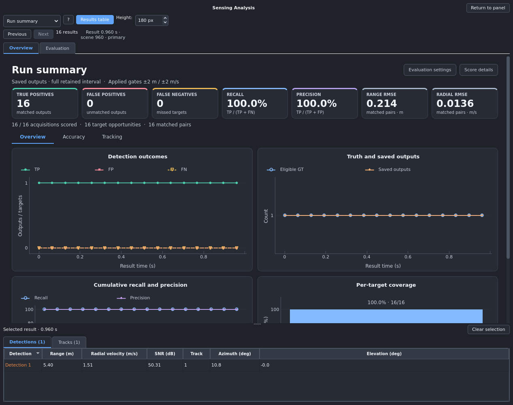

# Evaluate sensing results

Evaluation compares saved detections or tracks with time-aligned ground truth.
Read accuracy together with matched reports, missed targets and false outputs.
The [two-target example](../../scenarios/sensing/cube_radar/two_moving/README.md)
provides an existing recording for inspecting association and identity.

## Matches, misses and false reports

Choose the truth reference, result interval, output population and matching
gates before comparing methods. One-to-one matching prevents several reports
on one target from counting as several successful detections.

| Outcome | Meaning |
|---|---|
| True positive (TP) | One report matched to one eligible target within the gates. |
| False positive (FP) | A report unmatched to an eligible target. |
| False negative (FN) | An eligible target without a matched report. |

This capture from an earlier single-cube recording shows 16 matched outputs,
no false positives and no false negatives. The error cards describe those
matched pairs. The time plots show when outcomes occurred, and per-target
coverage shows how consistently each target was matched. The capture illustrates
the metrics rather than predicting the two-target example's values.

In the [sensing panel](../visualizer/sensing_dashboard.md#run-summary-and-evaluation),
**Run summary** evaluates the recording and **Current result** evaluates one
acquisition. The dashboard initially uses ±2 m and ±2 m/s gates. Native processing
and other entry points have their own [configured gates](parameters.md#evaluation-gates).
Set them explicitly for comparisons. Tightening a gate can turn one TP into an
FP and an FN without changing the saved detector output.

## Read counts and errors together

| Metric | Interpretation |
|---|---|
| Recall | TP / (TP + FN), the fraction of eligible target appearances matched. |
| Precision | TP / (TP + FP), the fraction of reports correctly matched. |
| Per-target coverage | Matched appearances divided by eligible appearances for that target. |
| Matched RMSE | Error over matched pairs only. Report its matched count alongside it. |

A zero denominator makes a score unavailable. Tight gates can lower matched
RMSE by excluding difficult cases. Track confirmation delay can cause initial
misses when tentative outputs are withheld. The evaluator does not discard
those initial results automatically. A target-center truth reference may also
be offset from the reflecting surface.

## Time and truth support

Evaluate targets at the saved [result time](concepts.md#result-timing).
The selected interval includes both endpoints. Missing or unaligned truth
excludes an event with a reason. An explicitly empty truth snapshot is a valid
target-absent event. The evaluator does not infer visibility or field of view.
A range-only match may be possible without reference velocity, but it is
excluded from velocity-error calculations.

## Track identity

Detection matching maximizes valid one-to-one matches, then minimizes normalized
range/velocity error. Multi-object tracking evaluation preserves an existing
truth-to-track assignment while it remains within the gates.

Inspect confirmation delay, gaps, retirement, rebirth and identity switches.
`track_fragmentation` counts tracked → untracked → tracked interruptions.
`distinct_track_id_count` counts identities used for each target. MOTP here
means matched mean absolute **range** error. It is not Cartesian position error.
Compare compatible saved `association_protocol` and `metric_protocol` values.
A coasting state is a prediction, not a newly measured detection.

## Noise comparisons

Hold acquisition, truth, matching gates and the processing recipe fixed while
varying the intended noise setting. Aggregate all CPIs within each independent
seed before comparing seeds. Input sample SNR, displayed cell power and a CFAR
local-background ratio are different quantities.

Report false detections per evaluated CPI and matched support alongside errors.
A deterministic trial is an outcome, not a detection probability. Seed min–max
bands describe observed variability, not confidence intervals. The optional
[noise-figure API](../../shared/sensing/plotting/noise.py) documents the input
records, aggregation and common-scale plot contract for custom studies.

For ordinary processing comparisons, use the existing
[filtering example](../../scenarios/sensing/cube_radar/stationary_filtering/README.md)
and [postprocessor](reprocessing.md#run-processing). Keep the same truth reference,
time interval and matching protocol across derived results.

Up: [Sensing](README.md) · Related: [Tracking](detection_and_tracking.md#tracking), [Current timings](timings.md)
