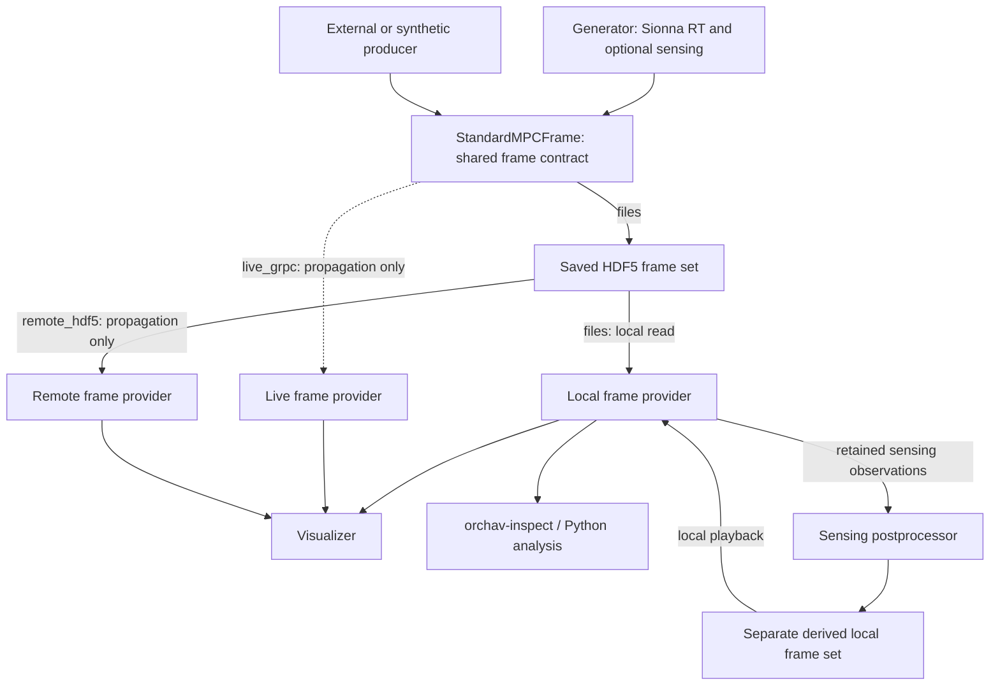

# Shared Data Layer

The Shared Data Layer makes a simulation recording usable across visualization,
inspection and analysis tools. A [frame](../reference/glossary.md#frame)
records [actor](../reference/glossary.md#actor) state and propagation paths at
one simulation step. A
[frame provider](../reference/glossary.md#frame-provider) retrieves that data
for playback or analysis. The common format connects [producers](../reference/glossary.md#producer),
such as the Generator, with [consumers](../reference/glossary.md#consumer),
such as the Visualizer and Python analysis tools.

## Producer, Shared Data Layer, And Consumer Roles

The [Generator](../generator/README.md) converts
[Sionna RT](https://nvlabs.github.io/sionna/rt/) results into `StandardMPCFrame`.
External adapters and the synthetic generator can write the same frame contract.

When sensing is enabled, the Generator can also save complex channel observations
and the radar products computed from them.

The solid `files` path supports local playback and the reprocessing loop,
which writes a separate result recording. The `live_grpc` and `remote_hdf5`
branches carry **propagation only**: sensing playback and reprocessing require
saved local observations. Copy or mount the complete frame set to inspect it
on another computer. For the implementation of each route, see
[Technical Delivery Routes](frame_reference.md#technical-delivery-routes).

## Start here

Start by [inspecting the Hello World frame](../../scenarios/getting_started/hello_world/README.md#generated-files)
to see what the Generator saves. The
[data-mode examples](../../scenarios/visualizer/data_modes/README.md) let you
compare local files, live generation, and remote playback. The
[external ray-tracer example](../../examples/external_raytracer_import/README.md)
shows how to write your own paths into frames that the same tools can read.

## Choose A Data Mode

The Visualizer's `data.mode` selects how frames reach it. Start with `files`
unless frames must be computed on demand or remain on another machine.

| Data mode | Choose it when | Durable frame data | Interactive recomputation |
|-----------|----------------|--------------------|---------------------------|
| Local HDF5 Playback (`files`) | You want the default reproducible workflow: generate once, inspect offline, analyze in Python, or share a frame set. | An HDF5 frame set under `frames/`. | Optional **Local What-if Preview** for the current step with pygfx and a local Sionna RT installation. The temporary result is not saved. |
| Live Generator (`live_grpc`) | You want frames on demand and temporary actor or ray-tracing changes while a Generator is running. | Session caches only. No HDF5 frame set is written. | Yes. Supported changes travel to the Generator over gRPC, which recomputes requested frames. |
| Remote HDF5 Playback (`remote_hdf5`) | You want to view a fixed frame set through a server without copying it to the Visualizer machine. | The server-side HDF5 frame set remains authoritative. | No. The frame-file service is read-only and does not run ray tracing. |

The synthetic benchmark generator and external ray-tracer import example are
alternative producers, not additional data modes. Both write a normal HDF5
frame set and then use `files` for playback, inspection, and analysis.

Use the runnable [Data Mode Scenarios](../../scenarios/visualizer/data_modes/README.md)
for complete commands and minimal YAML. See
[Interactive Recomputation](../visualizer/interactive_recomputation.md)
for Local What-if Preview and Live Generator edit behavior.

## Choose A Shared-Data Task

| Goal | Start with |
|------|------------|
| Check generated frames without opening the Visualizer | [Frame Inspection](frame_inspection.md) |
| Load a generated HDF5 frame from Python | [Frame Data Reference](frame_reference.md#minimal-hdf5-frame-provider-example) |
| Calculate channel statistics from frame arrays | [Statistics Helpers](statistics.md) |
| Understand frame fields, HDF5 storage, selected-field views, or how frames are retrieved | [Frame Data Reference](frame_reference.md) |
| Change sensing processing on an existing acquisition | [Sensing Postprocessor](../sensing/reprocessing.md#run-processing) |
| Import solved paths from another propagation tool | [External Ray-Tracer Import](frame_reference.md#external-ray-tracer-import) |
| Validate `scenario.yaml` | [Scenario Validation](../reference/scenario_validation.md) |
| Configure desktop Visualizer scene/Open3D IBL locations or network endpoint defaults | [Application Configuration](../reference/application_configuration.md) |
| Change diagnostic output | [Logging](../reference/logging.md) |
| Create repeatable high-density test frames | [Synthetic Frame Generation](synthetic_frames.md) |

## Developer Details

For component ownership, package boundaries, stable interfaces, and extension
points, see the [Developer Architecture](../development/architecture.md).

---

Home: [Documentation](../README.md) | Related: [Frame Data Reference](frame_reference.md) | [Developer Architecture](../development/architecture.md)
