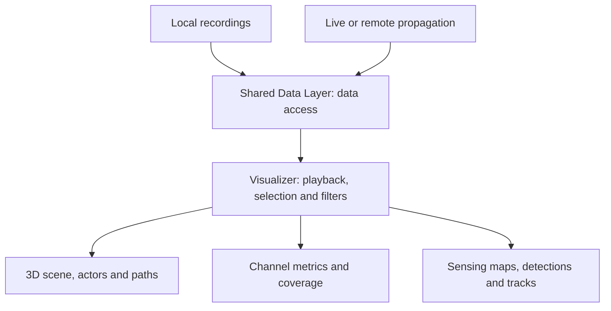

# Visualizer

The Visualizer is ORCHAV's interactive workspace for examining a simulated
channel in its 3D scene. You can follow moving [actors](../reference/glossary.md#actor), select and filter
[multipath components (MPCs)](../reference/glossary.md#propagation-path-mpc),
and compare channel metrics and coverage. As a [frame consumer](../reference/glossary.md#consumer),
it plays [frames](../reference/glossary.md#frame): snapshots of the scenario
over time. The [Shared Data Layer](../shared/README.md) supplies these from
local recordings, a running Generator or a remote HDF5 recording.

For file-backed sensing experiments, the [Sensing Dashboard](sensing_dashboard.md)
shows saved radar products, detections and tracks alongside the scene.

The lower branches represent linked scene, channel and sensing views. Sensing
products are available from saved local recordings; live and remote routes
provide propagation data. See [data modes](../shared/README.md#choose-a-data-mode)
for the corresponding provider choices.

The desktop application uses `pygfx`, the actively developed renderer, by
default. [Renderers](renderers.md) explains when the retained Open3D/Filament
renderer may still be useful on Windows and Linux. Use pygfx on macOS and for
ORCHAV Sensing visualization.

## Start Here

After completing the repository [Quickstart](../getting_started/quickstart.md),
use [Your First Visualizer Session](first_session.md) to reopen the generated
Hello World frame, orient yourself in the interface, inspect its MPCs, and
export an image.

Watch the [Visualizer demos](demo_video.md) for examples of ORCHAV in use.
The [Visualizer scenarios](../../scenarios/visualizer/README.md) let you try
path inspection, channel metrics and multi-device playback yourself.

## Choose A Task

| Goal | Guide |
|------|-------|
| Learn the desktop interface | [Your First Visualizer Session](first_session.md) |
| Compare current-frame metrics and scenario statistics | [Channel analysis](analysis.md) |
| Explore range-Doppler, angular, micro-Doppler, detection, and tracking products | [First sensing result](../../scenarios/sensing/cube_radar/stationary/README.md), then [Sensing Dashboard](sensing_dashboard.md) |
| Inspect individual MPCs, arrival gates and delay–angle groups | [Path inspection](path_inspection.md) |
| Test a temporary actor or solver change | [Interactive Recomputation](interactive_recomputation.md) |
| Watch several targets or run an automatic presentation | [Extra views and Demo mode](presentation_tools.md) |
| Inspect antenna-array response overlays | [Beam-Pattern Visualization](beam_patterns.md) |
| Resume an investigation | [Workspace Snapshots](workspace_snapshots.md) |
| Choose a frame provider and data mode | [Shared Data Layer](../shared/README.md) |
| Choose a renderer for the current platform | [Renderers](renderers.md) |
| Render without the desktop application | [Headless Rendering](headless_rendering.md) |
| Render or regenerate local frames in Jupyter | [Notebook Visualization](notebooks.md) |
| Configure the initial camera, coloring, visibility, panels, or markers | [Visualizer Scenario Defaults](scenario_defaults.md) |
| Look up launch and automation flags | [Visualizer CLI Reference](cli_reference.md) |
| Understand loading costs and playback caches | [Loading and performance](caching.md) |
| Follow an actor or save a camera sequence | [Camera navigation](camera.md) |

For spatial results, use [3D Volume Inspection](volume_inspection.md) to
compare heights and positions. The [path analysis guide](path_inspection.md)
shows how to inspect arrivals in a selected delay interval, with an [example arrival-time view](figures/experimental-arrival-gate.png).

The [Scenario Builder](../generator/scenario_builder.md) is an authoring workspace
available by default with pygfx in the desktop application. It creates scenario
inputs for the Generator.

## Building Appearance

Use [Scene appearance](appearance.md) for presets, facades, roads, geographic
layers, lighting and skies. The
[building-appearance example](../../scenarios/visualizer/building_appearance/README.md)
compares these controls in a small local scene.

Use [Visual assets](visual_assets.md) when authoring building annotations,
landmark textures or textures for animated targets. The
[texture library](../../libraries/textures/README.md) lists the bundled assets.

---

Home: [Documentation index](../README.md) | Begin: [Your First Visualizer Session](first_session.md)
