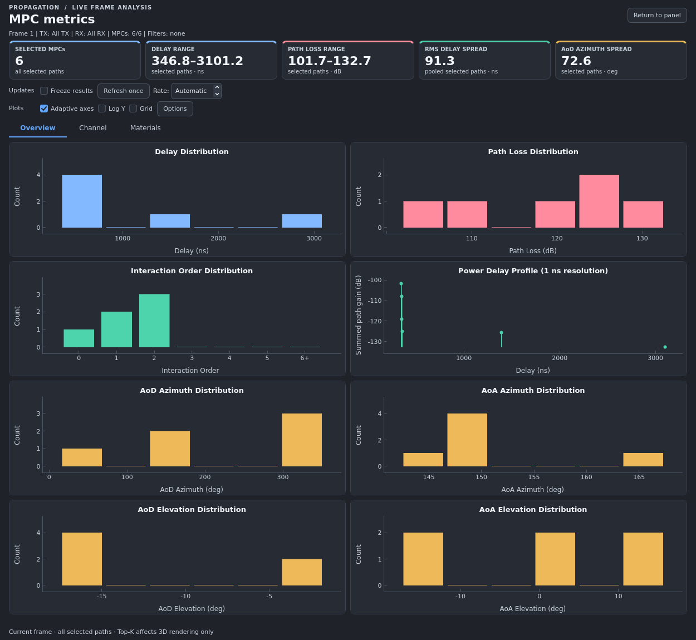

# Channel analysis

The Visualizer is a [frame consumer](../reference/glossary.md#consumer). Use
**Metrics** to inspect the frame currently displayed, and use the **Analysis**
tab's **Statistics** and **Graphs** sections to summarize the complete sequence
available from the active [frame provider](../reference/glossary.md#frame-provider).
The same workspace also provides coverage and camera inspection. When the
selected data mode supports it,
[Interactive Recomputation](interactive_recomputation.md) lets you test
temporary actor or ray-tracing changes without rewriting the scenario or its
saved frames.

The main status bar shows **Simulation time** from the displayed frame's
recorded timestamp, independently of sensing and playback speed. The pygfx
viewport also shows it when detached. An absent timestamp is shown as
unavailable; frame numbers are not converted into a guessed time.

| Question | Tool | Data scope |
|---|---|---|
| What is happening in the displayed frame? | Metrics window | Current TX/RX and path-filter selection |
| How does the channel change across the scenario? | Statistics and Graphs | Every frame and represented TX/RX pair available from the frame provider |
| What are the delay, loss, and interactions of a selected path? | [MPC Explorer](path_inspection.md) | One selected path in the displayed frame |
| Where does a coverage metric meet a threshold? | Coverage tab and coverage graphs | Selected coverage metric and height |
| What would one temporary actor or solver change do? | [Interactive Recomputation](interactive_recomputation.md) | Current session. Scenario files are unchanged. |

Use these included scenarios for hands-on examples:

- [Metrics Evolution](../../scenarios/visualizer/metrics_evolution/README.md)
  contrasts current-frame Metrics with changes over a moving receiver route.
- [Statistics](../../scenarios/visualizer/statistics/README.md) adds
  whole-sequence graphs and a companion coverage map.
- [Multi-Device
  Trajectory](../../scenarios/visualizer/multi_device_trajectory/README.md)
  demonstrates actor selection, trajectories, Follow, and POV camera modes.
- [MPC Inspection](../../scenarios/visualizer/mpc_inspection/README.md) provides
  a compact urban frame for path selection, material inspection, and the
  advanced RF X-Ray overlays.

## Current-Frame Metrics

This Hello World capture includes all six saved paths. The delay and loss
histograms count paths, while the power-delay plot weights them by path gain.
The cards summarize the same selected set. A different recording or filter
selection changes both the cards and plots.

Open **View > Metrics Window**, or press `M`. The window follows the latest
displayed frame and redraws only its visible tab:

- **Overview** shows delay, angle, [path-loss](../reference/propagation.md#path-metrics),
  and interaction-order distributions. It also shows the **Power Delay Profile
  (1 ns resolution)**.
- **Channel** shows a delay-power scatter plot, an AoD or AoA direction map,
  per-pair values, and compact link summaries.
- **Materials** counts material contacts by bounce depth and relates retained
  paths to their material categories.

The 1 ns power-delay profile groups selected paths into 1 ns bins, sums their
linear path gains, and places each displayed bin at its power-weighted delay.
It does not use phase and is therefore not labeled as a complex channel
impulse response. Select one concrete TX/RX pair in **Context** when you need a
per-link profile. Selecting multiple pairs pools their paths.

Material plots describe associations within retained paths. In particular,
the associated path-gain proxy is not a measurement of energy deposited at an
individual bounce.

### Scope And Drawing Limits

The TX/RX choice in **Context** and the filters in **Paths** determine which
paths Metrics analyzes. **Filtering > Top K > Keep strongest paths** reduces 3D
drawing work only. It does not reduce Metrics calculations or exports.

**Max plotted markers** is a separate dashboard drawing limit for dense plots.
Choose **No limit** to draw every selected sample. Calculations and CSV export
still use every path selected by the Context and Paths filters.

**Adaptive axes** lets the Overview plots follow the displayed frame. Turn it
off to retain their current X and Y ranges while the scenario plays. Retained
ranges are the current plot ranges, not global bounds scanned from every
frame.

### Refresh behavior

**Automatic** refresh adapts to the work needed by the visible plots. Choose a
fixed rate to limit dashboard refresh, **Freeze results** to hold it, or **Refresh once** for
one update. Playback can advance faster than the dashboard redraws.

## Scenario Statistics And Graphs

Open the **Analysis** tab and expand **Statistics**. The Visualizer checks for a
matching cache. On a first run or cache miss, choose **Compute Statistics** to
scan the active frame provider. **Compute automatically on cache miss** is an
optional setting and is off by default. **Compute Statistics** also forces a
fresh scan of the currently open recording. Export the result as CSV or the
chart figures as PNG files.

The **Graphs** section includes:

- MPC-count, delay, path-loss, and angular distributions.
- Delay and path-loss cumulative distributions.
- Interaction-mechanism and interaction-order evolution.
- TX/RX pair path-state and channel-metric summaries.
- coverage distributions and threshold-success curves for the selected height
  when [coverage data](../reference/propagation.md#coverage-maps) is loaded.

Every graph provides an explanation of what it counts. Hover over a plotted
item to inspect its value when the chart supports point inspection. Evolution
graphs appear only when the frame provider offers multiple frames. Inline
graphs use PyQtGraph; PNG chart export uses Matplotlib.

Statistics describes the complete sequence available from the active frame
provider. It does not apply the current **Context** or **Paths** filters. Use
Metrics for selection-scoped analysis.

### Statistics Cache

For local and remote HDF5 providers, the Visualizer can reuse derived numeric
results from a consumer-side cache. For live Generator sessions, explicitly
compute Statistics to scan the available frames without persistent caching. See [Caching](caching.md#statistics-cache) for cache
location, identity, deletion, and refresh behavior.

## Coverage inspection

The **Coverage** tab displays a saved metric at a selected height. Choose the
metric and transmitter, then adjust the threshold and opacity. Scalar values
use a continuous color scale. Serving-transmitter identity uses transmitter
colors. For linear RF quantities, threshold controls show dB for gain/SINR and
dBm for power in watts. Cell inspection retains the original stored units.

**Analysis → Compare heights** compares the percentage of saved cells meeting
a received-power threshold at each height. Unknown samples appear as an
uncertainty band. Selecting an XYZ region uses that same region for comparisons.

See [Volume inspection](volume_inspection.md) for slices, cutaways, sweeps and
cell selection, and the
[single-transmitter example](../../scenarios/generator/coverage/single_tx/README.md) for generation
and expected figures. Display controls do not rerun the coverage solve.

## Related inspection tools

[Camera navigation](camera.md) explains Follow, POV, saved views and camera
sequences. [Path inspection](path_inspection.md) connects path-table selection
to arrival-time and delay–angle plots. The
[appearance guide](appearance.md#visibility-and-scene-guides) covers cutaways
and visibility controls.

For saved radar results, use the [sensing dashboard](sensing_dashboard.md).
For a temporary actor or solver change, use
[interactive recomputation](interactive_recomputation.md).

## RF X-Ray (Advanced, pygfx)

Expand **Analysis > RF X-Ray** while using the pygfx renderer. RF X-Ray is an
inspection overlay, not a material-appearance editor:

- **Material Map** recolors visible geometry by its assigned radio-material
  class.
- **MPC Material Usage** colors materials by their relative, path-loss-weighted
  contacts in the current visible MPC selection. **Top Paths** can additionally
  highlight a bounded number of the strongest material-bearing paths.
- **Material Properties** colors materials by a selected configured RF value,
  such as relative permittivity, conductivity, scattering coefficient, XPD
  coefficient, or thickness.

The overlay works at material or material-family granularity because current
frames do not identify every bounce by a stable scene-object ID. Treat the
results as comparative inspection aids, not as per-bounce power measurements.

---

Up: [Visualizer](README.md) | Related: [MPC Explorer](path_inspection.md) | [Interactive Recomputation](interactive_recomputation.md)
