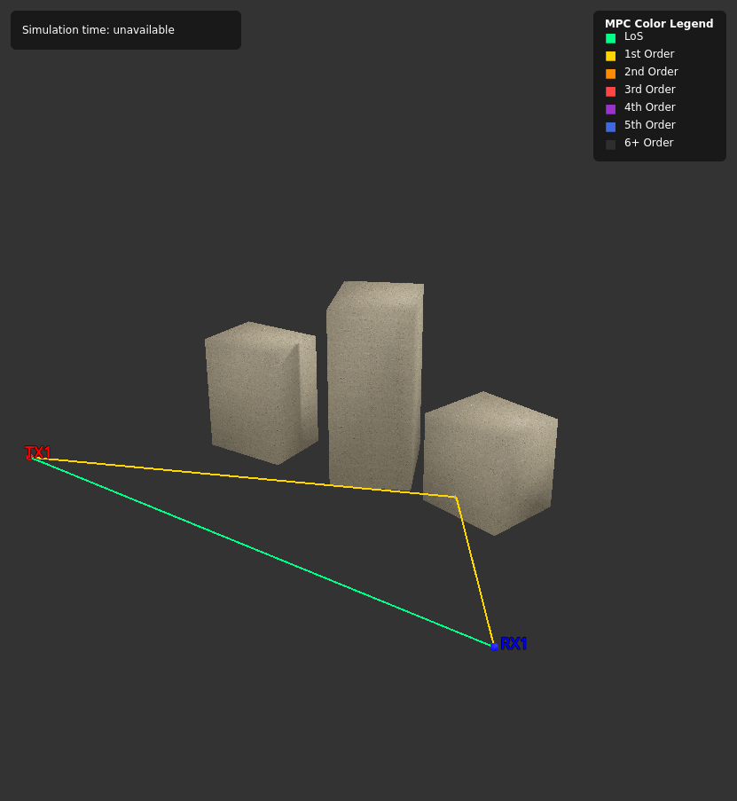
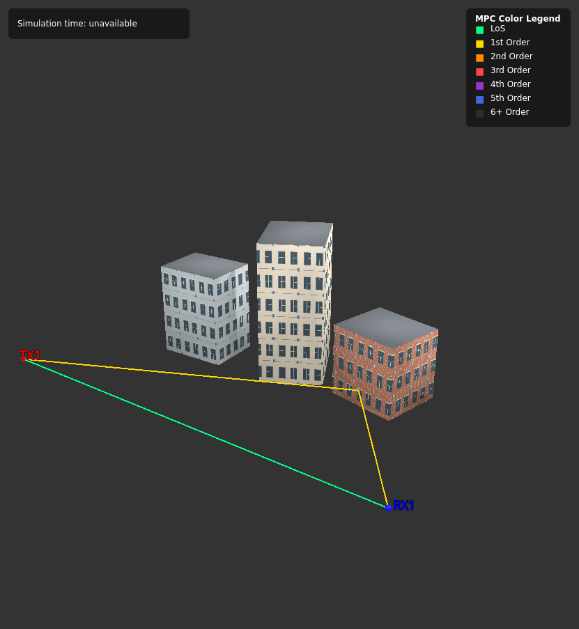

# Scene appearance

The Visualizer can show the same recorded scene with material colors, textured
surfaces or a simplified plan. These controls change the display. Geometry,
radio materials, propagation paths and sensing results remain unchanged.

In pygfx, start under **Rendering → Appearance**. The
[building appearance scenario](../../scenarios/visualizer/building_appearance/README.md)
provides a small recorded scene for comparing the controls.

| Original surfaces | Procedural facades |
|---|---|
|  |  |

The camera and building geometry are identical. The window patterns make scale
and orientation easier to read, but they add no openings or scattering surfaces.
[Image provenance](../assets/building_appearance/provenance.json) records the
scene and capture settings.

## Choose a look

| Preset | Appearance |
|---|---|
| Detailed | Available authored textures and procedural facades, with matching lighting and an installed sunny sky. |
| Paper | White background, unlit radio-material colors and fine mesh edges. |
| Plan | Saved street lines on a metric grid, with trajectories visible. Requires a saved street graph. |
| Dark | Matte blue-gray surroundings and soft shadows. |
| Glow | Violet surroundings and bloom. |
| Custom | A named look modified through the appearance controls. |

Scene looks preserve the camera, frame, path filters and
[multipath component (MPC)](../reference/glossary.md#propagation-path-mpc) coloring. Set path
colors separately under **Paths → Color By** and **Palette**. Delay and Loss use
green for low values and red for high values in the default **RdYlGn_r** palette.
A resumed workspace can retain a different palette.

**Detailed** enables available texture maps unless the application was launched
with `--disable-textures`. No preset downloads assets automatically. A scene
without facade annotations retains the detail its existing assets provide.

## Customize and save a look

Enable **Customize appearance** to expose the controls:

| Group | Controls |
|---|---|
| **Lighting and environment** | Sky, environment lighting, direct lights and shadows. |
| **Surfaces** | Surface colors, textures, facade themes, opacity and mesh edges. |
| **Image quality** | Antialiasing and distant depth precision. |

Radio-material colors identify material categories. They do not represent
permittivity or conductivity numerically. Choose **Surface colors → Uniform
color** for a neutral scene, or edit individual optical materials under
**Scene → Materials**.

**Save as…** stores a named appearance recipe in `~/.orchav/appearance/`.
**Reset** reapplies the selected named preset. **Previous look** switches back
to the appearance before the last preset change.

A recipe saves global surfaces, lighting, sky and image-quality settings.
It does not save the camera, MPC styling or per-object assignments. Use a
[workspace snapshot](workspace_snapshots.md) to resume the whole investigation,
or [visual material profiles](scenario_defaults.md#visual-material-profiles)
to author per-object appearance. Recipes reference external sky assets rather
than embedding them, so another machine needs the same installed files.

## Building and road surfaces

### Procedural facades

Under **Rendering → Surfaces → Buildings**, choose **Original materials**,
**Repeated facade textures** or **Facades by building**. The repeated style uses
one pattern per material mesh. The per-building style fits illustrated windows
to individual building parts and exposes **Facade theme**.

| Theme | Visual emphasis |
|---|---|
| Mixed urban | A height-aware mix of facade families. |
| American downtown | Brick, concrete bands and darker office grids. |
| European masonry | Warm masonry colors and narrower windows. |
| East Asian urban | Light panels and broad office windows. |
| Portuguese tiles | Blue-and-white tile motifs, plaster and shutters. |
| Limestone and slate | Pale stone, narrow windows and cool-gray roofs. |
| Haussmann detail | Fitted window bays, balcony bands and detailed stone and roof textures. |

These are illustrative styles, not geographic classifications. Procedural
facades require annotated building faces. Per-building styles also require
building-part boundaries. [OpenStreetMap (OSM) generation](../generator/geography/osm_scene_generation.md)
supplies this metadata, and imported
scenes can use the [same annotation format](visual_assets.md#classify-building-faces).
A disabled control explains which information is missing.

Authored textures and explicit material assignments take precedence. The
**Custom surface textures** switch controls authored landmark images separately.
Changes to roughness or other optical properties preserve the active texture.
**Reset to Default** restores the procedural material, while **Original
materials** restores the source appearance. The
[renderer guide](renderers.md#materials-textures-and-lighting) explains texture
switching differences in Open3D.

### Road surfaces

Choose **Roads → Textures + markings** independently of the facade theme.
Annotated street polylines place the markings along existing road geometry.
Known surface tags can select paving, cobblestone, gravel or other patterns.
Footpaths and known unpaved roads receive surface detail without lane markings.
These appearances do not infer traffic rules or reconstruct surveyed lanes.

Road styling requires recorded face annotations, not just a street graph.
Older scenes without those annotations retain their original surfaces. Try the
[tagged-surface example](../../scenarios/generator/building_appearance/surfaces/README.md)
to compare the supplied patterns.

### Texture detail

**Surfaces → Mipmaps** reduces distant texture aliasing by filtering fine detail.
It can soften narrow or angled facades. **Image quality → Improve distant depth
precision** addresses depth flicker, which is a different effect. Neither
setting changes simulation geometry. Texture preparation can delay the first
style change, and detailed textures, shadows and transparency add rendering work.

## Lighting and skies

Image-based lighting (IBL) uses a panorama to illuminate visual surfaces and
reflections. The optional skybox displays that panorama behind the scene.
**Background → Solid color** hides the panorama while keeping its illumination.
Set **Intensity** to zero to disable environment lighting.

### Install and reuse a sky

Under **Rendering → Lighting and environment**, select a sky and choose
**Download & apply** if needed. Choose **Background → Skybox** to display it.

| Sky | Source | Download |
|---|---|---|
| Default | Included `neutral_outdoor` environment | None |
| Overcast | [Overcast Soil PureSky](https://polyhaven.com/a/overcast_soil_puresky) | About 4.4 MiB |
| Sunny | [Kloofendal 43d Clear PureSky](https://polyhaven.com/a/kloofendal_43d_clear_puresky) | About 4.4 MiB |
| Partly cloudy | [Kloofendal 48d Partly Cloudy PureSky](https://polyhaven.com/a/kloofendal_48d_partly_cloudy_puresky) | About 5.2 MiB |
| Sunset | [Qwantani Sunset PureSky](https://polyhaven.com/a/qwantani_sunset_puresky) | About 4.0 MiB |

The optional panoramas are [Poly Haven CC0 assets](https://polyhaven.com/license).
The included [catalog](../../visualizer/src/lighting/environments.yaml) records
their authors, source URLs and checksums. Installed skies work offline.

Matching lighting aligns the directional light with the visible sun. These
settings are illustrative, not geographic sun-position or weather models.
Selecting **Default** restores the fallback panorama but retains the current
light rig. Choose a direct-light profile to reset the rig too. Recipes and
workspace snapshots can retain these choices.

### Custom skies and offline use

Use **Load HDR…** in pygfx for a local panorama. Open3D uses a matching
`*_ibl.ktx` and `*_skybox.ktx` pair through **Load KTX…**. Preserve source and
license records for custom assets you distribute.

Downloaded skies and prepared cubemaps live in the user's cache:

| Platform | Default cache |
|---|---|
| Linux | `$XDG_CACHE_HOME/orchav/ibl`, otherwise `~/.cache/orchav/ibl` |
| Windows | `%LOCALAPPDATA%/ORCHAV/Cache/ibl` |
| macOS | `~/Library/Caches/orchav/ibl` |

Set `ORCHAV_IBL_CACHE_DIR` to use another location. Startup and headless rendering
do not download skies. In [headless rendering](headless_rendering.md),
`--ibl-name` accepts an installed sky identifier or local HDR path. Set the
matching intensity and direct lights separately when reproducing a desktop look.

## Geographic layers and maps

**Scene → Objects → Geographic layers** controls buildings, roads, ground,
vegetation, water and barriers when the scene contains the required
classification. Missing or ambiguous classifications remain visible. A hidden
wall can still block a radio path because visibility does not alter the recording.
Individual object visibility and the master **Show Scene** control also apply.

### Plan and map views

**Plan** uses the saved street graph and a metric grid. It hides the 3D environment,
shows recorded trajectories and preserves the camera. Choosing another look
restores the previous environment and trajectory visibility. No map download is
needed. Plan is unavailable without a saved street graph.

**2D OpenStreetMap** is a separate geographic layer. It displays a georeferenced
image alongside the scene. **Opacity** controls transparency, and **Height Z**
sets the flat image's height in local metres. Raise it above overlapping ground
surfaces when necessary. It is not draped over terrain.

A saved Builder map is reused when available. Otherwise the viewer downloads
tiles using the scene's bounds and coordinate metadata. Tiles are cached under
`~/.orchav/cache/map-tiles`, or `ORCHAV_CACHE_DIR`. A current map can differ from
the data used to generate an older scene. Configure another compatible provider
with `ORCHAV_OSM_TILE_URL` and its credit with `ORCHAV_OSM_TILE_ATTRIBUTION`.
Attribution remains visible in exports. See the
[OpenStreetMap tile usage policy](https://operations.osmfoundation.org/policies/tiles/).

### Visibility and scene guides

**Surfaces → Street names** adds labels where geographic metadata supports them.
Choose Plain, Box or Card style. Labels stay at street level and can be occluded
by scene geometry.

Under **Rendering → Guides and inspection**, use the ground grid, world axes
or environment dimensions to orient a view. **Size labels** shows the scene's
X/Y/Z spans in metres. **Paper axes** shows actual coordinate ticks. The north
compass requires geographic coordinates and accounts for the map projection.
It does not assume that world +Y is north. The **HUD** switch controls its
visibility, including captures that request **Include HUD**.

**Cutaway** exposes a section of the displayed scene. **Section contours** traces
where the cut intersects static meshes. It does not fill open sections or change
the propagation geometry.

Up: [Visualizer](README.md) | Related: [Visual asset authoring](visual_assets.md) |
[Workspace snapshots](workspace_snapshots.md) | [Presentation tools](presentation_tools.md)
