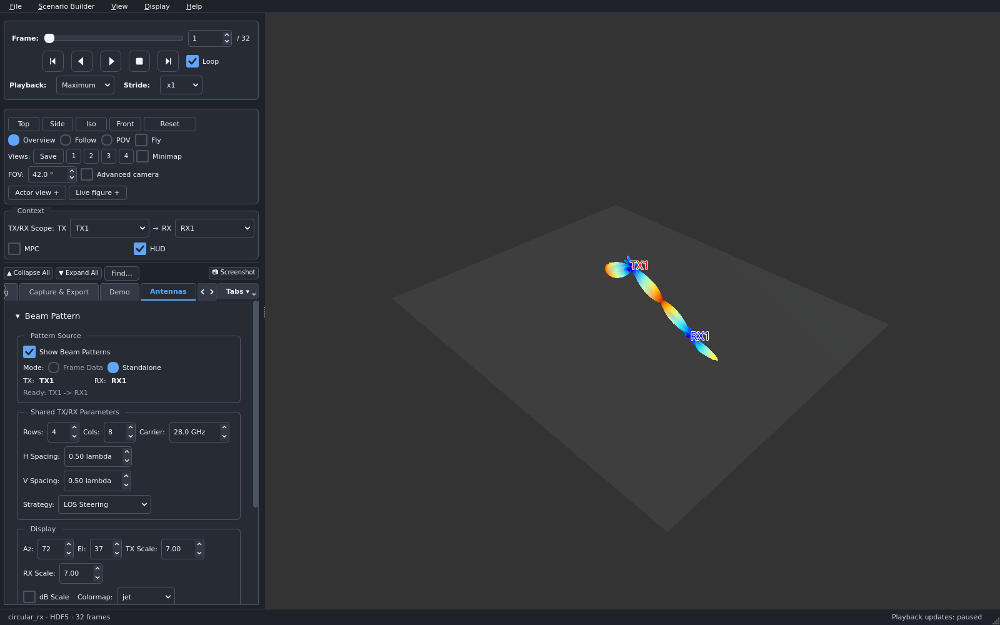

# Beam-Pattern Visualization

The **Antennas** tab displays transmitter and receiver array-response surfaces
for the selected TX/RX pair. Use them to inspect array orientation, steering and
sidelobes. These are display calculations based on the current frame. Editing
these controls does not change the simulated channel or `scenario.yaml`.

Start with the [circular-receiver example](../../scenarios/visualizer/beamforming/circular_rx/README.md),
which provides the recording and a short control walkthrough. The
[multiple-device example](../../scenarios/visualizer/beamforming/multi_device/README.md)
lets you compare several pairs.

## Pair Selection

Select one transmitter and one receiver in **Context → TX/RX Scope**, then
open **Antennas** and enable **Show Beam Patterns**. The TX and RX fields in
**Antennas** reflect that selection.

Selecting `All` keeps the broader path display but disables pair-specific
patterns. The status line identifies an incomplete pair, pending calculation or
unavailable response.

The selected pair uses 4 × 8 arrays. LOS Steering points the main responses
along their link. A display scale of 7 makes the surfaces visible here. Their
size is an inspection setting, not a physical coverage boundary.

## Pattern Sources

| Source | Meaning |
|--------|---------|
| **Standalone** | Computes display weights from the selected arrays and steering strategy. This is the default. |
| **Frame Data** | Uses beamforming weights saved in the frame, when recognized metadata is available. |

If a later frame has no usable saved weights, **Frame Data** returns to
**Standalone**. The circular-receiver example uses Standalone because its
frames do not contain beamforming weights.

## Standalone Steering

| Strategy | Meaning |
|----------|---------|
| **LOS Steering** | Points each array toward the other selected device. |
| **Manual Steering** | Uses the azimuth and elevation entered in the panel. |
| **SVD (Current MPCs)** | Estimates weights from the selected pair's saved paths, with a line-of-sight fallback when no usable paths exist. |

SVD means singular value decomposition. This preview reconstructs an
approximate channel from path geometry and path-loss values. It does not use
full complex channel coefficients or polarization terms. Use it to compare
response shapes rather than as a calibrated precoder or link-budget result.

## Controls and Limits

Scenario antenna and carrier settings initialize the panel. Runtime edits stay
in the Visualizer.

| Controls | Meaning |
|---|---|
| Array rows and columns | Number of antenna elements along each array dimension. |
| Horizontal and vertical spacing | Element spacing in wavelengths. Half-wavelength spacing is a common starting point. Larger spacing can produce additional strong lobes. |
| Carrier frequency | Frequency used to relate wavelength and element spacing. |
| Element pattern | Isotropic, dipole or 3GPP TR 38.901 response for each element. |
| Angular sampling | Number of azimuth and elevation samples used to draw the response. |
| TX/RX scale | Size of the drawn surface, independent of its physical gain. |
| Linear/dB display, dynamic range and colormap | How response magnitude is mapped to the displayed surface and colors. |

Interactive arrays support up to 32 × 32 elements and up to 180 azimuth by
91 elevation samples. Large arrays may reduce the requested display sampling
to stay within memory limits. Hiding beam patterns stops new surface generation.

## Renderer Support

Beam patterns are available with both [renderers](renderers.md). See
[Visual Analysis](analysis.md) for surrounding inspection tools and the
[Frame Data Reference](../shared/frame_reference.md) for saved beamforming
metadata.

---

Up: [Visualizer](README.md) | Example: [Circular Receiver](../../scenarios/visualizer/beamforming/circular_rx/README.md)
