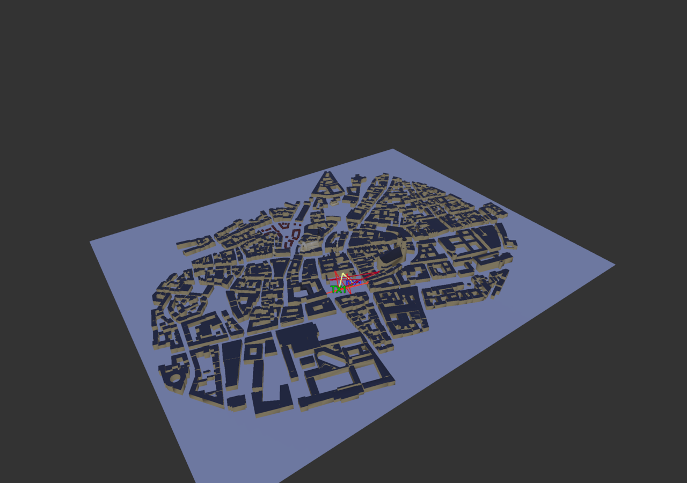

# Render Images from Saved Frames

Headless rendering turns existing frames into images without opening the desktop
Visualizer. Use the command-line interface for batch output and `render_scenario()`
for Python scripts. Both read local recordings through the
[Shared Data Layer](../shared/README.md) and render with pygfx.

For an interactive view inside Jupyter, use [Notebook Visualization](notebooks.md).
For image export from an open desktop session, use the Visualizer's Screenshot
control or [batch rendering](cli_reference.md#batch-rendering).

## Render One Frame

Use the frame set from [Hello World](../../scenarios/getting_started/hello_world/README.md#running).
Run commands from the repository root after generating the recording.

Render its first frame to a PNG:

```bash
python -m visualizer.headless scenarios/getting_started/hello_world \
  --frame 0 -o tmp/orchav-frame.png
```

The command loads frame 0, writes `tmp/orchav-frame.png`, and exits. No ray
tracing is performed.

## Render From Python

`render_scenario()` returns an `(H, W, 3)` `uint8` NumPy array. Pass `output`
when you also want an image file:

```python
from visualizer.headless import render_scenario

image = render_scenario(
    "scenarios/getting_started/hello_world",
    frame=0,
    azimuth=45,
    elevation=30,
    output="tmp/orchav-headless/frame0.png",
)
```

Camera angles are in degrees. Image width and height are in pixels. Camera
distance and center use the scene's metre coordinates.

## Select Frames, Camera, And Appearance

For a moving recording, use the existing
[Notebook Mode example](../../scenarios/visualizer/notebook_mode/README.md#running).

Render its first three frames with path-loss coloring:

```bash
python -m visualizer.headless scenarios/visualizer/notebook_mode \
  --frames 0,1,2 --color-mode path_loss \
  -o tmp/orchav-headless/frames/
```

This creates `frame_0000.png`, `frame_0001.png`, and `frame_0002.png` in the
output directory.



This example render shows the Munich scene and the paths for frame 2. Change
`--center`, `--distance`, `--azimuth` and `--elevation` to inspect the link more
closely. These controls change the view of the saved data.

| Area | Options |
|------|---------|
| Frame selection | `--frame`, `--frames` |
| Output | `--output`, `--base64` |
| Camera | `--azimuth`, `--elevation`, `--distance`, `--center X Y Z` |
| Image | `--width`, `--height`, `--color-mode` |
| MPC display | `--disable-mpc-layer`, `--hide-mpc-paths`, `--hide-mpc-bounce-points`, `--line-width`, `--point-size` |
| Lighting | `--ibl-name`, `--ibl-intensity` |
| Textures | `--enable-textures`, `--disable-textures` |

`--base64` writes a base64-encoded PNG to standard output. Run
`python -m visualizer.headless --help` for all options. Python calls accept the
frame, camera, coloring, visibility, lighting and image-size arguments shown in
the [`render_scenario()` signature](../../visualizer/headless.py).

## Graphics Environment

Rendering requires a working wgpu graphics backend, even when no desktop window
opens. Test one frame in the environment where the script will run. See
[Troubleshooting](../help/troubleshooting.md) for graphics and remote-machine
setup, and [Renderers](renderers.md) for desktop backend choices.

---

Up: [Visualizer](README.md) | Related: [Notebook Visualization](notebooks.md) | [CLI Reference](cli_reference.md)
