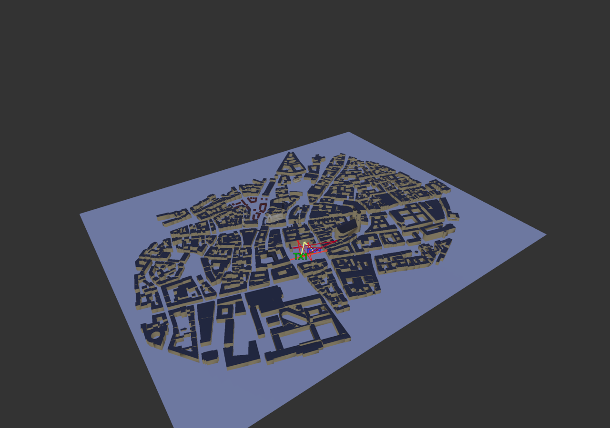

# Notebook Visualization

`PygfxNotebookViz` displays saved ORCHAV scenes and
[multipath components (MPCs)](../reference/glossary.md#propagation-path-mpc)
inside Jupyter. You can orbit the scene, play its recorded motion and render
images from Python. It reads the same local HDF5 frames as the desktop
[Visualizer](README.md).

Use the [Notebook Mode scenario](../../scenarios/visualizer/notebook_mode/README.md)
for installation, generation and the runnable notebook. The examples below use
that recording, with paths relative to the repository root.

## Open The Scenario

Create one viewer and reuse it across cells:

```python
from visualizer.src.notebook.pygfx import PygfxNotebookViz

viz = PygfxNotebookViz("scenarios/visualizer/notebook_mode")
print(viz.frames)
```

Select frame indices from `viz.frames`. They can be nonconsecutive, and an
unavailable index raises `ValueError`. Without recorded frames, the default
`render(frame=0)` can preview scene geometry.

The notebook reads the local `files` data mode. Use the desktop Visualizer for
`live_grpc` or `remote_hdf5`, channel-analysis panels, coverage controls and the
Path Explorer. See [data modes](../shared/README.md#choose-a-data-mode) for those
connections.

## Render A Static Image

`render()` returns an `(H, W, 3)` `uint8` NumPy array and displays it inline when
IPython and Pillow are available:

```python
image = viz.render(frame=2, color_mode="path_loss")
print(image.shape)
```



The rendered image includes the scene, devices and their saved paths. Camera
arguments such as `azimuth`, `elevation`, `distance` and `center` let you inspect
a smaller region. Pass `display=False` when you only need the array. Rendering
requires a working wgpu backend but does not open a Qt desktop window.

For a PNG-writing Python function or command-line batch output, use
[Render Images from Saved Frames](headless_rendering.md).

## Interact In A Cell

`show()` opens an in-cell view with orbit, pan and zoom controls:

```python
viz.show(frame=viz.frames[0], width=900, height=650)
```

The `jupyter` installation extra includes the required `jupyter_rfb` package.
`widget()` returns the canvas instead when you want to place it in a larger
notebook layout.

Play the saved frames with the same interactive camera:

```python
animation = viz.animate(frames=viz.frames, fps=24, loop=True)
animation
```

`fps` controls presentation speed independently of simulation time and must be
positive. All requested frames must exist before playback starts. Set
`loop=False` to stop at the last frame while keeping camera interaction.

## Choose Appearance And Labels

The notebook supports the desktop's `Detailed`, `Paper`, `Dark` and `Glow`
[appearance presets](appearance.md). Set an appearance on the viewer
constructor or on an individual `render()`, `show()`, `widget()` or `animate()`
call. Existing views retain their own settings.

Open a paper-style view with callout labels:

```python
canvas = viz.widget(
    frame=viz.frames[0],
    appearance="Paper",
    label_style="callout",
)
canvas
```

| Setting | Choices and meaning |
|---|---|
| `color_mode` | `reflection_order`, `mpc_type`, `delay` or `path_loss` for MPC colors. |
| `label_style` | `plain` uses sphere markers and text, `callout` adds leader lines, and `card` adds tinted labels with circular markers. |
| `tx_color`, `rx_color` | RGB or RGBA values between zero and one. |
| `width`, `height` | Canvas dimensions in pixels. |
| `azimuth`, `elevation` | Camera angles in degrees. |
| `distance`, `center` | Camera distance and look-at position in scene metres. |

Explicit path-color, line-width, point-size and bounce-point arguments override
the preset's corresponding choices. `Detailed` uses installed texture and sky
assets without downloading them. A preset controls environment lighting. Omit
`appearance` to use `ibl_name` and `ibl_intensity` directly. Plan view and saved
desktop appearance files are desktop features.

For the full argument list, see the
[`PygfxNotebookViz` methods](../../visualizer/src/notebook/pygfx.py).

## Regenerate A Simple Position Study

Rendering consumes saved frames. `regenerate()` explicitly runs the
[Generator](../generator/README.md) with new stationary TX/RX positions and
replaces this scenario's frame output:

```python
viz.regenerate(
    tx_positions=[[80.0, 100.0, 30.0]],
    rx_positions=[[25.0, 80.0, 1.5]],
    quality="ultra-low",
    steps=1,
)
image = viz.render(frame=0)
```

Each position row creates one stationary device with zero fixed yaw, pitch and
roll. Multiple steps repeat those poses. Targets from `scenario.yaml` are not
reconstructed automatically. This action requires the Generator dependencies
and a working [Sionna RT](https://nvlabs.github.io/sionna/rt/) backend.

For motion, orientation or targets, edit the scenario and run the Generator.
Call `viz.close()` first to release its frame files, then `viz.reload()` after
generation. Integrated `regenerate()` handles that close/generate/reload
sequence. The standalone
[`generate_frames()` helper](../../visualizer/src/notebook/generator.py)
provides the stationary producer step for separate notebook cells.

## Visual-Only Marker Overrides

Passing positions to a rendering call moves only the displayed device markers:

```python
image = viz.render(rx_positions=[[80.0, 50.0, 1.5]])
```

Stored MPC geometry remains unchanged. Use regeneration when the physical
channel must change.

## Close Or Reload The Viewer

Release canvases, playback and open frame files when finished:

```python
viz.close()
```

`reload()` also closes existing views before reopening the recording. Call
`show()`, `widget()` or `animate()` again to view the refreshed frames. A
`with PygfxNotebookViz(...) as viz:` block closes its resources automatically.

For custom numerical analysis, use the [frame-provider example](../shared/frame_reference.md#minimal-hdf5-frame-provider-example)
and [statistics helpers](../shared/statistics.md).

---

Up: [Visualizer](README.md) | Example: [Notebook Mode](../../scenarios/visualizer/notebook_mode/README.md) | Related: [Image Output](headless_rendering.md)
