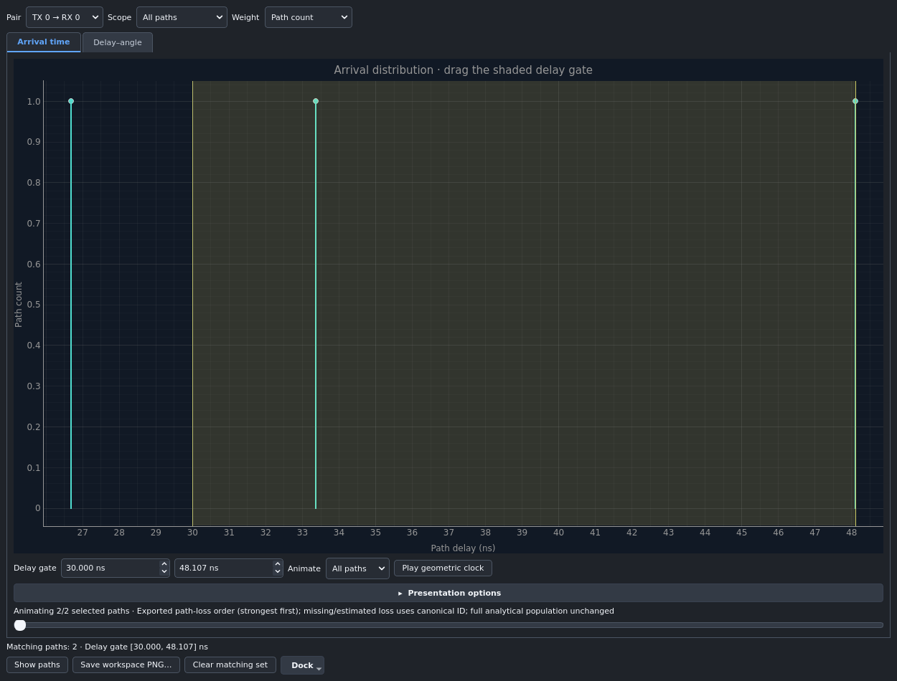
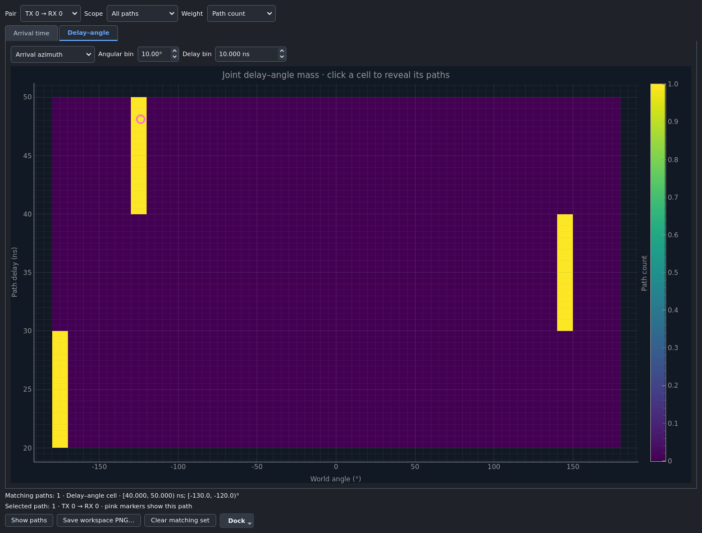

# Path inspection

Inspect individual [multipath components (MPCs)](../reference/glossary.md#propagation-path-mpc),
select paths within an arrival-time interval, and relate them to their recorded
geometry. Start with the existing
[MPC Inspection scenario](../../scenarios/visualizer/mpc_inspection/README.md).
The tools use saved paths and do not rerun ray tracing.

## Select a path

Pause playback and choose a transmitter and receiver in **Context**. Open
**Paths → Appearance → Path tools → Path Explorer…** to see individual paths.
Selecting a row highlights that path in the scene and shows its interactions,
materials, delay and loss. Select the same row again to clear the individual
highlight.

| Control | What it selects |
| --- | --- |
| **All paths** | Every path in the selected frame and TX/RX pair. |
| **Filtered paths** | Paths passing the current path filters. |
| **Actually rendered paths** | Paths included in the current display subset. |
| Table filters | Narrow the rows by available path properties, including interaction types, materials and order. |
| Matching set from Path Analysis | Paths in a selected delay gate or delay–angle bin. An individual table selection remains separate. |

Delay is in nanoseconds, path loss in dB, and angles in degrees. Missing values
are shown as unavailable. Geometry-derived estimates are identified separately
from exported metrics. A path ID identifies a path within one saved frame, not
an object tracked across the recording.

The table can show interaction codes such as specular reflection (`1`), diffuse
reflection (`2`), refraction (`4`) and diffraction (`8`). Sensing (`16`) and
virtual reconstruction (`99`) markers appear only when present in the supplied
data. Virtual vertices are not physical reflections.

## Inspect arrivals

Open **Analysis…** from Path Explorer, or **Path Analysis…** from the path-tools
menu. This workspace requires the default pygfx renderer. Choose a TX/RX pair,
scope and weighting, then use the **Arrival time** tab.

The shaded gate in this recorded example includes two of the three arrivals.
Moving either bound changes the matching set in the table and scene.
**Show paths** opens the matching rows in Path Explorer.

Drag the gate or type its bounds. The matching count describes the full selected
set. A separate display limit can reduce how many of those paths are animated.

## Compare delay and direction

Choose **Delay–angle**, select arrival or departure azimuth/elevation, and set
the numerical delay and angle bin widths. Click an occupied cell to inspect its
matching paths.

Here the arrivals occupy three distinct numerical bins. The selected bin
contains one path. Bin occupancy depends on the chosen widths and does not
identify physical scatterers or stable multipath clusters. The pink marker
identifies the individual path selected in Path Explorer.

## Choose a weighting

| Weight | Meaning |
| --- | --- |
| **Path count** | Each selected path contributes one. |
| **Relative power** | Finite exported path losses contribute `10 ** (-(loss - minimum_loss) / 10)`. The strongest eligible path has weight 1. |

Relative power sums path-gain weights. It does not include coherent phase
interference and is not absolute received power or SINR. Estimated or missing
losses are excluded from this weighting. Missing delays or angles are excluded
from the corresponding numerical plots and reported in their captions.

Arrival-gate shares use all eligible weight in the chosen pair and scope,
including paths missing delay. Delay–angle shares use weight assigned to bins.
Read the denominator shown by each view before comparing percentages.

## Animate the recorded geometry

With scene playback paused, select a gate, bin or path and press **Play geometric
clock**. The pulse advances along each recorded polyline using cumulative
segment length divided by the speed of light. Intermediate bounce timestamps
are not recorded. Pulse brightness, trails and interaction flashes are visual
aids, not field strength or transferred energy.

**Presentation options** controls pacing, trails, colors and interaction markers.
Use **Previous / Next** to step between geometric interaction times. **All paths**
animates the selected set. **Top 10**, **Top 50** and **Top 100** reduce drawing
work without changing the analytical statistics. Finite exported losses rank
paths by strength. Paths without such losses use path-ID ordering.

Starting scene playback stops the geometric clock. Pause and select paths
again to inspect another frame. For camera tours and automatic presentation,
see [Presentation tools](presentation_tools.md).

## Connect a sensing cell to path candidates

In the [sensing dashboard](sensing_dashboard.md), select a range–Doppler cell
and expand **Selection & 3D explanation** below the results table. Choose
**Inspect delay-matched paths…** to open
Path Analysis on the saved scene and sensor pair, with range converted to a
delay interval: `2r/c` for monostatic range or `r/c` for bistatic total path length.

These paths match the delay interval. They are not proven contributors to the
selected range–Doppler cell: Doppler, beamforming, finite bandwidth and
interference also affect that cell. An empty gate does not prove zero radar
power. The saved path identities belong to one scene solve, not every pulse
in the acquisition.

A selected range alone does not locate a target. The dashboard's range shell
shows the corresponding sphere or ellipsoid at the recorded sensor pose.
The [range-selection walkthrough](../../scenarios/visualizer/sensing_selection/README.md)
explains that geometry and its limits.

## Export the inspection

**Save workspace PNG…** saves visible plots, controls and captions. The main
Visualizer's Screenshot control saves the 3D scene. Save both when a result
needs its path geometry as context. A capture documents an inspection, not
independent physical validation.

Up: [Visualizer](README.md) | Related: [Channel analysis](analysis.md) | [Propagation](../reference/propagation.md)
