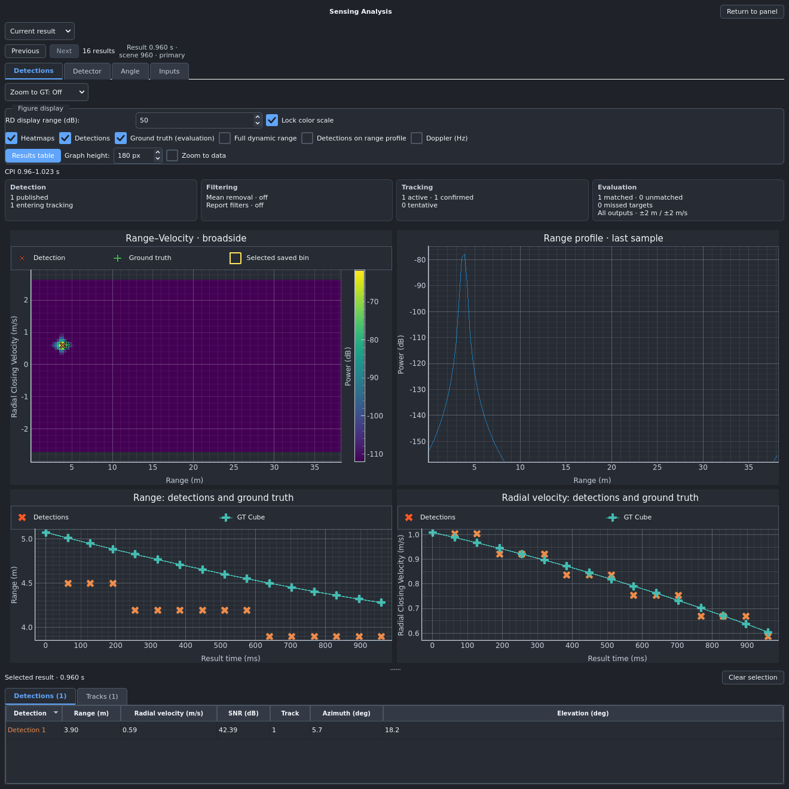
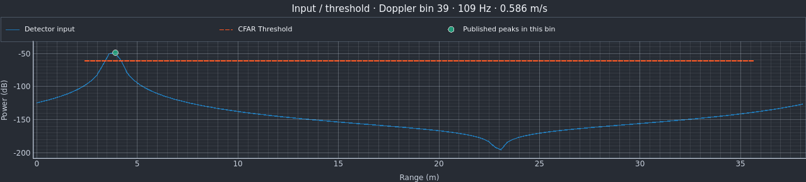
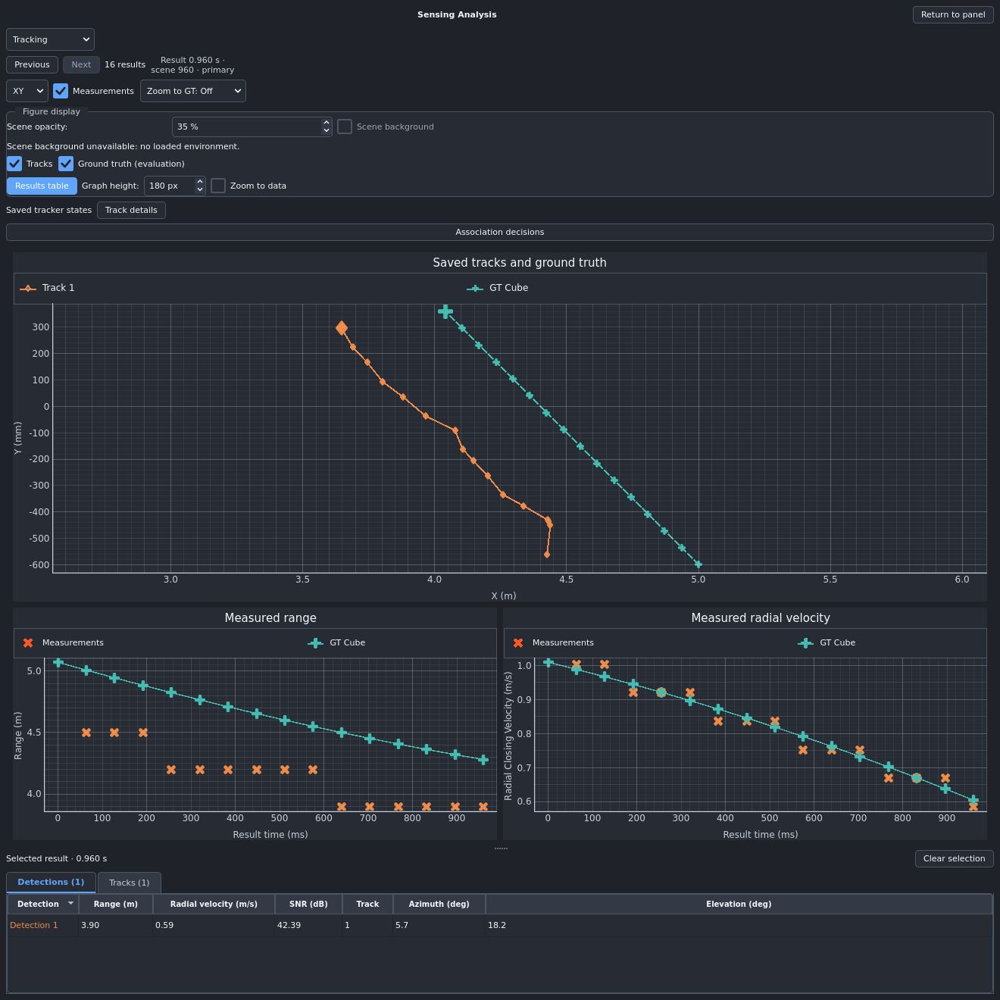
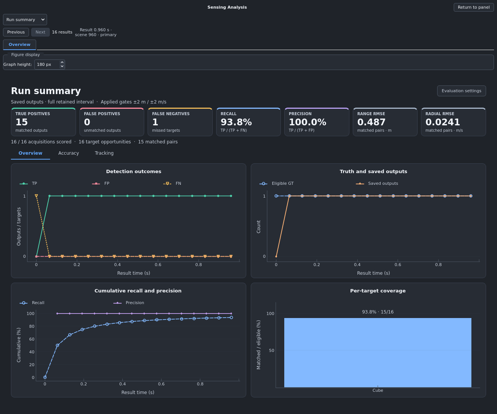

# Sensing Dashboard

Use this guide to **inspect saved sensing results**, primarily through the
dashboard's 2D plots, maps, tables and histories. It helps answer where a
return appeared, why the detector did or did not report it, and whether a
tracker maintained an identity across observations. The 3D scene provides
additional geometry and context, not a replacement for the 2D evidence.

Start with the [Cartesian cube tracking example](../../scenarios/sensing/cube_radar/moving_tracking_3d/README.md)
to explore range, angle, detector and tracking products. For the available
detectors, tracking models and intermediate decisions themselves, see
[Detection and tracking](../sensing/detection_and_tracking.md#what-orchav-implements).

## Open the Example

Follow the example's [generation and viewing instructions](../../scenarios/sensing/cube_radar/moving_tracking_3d/README.md#running).
In the Visualizer, open **Sensing → Result graphs**. The dashboard opens in
**Run summary**. Choose **Pop out** if you want to keep the graphs visible beside the 3D scene.

On a small screen, collapse **Player**, **Camera** and **Context** using their
headers to give the plots more space. These choices are remembered and stay
unchanged when switching tabs. You can also collapse **Sensing options** and
**Figure options**. **Sensing options** holds sensing-only playback,
3D overlays and figure-loading controls. **Figure options** holds plot display
settings and result details; closing it keeps the figures updating. Result
navigation, loading status and unavailable-product explanations remain visible.
For two plots beside the scene, use the
[Sensing presentation preset](presentation_tools.md#demo-mode).

The example uses an 8×8 receiver array and saves `maps` with detector-stage and
tracking diagnostics. It supports the views below without another processing
step. Complex input phase is not retained. The captures below use this example's
saved recording, with the last acquisition selected at 0.960 s.

| Goal | Where to look | What to try in the Cartesian cube example |
| --- | --- | --- |
| Evaluate results across the recording | **Run summary** | Compare matched reports, misses, and false positives under the displayed matching tolerances. |
| Locate the target in the current result | **Current result → Detections** | Step through the results and follow the return toward shorter range. Its position follows the reflecting face, offset from the cube-center truth. |
| Understand why a cell passed the detector | **Current result → Detector** | Select a cell and compare its return with the local background and threshold. Follow the surviving peaks through grouping. |
| Inspect the return's arrival direction | **Current result → Angle** | Compare azimuth and elevation with the cube's changing direction from the planar receiver. |
| Inspect motion over the recording | **Motion** | Click a time in the range–time plot and compare the selected range and Doppler response with **Current result**. |
| Follow a target across successive detections | **Tracking** | Compare XY, XZ and YZ projections as x decreases and y and z increase. Read the measurement histories alongside the saved track. |

Use **Previous** and **Next** to move between saved results. The example
contains 1,024 scene frames but only 16 complete acquisitions. During playback
the dashboard can hold a result as the scene advances. Its timestamp and
scene binding tell you which acquisition you are viewing.

## Current result

The upper plots describe the selected acquisition. The lower histories show
the cube approaching, with detected ranges offset from the cube-center truth.
The results table also retains its measured azimuth and elevation.

Click a detection in the **Results table** to highlight the same evidence in the
plots and scene. The Detection, Filtering, and Tracking cards distinguish the
returns that survived each stage. Selecting a bin, detection or track makes
**Selection & 3D explanation** available below the detections/tracks table. Open
it to inspect saved values and the selection's geometry in the scene. Clearing
the selection hides these controls. The table and selection controls are hidden
in **Run summary**. When time-aligned truth is available, **Evaluation** shows
matches for this acquisition.

In **Detector**, inspect how the threshold varies across neighboring cells.
When both spectra were retained, compare **Before clutter suppression** and
**After clutter suppression** to see what filtering removed. **Inputs** shows
saved signal magnitudes and, when retained, phase.

This detector-plot capture shows the selected Doppler slice. The marked peak
exceeds its saved threshold near 3.9 m. The threshold and input belong to that
processing result, independently of the current plot contrast.

## Motion and tracking

The **Motion** overview shows energy across all ranges. With several targets,
their contributions can overlap. Open **Motion display options** to inspect
the current result around a detected range, at one detected range bin, or
around the known ground-truth range. The ground-truth option is an oracle
diagnostic. These range choices filter displayed saved power. They do not rerun
detection or tracking. A saved micro-Doppler spectrum is available when the
recording contains that product.

Use **Tracking** to follow an individual track identity, including intervals
when the tracker predicted a state without receiving a new detection.
Range/velocity tracking works without angle measurements. A spatial trajectory
requires saved Cartesian track positions. Open the derived `tracks` recording
when following a reprocessing tutorial. The input recording and the derived
`detections` recording do not contain those track estimates.

The top plot compares the saved XY track with the cube-center trajectory.
Use the projection selector for XZ or YZ. The lower plots show the measured
range and radial velocity, which remain distinct from the filtered track state.

## Run summary and evaluation

The summary counts 15 matched outputs and one initial miss across 16 target
appearances. Its recall is 93.8%, while the error cards describe only the
15 matched pairs.

Read errors alongside counts. A tracker can have a small error on its matched
reports while missing a target in other acquisitions. The **Run summary**
covers the recording, while **Current result** covers the selected acquisition.
The detection error summary compares measured ranges and velocities with truth.
It does not substitute the filtered track estimates displayed in **Tracking**.
Changing evaluation gates rematches the saved reports to ground truth.
**Selected time interval** scores the inclusive **From**/**To** bounds.
Unedited defaults retain their full precision. Typing a shorter cutoff changes
the scored interval. See [evaluation](../sensing/evaluation.md)
for the metrics and endpoint rules.

## Display settings and 3D links

In the main **Sensing** panel, enable **Show 3D sensing** to compare the selected
evidence with the scene and reveal **3D sensing options**.
A range shell marks compatible positions. A measured direction or a saved
Cartesian estimate can narrow that region. **RT paths**, under **Context**, displays
the geometry from the original solve. A dimmed historical path stays at its
solved position as actors move.

While paused, select a report, expand **Selection & 3D explanation** in the
dashboard, and use **Play reveal** to step through its
available range, angle, position, and track evidence with cinematic camera
framing. **Focus selected evidence** in the main panel dims unrelated overlays.
For a track with saved Cartesian covariance, **Show tracking uncertainty**
draws the tracker’s model uncertainty around its estimated position. It follows
the compatible saved results during playback and pause. This covariance
describes the tracker's model, rather than measured error or a guaranteed
probability of containing the target.

## Explore other products

For spatial detection coverage, try [Wall Detection Volume](../../scenarios/sensing/applications/wall_detection_volume/README.md).
For reports from multiple radars, use [Munich drone fusion](../../scenarios/sensing/applications/drone_tracking/README.md).
For articulated motion or more than one target, explore [targets and motion](../../scenarios/sensing/targets_motion/marching_person/README.md)
or [multi-target tracking](../../scenarios/sensing/cube_radar/two_moving/README.md).

## If a view is missing

The dashboard displays the products saved for the selected sensor pair.
A compact recording can contain detections and tracks without their input
samples or intermediate maps.

| Missing view | What to check |
| --- | --- |
| Angle spectrum | Receiver array and a saved angular product |
| Detector thresholds, peaks, or clusters | Detection-stage artifacts retained during generation |
| Tracking associations or uncertainty | Diagnostics for the corresponding tracker and state |
| Complex inputs or a reconstructed spectrum | Retained delay or frequency samples with their axes |
| Evaluation | Saved estimates and time-aligned target truth |

Choose a [recording profile](../sensing/reprocessing.md#choose-a-profile) before
generating a new recording. To compare detector settings on the same saved
observations, [reprocess the acquisition](../sensing/reprocessing.md#run-processing)
and open the resulting analysis directory in the Visualizer.

## Loading and playback

Leave **Play sensing frames only** enabled to navigate indexed results, including
results with no detections. The main count, slider and frame-number control
address this index, with an effective stride of x1. Clear it to see every scene
frame with the authored or selected full-timeline stride. Enabling it again
reuses the same source’s index. Under **Sensing figure preparation**, choose **Open
quickly** to load plots when needed, **Summary only** for run-level results,
**Motion only** for spectral history, or **Prepare before playback** to prepare
saved playback figures. Changes apply at the next scenario opening.
Large recordings may still load some figures on demand.
The launch option `--sensing-figures` overrides the saved preparation choice:

| Value | Loading behavior |
|---|---|
| `on-demand` | Open promptly and load each requested view on first use. Reuse its cache afterward. |
| `summary` | Start with Run summary. Index the recording and load aggregate results; defer signal figures and 3D sensing preparation. |
| `motion` | Start with Motion and load the spectral families used by its visible figures; defer other figures and 3D sensing preparation. |
| `prepare` | Prepare supported saved maps, Motion, Summary and inspection data on disk; retain individual results within the RAM budget. |
| `off` | Open without figure requests. 3D sensing and sensing-frame navigation can be enabled separately. |

The focused `summary` and `motion` choices start with **Show 3D sensing** off,
unless `--sensing-3d on` overrides that choice. Use `--sensing-3d off` to skip
3D sensing preparation with any figure mode, including `prepare`. Ordinary
opening also defers that preparation while **Show 3D sensing** is off. Select
another graph or enable 3D sensing when needed; its data then loads on demand.
Motion stores compact spectral columns separately from detailed detection and
tracking history. Its initial **All ranges** view reads saved RD maps and sums
their power over range. To open the authored STFT directly, add
`--sensing-motion saved-stft` alongside `--sensing-figures motion`. This view
reads saved STFT products and the profiles used by its range–time figure.
It does not need complex CIR/CFR samples. **Inputs** and explicit reconstruction
load those samples when requested.

To prepare just the chosen Motion view before a demonstration, use
`python -m visualizer.sensing_prepare SCENARIO --sensing-figures motion`
with the same `--sensing-motion` choice used when opening. See the
[preparation commands](caching.md#sensing-display-cache) for focused and full
preparation. The first load builds compact spectra; later openings reuse them
while the source recording and processing settings remain compatible.

Plot captions report loaded versus available results and their physical time
span. A visible retention notice explains a reached limit and names the setting
to increase. Spectral coverage, detailed-history coverage and per-result RAM
residency have separate [cache limits](caching.md#sensing-display-cache).

For minimal sensing startup, combine `--sensing-figures off --sensing-3d off`.
This also leaves **Play sensing frames only** off, so ordinary scene-frame
navigation can start without indexing sensing results. Enable that control later,
or pass `--sensing-frames-only` when the initial result index is wanted. The scene
and visible frame still load normally; subsequent frames may require disk reads.
Displaying historical ray paths can also load the result index to establish their
recorded source and time labels.

Enable **Load sensing figures** later when needed. Preparing more data trades
opening time and storage for fewer waits during inspection. **System → Performance
→ Diagnostics → Cache and memory…** shows reader activity and RAM use. See the
[sensing display cache](caching.md#sensing-display-cache) for budgets and invalidation.

Up: [Visualizer](README.md) · [Sensing scenarios](../../scenarios/sensing/README.md)
