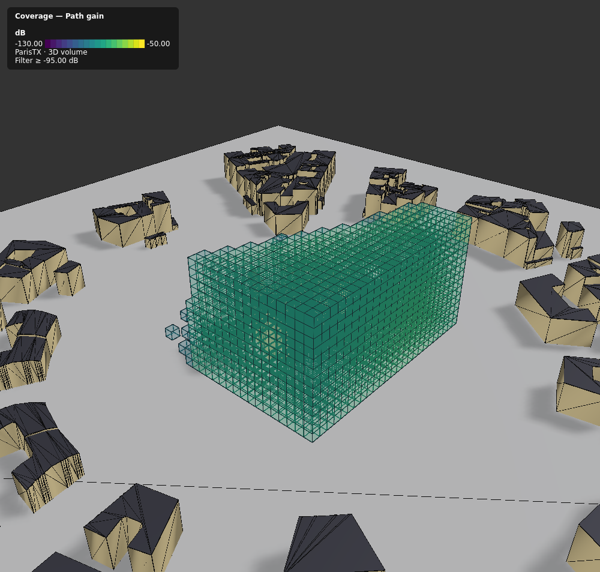
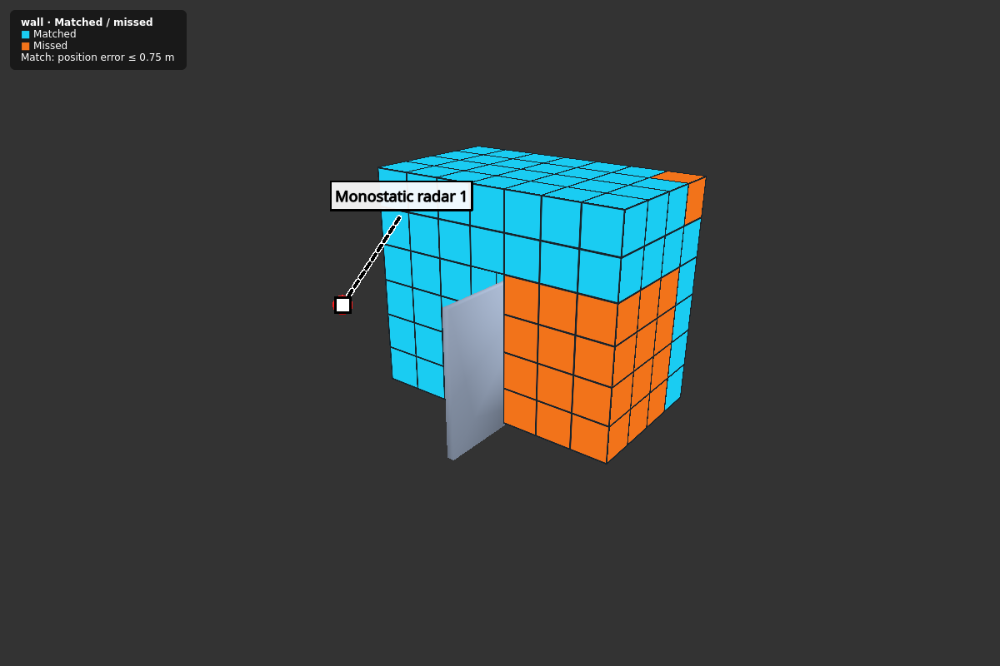

# 3D Volume Inspection

Inspect saved coverage or sensing results with slices, thresholds and spatial
sweeps. These views use pygfx and change how existing results are displayed.
They do not rerun propagation or sensing.

A coverage cell stores a radio-channel estimate at a sampled position. A
sensing cell records the outcome of a target trial at a position and heading.
The controls are similar, but the quantities answer different questions.

## Start with an example

For radio coverage, follow the [Paris volume example](../../scenarios/generator/coverage/paris_volume/README.md).
In its Visualizer session, open **Coverage**, enable **Show coverage map**, and
choose a metric and transmitter under **Data**.

For sensing, follow the [wall-volume example](../../scenarios/sensing/applications/wall_detection_volume/README.md).
It compares the same target trials with and without the wall. Open its saved
result directory with **File → Open** or the command in that example.

## Slices, regions and sweeps

| View | Use it to |
|---|---|
| **Slice** | Inspect one XY, XZ or YZ plane and move through sampled positions. |
| **3D volume** | See the extent of a region and use a threshold to isolate selected values. |
| **Maximum strength along view** | See the strongest coverage along each viewing ray. |

Paris path gain at or above −95 dB across 13 sampled heights. Cell edges show
the 5 m sampling grid, and colors show path gain on the displayed scale. Map data: ©
[OpenStreetMap contributors](https://www.openstreetmap.org/copyright).

**Apply threshold** keeps gain, power and SINR values at or above the threshold,
and path-loss values at or below it. A projection can hide weaker cells behind
stronger ones. Use a slice to inspect an individual location.

**Sweep slice** moves through saved planes. **Sweep 3D** progressively reveals
the volume along X, Y or Z. These spatial sweeps are independent of scenario
playback. **Restrict to XYZ region** focuses on a smaller area.

Use **Display details** for color limits, opacity, smoothing and cell edges.
Keep the same color limits when comparing views. Smoothing changes appearance,
not sampling resolution.

## Inspect and compare cells

Expand **Inspect cells** to read a location's coordinates and saved value.
Linked slices locate it in three dimensions. Where available, the transmitter
table compares links at that location. **Analysis** summarizes the region and
compares heights.

Coverage can contain cells without a usable estimate or with zero recorded
solver contribution. Both differ from finite weak estimates. Inspect their
state or enable **Grey no-data** in slices and projections. A zero solver
contribution does not establish zero physical signal. For metric definitions
and power assumptions, see [coverage inspection](analysis.md#coverage-inspection).

## Sensing volumes

The sensing panel separates display controls under **View** from full-volume
outcome counts, position errors and condition comparisons under **Analysis**.
Choose a quantity with **Colour by** and a cell filter with **Show**.

The cutaway reveals the sampled region behind the wall. Cyan marks matched
trials and orange marks misses under the example's matching rules. Each cell
is an independent target trial. Its outcome is not a continuous probability
field.

Click a visible cell to open **Selected cell**. Its source details identify the
position, heading, sensor and sampling bounds. These bounds describe the grid,
not detector gates or position uncertainty. The report table shows the saved
estimates for that trial.

Use **Open trial in visualizer** to inspect the trial's scene and sensing plots,
then **Return to volume** to restore the selected cell. This requires retained
trial frames. A compact volume can still show outcomes and rescore saved
reports without containing those recordings. The
[synthetic cell-inspection example](../../scenarios/visualizer/volume_cell_inspection/README.md)
provides a small dataset for learning these controls.

A **Cutaway** reveals the interior with a plane or an XYZ box. **Hide volume**
removes the fill and grid while you inspect reports. Cell edges expose the
sampling grid, and opacity changes only the display.

The **Show** filter changes visible cells but leaves the full-volume charts
unchanged. Use **Analysis → Rescore saved reports** to change the matching rules.
Rescoring updates outcome colors and charts without rerunning the detector.
See [evaluation](../sensing/evaluation.md) for the matching
criteria. A single trial per cell does not estimate detection probability, and
strong radio coverage alone does not establish target detectability.

## Save a view

**Saved views** retains coverage display settings for the same recording.
For sensing volumes, **Save view bookmark…** writes a JSON reference containing
the camera, display settings and selected cell/report. **Open view bookmark…**
restores it from the existing dataset. A bookmark does not copy recordings.
Use **Save image…** when you need a picture.

## Generate new coverage

**Coverage → Generate new coverage…** explicitly runs propagation at the
scenario's initial poses. Choose the grid, heights and output directory, then
use **Open result** after completion. See
[coverage configuration](../generator/configuration.md#coverage-configuration)
for scripted generation.

---

Up: [Visualizer](README.md) | Related: [Visual Analysis](analysis.md) | [Sensing Dashboard](sensing_dashboard.md)
