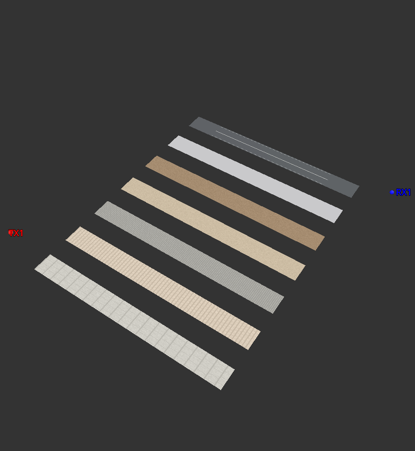
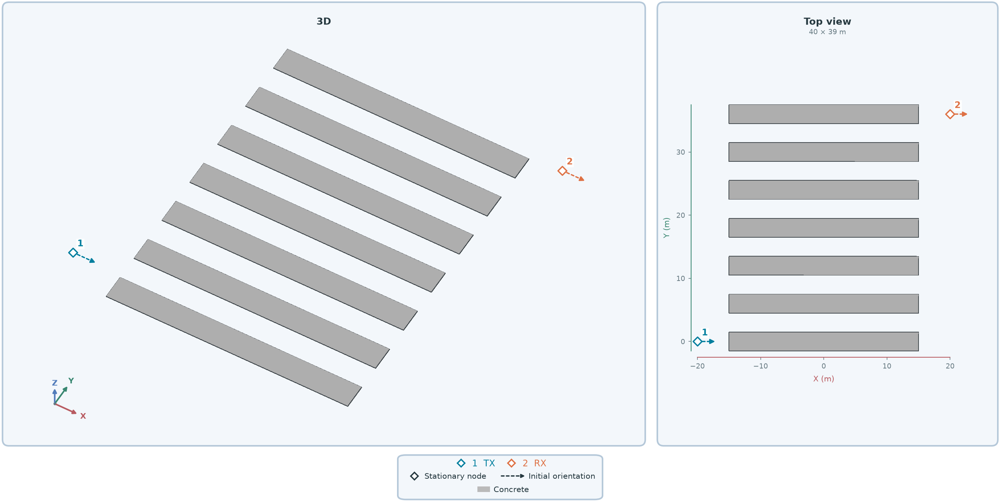

# Tagged road and path surfaces

Compare seven synthetic road and path strips to see how surface tags control
visual appearance. A strip with no surface tag keeps its base color. All seven
share the same concrete radio material.

To run it, see [Running](#running).



From nearest to farthest: concrete, paving stones, cobblestone, gravel, earth,
unknown, and the marked vehicle road. The unknown strip keeps its base color.
[Capture provenance](../../../../docs/assets/building_appearance/provenance.json).

## Scene Layout



Each strip is 30 m long and 3 m wide, at z = 0.15 m. Their centerlines are at
increasing y coordinates:

| y | Explicit example tag | Expected visual result |
|---|---|---|
| 0 m | `footway`, `concrete` | Gray paving joints, no lane markings |
| 6 m | `footway`, `paving_stones` | Warmer paving blocks |
| 12 m | `footway`, `cobblestone` | Smaller stone pattern |
| 18 m | `footway`, `gravel` | Granular beige surface |
| 24 m | `footway`, `earth` | Brown earth surface |
| 30 m | `footway`, surface missing | Original base color, no invented surface |
| 36 m | `residential`, `asphalt`, two lanes | Dark paving and lane markings |

TX is at (−20 m, 0 m, 3 m); RX is at (20 m, 36 m, 3 m).

See [scenario.yaml](scenario.yaml) for the scene and generation settings.

## Running

Generate the frames:

```bash
orchav-generator scenarios/generator/building_appearance/surfaces
```

Open the scenario in the Visualizer:

```bash
orchav-visualizer --enable-textures --scenario scenarios/generator/building_appearance/surfaces
```

Select **Rendering → Surfaces → Roads → Textures + markings**.
Compare with **Original surfaces**. The missing surface stays unclassified; no architecture
theme or urban/rural guess assigns it a material. The patterns are illustrative,
not surveyed joint spacing. Appearance does not change the shared RF material
or rerun propagation.

Generation writes one low-budget context frame to `frames/`; it is not bundled.
This example demonstrates visual mapping, not propagation accuracy.

## Browse scenarios

[Building Appearance exercise](../../../visualizer/building_appearance/README.md) ·
[Appearance reference](../../../../docs/visualizer/appearance.md#road-surfaces)
