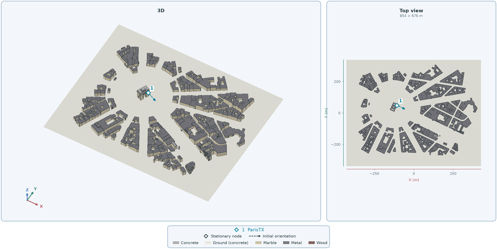
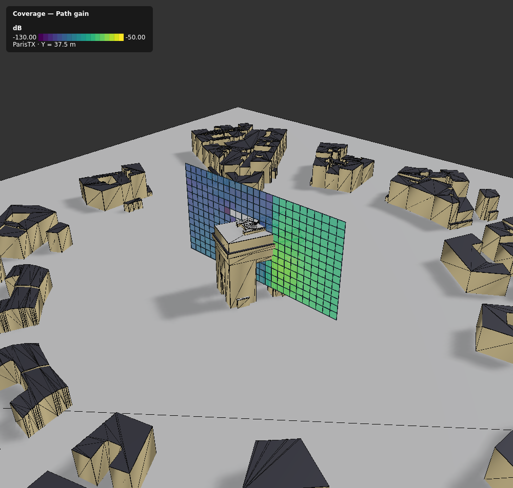
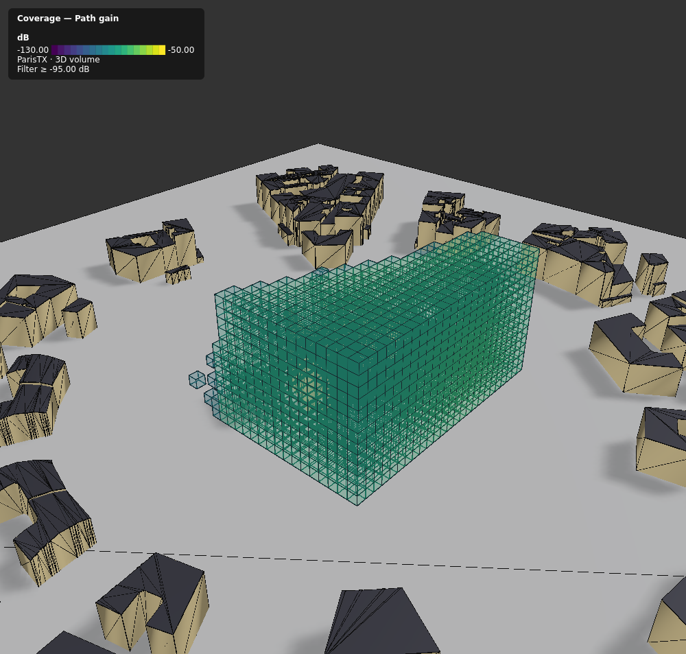

# Paris Multi-Height Radio Coverage

Explore radio coverage across 13 heights around the Arc de Triomphe. This
example focuses on interpreting coverage in three dimensions: compare horizontal
and vertical slices, then use a volumetric view to see how stronger links extend
around and above the buildings.

To run it, see [Running](#running).

## Scene Layout



Map data: © [OpenStreetMap contributors](https://www.openstreetmap.org/copyright).

The example uses [Sionna RT](https://nvlabs.github.io/sionna/)'s Etoile scene with one isotropic transmitter at
4.9 GHz and 44 dBm. The grid contains 25 × 25 horizontal cells at 5 m spacing,
sampled from 10 m to 70 m in 5 m steps: 8,125 receiver cells in total.
The transmitter is at 25.5 m, between sampled planes. Direct paths and specular
reflections are enabled, with up to three interactions.

See [scenario.yaml](scenario.yaml) for the scene and generation settings.

## Running

From the repository root, generate the example:

```bash
orchav-generator scenarios/generator/coverage/paris_volume
```

Open the saved results:

```bash
orchav-visualizer --scenario scenarios/generator/coverage/paris_volume
```

Generation writes frames and `coverage/coverage_maps.h5`. If those already
exist, use only the Visualizer command. Open **Coverage**, enable **Show coverage
map**, and select **Path gain (dB)** in **Data**.

## What To Look For



*XZ slice at Y = 37.5 m with cell edges marking the 5 m grid. Yellow shows stronger path gain and purple weaker gain.*

Use **View → Slice** to compare XY, XZ and YZ planes. Moving a vertical slice
reveals how the saved coverage changes with height and around the monument.



*3D region with path gain at or above −95 dB, using the same colour scale and showing the retained cells' edges.*

Choose **3D volume** and enable **Apply threshold**. Compare −110, −95 and
−80 dB: raising the threshold retains stronger links and reduces the visible
region. **Sweep 3D** reveals successive sections; return to a slice to inspect
locations hidden inside the volume.

Transparent cells can contain zero solver contributions or unavailable estimates;
inspect a cell to distinguish them from weak coverage. Changing views and
thresholds uses saved data and does not rerun propagation.

Both views use map data © [OpenStreetMap contributors](https://www.openstreetmap.org/copyright).
See [3D Volume Inspection](../../../../docs/visualizer/volume_inspection.md)
for the controls and [capture provenance](../../../../docs/assets/volume_inspection/provenance.json)
for the illustrated results.

## Browse Scenarios

Up: [Generator](../../README.md) ·
[Multi-Transmitter Coverage](../multi_tx/README.md)
