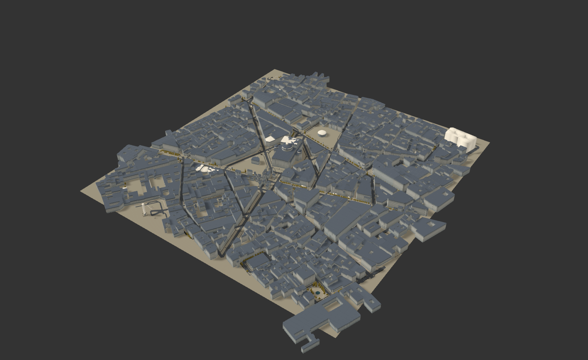
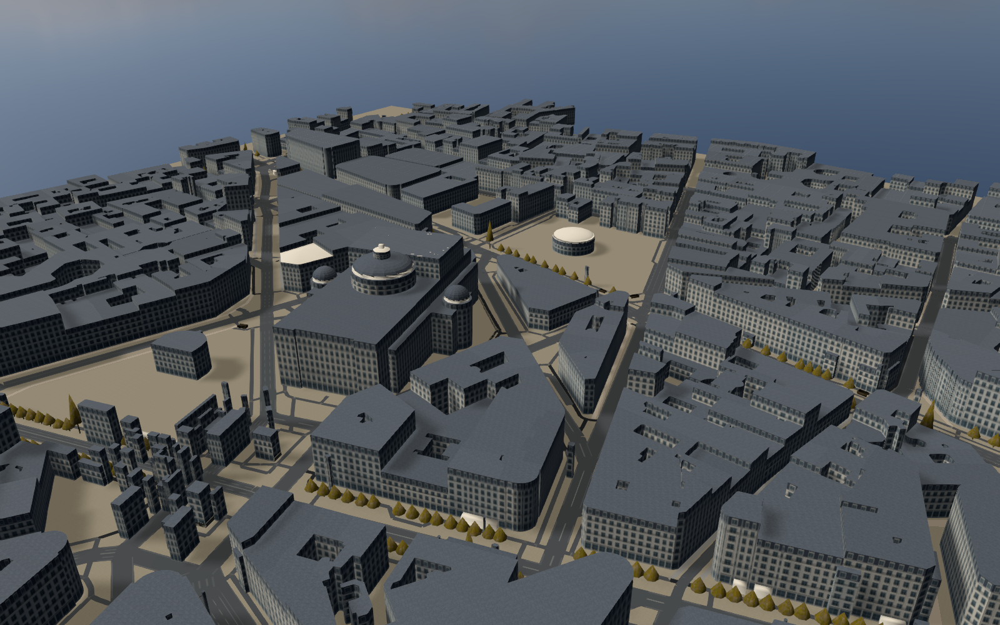

# Paris Opéra: Build Geography Locally

Build a scene around the Palais Garnier from OpenStreetMap. The YAML recipe
acquires map features, constructs buildings and streets, and runs a small
preview with one transmitter and one receiver.

To run it, see [Running](#running).

## Scene Layout





*Locally generated Opéra snapshot with procedural Haussmann-style facades,
slate roofs and road markings. Facade details are illustrative; map features can
change between runs. Map data: ©
[OpenStreetMap contributors](https://www.openstreetmap.org/copyright).*

The recipe covers 48.8675°–48.876° N and 2.3265°–2.3385° E. It uses flat ground
and mapped building heights where available, with construction defaults for
missing tags. External terrain and height enrichment are disabled.
The preview radios are at `(0, 0, 25)` m and `(60, 20, 1.5)` m in the local
coordinate frame.

## Configuration Walkthrough

In [Hello World](../../getting_started/hello_world/README.md),
`scene.source: sionna` selects a bundled example scene. Here,
`scene.source: osm` builds a scene from map features. This excerpt from
[`scenario.yaml`](scenario.yaml) focuses on that change:

```yaml
scene:
  source: osm
  id: scene.xml
  osm:
    bbox: [48.8675, 2.3265, 48.876, 2.3385]
    terrain: false
    height_enrichment: false
    barriers: true
    vegetation: true
    bridges: true
    refresh_cache: false
```

`bbox` gives the south, west, north, and east bounds in degrees. `id` labels the
scene; the generated XML is saved as `scene.xml` in this scenario directory.
`terrain: false` keeps the ground flat, and
`height_enrichment: false` uses mapped building heights or construction
defaults instead of another height dataset. The enabled feature options add
mapped barriers, vegetation, and bridges.

With `refresh_cache: false`, matching cached map data can be reused. See the
[OSM configuration guide](../../../docs/generator/geography/osm_scene_generation.md)
for the remaining options. The rest of the YAML defines the two preview radios,
one simulation step, and HDF5 output, using the same sections as Hello World.

## Running

Use the ORCHAV environment from the [installation guide](../../../docs/getting_started/installation.md)
and install the optional OSM dependencies:

```bash
python -m pip install -e ".[osm]"
```

Triangle is installed separately with these dependencies. See its
[license notice](../../../THIRD_PARTY_NOTICES.md#triangle-wrapper-and-embedded-library)
if you plan to redistribute an installed environment.

Generate the scene and preview:

```bash
orchav-generator scenarios/generator/paris_opera_osm
```

Open the result:

```bash
orchav-visualizer --enable-textures --no-resume \
  --scenario scenarios/generator/paris_opera_osm
```

To match the illustrated style, choose **Rendering → Appearance → Detailed**,
then under **Surfaces** set **Buildings → Facades by building**, **Facade theme → Haussmann
detail**, and **Roads → Textures + markings**. These display settings preserve
the scene geometry and radio materials. See
[building appearance](../../../docs/visualizer/appearance.md#procedural-facades)
for the procedural texture options.

The second image uses **Sunny** under **Rendering → Lighting and environment**,
with matching lighting and **Show Skybox** enabled.

The first run needs network access to OpenStreetMap's Overpass service.
Later matching runs reuse cached data. Generated geometry and frames are kept
locally; they are not bundled with this recipe.

## What To Look For

Inspect the street layout, building heights and radio clearance before adapting
the example. The one-frame preview provides a starting point for placing actors
or creating routes on the generated street graph.

Generation writes `scene.xml`, `mesh/`, `street_network.graphml` and
`osm_metadata.json`, followed by `frames/` and `summary/`. The metadata records
the coordinate transform, data sources and acquisition completeness. See the
[OSM guide](../../../docs/generator/geography/osm_scene_generation.md) to change the area
and [acquisition and recovery](../../../docs/generator/geography/osm_scene_generation.md#reuse-and-recovery) for
cache settings or failed downloads.

## Attribution

Geographic data is © [OpenStreetMap contributors](https://www.openstreetmap.org/copyright),
under ODbL 1.0. Preserve the applicable attribution and data terms when sharing
results. See [producer notices](../../../generator/osm/NOTICE.md) for upstream
code credits and [image provenance](../../../docs/assets/paris_opera_osm/provenance.json)
for the illustrated snapshot.

## Browse Scenarios

[Generator scenarios](../README.md) · [OSM guide](../../../docs/generator/geography/osm_scene_generation.md) ·
[External scene inputs](../../../docs/generator/geography/osm_scene_generation.md#local-scene-inputs)
