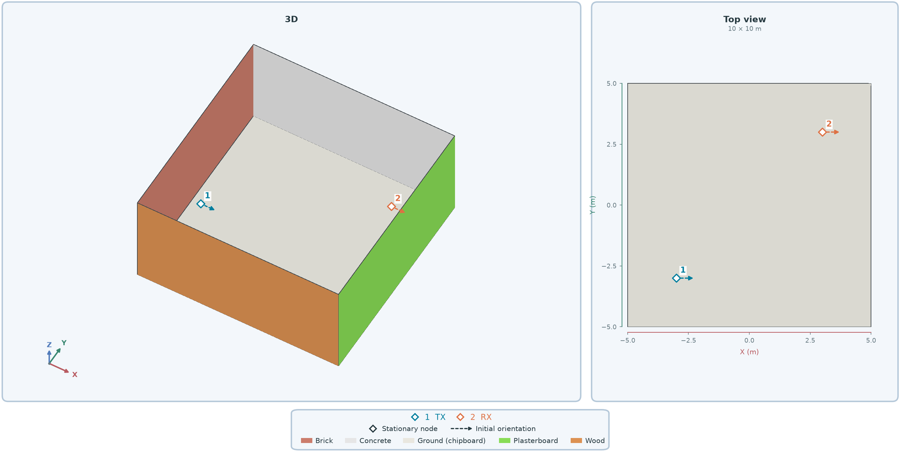

# Explicit Concrete Diffuse Scattering

This variant enables diffuse solving and sets the concrete scattering
coefficient directly, without applying the ITU-family preset. The other room
materials keep the values loaded from the scene.

To run it, see [Running](#running).

## Scene Layout



The concrete, wood, brick, plasterboard, and chipboard room is shared by
all four variants. `TX` is stationary at `(-3.0 m, -3.0 m, 4.0 m)`, and `RX`
is stationary at `(3.0 m, 3.0 m, 1.0 m)`.

## Configuration Walkthrough

See [scenario.yaml](scenario.yaml) for the complete configuration.

```yaml
raytracing:
  quality:
    custom:
      max_depth: 1
      diffuse_reflection: true
  materials:
    itu_concrete:
      scattering_coefficient: 0.1
```

The solver switch and the nonzero material value are both required. Explicit
overrides work without a preset, so only the concrete surface receives a
nonzero scattering coefficient in this variant.

## Running

Generate the frames:

```bash
orchav-generator scenarios/generator/propagation_and_materials/scene_diffuse_scattering/explicit_concrete
```

Inspect the effective material coefficients:

```bash
orchav-inspect scenarios/generator/propagation_and_materials/scene_diffuse_scattering/explicit_concrete --frame 0 --materials
```

Open the scenario in the Visualizer:

```bash
orchav-visualizer --scenario scenarios/generator/propagation_and_materials/scene_diffuse_scattering/explicit_concrete
```

Generation writes this variant's frame set under `explicit_concrete/frames/`.
Inspection should show `itu_concrete` at `0.1` and report
`code 2 (diffuse)`. Exact path counts can vary with Sionna RT and the tracing
environment.

## Browse Scenarios

Up: [Scene Diffuse Scattering](../README.md) ·
[Solver Switch Only](../README.md#1-enable-diffuse-solving-only) ·
[ITU Preset](../itu_preset/README.md) ·
[Preset With Concrete Override](../itu_preset_concrete_override/README.md)
