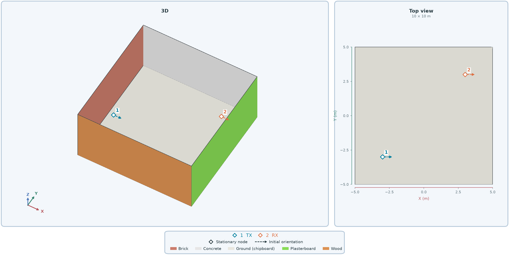

# ITU Preset Diffuse Scattering

This variant enables diffuse solving and applies ORCHAV's known scattering
coefficients to recognized scene-material families. It uses the same open room,
fixed transmitter, and fixed receiver as the
[starting configuration](../README.md#1-enable-diffuse-solving-only).

To run it, see [Running](#running).

## Scene Layout



The transmitter is stationary at `(-3.0 m, -3.0 m, 4.0 m)`, and the receiver
is stationary at `(3.0 m, 3.0 m, 1.0 m)`. The room contains concrete, wood,
brick, plasterboard, and chipboard surfaces.

## Configuration Walkthrough

See [scenario.yaml](scenario.yaml) for the complete configuration.

```yaml
raytracing:
  scene_materials:
    scattering_coefficient_preset: itu
  quality:
    custom:
      max_depth: 1
      diffuse_reflection: true
```

The solver switch allows diffuse interactions. The preset gives concrete,
wood, plasterboard, and chipboard nonzero scattering coefficients. It assigns
no coefficient to brick, which retains its loaded value of `0` and produces
no diffuse paths.

Material values are resolved from the loaded scene, then the optional preset,
then any explicit override. This variant has no explicit override.

## Running

Generate the frames:

```bash
orchav-generator scenarios/generator/propagation_and_materials/scene_diffuse_scattering/itu_preset
```

Inspect the effective material coefficients:

```bash
orchav-inspect scenarios/generator/propagation_and_materials/scene_diffuse_scattering/itu_preset --frame 0 --materials
```

Open the scenario in the Visualizer:

```bash
orchav-visualizer --scenario scenarios/generator/propagation_and_materials/scene_diffuse_scattering/itu_preset
```

Generation writes this variant's frame set under `itu_preset/frames/`. Inspect
the effective coefficients and confirm that the interaction summary contains
`code 2 (diffuse)`. Exact path counts can vary with Sionna RT and the tracing
environment.

## Browse Scenarios

Up: [Scene Diffuse Scattering](../README.md) ·
[Solver Switch Only](../README.md#1-enable-diffuse-solving-only) ·
[Preset With Concrete Override](../itu_preset_concrete_override/README.md) ·
[Explicit Concrete](../explicit_concrete/README.md)
