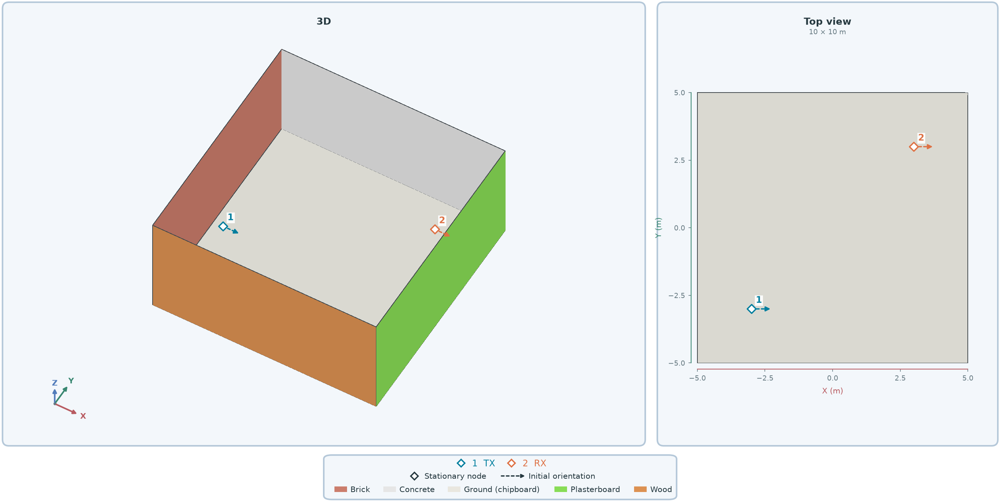

# ITU Preset With Concrete Override

This variant applies the ITU-family scattering preset and then sets concrete
back to zero. It isolates explicit-override precedence while keeping diffuse
paths available from other room surfaces.

To run it, see [Running](#running).

## Scene Layout



The open room contains concrete, wood, brick, plasterboard, and chipboard. `TX`
is stationary at `(-3.0 m, -3.0 m, 4.0 m)`, and `RX` is stationary at
`(3.0 m, 3.0 m, 1.0 m)`.

## Configuration Walkthrough

See [scenario.yaml](scenario.yaml) for the complete configuration.

```yaml
raytracing:
  scene_materials:
    scattering_coefficient_preset: itu
  quality:
    custom:
      max_depth: 1
      diffuse_reflection: true
  materials:
    itu_concrete:
      scattering_coefficient: 0.0
```

ORCHAV starts with the values loaded by the scene, applies the preset, and
applies explicit per-material overrides last. Concrete therefore resolves to
`0`, while recognized wood, plasterboard, and chipboard surfaces retain their
preset values.

## Running

Generate the frames:

```bash
orchav-generator scenarios/generator/propagation_and_materials/scene_diffuse_scattering/itu_preset_concrete_override
```

Inspect the effective material coefficients:

```bash
orchav-inspect scenarios/generator/propagation_and_materials/scene_diffuse_scattering/itu_preset_concrete_override --frame 0 --materials
```

Open the scenario in the Visualizer:

```bash
orchav-visualizer --scenario scenarios/generator/propagation_and_materials/scene_diffuse_scattering/itu_preset_concrete_override
```

Generation writes this variant's frame set under
`itu_preset_concrete_override/frames/`. Inspection should show concrete at `0`
and still report `code 2 (diffuse)` from other materials. Exact path counts can
vary with Sionna RT and the tracing environment.

## Browse Scenarios

Up: [Scene Diffuse Scattering](../README.md) ·
[Solver Switch Only](../README.md#1-enable-diffuse-solving-only) ·
[ITU Preset](../itu_preset/README.md) ·
[Explicit Concrete](../explicit_concrete/README.md)
