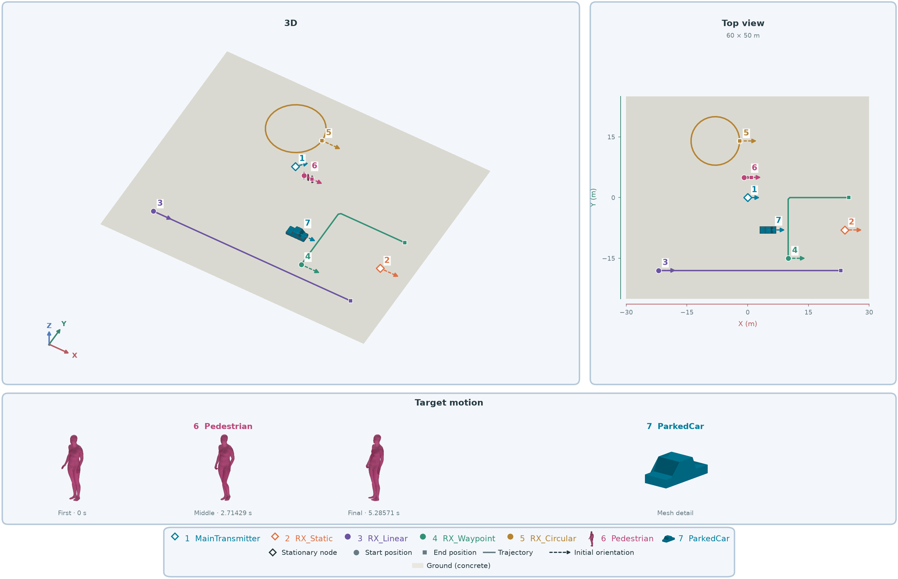

# Mesh Targets

This scenario adds physical [targets](../../../../docs/reference/glossary.md#target)
to the mobility models used in the basic Generator examples. It includes a
walking pedestrian and a parked car so you can inspect when their surfaces
contribute paths between transmitters and receivers.

To run it, see [Running](#running).

## Scene Layout



| Element | Role |
| --- | --- |
| `MainTransmitter` | Fixed transmitter |
| `RX_Static`, `RX_Linear`, `RX_Waypoint`, `RX_Circular` | Receiver mobility examples |
| `Pedestrian` | Moving walking target |
| `ParkedCar` | Static vehicle target |

The pedestrian walks 1.876 m in 5.286 s using all 38 supplied NIST poses at
7 fps. Its center is 0.98 m above the flat ground, leaving a small foot clearance.

## Configuration Walkthrough

See [scenario.yaml](scenario.yaml) for the complete configuration.

```yaml
actors:
  targets:
    - name: Pedestrian
      asset:
        source: directory
        path: libraries/targets/digital_twin_update1
        pattern: "DT_Pjh_02_*.ply"
        mesh_end_behavior: hold_last
      mobility:
        type: linear
        start_m: [-0.938, 5, 0.98]
        end_m: [0.938, 5, 0.98]
      orientation:
        type: align_motion
        allow_pitch: false

    - name: ParkedCar
      asset:
        source: directory
        path: libraries/targets/procedural_car
        pattern: car.ply
        switch_meshes: false
      mobility:
        type: stationary
        position_m: [5, -8, 0.79]
```

The vehicle uses the ORCHAV
[procedural car-shaped prism](../../../../libraries/targets/procedural_car/README.md).
It is not a calibrated vehicle RCS.

The pedestrian uses the bundled
[NIST walking sequence](../../../../libraries/targets/digital_twin_update1/README.md),
selected by `asset.pattern`, while the car uses one static mesh.
`orientation.type: align_motion` combines the route heading with the mesh's
front-direction metadata. `mesh_end_behavior: hold_last` avoids wrapping the
finite clip. The pedestrian uses the default `glass` radio material as an
uncalibrated scattering placeholder. The full YAML assigns `metal` to the car.

## Running

Generate the frames:

```bash
orchav-generator scenarios/generator/targets/mesh_targets
```

Open the scenario in the Visualizer:

```bash
orchav-visualizer --scenario scenarios/generator/targets/mesh_targets
```

## What To Notice

- Target actors are listed separately from transmitter and receiver actors.
- Moving targets use the same mobility and orientation concepts as other actors.
- The default ultra-low ray budget keeps the example fast, so target interactions are intentionally sparse.
- A visible target may contribute no recorded paths. Its presence alone does
  not guarantee a reflection reaches a receiver.
- Path records can identify which object was involved in an interaction.

## Outputs

Running the scenario writes default HDF5 frame chunks under `frames/` and
summary figures under `summary/`. Generated frames include target metadata and
object-interaction fields. Use those records to separate direct paths,
environmental interactions, and target-related interactions:

```bash
orchav-inspect scenarios/generator/targets/mesh_targets --frame 0
```

Inspect the midpoint pose:

```bash
orchav-inspect scenarios/generator/targets/mesh_targets --frame 18
```

Inspect the final pose:

```bash
orchav-inspect scenarios/generator/targets/mesh_targets --frame 37
```

Each frame contains one transmitter, four receivers and two targets. Target
metadata confirms the objects are present; an object contributes a propagation
path only when the solver finds a valid interaction. Direct paths have no
physical bounce rows, and ground reflections are not target hits.

A specular target path must satisfy the reflection law and visibility checks
for the transmitter, target surface and receiver. A target can therefore
contribute no reflected path to a receiver, even when it is present and visible
in the scene. Increasing the ray budget improves path discovery but cannot
create a geometrically impossible reflection. See
[ray tracing](../../../../docs/reference/propagation.md) for the relationship
between ray budget and path discovery.

The [Target Diffuse Scattering](../target_diffuse_scattering/README.md) example
shows how to allow scattering beyond the mirror-reflection direction. Diffuse
paths still require an illuminated surface and a visible route to the receiver.

## Browse Scenarios

Up: [Generator](../../README.md) ·
[Target Orientation](../target_orientation/README.md)
