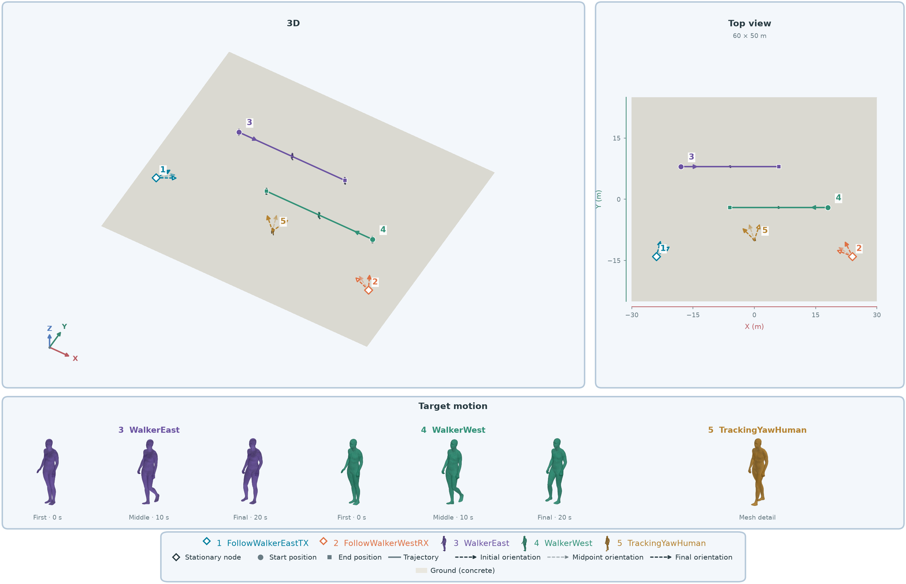

# Target Orientation

This scenario is a compact visual check for
[target](../../../../docs/reference/glossary.md#target) and node orientation. It
uses three human targets. Two walkers face their direction of travel, and one
stationary human tracks a moving walker with yaw-only `look_at` orientation.
The transmitter and receiver also point at different moving walkers so actor
`look_at` orientation can be checked in the same Visualizer run.

To run it, see [Running](#running).

## Scene Layout



| Element | Role |
| --- | --- |
| `FollowWalkerEastTX` | Fixed transmitter with `look_at` orientation toward `WalkerEast` |
| `FollowWalkerWestRX` | Fixed receiver with `look_at` orientation toward `WalkerWest` |
| `WalkerEast` | Human target moving east with `align_motion` orientation |
| `WalkerWest` | Human target moving west with `align_motion` orientation |
| `TrackingYawHuman` | Human target with yaw-only `look_at` orientation toward `WalkerEast` |

The 141-frame timeline spans 20 s at 7 fps. Each walker travels 24 m at
1.2 m/s: `WalkerEast` moves from x = −18 m to x = 6 m, and `WalkerWest`
moves from x = 18 m to x = −6 m. `TrackingYawHuman` stays in place and turns
through approximately 63° while following `WalkerEast`. All three target
centers are 0.98 m above the flat ground.

## Configuration Walkthrough

This excerpt from [scenario.yaml](scenario.yaml) shows one moving walker and
the stationary observer. `WalkerWest` uses the same orientation model as
`WalkerEast`, with a route in the opposite direction.

```yaml
timeline:
  steps: 141
  duration_s: 20.0

actors:
  tx:
    - name: FollowWalkerEastTX
      mobility:
        type: stationary
        position_m: [-24, -14, 7]
      orientation:
        type: look_at
        actor: WalkerEast

  rx:
    - name: FollowWalkerWestRX
      mobility:
        type: stationary
        position_m: [24, -14, 2]
      orientation:
        type: look_at
        actor: WalkerWest

  targets:
    - name: WalkerEast
      asset:
        source: directory
        path: libraries/targets/digital_twin_update1
        pattern: "DT_Pjh_02_*.ply"
        mesh_end_behavior: loop
      mobility:
        type: linear
        start_m: [-18, 8, 0.98]
        end_m: [6, 8, 0.98]
      orientation:
        type: align_motion
        allow_pitch: false

    - name: TrackingYawHuman
      asset:
        source: directory
        path: libraries/targets/digital_twin_update1
        pattern: "DT_Pjh_02_00009.ply"
        switch_meshes: false
      mobility:
        type: stationary
        position_m: [0, -10, 0.98]
      orientation:
        type: look_at
        actor: WalkerEast
        allow_pitch: false
```

The [bundled NIST human mesh](../../../../libraries/targets/digital_twin_update1/README.md)
declares a target-front offset for `align_motion` and `look_at` orientations.
`TrackingYawHuman` disables pitch so the target-tracking case is a pure yaw check.
The moving targets loop through the 38 supplied mesh poses at 7 fps throughout
the 20 s timeline.
`TrackingYawHuman` holds one pose throughout so its yaw rotation can be
inspected independently of articulation.

The NIST digital-twin poses come from measurements of a person walking and
stopping. The captured gait slows near the end of the clip, pauses, and starts
again when the poses loop. Here, the target's position keeps moving at a
constant 1.2 m/s along a long straight route, making its orientation easier to
follow. Repeating the measured poses along that route creates an artificial
stop-and-start gait and can make the feet appear to slide. This is a visual
effect of looping the short recording, not a change in the configured speed.

## Running

Generate the frames:

```bash
orchav-generator scenarios/generator/targets/target_orientation
```

Open the scenario in the Visualizer:

```bash
orchav-visualizer --scenario scenarios/generator/targets/target_orientation
```

## What To Notice

- `WalkerEast` and `WalkerWest` keep moving along their linear paths and face
  their direction of travel. Their measured walking poses repeat as described
  above.
- `TrackingYawHuman` should rotate in yaw while staying fixed and tracking
  `WalkerEast`.
- `FollowWalkerEastTX` should point at `WalkerEast`, turning approximately 38° in yaw.
- `FollowWalkerWestRX` should point at `WalkerWest`, turning approximately 42° in yaw.
- Enable the target orientation axes to see each target's local frame. The axes
  should not change target or node motion. On Windows and Linux, you can compare
  the same orientation in pygfx and Open3D. On macOS, use pygfx.

## Outputs

Running the scenario writes default HDF5 frame chunks under `frames/` and
summary figures under `summary/`. The orientation summary is useful for spotting
unexpected yaw wrapping before opening the Visualizer.

## Browse Scenarios

Up: [Generator](../../README.md) ·
[Mesh Targets](../mesh_targets/README.md) ·
[Target Diffuse Scattering](../target_diffuse_scattering/README.md)
