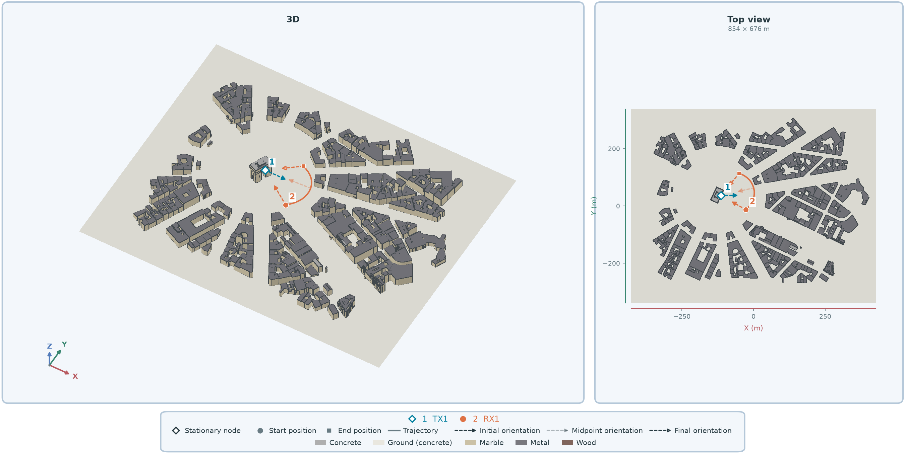

# Hello World Scripted

[Scenarios](../../README.md) > [Getting Started](../README.md) > Hello World Scripted

After [Hello World](../hello_world/README.md), try the second authoring approach:
[YAML with additional Python scripting](../../../docs/generator/scenario_authoring.md#python-scripted-actors).
This example keeps the same `etoile` scene and one TX/RX pair. Python calculates
a curved RX trajectory and supplies it to the built-in `waypoint` mobility
model. RX1 looks at TX1 while it moves.

To run it, see [Running](#running).

## Scene Layout



| Element | Configuration |
|---|---|
| Scene | `etoile`, the [Sionna RT](https://nvlabs.github.io/sionna/) Arc de Triomphe roundabout scene |
| `TX1` | Stationary at `(-114.0 m, 37.0 m, 30.0 m)` with default fixed orientation |
| `RX1` | Starts at `(-27.18 m, -12.61 m, 1.5 m)`, follows a calculated curved sweep, and looks at TX1 |
| Timeline | 16 frames over `4.0 s` |
| Targets | None |

The RX path remains at street level, sweeps around the TX, and temporarily bows
outward. The script samples that equation once per timeline step.

## Configuration Walkthrough

Open [`scenario.yaml`](scenario.yaml) to compare its settings with Hello World.
The scene and tracing preset are unchanged; the timeline now spans 16 frames
over 4 s. Actor definitions move into Python:

| File | Responsibility |
|---|---|
| [`scenario.yaml`](scenario.yaml) | Scene, timeline, and ray-tracing quality |
| [`actors.py`](actors.py) | Defines the transmitter and receiver, calculates RX waypoints, and sets look-at orientation |
| [`generate.py`](generate.py) | Loads the configuration and actors, then runs the Generator |

This excerpt from `actors.py` defines the moving receiver:

```python
RxActorSpec(
    name="RX1",
    mobility=WaypointMobilitySpec(
        points_m=_arc_sweep_points(scenario.timeline.steps),
        interpolation="linear",
    ),
    orientation=LookAtOrientationSpec(actor="TX1"),
)
```

The `_arc_sweep_points` function calculates one position per timeline step.
The standard [waypoint model](../../../docs/generator/mobility_and_orientation.md#mobility-models)
then interpolates between those positions. Python supplies the calculated
points; generation and frame inspection follow the same workflow as Hello World.

TX1 omits [orientation](../../../docs/generator/mobility_and_orientation.md#orientation-models)
and therefore uses the default fixed zero orientation. RX1 uses the [look-at
orientation model](../../../docs/generator/mobility_and_orientation.md#look-at),
configured in Python as `LookAtOrientationSpec(actor="TX1")`. Its +X forward
axis therefore tracks the transmitter throughout the sweep.

Use this pattern for trajectory equations, external preprocessing, generated
actor lists, parameter sweeps, or other calculations outside the YAML schema.
Prefer YAML for built-in mobility, orientation, target, and coverage settings.
[Scenario Authoring](../../../docs/generator/scenario_authoring.md#python-scripted-actors)
explains the general Python pattern.

## Running

Validate the shared YAML first:

```bash
orchav-validate scenarios/getting_started/hello_world_scripted
```

This checks the shared scene, timeline, and ray-tracing configuration. The
calculated actor specifications and trajectory logic are checked when
`generate.py` runs.

Generate the scripted frames:

```bash
python scenarios/getting_started/hello_world_scripted/generate.py
```

Inspect the initial pose:

```bash
orchav-inspect scenarios/getting_started/hello_world_scripted --frame 0
```

Inspect the midpoint pose:

```bash
orchav-inspect scenarios/getting_started/hello_world_scripted --frame 8
```

Inspect the final pose:

```bash
orchav-inspect scenarios/getting_started/hello_world_scripted --frame 15
```

Open the sequence in the Visualizer:

```bash
orchav-visualizer --scenario scenarios/getting_started/hello_world_scripted
```

Enable **Edit → Actor Editing → Enable Local What-if Preview** to
recompute the displayed frame after a temporary actor edit. Preview uses the
same `actors.py` factory as generation, including the curved trajectory and
look-at orientation. It leaves the saved frames unchanged. See
[Interactive Recomputation](../../../docs/visualizer/interactive_recomputation.md).

## What To Notice

- `scenario.yaml` still owns the shared scene, timeline, and tracing budget.
- `actors.py` supplies the calculated actors to both `generate.py` and local preview.
- RX1 changes position and orientation over time while TX1 remains fixed.
- The same prepared actor specifications flow through the normal Generator and
  shared frame contract.

## Generated Files

Generation writes one HDF5 chunk covering frames 0 through 15 under `frames/`,
plus `frames_manifest.json`. The Visualizer, `orchav-inspect`, and Python tools
consume that same frame set.

See the [Frame Reference](../../../docs/shared/frame_reference.md) for the frame
contract and HDF5 layout, and
[Scenario Validation](../../../docs/reference/scenario_validation.md) for the
difference between YAML validation and runtime checks.

## Browse Scenarios

Up: [Getting Started](../README.md) | Current: **Hello World Scripted**

Continue authoring: [Generator Scenarios](../../generator/README.md) |
Related first example: [Hello World](../hello_world/README.md)
