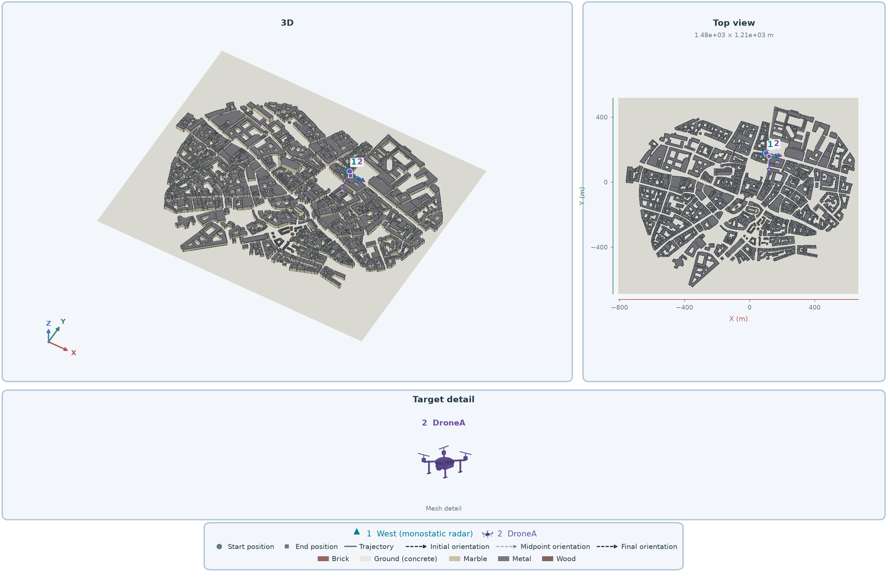
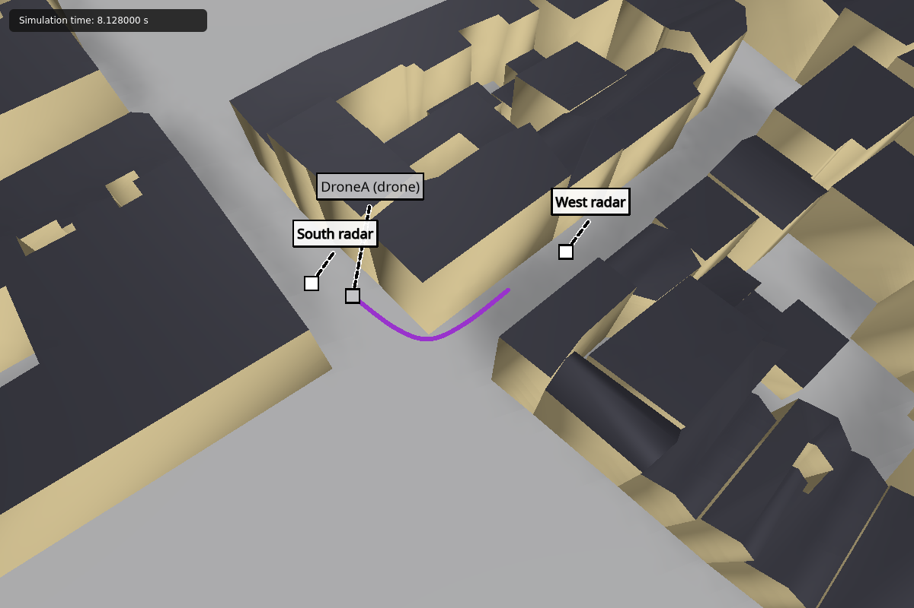
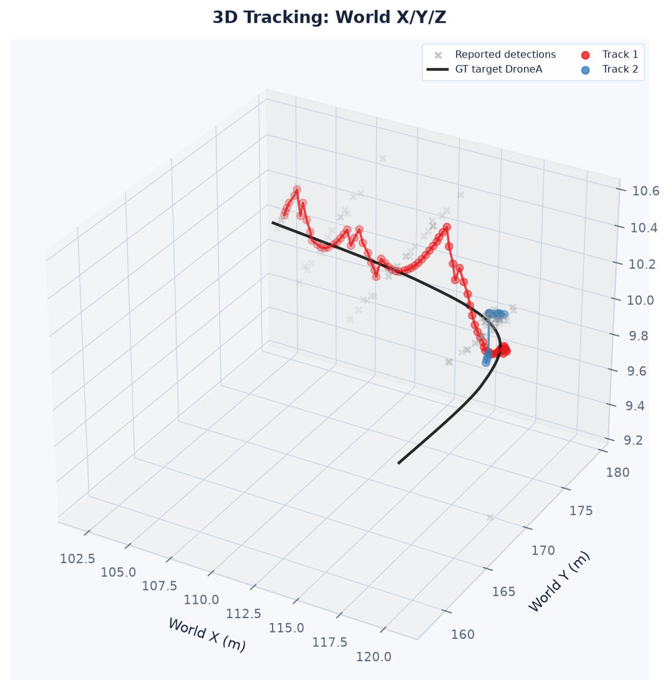
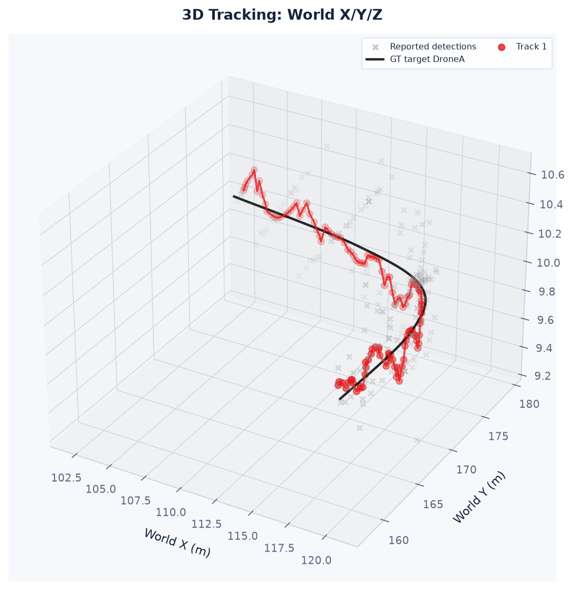
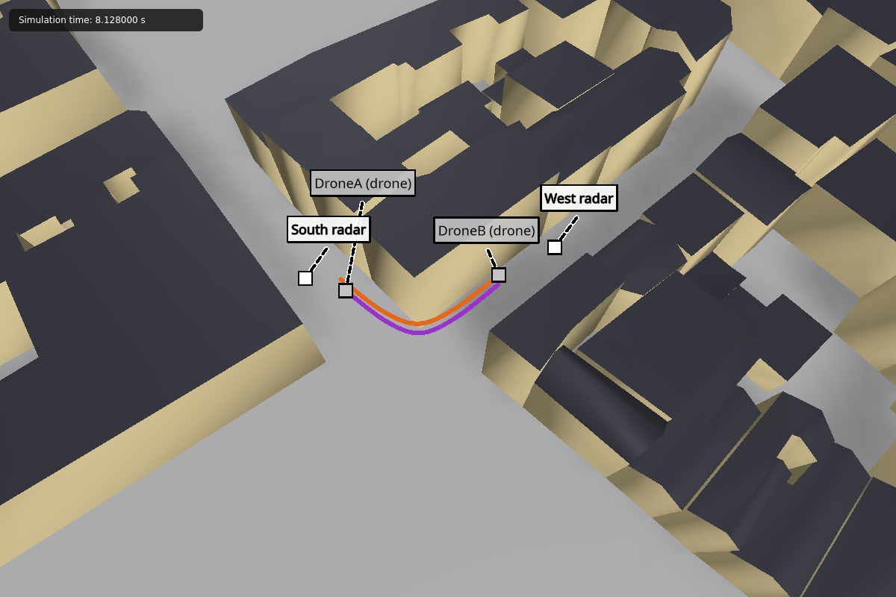
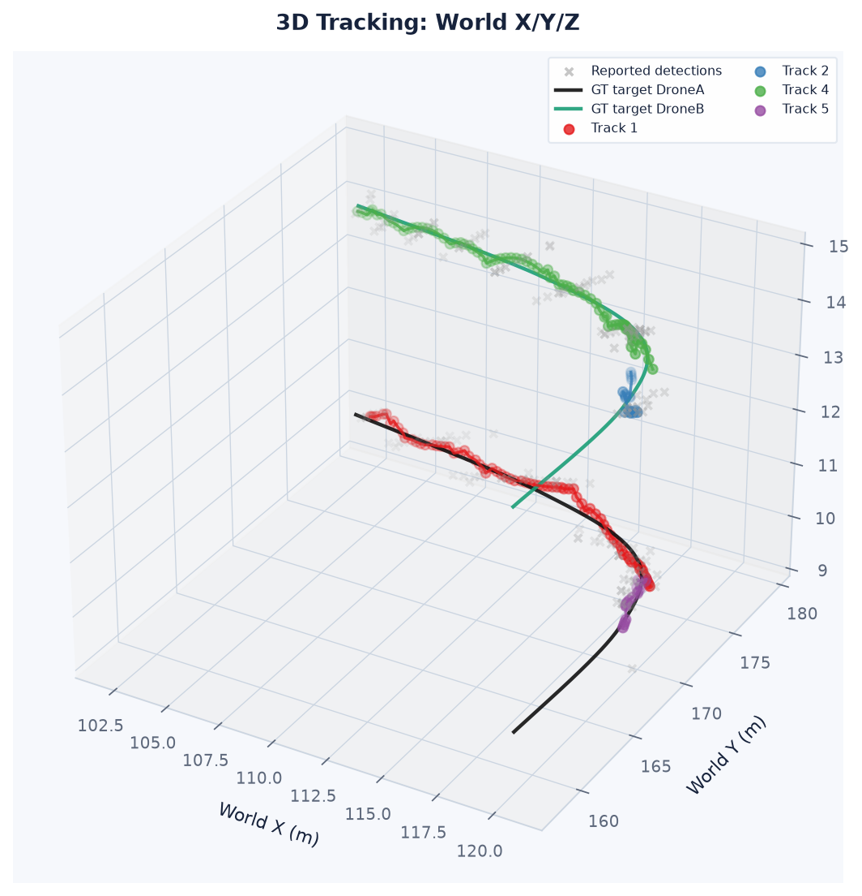
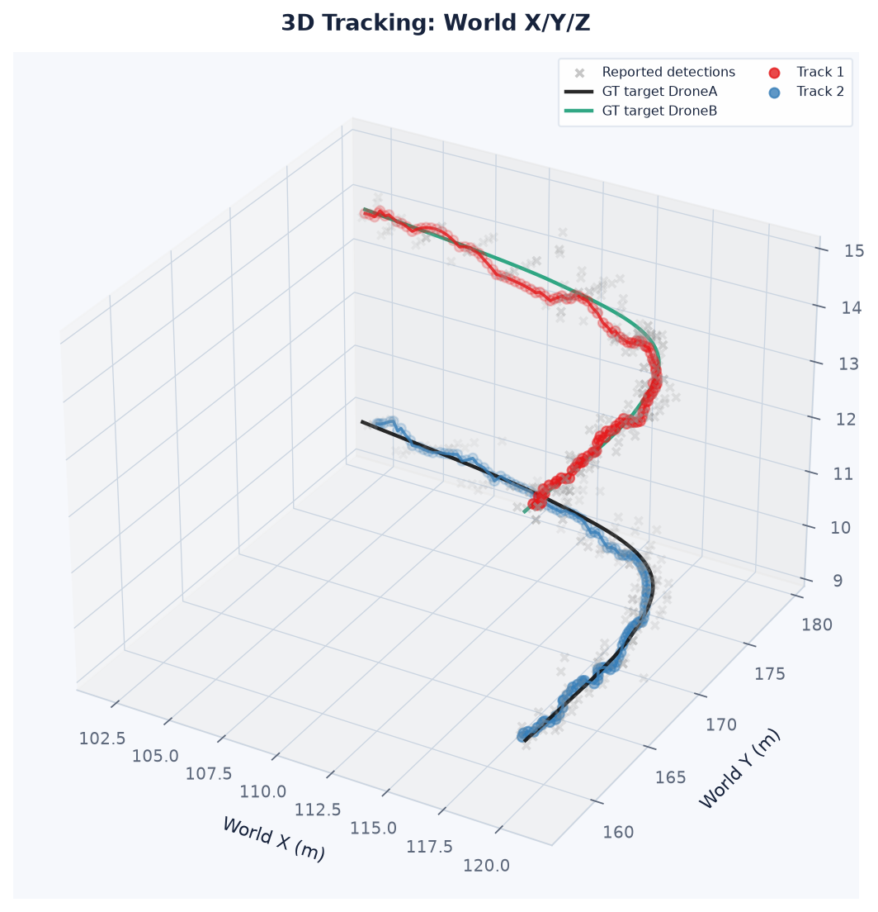

# Drone fusion around a building in Munich

Follow one drone around a street corner, compare each radar alone with fusion,
then add a second drone returning at a different height. Buildings hide parts
of each flight, so the radars must hand off their observations.

To run it, see [Running](#running).

## Scene Layout





The purple curve is **one DroneA flight**, starting near West and ending near
South. It flies at 10 m beneath the corner building's 20.6 m roof, at about
4.08 m/s. West sees the approach; South sees the exit.

- **West radar:** (87 m, 182 m, 7 m), facing −15° from +X.
- **South radar:** (122 m, 149 m, 7 m), facing +Y.
- Each monostatic radar has a collocated transmitter and 8 × 8 receive array.
  World Z points upward.

The scene is Sionna RT's built-in Munich, based on
[© OpenStreetMap contributors](https://www.openstreetmap.org/copyright).
This credit applies to both scene layouts on this page. The original bundled
[UAV mesh](../../../../libraries/targets/uav/README.md) measures
1.6 m × 1.5 m × 0.7 m, with fixed rotors. Each recording lasts **8.192 s**:
128 coherent processing intervals (CPIs), with 128 samples per CPI at 2 kHz.

## Running

Run from the repository root. Generate each radar separately, then combine its
saved reports. The comparison produces **West alone, South alone and fused**
tracks with the same world-state estimator. Ground truth is used only for
scoring. Reuse complete native recordings by skipping their generation commands;
choose a fresh output directory for each fusion run.

### 1. One drone: compare the radars and fusion

Generate the one-drone recording with the [West configuration](munich/scenario.yaml):

```bash
python -m generator scenarios/sensing/applications/drone_tracking/munich
```

Generate the same flight with the [South configuration](munich/south/scenario.yaml):

```bash
python -m generator scenarios/sensing/applications/drone_tracking/munich/south
```

Compare the two radars and their fusion using the [one-drone recipe](munich/experiment.json):

```bash
python -m shared.sensing.fusion.experiment scenarios/sensing/applications/drone_tracking/munich/experiment.json --output-dir analysis/drone-tracking/munich-fusion
```

Open the saved fusion results in the Visualizer:

```bash
python -m visualizer --fusion-results analysis/drone-tracking/munich-fusion/fusion_results.json
```

The figures and tables describe the illustrated recordings:
[one drone](../../../../docs/assets/sensing_summary/drone_tracking_munich_fused_tracking_xyz.json)
and [two drones](../../../../docs/assets/sensing_summary/drone_tracking_munich_two_fused_tracking_xyz.json).
New acquisitions can differ, even with a fixed seed. Compare West, South, and
fusion from the same pair of recordings using the generated `evaluation.json`.

**Result: `munich-fusion/figures/tracking_xyz_*.png`.**

| One drone: West alone | Same flight: West + South fused |
|---|---|
|  |  |

The black curve is the target-centre reference, coloured circles are confirmed
estimates and grey crosses are reported detections. West loses the drone behind
the building; South supplies the later observations.

| Mode | Matched epochs | Position RMSE | Extra confirmed outputs | Identity switches |
|---|---:|---:|---:|---:|
| West alone | 84/128 (65.6%) | 0.364 m | 13 | 1 |
| South alone | 90/128 (70.3%) | 0.314 m | 0 | 0 |
| **Fused** | **126/128 (98.4%)** | **0.233 m** | **0** | **0** |

Fusion keeps one identity through the turn. Its only misses are the first two
confirmation epochs. Velocity-vector RMSE falls from 1.104 m/s for West and
0.876 m/s for South to **0.384 m/s** with fusion.

### 2. Add a second drone returning above the first

**DroneA follows exactly the same flight.** DroneB travels in the opposite
direction along the same street, at 14 m. Their paths cross in plan view while
remaining at least 4 m apart. Both flights stay below the roof.



West initially sees DroneA, while South initially sees DroneB. Around the
corner both radars can observe both drones; each later loses its original drone
behind the building. This adds simultaneous tracking and two sensor handoffs.
Radar poses, detector settings and the fusion recipe are the same as in step 1.

Generate both flights with the [two-drone West configuration](munich/two_drones/scenario.yaml):

```bash
python -m generator scenarios/sensing/applications/drone_tracking/munich/two_drones
```

Generate both flights with the [two-drone South configuration](munich/two_drones/south/scenario.yaml):

```bash
python -m generator scenarios/sensing/applications/drone_tracking/munich/two_drones/south
```

Compare the radars and fusion using the [two-drone recipe](munich/two_drones/experiment.json):

```bash
python -m shared.sensing.fusion.experiment scenarios/sensing/applications/drone_tracking/munich/two_drones/experiment.json --output-dir analysis/drone-tracking/munich-two-fusion
```

Open the two-drone fusion results in the Visualizer:

```bash
python -m visualizer --fusion-results analysis/drone-tracking/munich-two-fusion/fusion_results.json
```

**Result: `munich-two-fusion/figures/tracking_xyz_*.png`.**

| Two drones: West alone | Same flights: West + South fused |
|---|---|
|  |  |

The comparison now counts how often **both drones are matched at the same
time**. The generated [coverage figure](../../../../docs/assets/sensing_summary/drone_tracking_munich_two_availability.png)
shows each drone's missed epochs (crosses), matched estimates (filled circles)
and matched predictions without a new report (open circles).

| Mode | Both drones matched | Position RMSE | Extra confirmed outputs | Identity switches |
|---|---:|---:|---:|---:|
| West alone | 45/128 (35.2%) | 0.355 m | 19 | 2 |
| South alone | 55/128 (43.0%) | 0.346 m | 8 | 1 |
| **Fused** | **126/128 (98.4%)** | **0.248 m** | **0** | **0** |

Fusion maintains **two separate identities** through the crossing and both
handoffs. Each drone is matched in 126/128 epochs; the only misses are their
first two confirmation epochs. Velocity-vector RMSE is **0.399 m/s**, compared
with 1.291 m/s for West and 1.053 m/s for South.

## Inspect The Results

1. In **Scene overlays**, compare West, South, and fused tracks at the same time.
2. Select a fused estimate to see its accepted sensor reports. Follow the
   flight through the turn and watch the contributing radar change.
3. Open **Sensor products** for the corresponding range–Doppler and angular
   plots.

Compare the modes inside the fusion result: the native per-sensor tracker
uses a separate estimator.

Generation writes native `frames/` and `summary/` directories beside each YAML.
The fusion command writes `evaluation.json`, 3D tracking summaries, coverage
and sensor-contribution figures. All reported counts use a **0.75 m position
matching gate** and include confirmed predictions. Extra-output counts sum over
epochs; they are not counts of distinct objects. Track IDs are independent
between modes: compare the named ground-truth trajectories.

### Export Figures From Saved Results

To regenerate figures from a saved result:

```bash
python -m shared.sensing.fusion.figures analysis/drone-tracking/munich-two-fusion --output-dir analysis/drone-tracking/munich-two-fusion
```

Reproduce the actual Visualizer layout (`3d/layout_3d.png`) and track captures:

```bash
python -m visualizer.capture_sensing --fusion analysis/drone-tracking/munich-two-fusion --output-dir analysis/drone-tracking/munich-two-fusion/3d --include-layout --camera-eye 143 200 95 --camera-lookat 109 173 8
```

Use `munich-fusion` in these commands for the one-drone figures. Keep the native
recordings available for scene geometry and sensor-product inspection.

Per-recording notes are available for the one-drone [West](munich/README.md)
and [South](munich/south/README.md) recordings, and the two-drone
[West](munich/two_drones/README.md) and [South](munich/two_drones/south/README.md)
recordings.

## Model and configuration

Both cases use 28 GHz, 500 MHz bandwidth, 512 frequency samples and 1,000,000
rays per solve. First-order reflections and stationary-clutter suppression
isolate building obstruction. Receiver noise and rotor micro-Doppler are absent;
higher-order multipath can produce persistent ghost tracks.

The detector uses a 36 dB dynamic-range limit and a 1.2 m clustering gate.
The fusion recipe allows 0.5 m range uncertainty and a 2 m birth-exclusion
radius for returns from different parts of the UAV. These settings apply to
both experiments and all three comparison modes. The birth radius suppresses
nearby returns with compatible motion; it is smaller than the drones' 4 m
minimum separation. This is a configured teaching example, not a calibration
for arbitrary drone sizes or spacings. See the
[fusion reference](../../../../docs/sensing/detection_and_tracking.md#multi-sensor-fusion)
for estimator and alignment settings, and
[mobility authoring](../../../../docs/generator/mobility_and_orientation.md)
for the waypoint flights.


## Browse Scenarios

[All scenarios](../../../README.md) · [Sensing](../../README.md) ·
[Single-radar wall volume](../wall_detection_volume/README.md)

## Benchmark

| Invocation | Elapsed |
|---|---:|
| munich generation | 676.62 s |
| munich/south generation | 671.87 s |
| munich/two_drones generation | 873.84 s |
| munich/two_drones/south generation | 908.71 s |
| Separate one-drone fusion | 17.71 s |
| Separate two-drone fusion | 18.93 s |
