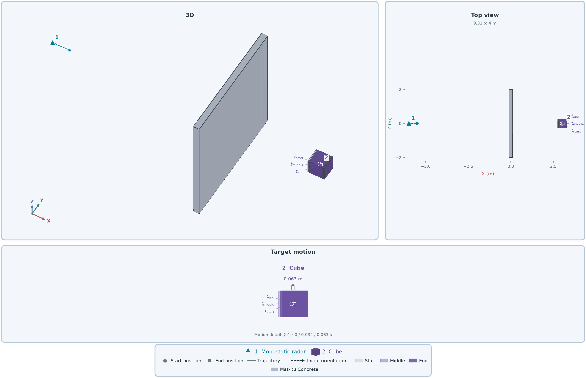
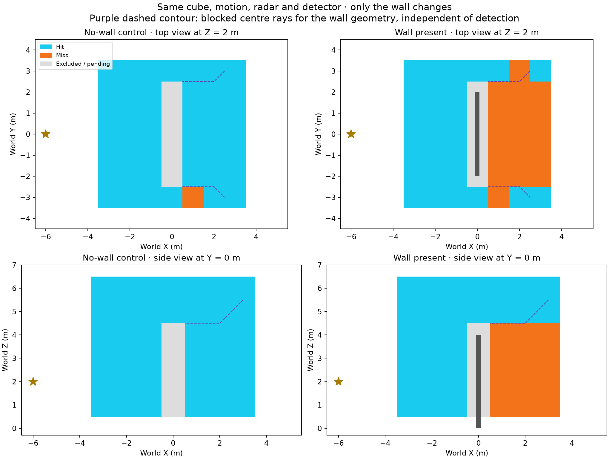
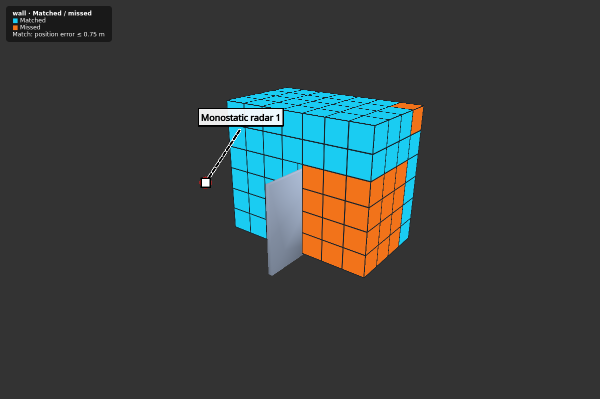
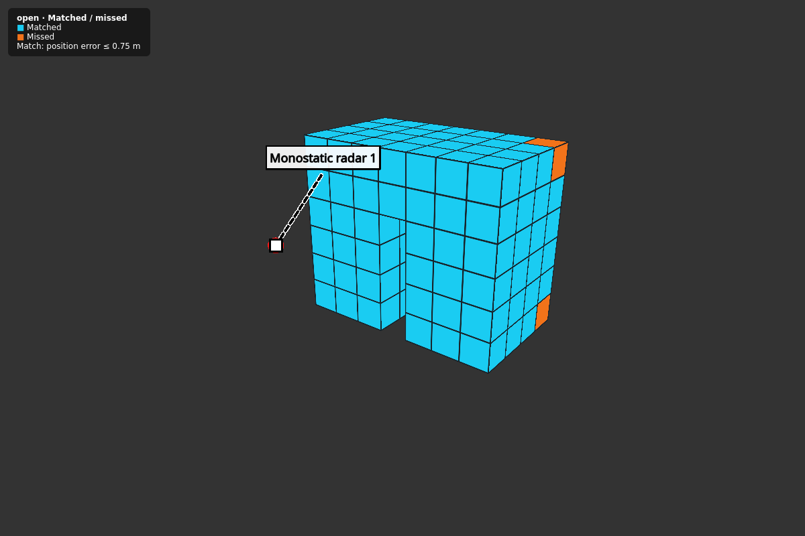

# A Small Cube-and-Wall Sensing Volume

Compare independent target placements with and without a finite wall. The result
separates a blocked return from a report that exists but misses the declared
localization gate. Each cell is a separate acquisition, not a point on one track.
This is the controlled introduction to a sensing volume before testing many
positions in a city.

To run it, see [Running](#running).

## Scene Layout



The figure shows the base wall/cube placement in [scenario.yaml](scenario.yaml); the tutorial grid
repeats acquisitions at separate positions. The short blue dashed arrow shows
the radar's initial orientation (+X).

A monostatic sensor (i.e., collocated transmitter and receiver) at
(−6 m, 0 m, 2 m) has an 8 × 8 receive array. A wall spans
X = −0.1…0.1 m, Y = −2…2 m and Z = 0…4 m. A 0.5 m cube translates along +X at
1 m/s during each 64-sample CPI. Both conditions use the same 28 GHz carrier,
500 MHz bandwidth, ray budget, receiver and detector.

The `tutorial` grid uses 1 m spacing: X and Y span −3…3 m, and Z spans
1…6 m. Of its 294 centres, 20 intersect the wall and are excluded from both
conditions, leaving **274 acquisitions per condition** (548 total). The grid
samples both lateral edges, several heights below the wall top and two heights
above it. The smaller `smoke` preset retains 11 acquisitions per condition.

CFR/IFFT uses 128 frequency observations,
Hann frequency weighting and 128 range samples. Weighted-mean suppression
removes stationary returns before beamwise detection.

## Configuration Walkthrough

Key excerpt from [scenario.yaml](scenario.yaml):

```yaml
sensing:
  preset: coherent_hann
  acquisition:
    bandwidth_hz: 500000000.0
    frequency_samples: 128
    sample_rate_hz: 1000.0
    samples_per_cpi: 64
  processing:
    range:
      interpretation: monostatic
      fft_size: 128
  detection:
    mode: beam_scan
    angle_oversampling: 4
```

The preset supplies CFR/IFFT, Hann frequency/Doppler weighting and weighted-mean
clutter suppression. Each cell contains one 64-sample acquisition at 1 kHz:
64 ms of sample slots and 63 ms between the first and last timestamps. One
geometry solve supplies analytical path Doppler during that interval. Its
0.300 m range-bin spacing and about 0.08365 m/s velocity-bin spacing remain
the same at every cell.

The array supplies both azimuth and elevation. Fourfold angular interpolation
refines the sampled beam response; the physical aperture stays 8 × 8 elements.
Reports are limited to 1–15 m, at least 10 dB SNR, and within 60 dB of the
strongest candidate. Two Doppler bins around zero are excluded. The target's
translation provides Doppler separation from the stationary wall, but the
wall can still block paths and contribute indirect returns.

The launcher repeats the same detector for wall/open conditions and resets
the acquisition for each position. It uses 300,000 rays, maximum depth three,
specular and diffuse reflection, and an uncalibrated diffuse metal surrogate
for the cube. There is no added receiver noise. Geometry labels and known
target centres enter the evaluation after detection; they do not supply reports.


### Sensing settings

| Parameter | Value | Meaning |
|---|---|---|
| `sensing.preset` | coherent_hann | Coherent CPI, CFR/IFFT and Hann frequency/Doppler weighting; YAML fields override the [preset](../../../../docs/sensing/parameters.md#grouped-configuration). |
| `acquisition.bandwidth_hz` | 500 MHz | Frequency span governing the range-resolution scale. |
| `acquisition.frequency_samples` | 128 | Number of acquired frequency observations. |
| `acquisition.samples_per_cpi` / `sample_rate_hz` | 64 / 1000.0 Hz | Samples and rate defining one coherent observation interval. |
| `processing.clutter.coherent_mode` | `windowed_mean` (preset) | Remove the Hann-weighted slow-time mean to suppress stationary returns. |
| `recording.profile` | maps | Keep numeric maps and reports, without complex phase samples; see [profiles](../../../../docs/sensing/reprocessing.md#choose-a-profile). |
| `detection.mode` | beam_scan | Use receive-array directions when detecting returns. |

Acquisition, processing, detection, tracking and recording paths are relative
to `sensing`. A coherent processing interval (CPI) groups pulses for Doppler
estimation. See the [parameter reference](../../../../docs/sensing/parameters.md) for defaults and constraints.

## Running

Use a fresh output directory from the repository root.

To prepare the trial configurations in a fresh output directory:

```bash
python -m scenarios.sensing.applications.wall_detection_volume.generate output/examples/wall-tutorial-1m --prepare --grid tutorial
```

Generate the recording:

```bash
python -m scenarios.sensing.applications.wall_detection_volume.generate output/examples/wall-tutorial-1m --yes
```

To collect the saved trial results into a sensing volume:

```bash
python -m scenarios.sensing.applications.wall_detection_volume.generate output/examples/wall-tutorial-1m --collect
```

To create the report from the collected results:

```bash
python -m scenarios.sensing.applications.wall_detection_volume.generate output/examples/wall-tutorial-1m --report
```

To visualize the volume with the wall:

```bash
orchav-visualizer --sensing-volume output/examples/wall-tutorial-1m/wall --no-resume
```

To visualize the volume without the wall:

```bash
orchav-visualizer --sensing-volume output/examples/wall-tutorial-1m/open --no-resume
```

Preparation never overwrites an existing campaign. Use a new directory when
changing the grid; repeating `--prepare` reports the frozen settings and exits.
Generation retains completed trials when resumed. `--yes` accepts the displayed
storage plan; omit it for an interactive prompt. The `maps` recording retains
numeric plots, reports and detector stages. Select `reprocessing` before preparing
trials when later replay needs complex observations. Use pygfx 0.17.x for the 3D volume view.
The `--collect` step gathers saved reports into the volume. `--report` writes
the complete numerical comparison to `report/summary.json`, `paired_sections.png`,
an HTML report and inspection bookmarks. Add `--capture-3d` to the report command to run the
pygfx Visualizer and write `report/3d/wall/` and `report/3d/open/`. Omit that flag
for numerical figures only. These commands reproduce the result figures below
from your saved acquisitions; no extra ray tracing is needed.

The first eligible trial in each condition (`wall` and `open`) writes native
figures to its `native/summary/sensing/` directory. Each `volume_recipe.json`
identifies that trial in `summary_trial_ids`. The optional summary command
renders any retained trial without rerunning detection.

## What to Observe

The figures and counts below describe the illustrated recording, identified
in its [provenance](../../../../docs/assets/volume_inspection/sensing_story_captures.json).
A new acquisition can differ, even with a fixed seed. Use its generated report
to compare the two conditions under the same matching gate.



The paired sections show the wall shadow below its top and the retained returns
above it. The blue-purple dashed contour is the **geometric direct-path blockage
boundary**: it separates grid centres whose straight path to the radar intersects
the wall. It is calculated independently of the detector and shown on both panels
as the same reference. It is not a measured detection boundary or a propagation path.

| Wall present | Open scene |
|---|---|
|  |  |

These 3D Visualizer captures hide the front half of the sampled cells to expose
the wall and the interior. Cyan means matched; orange means missed. The cut
changes visibility only.

1. Choose **Colour by → Outcome detail** and **View → 3D volume**. Compare
   the **wall** and **open** conditions with the same camera and scale.
2. Select a slice below the wall top, then one above it. Cyan marks matches
   without extras; purple marks matches with extras. Orange means no reports,
   while yellow means reports exist but none matches the tested target.
3. Click a cell to read its reports in **Selected cell**. Use **Analysis** to
   compare outcome counts and position errors across the measured grid.
4. To inspect its recording, choose **Open trial in visualizer**, then
   **Return to volume** when finished.

The 0.75 m matching gate evaluates localization after detection. Changing it
with **Rescore saved reports** does not change the recorded signal or detector.
The **Show** filter changes only which cells are visible. See
[volume inspection](../../../../docs/visualizer/volume_inspection.md) for more controls.

At (3 m, 0 m, 3 m), the wall condition has no report, while the open condition
has a matched report. At (3 m, 0 m, 6 m), both conditions retain a matched
return above the wall. Before the wall, additional reports can follow reflected
paths rather than the direct target direction.

| Tutorial-grid outcome at the 0.75 m position gate | Wall | Open |
|---|---:|---:|
| Evaluated positions | 274 | 274 |
| Positions with a matching report | 209 | 268 |
| Positions with no reports | 60 | 0 |
| Positions with reports outside the gate | 5 | 6 |
| Extra reports, including extras at matched positions | 164 | 24 |

All 60 positions with nine blocked geometry probes produced no reports with the
wall; 59 of those positions matched in the open condition. The grid also retains
30 partly blocked positions, rather than classifying every wall-edge placement
as fully hidden.

At (3 m, 3 m, 6 m), the nearest report is 0.848 m from the target reference in
both conditions, just outside the gate. This is a localization miss even though
a detection was reported. The position gate separates this localization miss
from a trial with no detection.

The saved report includes every outcome. These are deterministic
placements without a noise ensemble; match fractions are not detection probabilities.
Finer spatial sampling would add experiments, not physical range or angle resolution.

## Browse Scenarios

Up: [Sensing](../../README.md)

[Interpret detections and localization](../../../../docs/sensing/concepts.md)
or read the [volume controls](../../../../docs/visualizer/volume_inspection.md).
For continuous flight and observation-level fusion, see the
[drone tracking progression](../drone_tracking/README.md).

## Benchmark

| Invocation | Elapsed |
|---|---:|
| Base YAML generation | 5.74 s |
| 548-trial acquisition campaign | 301.89 s |
| Collect saved reports | 2.82 s |
| Report figures | 2.40 s |
