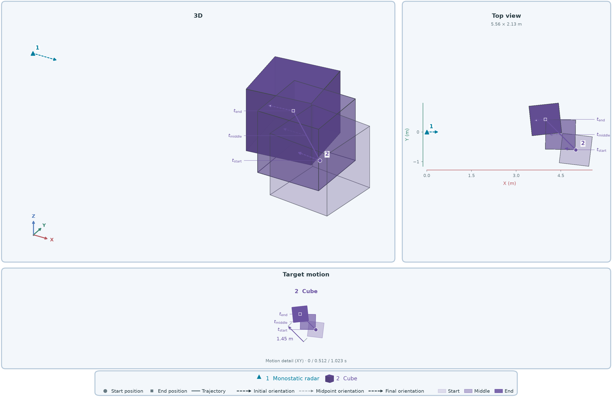
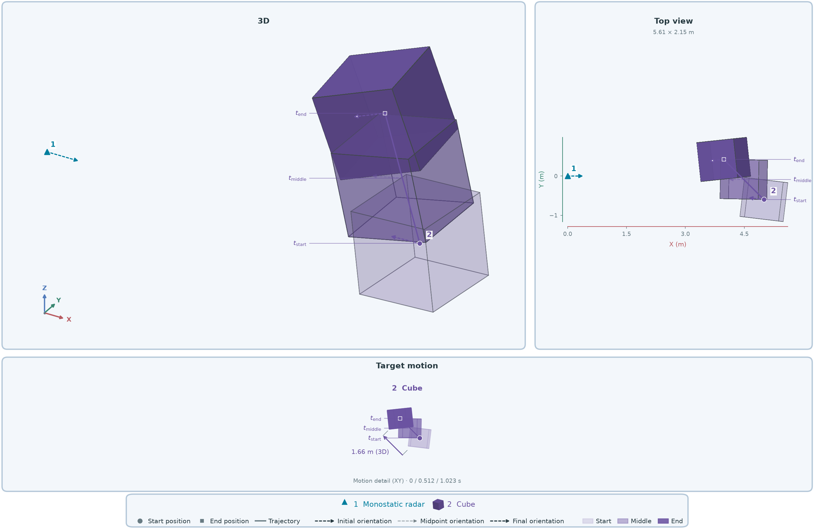
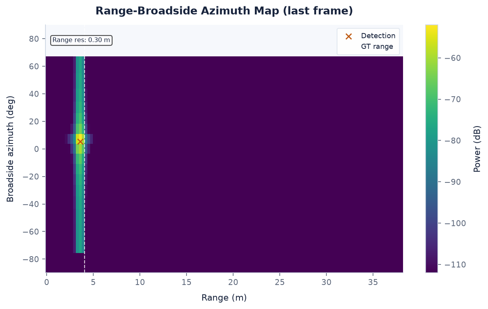
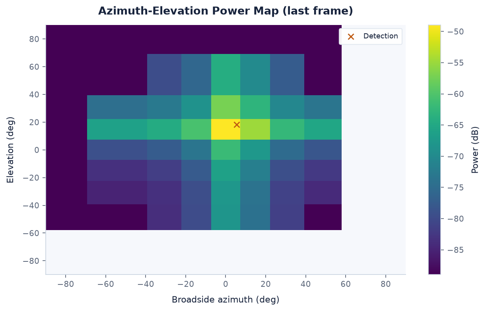

# Moving Cube: Azimuth and Elevation

A horizontal receive array adds **azimuth**, the bearing of a return in the
sensor's horizontal plane. This is the directional information missing from
range-only tracking. A single row does not independently measure elevation.
Then add vertical elements to estimate **elevation**, the angle above the
sensor's horizontal plane. Both configurations belong to this example and
estimate direction before the next example enables Cartesian tracking.

To run it, see [Running](#running).

## Scene Layout



The transmitter and 16-element horizontal receive array are collocated.
The one-metre metallic cube moves at (−1 m/s, +1 m/s, 0 m/s), crossing
the radar's forward axis. `orientation.type: look_at` keeps one face normal
pointing toward the radar, allowing a specular return in the empty scene.
Local +X is forward, +Y is left, and +Z is up.



The planar-array variant keeps the radar at (0 m, 0 m, 0.5 m) and uses
8 × 8 receive elements. Its cube starts at (5 m, −0.6 m, 1.1 m) and ends at
(3.977 m, 0.423 m, 1.9184 m), adding 0.8 m/s upward motion. The face still
points toward the radar. These are the standard topology summary figures
for the two configurations.

## Configuration Walkthrough

[Horizontal YAML](scenario.yaml) and [planar YAML](elevation/scenario.yaml)
each produce 16 coherent processing intervals (CPIs) over 1.024 s.
The [planar configuration page](elevation/README.md) is a short entry point
for readers opening that directory directly.

| Parameter | Value | Meaning |
|---|---|---|
| `raytracing.antenna.rx.num_rows` / `num_cols` | 1 / 16, then 8 / 8 | Horizontal, then planar array; half-wavelength element spacing. |
| `sensing.acquisition.bandwidth_hz` | 500 MHz | Approximately 0.30 m range-resolution scale. |
| `sensing.acquisition.frequency_samples` | 128 | Frequency observations across the bandwidth. |
| `sensing.acquisition.samples_per_cpi` / `sample_rate_hz` | 64 / 1 kHz | 64 ms observation window. |
| `sensing.preset` | `coherent_hann` | Hann frequency and Doppler weighting. |
| `sensing.detection.mode` | `beam_scan` | Search receive-array directions for detections. |
| `sensing.detection.angle_oversampling` | 8 | Refine the angular grid around detected returns; no extra physical aperture. |
| `sensing.processing.clutter.coherent_mode` | `none` | Preserve stationary and moving components. |

The carrier is 28 GHz. Each solve uses 10,000 rays, path depth 1 and seed 42;
noise and diffuse reflection are disabled. The detector retains the cube
examples' 3 dB local-background and 12 dB peak-relative power limits.
See [array processing](../../../../docs/sensing/concepts.md)
and the [parameter reference](../../../../docs/sensing/parameters.md).

## Running

Run commands from the repository root.

Generate the horizontal-array recording:

```bash
orchav-generator scenarios/sensing/cube_radar/azimuth
```

Open its azimuth results:

```bash
orchav-visualizer --scenario scenarios/sensing/cube_radar/azimuth --no-resume
```

Generate the planar-array recording:

```bash
orchav-generator scenarios/sensing/cube_radar/azimuth/elevation
```

Open its azimuth and elevation results:

```bash
orchav-visualizer --scenario scenarios/sensing/cube_radar/azimuth/elevation --no-resume
```

Reusable HDF5 frames are written to `frames/`; standalone topology and sensing
figures are written to `summary/` beside each YAML.

## What To Observe

Open **Sensing → Result graphs → Current result → Angle**. Follow the bearing
from negative to positive azimuth as the cube crosses +X. The angular grid
samples an array response; a denser grid does not make the physical beam narrower.
For the planar array, inspect the azimuth–elevation map as the return rises
and crosses the forward axis. Range plus both angles supplies a position
observation in three dimensions. The two variants have different apertures
and trajectories, so they illustrate their directional capabilities rather
than measuring an isolated effect of adding rows.



The horizontal array's final result is at 0.960 s. The orange cross marks the
saved detection at positive azimuth after the cube crosses the forward axis.
The dashed line marks cube-centre range, farther away than the reflecting face.



The planar array's final result shows positive azimuth and elevation for the
rising cube. The colored cells are the stored angular power map. The detection
uses the refined angular search grid, so its marker can lie between displayed
cell centres. These are directional detections, not filtered tracks.

Neither configuration enables a tracker. The
[Cartesian tracking example](../moving_tracking_3d/README.md) reuses the planar
array, trajectory and detector, then associates and filters those position
observations over time.

## Browse Scenarios

Up: [Cube radar experiments](../README.md) | Previous: [Radial tracking](../moving_tracking/README.md) | Next: [Cartesian tracking](../moving_tracking_3d/README.md)

## Benchmark

| Invocation | Elapsed |
|---|---:|
| Horizontal-array generation | 20.63 s |
| Planar-array generation | 27.73 s |
