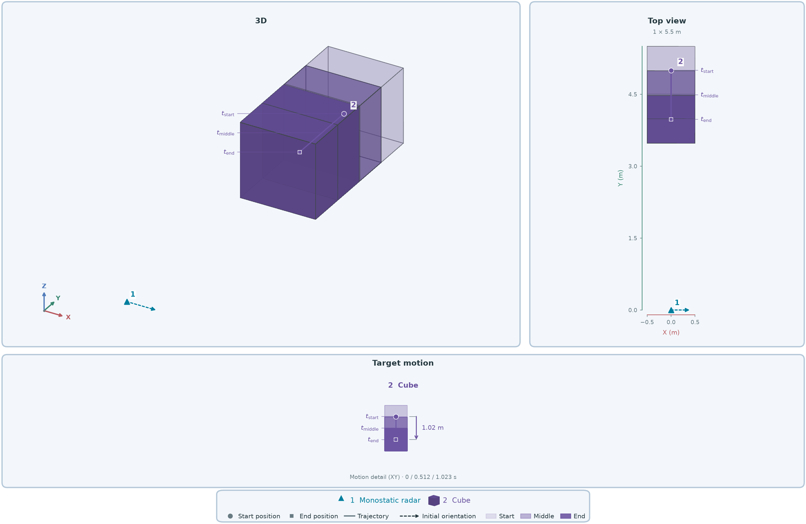
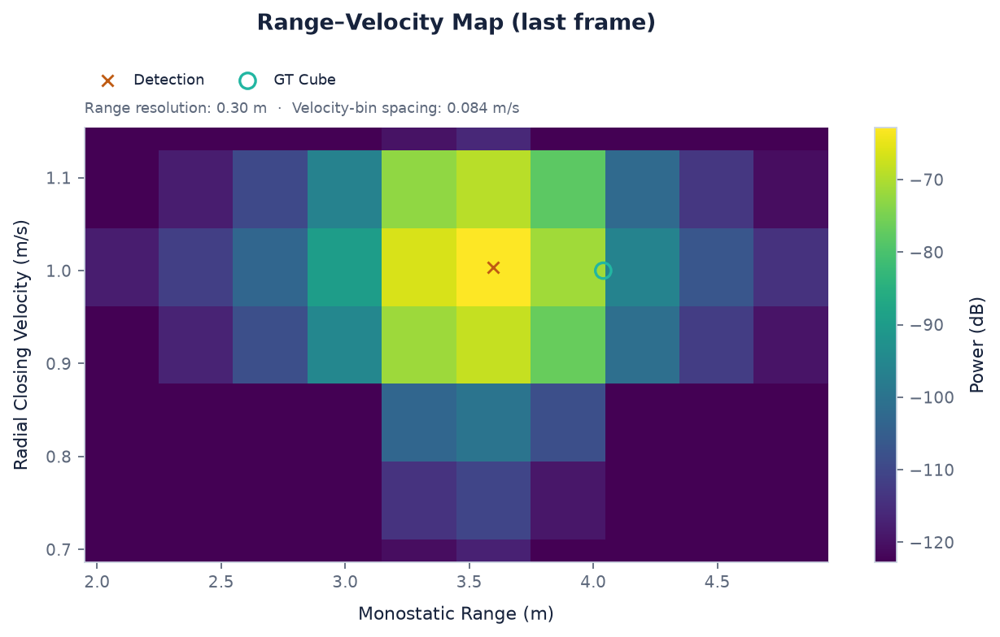
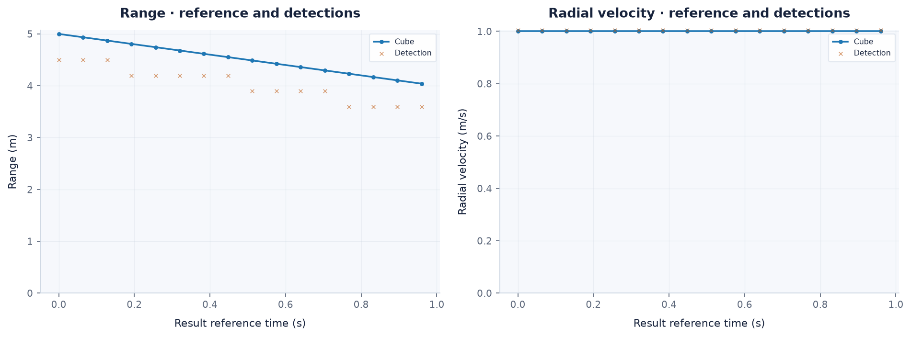
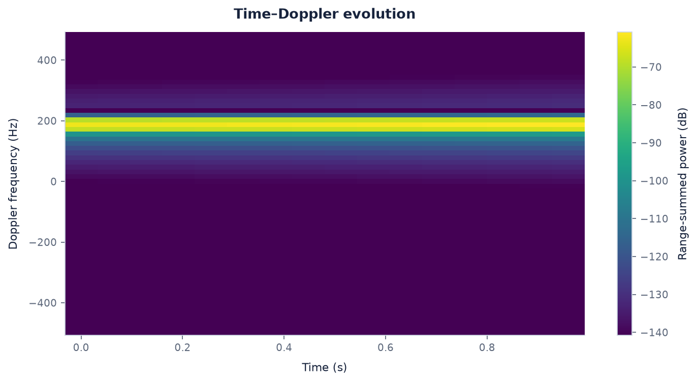

# Moving Cube: Radial Velocity

Move the stationary experiment's cube toward the sensor while keeping its
geometry, finite-bandwidth processing and detector settings fixed. Sixteen
[coherent processing intervals (CPIs)](../../../../docs/reference/glossary.md#cpi)
show range and closing velocity over time.

To run it, see [Running](#running).

## Scene Layout



A [monostatic sensor](../../../../docs/reference/glossary.md#monostatic),
i.e., collocated transmitter and receiver, is at `(0 m, 0 m, 0.5 m)` in an empty
scene. A one-metre metallic cube
moves along the y-axis from `(0 m, 5 m, 0.5 m)` to `(0 m, 3.977 m, 0.5 m)`
over sample timestamps 0–1.023 s. Its speed toward the sensor is 1 m/s. The
sensor remains on the normal through the nearest face's center,
so its specular reflection returns toward the sensor throughout the motion.

The layout shows the start and end mesh outlines with a displacement arrow.

## Configuration Walkthrough

The changed settings in [scenario.yaml](scenario.yaml) are:

```yaml
timeline:
  steps: 1024
  sample_rate_hz: 1000.0
# Under actors.targets[0]:
mobility:
  type: linear
  start_m: [0.0, 5.0, 0.5]
  end_m: [0.0, 3.977, 0.5]
```

The 1,024 samples occupy 1.024 s of the acquisition clock.
`acquisition.samples_per_cpi` selects 64 samples per CPI, giving 16 results at
64 ms spacing. Each CPI
solves one geometry and uses its analytical Doppler phase progression; it does
not update geometry during those 64 samples. The carrier remains 28 GHz,
bandwidth 500 MHz and frequency count/IFFT size 128. Both transforms use
[Hann weighting](../../../../docs/reference/glossary.md#hann-window).
[Clutter suppression](../../../../docs/reference/glossary.md#clutter-suppression)
and receiver noise are disabled.

The detector retains the stationary [CFAR](../../../../docs/reference/glossary.md#cfar)
and filter settings: threshold multiplier 2, minimum local ratio 3 dB,
12 dB peak-relative span. Range/velocity
clustering gates are 0.5 m and 0.3 m/s. Complex observations and detector stages
are saved for the next tracking experiment.

The `reprocessing` profile saves complex observations for later processing
comparisons without another ray-tracing run. See [recording profiles](../../../../docs/sensing/reprocessing.md#choose-a-profile).


### Sensing settings

The acquisition and processing settings carry forward from the
[stationary cube](../stationary/README.md#sensing-settings): the `coherent_hann`
preset, 500 MHz bandwidth, 128 frequency samples, 64 samples per CPI at 1 kHz,
and disabled clutter suppression. This example changes the target motion and
timeline rather than the basic range–Doppler settings.

Unlike the stationary example's `maps` recording profile, this scenario uses
`sensing.recording.profile: reprocessing` to retain complex observations as
well as maps and reports. See [recording profiles](../../../../docs/sensing/reprocessing.md#choose-a-profile)
for their capabilities and the [parameter reference](../../../../docs/sensing/parameters.md)
for exact settings and constraints.

## Running

Run commands from the repository root with the ORCHAV environment active.

Generate the recording:

```bash
orchav-generator scenarios/sensing/cube_radar/moving
```

Open the recording:

```bash
orchav-visualizer --scenario scenarios/sensing/cube_radar/moving --no-resume
```

Generation creates local `frames/` and standard figures in `summary/sensing/`. The saved result timestamps are the geometry solve starts,
from 0 to 0.960 s;
the observation-window midpoints run from 0.0315 to 0.9915 s.

## What To Inspect

This first moving sensing example has **1,024 scene frames but only 16 sensing
results**: one result for every 64-sample CPI. Under **Sensing**, **Play sensing
frames only** is enabled by default:

- **Enabled:** playback and the main slider visit the 16 scene frames associated
  with saved results, 64 ms apart. Use this to follow the cube and its detection
  together; the cube's displayed position advances in larger steps.
- **Cleared:** playback follows the full scene timeline. With stride **x1**, the
  cube's position advances at 1 ms intervals, while new sensing results are
  still only available every 64 ms. The dashboard can hold a result as the
  scene moves between acquisitions; check its displayed timestamp.

This option changes navigation, without computing extra results or changing the
recorded motion. Leave it enabled for the comparison below. See
[sensing playback](../../../../docs/visualizer/sensing_dashboard.md#loading-and-playback)
for other playback options.

1. Open **Sensing → Result graphs → Current result → Detections**.
2. Step through the 16 results with **Previous** and **Next** in the dashboard.
   Range decreases while closing velocity
   stays near +1 m/s.
3. Open **Motion** to compare the saved range and Doppler histories.

## Results

The recording contains **one detection in each of 16 CPIs**. Its reported
velocity is **+1.004 m/s** throughout, with positive velocity denoting approach.
The standard range–Doppler summary below shows the final CPI.



The detection history shows range decreasing from **4.497 m to 3.598 m** as the
cube approaches. Range estimates advance in approximately 0.300 m bins.
The ground-truth curve represents the cube center, 0.5 m behind its nearest
reflecting face.



The standard time–Doppler summary displays the saved spectra across all 16 CPIs,
summing power over range. A steady component near **+187.5 Hz** corresponds to
the estimated **+1.004 m/s** closing velocity. This rigid translation has no
internal motion to introduce additional micro-Doppler structure.



Each spectrum uses 64 samples; its Doppler bins are 15.625 Hz apart, equivalent
to approximately 0.08365 m/s at 28 GHz. The 1.024 s recording provides 16 updates
without changing that per-window spacing. These detections have no persistent
identity until tracking is enabled in the next example.

## Browse Scenarios

Up: [Cube radar experiments](../README.md) | Previous: [Stationary filtering](../stationary_filtering/README.md) | Next: [Oscillating cube](../oscillating_comparison/README.md)

## Benchmark

| Invocation | Elapsed |
|---|---:|
| Generation | 23.47 s |
