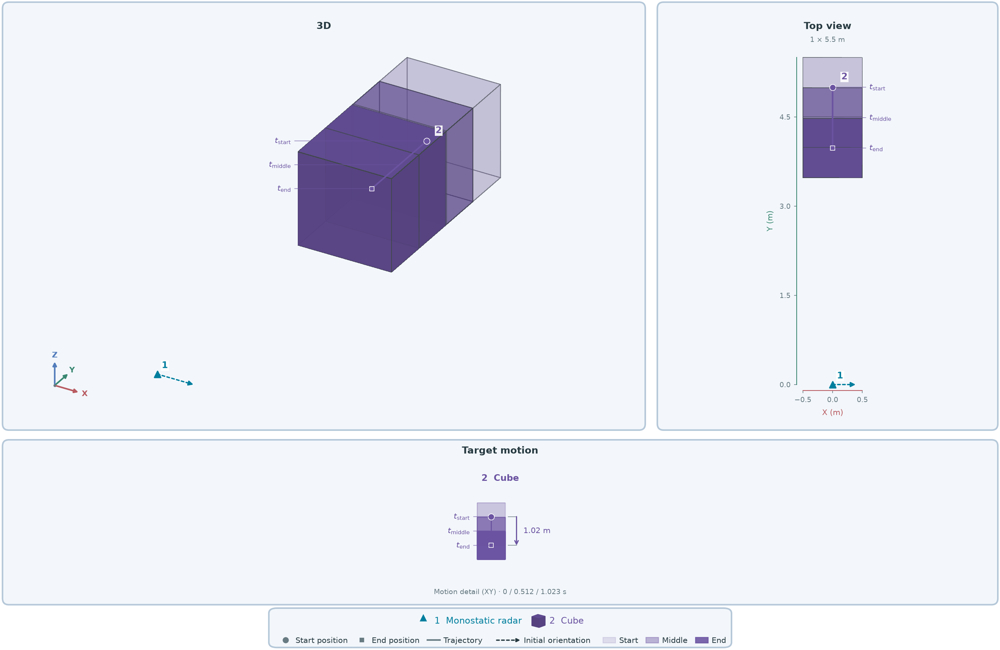
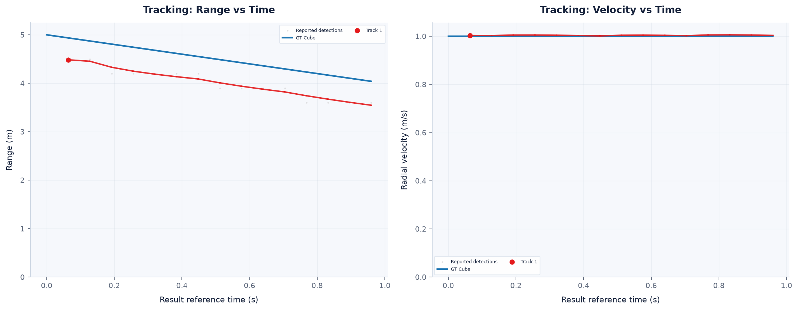

# Moving Cube: Radial Tracking

Associate successive detections to keep an identity while a cube approaches.
This Kalman tracker follows **range and radial velocity**. A single transmit/
receive element supplies no direction observation and cannot locate the return
independently in Cartesian space.

To run it, see [Running](#running).

## Scene Layout



The collocated transmitter and receiver are at (0 m, 0 m, 0.5 m). A one-metre
metallic cube moves along −Y toward them, from (0 m, 5 m, 0.5 m) to
(0 m, 3.977 m, 0.5 m), at 1 m/s. Its reflecting face is 0.5 m nearer than
its centre. The empty scene and face-normal placement isolate a specular return.

## Configuration Walkthrough

[scenario.yaml](scenario.yaml) enables detection and tracking during generation.
There are 1,024 samples at 1 kHz, grouped into 16 coherent processing intervals
(CPIs) of 64 samples. Geometry is fixed within a CPI; analytical Doppler evolves
the channel inside it. Positive closing velocity means approach.

| Parameter | Value | Meaning |
|---|---|---|
| `acquisition.bandwidth_hz` | 500 MHz | Sets the approximately 0.30 m range-resolution scale. |
| `acquisition.frequency_samples` / `processing.range.fft_size` | 128 / 128 | Frequency observations and range-transform samples. |
| `preset` | `coherent_hann` | Finite-bandwidth response with Hann frequency and Doppler weighting. |
| `tracking.enabled` / `tracking.type` | `true` / `kalman` | Estimate range and radial velocity from detections. |
| `tracking.confirmation` | 2 hits in 3 updates | Require repeated observations before publishing an identity. |
| `tracking.association` | 0.5 m range; 0.3 m/s velocity | Reject candidate associations outside these gates. |
| `tracking.max_missed_updates` | 1 | Retire a track after more than one consecutive miss. |
| `recording.tracking_diagnostics` | `true` | Save association and confirmation decisions for inspection. |

Sensing parameter paths above are relative to `sensing`. The carrier is 28 GHz;
receiver noise and clutter suppression are off. The detector uses a CFAR
threshold multiplier of 2, a 3 dB local-background ratio and a 12 dB limit below
the strongest cell. See the [parameter reference](../../../../docs/sensing/parameters.md).
Ground truth enters display and evaluation only.

## Running

Run commands from the repository root.

Generate the recording with radial tracking enabled:

```bash
orchav-generator scenarios/sensing/cube_radar/moving_tracking
```

Open the saved tracks:

```bash
orchav-visualizer --scenario scenarios/sensing/cube_radar/moving_tracking --no-resume
```

Generation writes reusable [HDF5 frames](../../../../docs/shared/frame_reference.md)
to `frames/` and standalone topology, motion and sensing figures to `summary/`
beside the YAML. No separate processing command is needed.

## What To Observe



The red curves show the saved track's range and radial velocity across the
recording. The blue curves show cube-centre truth. These are radial estimates,
not Cartesian positions.

Open **Sensing → Result graphs → Tracking** and step through the results.
The first detection is tentative; repeated association confirms an identity.
Range decreases while closing velocity stays near +1 m/s. The track follows
the reflecting face, so it is offset from the cube-centre truth curve.
Use the saved tracking decisions to inspect confirmation and association.

## Browse Scenarios

Up: [Cube radar experiments](../README.md) | Previous: [Oscillating cube](../oscillating_comparison/README.md) | Next: [Azimuth and elevation](../azimuth/README.md)

## Benchmark

| Invocation | Elapsed |
|---|---:|
| Generation | 16.60 s |
