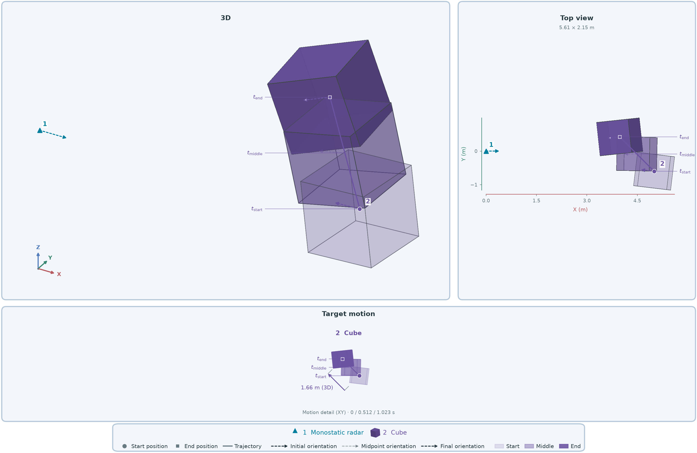
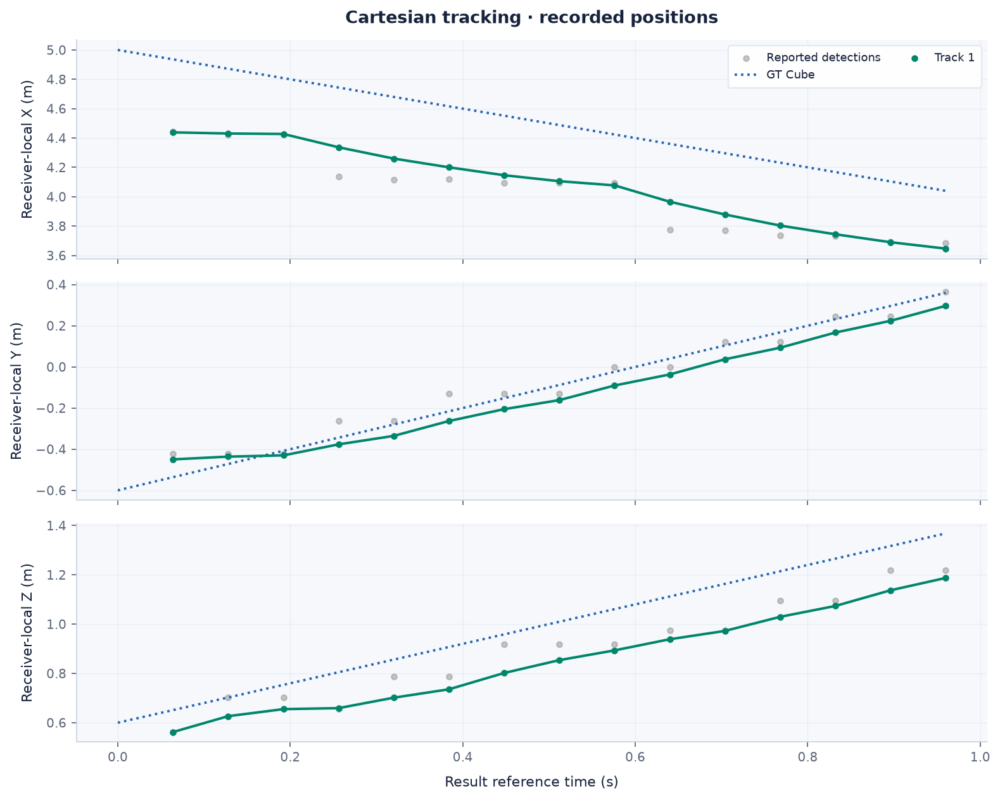
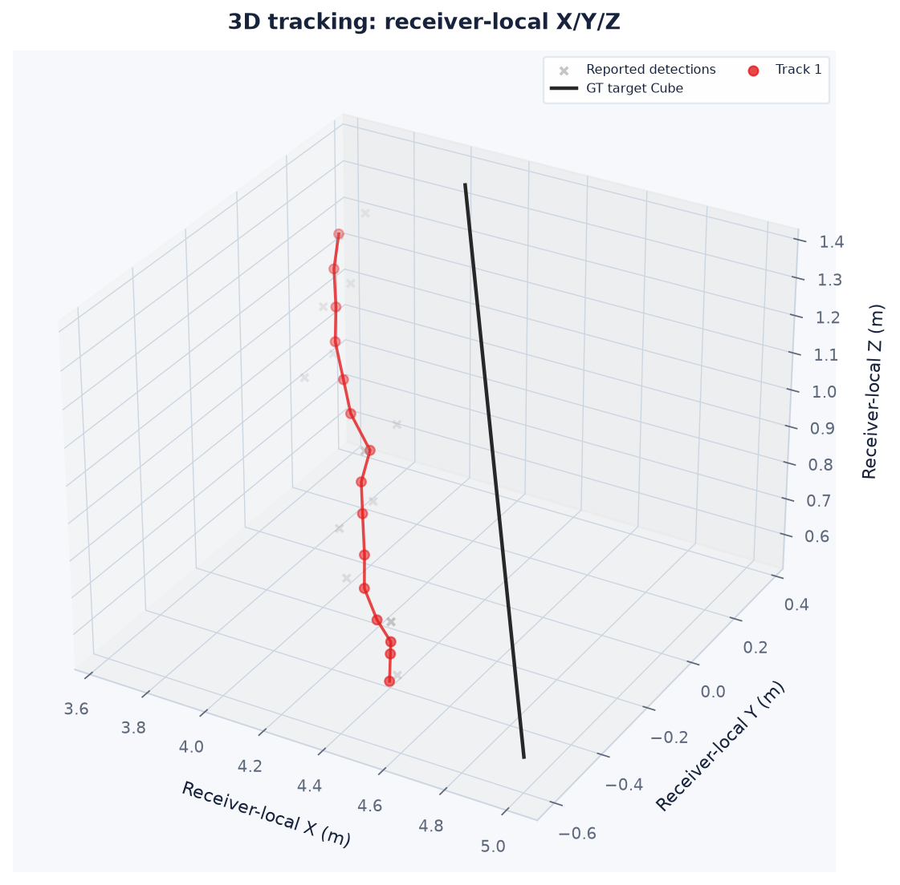

# Moving Cube with Cartesian Tracking

Evaluate Cartesian tracking of a moving cube's reflected return using range,
azimuth and elevation. An 8×8 receive array supplies both angles, and the
Cartesian Kalman tracker follows the resulting positions. This reuses the
planar array, trajectory and detector from the
[azimuth and elevation example](../azimuth/README.md), adding temporal association
and state estimation. The SISO moving-cube recording cannot provide these
three-dimensional observations.

To run it, see [Running](#running).

## Scene Layout



A [monostatic radar](../../../../docs/reference/glossary.md#monostatic)
(i.e., collocated transmitter and receiver) is at `(0 m, 0 m, 0.5 m)` in an empty
scene. Its local axes align with the world axes, with the array looking
toward positive x. A one-metre metallic cube moves from
`(5 m, −0.6 m, 1.1 m)` to `(3.977 m, 0.423 m, 1.9184 m)`. Its velocity is
`(−1 m/s, 1 m/s, 0.8 m/s)`. The cube's `look_at` orientation keeps a face
normal pointed toward the sensor, producing a specular surface return.

The timeline contains 1,024 samples at 1 kHz: 1.024 s of sample slots,
with sample timestamps from 0 to 1.023 s. The 16 coherent
[CPIs](../../../../docs/reference/glossary.md#cpi) each contain 64 samples.
Geometry is fixed inside each CPI; saved result times are the geometry solve
starts, from 0 to 0.960 s.

## Configuration Walkthrough

The new settings in [scenario.yaml](scenario.yaml) are:

```yaml
raytracing:
  antenna:
    rx:
      num_rows: 8
      num_cols: 8
sensing:
  detection:
    mode: beam_scan
    angle_oversampling: 8
  tracking:
    enabled: true
    type: cartesian3d
    confirmation: {hits: 2}
    max_missed_updates: 1
    association: {position_gate_m: 0.75, velocity_gate_m_s: 1.0}
  recording:
    tracking_diagnostics: true
```

The planar array uses half-wavelength element spacing. `beam_scan` detects
returns in the array's forward hemisphere. The local eightfold angular-grid
interpolation refines the direction of an already detected return; it does not
increase the physical aperture or resolve additional targets in the same
range–Doppler cell.

The finite-bandwidth settings match the
[stationary cube](../stationary/README.md#configuration-walkthrough).

The carrier is 28 GHz, with Hann frequency and Doppler windows, no receiver
noise and no clutter suppression. Each specular solve uses 10,000 rays,
maximum path depth 1 and seed 42. Range-bin spacing is about 0.300 m and
velocity-bin spacing is about 0.08365 m/s.

The generator applies `cartesian3d`, a constant-velocity Kalman filter with
state `[x, y, z, vx, vy, vz]`, to the detected positions. Association uses
distance between observed and predicted positions with a 0.75 m spatial gate
and a 1 m/s radial-velocity gate. Two hits in the latest three updates initially
confirm a track; confirmation then remains latched until retirement. One missed
update is allowed. The `maps` recording retains numeric range, Doppler and
angular products, reports before tracking and confirmed states. The explicit
diagnostic switches also retain detector decisions and tracker diagnostics.
Complex element observations are discarded after processing, so saved maps
cannot support new phase-based angle refinement. Ground truth does not enter
detection, association or state estimation. See
[recording profiles](../../../../docs/sensing/reprocessing.md#choose-a-profile)
for workflows that need to retain complex observations.


### Sensing settings

| Parameter | Value | Meaning |
|---|---|---|
| `sensing.preset` | coherent_hann | Coherent CPI, CFR/IFFT and Hann frequency/Doppler weighting; YAML fields override the [preset](../../../../docs/sensing/parameters.md#grouped-configuration). |
| `acquisition.bandwidth_hz` | 500 MHz | Frequency span governing the range-resolution scale. |
| `acquisition.frequency_samples` | 128 | Number of acquired frequency observations. |
| `acquisition.samples_per_cpi` / `sample_rate_hz` | 64 / 1000.0 Hz | Samples and rate defining one coherent observation interval. |
| `processing.clutter.coherent_mode` | none | Keep stationary and moving slow-time components. |
| `recording.profile` | maps | Keep numeric maps and reports, without complex phase samples; see [profiles](../../../../docs/sensing/reprocessing.md#choose-a-profile). |
| `detection.mode` | beam_scan | Use receive-array directions when detecting returns. |
| `tracking.type` | cartesian3d | Cartesian position/velocity estimation. |

Acquisition, processing, detection, tracking and recording paths are relative
to `sensing`. A coherent processing interval (CPI) groups pulses for Doppler
estimation. See the [parameter reference](../../../../docs/sensing/parameters.md) for defaults and constraints.

## Running

Run from the repository root.

Generate the recording:

```bash
orchav-generator scenarios/sensing/cube_radar/moving_tracking_3d
```

Open the recording:

```bash
orchav-visualizer --scenario scenarios/sensing/cube_radar/moving_tracking_3d --no-resume
```

The same recording supplies angle maps, detection stages and Cartesian tracks
in the Visualizer. `generator_summary.create: [topology, sensing]` also produces
`summary/topology.png` and standard figures in `summary/sensing/` automatically.
To render just the two Cartesian figures again from saved results, choose a
fresh output directory:

```bash
python -m generator.figures.summary.saved_sensing scenarios/sensing/cube_radar/moving_tracking_3d -o analysis/moving-tracking-3d-summary --figure tracking_cartesian --figure tracking_xyz
```

This summary command reads the recorded observations and states without rerunning
the detector or tracker.

## What To Inspect

1. Open **Sensing → Result graphs → Current result → Angle** and inspect
   the direction estimate from the planar array.
2. Open **Tracking** and step through the results to follow the estimated
   x/y/z position.
3. Enable **Show 3D sensing** in the main Sensing panel and compare the saved
   track with the cube's motion. The return follows its surface, not its center.

## Results

The generated recording contains one finite x/y/z observation in every CPI.
Track 1 becomes confirmed at 0.064 s, after the second observation, and remains
the only reported identity through all 15 confirmed updates. Its receiver-local
position changes from `(4.439 m, −0.450 m, 0.562 m)` at confirmation to
`(3.646 m, 0.297 m, 1.187 m)` at 0.960 s. Thus x decreases while y and z increase,
including the crossing of y = 0.



The standard history figure shows the saved coordinate observations and Kalman
states at their result timestamps. The dotted ground-truth curve is the cube's
**center**, so its offset from the reflected-return positions is expected.
The first observation is retained before tracking but does not appear in the
published track series because confirmation requires two hits. The filter
smooths the sampled coordinates and initially
lags their motion while estimating velocity.



The standard spatial figure shows the same saved states in three dimensions.
It provides a view of the estimated trajectory; it does not reconstruct the
cube's shape. Both figures are generated by the normal summary command above.

Across the 15 confirmed epochs, the three-dimensional root-mean-square error
against the face-center reference is 0.111 m; the individual x/y/z errors are
0.081 m, 0.060 m and 0.048 m. The corresponding error against the cube center
is 0.446 m. These values describe this noiseless, specular, sampled control;
the filter does not improve position error over the unfiltered observations
in this run. Replaying the tracker with only recorded observations and result
times reproduces every saved state exactly.

## Interpreting the Coordinates

The saved detections and Kalman state are **receiver-local coordinates**.
Here, local x and y equal world x and y; world z is local z plus 0.5 m.
These positions follow the reflecting surface response. They are not an
estimate of the cube's center or its full shape.

For this face-on specular control, the nearest face is 0.5 m toward the sensor
from the center. Validation compares estimates with that geometric surface
reference in the receiver frame and reports the center offset separately.
The reference is used only for evaluation; no shape offset or truth correction
is applied to the tracker. Angular and range sampling, plus temporal filtering,
limit the agreement expected from this finite-bandwidth example.

The Cartesian tracker's `track_range_m` stores horizontal distance
`sqrt(x² + y²)`. Use the x/y/z histories to assess this
three-dimensional example; that field is not the three-dimensional slant range.

## Browse Scenarios

Up: [Cube radar experiments](../README.md) | Previous: [Azimuth and elevation](../azimuth/README.md) | Next: [Two targets](../two_moving/README.md) | Related: [Radial tracking](../moving_tracking/README.md) · [Sensing guide](../../../../docs/sensing/README.md)

## Benchmark

| Invocation | Elapsed |
|---|---:|
| Generation | 63.52 s |
