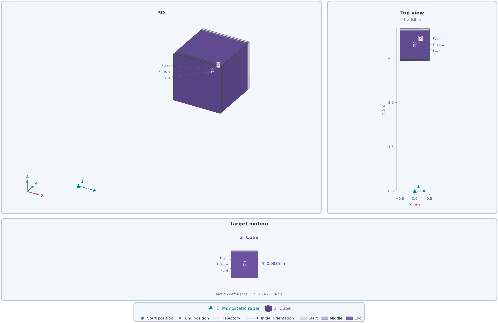
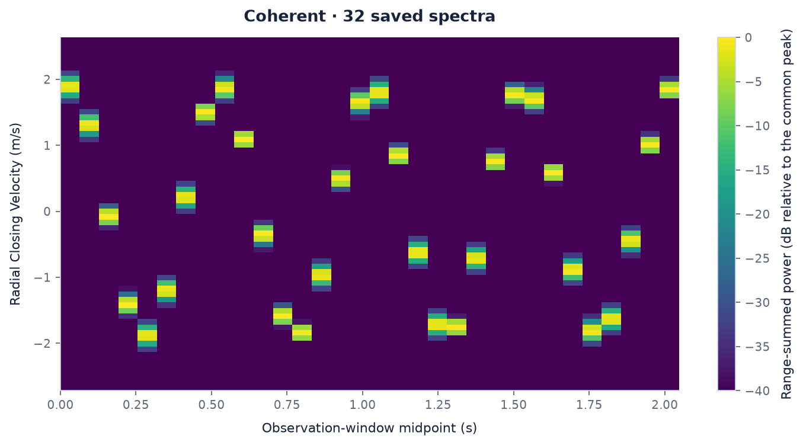
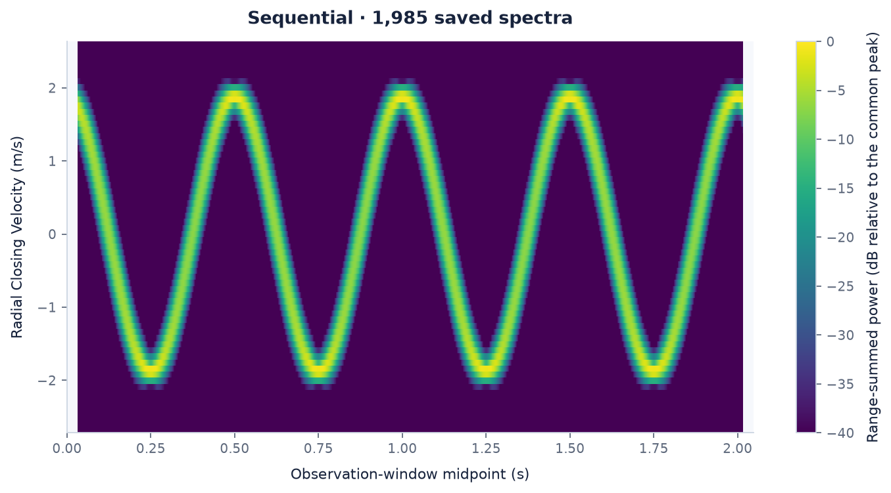

# Oscillating Cube: Coherent and Sequential Acquisition

Compare geometry frozen within a coherent processing interval (CPI) with
geometry solved at every pulse for a short-time Fourier transform (STFT).
Both observe the same rigid cube oscillating by 0.15 m at 2 Hz.

To run it, see [Running](#running).

## Scene Layout



The collocated transmitter and receiver are at (0 m, 0 m, 0.5 m).
The one-metre metallic cube oscillates along Y about (0 m, 5 m, 0.5 m).
Its face remains normal to the radar. The empty scene uses specular reflection,
with no receiver noise or clutter suppression.

## Configuration Walkthrough

Use [coherent YAML](../oscillating_coherent/scenario.yaml) and
[sequential YAML](../oscillating_sequential/scenario.yaml).

| Parameter | Value | Meaning |
|---|---|---|
| `timeline.steps` / `sample_rate_hz` | 2,048 / 1 kHz | 2.048 s of sample slots, about four oscillations. |
| `raytracing.carrier_frequency_hz` | 28 GHz | Converts Doppler frequency to closing velocity. |
| `sensing.acquisition.bandwidth_hz` / `frequency_samples` | 500 MHz / 128 | Range observations with approximately 0.30 m spacing. |
| `sensing.preset` | `coherent_hann` | Hann frequency and Doppler weighting. |
| Coherent `acquisition.samples_per_cpi` | 64 | One solved geometry per 64 ms CPI, 32 solves/results. |
| Sequential `acquisition.mode` | `sequential_stft` | Solve all 2,048 pulses independently. |
| Sequential `processing.doppler.fft_size` | 64 | 64-sample moving analysis window, 1,985 complete results. |
| Sequential `raytracing.mesh_update_interval_s` | 0.001 s | Update the moving geometry at every pulse. |

Acquisition and processing paths are relative to `sensing`. Both modes have
the same 64 ms window and approximately 0.08365 m/s velocity-bin spacing.
Sequential windows share 63 of 64 samples: their 1 ms cadence does not provide
independent 1 ms velocity estimates. See [acquisition modes](../../../../docs/sensing/concepts.md).

## Running

Run commands from the repository root.

Generate the coherent recording:

```bash
orchav-generator scenarios/sensing/cube_radar/oscillating_coherent
```

Generate the sequential recording:

```bash
orchav-generator scenarios/sensing/cube_radar/oscillating_sequential
```

Open the coherent recording first:

```bash
orchav-visualizer --scenario scenarios/sensing/cube_radar/oscillating_coherent --no-resume
```

Close the coherent viewer, then open the sequential recording:

```bash
orchav-visualizer --scenario scenarios/sensing/cube_radar/oscillating_sequential --no-resume
```

Each mode writes reusable `frames/` and standalone
figures in `summary/` beside its YAML. To plot the saved spectra on common axes:

```bash
python -m shared.sensing.plotting.doppler_summary --source Coherent scenarios/sensing/cube_radar/oscillating_coherent --source Sequential scenarios/sensing/cube_radar/oscillating_sequential --output analysis/cube-radar-motion --axis velocity --time-reference midpoint --layout separate
```

This reads saved products and writes `source_1_doppler.png` and
`source_2_doppler.png`; it does not repeat acquisition or signal processing.

## What To Observe

Open **Sensing → Result graphs → Motion**. At 2 Hz, a full oscillation lasts
0.5 s and the cube reverses radial direction every 0.25 s. The Doppler sign
alternates between positive (approaching) and negative (receding) motion.
Coherent acquisition uses the velocity at each geometry solve. Sequential
acquisition captures changing geometry within the window and can broaden the
spectrum around reversals. Compare window midpoints so both figures describe
the same observation intervals; saved timestamp conventions remain unchanged.





Sequential acquisition requires 64 times as many geometry solves here. The
benchmark below includes normal summaries and frame writing for both modes.

## Browse Scenarios

Up: [Cube radar experiments](../README.md) | Previous: [Moving cube](../moving/README.md) | Next: [Radial tracking](../moving_tracking/README.md)

## Benchmark

| Invocation | Elapsed |
|---|---:|
| Coherent generation | 23.49 s |
| Sequential generation | 167.37 s |
| Optional comparison figures | 33.71 s |
