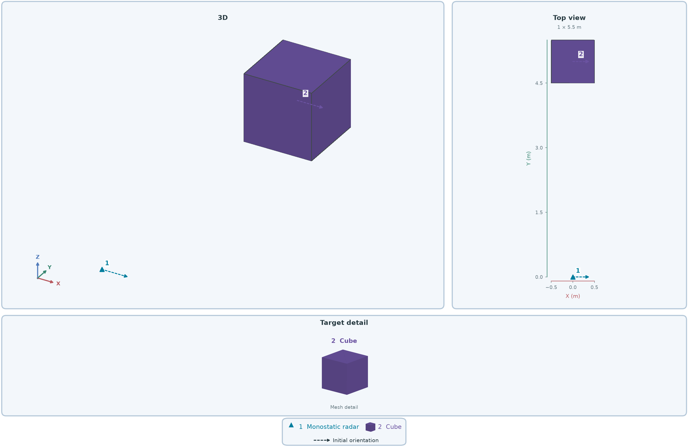
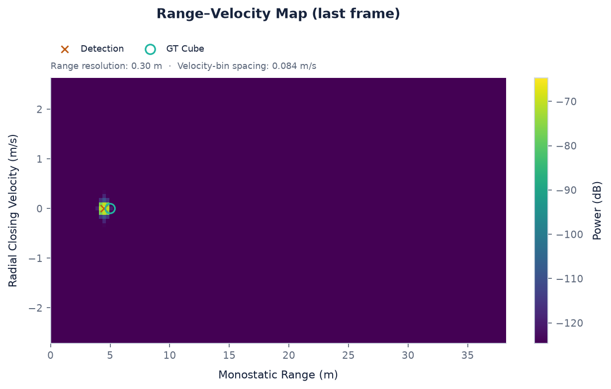
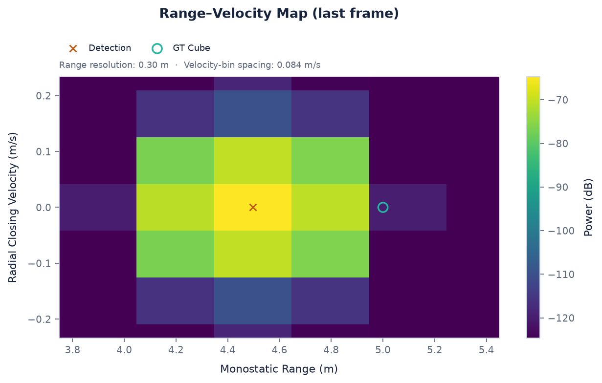
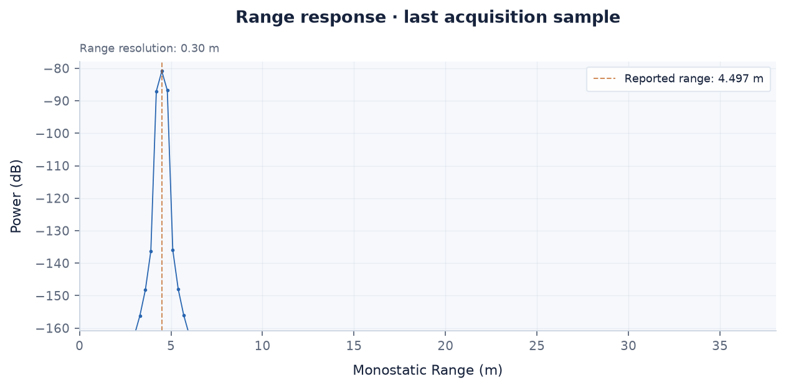
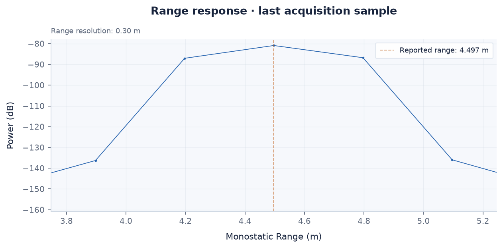

# Stationary Cube: Range and Detection

Evaluate the finite-bandwidth range response and detection of a stationary
metallic cube.

To run it, see [Running](#running).

## Scene Layout



A [monostatic sensor](../../../../docs/reference/glossary.md#monostatic),
i.e., collocated transmitter and receiver, is located at `(0 m, 0 m, 0.5 m)`.
A one-metre cube is centered at `(0 m, 5 m, 0.5 m)` in an empty scene. Its
nearest face is 4.5 m from the sensor. The sensor lies on the normal through
this face's center, so the normal-incidence
[specular reflection](../../../../docs/reference/glossary.md#specular-reflection)
returns toward the sensor.

## Configuration Walkthrough

The key settings in [scenario.yaml](scenario.yaml) are:

```yaml
sensing:
  preset: coherent_hann
  acquisition:
    bandwidth_hz: 500000000.0
    frequency_samples: 128
    sample_rate_hz: 1000.0
    samples_per_cpi: 64
  processing:
    range:
      interpretation: monostatic
      fft_size: 128
    clutter:
      coherent_mode: none
```

At a carrier frequency of 28 GHz, the simulation constructs a
[channel frequency response (CFR)](../../../../docs/reference/glossary.md#cfr)
on 128 frequencies across 500 MHz. The `coherent_hann` preset applies a
[Hann window](../../../../docs/reference/glossary.md#hann-window)
before the 128-point range
[IFFT](../../../../docs/reference/glossary.md#ifft), and another Hann
window before Doppler processing. One
[coherent processing interval (CPI)](../../../../docs/reference/glossary.md#cpi)
contains 64 samples at 1 kHz, occupying 64 ms.
[Clutter suppression](../../../../docs/reference/glossary.md#clutter-suppression)
is disabled to retain the stationary response.

The optional [range-windowing experiment](../../foundations/windowing/README.md)
isolates how rectangular and Hann weights change the response using saved
observations, without repeating ray tracing.

[CFAR](../../../../docs/reference/glossary.md#cfar) uses a threshold
multiplier of 2. The following filters select reported detections:

```yaml
sensing:
  detection:
    filters:
      minimum_snr_db: 3.0
      maximum_dynamic_range_db: 12.0
```

A report must exceed its estimated local background by 3 dB and lie within
12 dB of the strongest map cell. These filters select
detections without changing the processed spectrum. The recording retains
processed maps and detector stages for the
[next filtering example](../stationary_filtering/README.md).

The summary includes the scene layout and sensing results:

```yaml
generator_summary:
  enabled: true
  create: [topology, sensing]
```

`topology` uses the same combined orthographic views as the scene layout above.
The sensor and cube are stationary, so no speed plot is requested.


### Sensing settings

| Parameter | Value | Meaning |
|---|---|---|
| `sensing.preset` | coherent_hann | Coherent CPI, CFR/IFFT and Hann frequency/Doppler weighting; YAML fields override the [preset](../../../../docs/sensing/parameters.md#grouped-configuration). |
| `acquisition.bandwidth_hz` | 500 MHz | Frequency span governing the range-resolution scale. |
| `acquisition.frequency_samples` | 128 | Number of acquired frequency observations. |
| `acquisition.samples_per_cpi` / `sample_rate_hz` | 64 / 1000.0 Hz | Samples and rate defining one coherent observation interval. |
| `processing.clutter.coherent_mode` | none | Keep stationary and moving slow-time components. |
| `recording.profile` | maps | Keep numeric maps and reports, without complex phase samples; see [profiles](../../../../docs/sensing/reprocessing.md#choose-a-profile). |

Acquisition, processing, detection, tracking and recording paths are relative
to `sensing`. A coherent processing interval (CPI) groups pulses for Doppler
estimation. See the [parameter reference](../../../../docs/sensing/parameters.md) for defaults and constraints.

## Running

Run commands from the repository root.

Generate the recording:

```bash
orchav-generator scenarios/sensing/cube_radar/stationary
```

Open the recording:

```bash
orchav-visualizer --scenario scenarios/sensing/cube_radar/stationary --no-resume
```

Generation creates reusable HDF5 data in `frames/`, the scene layout in
`summary/topology.png`, and standalone sensing figures in `summary/sensing/`.

## What To Inspect

1. Open **Sensing → Result graphs → Current result → Detections**.
   Find the peak near 4.5 m and zero velocity in the range–Doppler map.
2. Compare the range profile with the cube's nearest face, then read the
   reported range in **Results table**.

## Results

The standard summary's
[range–Doppler map](../../../../docs/reference/glossary.md#range-doppler-map)
shows one reported detection at **4.497 m and 0 m/s**. The range estimate is
close to the cube's front face at 4.5 m; the range-bin spacing is approximately
0.300 m. Hann weighting spreads the response over neighboring range and
Doppler bins.



The full map shows the complete saved range and velocity grids. The zoomed view
below focuses on the return and its reported detection using the same samples
and power scale.



The [range profile](../../../../docs/reference/glossary.md#range-profile)
below shows the power of the last sample's delay response. Its annotated
vertical line marks the reported range. The range–Doppler map above uses all
64 samples of the CPI.





The full and zoomed profiles contain the same saved range samples; zooming changes
only the displayed range interval.

These are standard sensing summary outputs: `range_doppler_full.png`,
`range_doppler.png`, `range_profile_full.png` and `range_profile.png`.
To regenerate these plots from saved frames without rerunning ray tracing or
detection, see [sensing figures from saved results](../../../../docs/generator/generated_figures.md#sensing-figures-from-saved-results).

## Browse Scenarios

Up: [Cube radar experiments](../README.md) | Next: [Stationary cube filtering](../stationary_filtering/README.md) | Related: [Sensing guide](../../../../docs/sensing/README.md)

## Benchmark

| Invocation | Elapsed |
|---|---:|
| Generation | 5.27 s |
