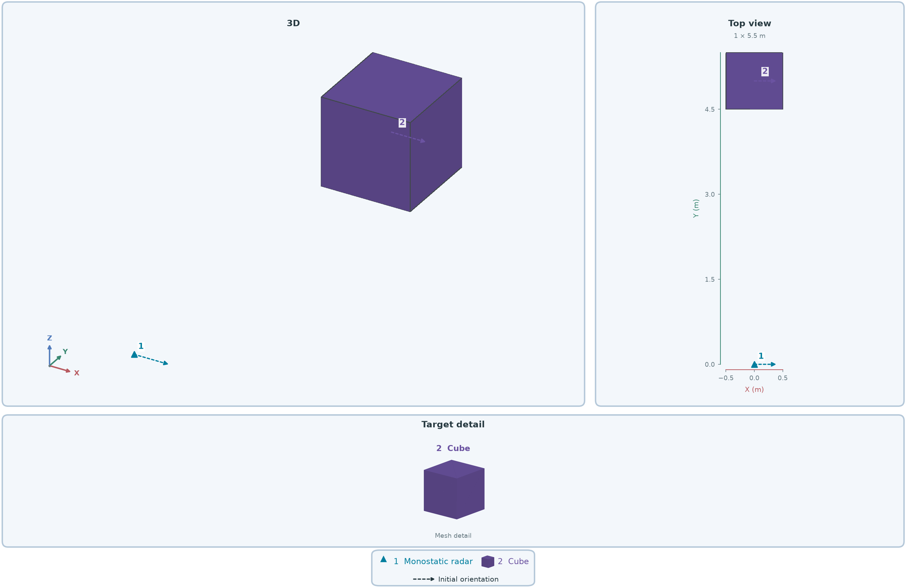
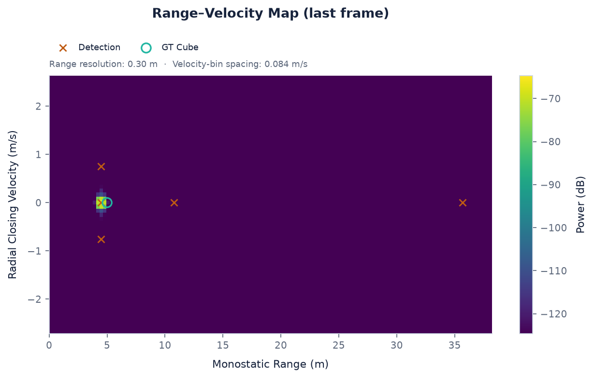

# Stationary Cube: Filtering Detections

Reuse the [stationary cube](../stationary/README.md) recording to compare three
detection settings without running ray tracing again. This is a central ORCHAV
workflow: generate an acquisition once, then try different sensing processing
settings on the saved data. Each comparison writes separate results while
preserving the original recording.

Here, the same saved map produces one, five or no reported detections depending
on the filters. The aim is to understand how a visible return becomes a reported
detection.

To run it, see [Running](#running).

## Scene Layout



A [monostatic sensor](../../../../docs/reference/glossary.md#monostatic),
i.e., collocated transmitter and receiver, is at `(0 m, 0 m, 0.5 m)`.
The one-metre metallic cube is centered at `(0 m, 5 m, 0.5 m)`.
Its nearest face is 4.5 m away, with the sensor on the face normal so that the
specular reflection returns toward the sensor.

## Configuration Walkthrough

The stationary example has already saved the
[range–Doppler map](../../../../docs/reference/glossary.md#range-doppler-map):
received power across range and radial velocity. The
[sensing postprocessor](../../../../docs/sensing/reprocessing.md#run-processing)
reads that map and repeats detection with the recipes in
[filtering.json](../filtering.json). A recipe is a named set of processing
settings; no new channel calculation is needed for these filter changes.

| Parameter | Value | Meaning |
|---|---|---|
| `cfar_min_snr_db` | 3 or 0 dB | Candidate power relative to estimated local background. |
| `cfar_max_dynamic_range_db` | 12 dB or `null` | Drop allowed below the strongest map cell; `null` removes the limit. |
| `max_detection_range_m` | 4 m in `outside_range` | Reject reports beyond this range while preserving their echo in the map. |

The filter settings in that file are:

```json
{
  "defaults": {
    "cfar_min_snr_db": 3.0,
    "cfar_max_dynamic_range_db": 12.0
  },
  "recipes": {
    "bounded": {},
    "cfar_only": {
      "cfar_min_snr_db": 0.0,
      "cfar_max_dynamic_range_db": null
    },
    "outside_range": {
      "max_detection_range_m": 4.0
    }
  }
}
```

This excerpt uses the postprocessor's field names. The two power limits are the
same minimum-SNR and dynamic-range filters introduced in the stationary example:

- `cfar_min_snr_db` compares a candidate's power with the local background
  estimated by [CFAR](../../../../docs/reference/glossary.md#cfar).
  A 3 dB limit requires roughly twice that background power.
- `cfar_max_dynamic_range_db` compares it with the strongest map cell.
  A 12 dB limit rejects candidates more than 12 dB below that peak.
  `null` removes this limit.
- `max_detection_range_m` limits the distance of reported detections.
  It does not remove the echo from the saved map.

Every recipe inherits `defaults` and overrides only the fields it lists.
Therefore, `bounded: {}` keeps the original power limits; `outside_range` keeps
them too and adds the 4 m range limit. The complete file keeps CFAR's threshold
multiplier at 2, with identical peak selection and clustering in all three cases.
CFAR remains active in `cfar_only`.

| Configuration | What it tests | Expected result |
|---|---|---|
| `bounded` | Keep the stationary example's power limits | One detection near 4.5 m and 0 m/s |
| `cfar_only` | Relax both power limits | The cube detection plus four weak reports |
| `outside_range` | Accept reports only up to 4 m | No detections, although the echo remains near 4.5 m |

All three use the same 500 MHz bandwidth, 128 frequency samples, 64-sample
[CPI](../../../../docs/reference/glossary.md#cpi) at 1 kHz, and
[Hann weighting](../../../../docs/reference/glossary.md#hann-window).
Only detection filters change; the range–Doppler power is unchanged.

## Running

Run from the repository root with the ORCHAV environment active. If the
stationary example has not been run yet, generate its data once:

```bash
orchav-generator scenarios/sensing/cube_radar/stationary
```

Apply all three recipes to that saved recording:

```bash
orchav-sensing scenarios/sensing/cube_radar/stationary/frames --recipes scenarios/sensing/cube_radar/filtering.json --output-dir analysis/cube-radar-filtering
```

The command creates **`analysis/cube-radar-filtering/` at the repository root**,
alongside `scenarios/`. Its `bounded/`, `cfar_only/` and `outside_range/`
subdirectories each contain derived HDF5 data in `frames/`, a `scenario.yaml`
for opening the result, and standalone figures in `summary/sensing/`.
`comparison.json` in the parent folder records the comparison.
Use a fresh output directory for another run.

Open each result in turn, closing the viewer between commands.
Start with the original power limits:

```bash
orchav-visualizer --scenario analysis/cube-radar-filtering/bounded --no-resume
```

Then open the relaxed power limits:

```bash
orchav-visualizer --scenario analysis/cube-radar-filtering/cfar_only --no-resume
```

Finally, open the 4 m range limit:

```bash
orchav-visualizer --scenario analysis/cube-radar-filtering/outside_range --no-resume
```

## What To Inspect

1. Open **Sensing → Result graphs → Current result → Detections** in each
   result. Keep **Detections** enabled and find the echo near 4.5 m and 0 m/s.
2. Open **Results table**. Expect one row for `bounded`, five for `cfar_only`
   and none for `outside_range`. Compare the markers with the power map,
   using the same color limits in each view.
3. In `outside_range`, check that the echo is still visible even though its
   detection marker and table entry are gone. The range filter rejects the
   report; it does not change the simulated reflection.

For the intermediate decisions, open **Current result → Detector**.
The recipes retain those stages so you can inspect how candidates were filtered.

## Results

Each image below is an individual `range_doppler_full.png` from the standard
sensing summary. They use the same axes and 60 dB display span as the stationary
example. The saved power arrays are exactly equal across the three configurations.

**Power filters (`bounded`): one detection.** The report at 4.497 m and
0 m/s matches the cube's nearest face at 4.5 m. The power limits retain this
strong response and reject the weaker candidates. Here, “bounded” refers to
power; no range limit is applied.


**Relaxed filters (`cfar_only`): five detections.** Lowering the local power-ratio
threshold and removing the peak-relative bound retains four
additional weak local maxima. CFAR compares each peak with its local background,
so a very weak peak can pass where that background is weaker still. The scene
still contains one stationary cube; the extra reports, including those at
nonzero velocity, do not indicate additional or moving objects.
Their markers can appear in
regions below the displayed power scale: the figure shows 60 dB below the peak,
while this configuration permits weaker reports.



**Maximum range reduced to 4 m (`outside_range`): no detections.** The main
response remains in the map, but its estimated range lies outside the accepted
interval. An empty detection table therefore does not mean the cube stopped
reflecting or that ray tracing missed it; the configured filter excluded it.


The Doppler response is the same in all three images. Its finite width around
zero velocity comes from the 64-sample Hann-weighted transform. A wider color
scale reveals weaker spectral components and can make the response appear more
spread out; detection filters do not broaden it.

## Browse Scenarios

Up: [Cube radar experiments](../README.md) | Previous: [Stationary cube](../stationary/README.md) | Next: [Moving cube](../moving/README.md)

## Benchmark

| Invocation | Elapsed |
|---|---:|
| Shared stationary acquisition | 5.27 s |
| Separate filtering recipes | 5.76 s |
