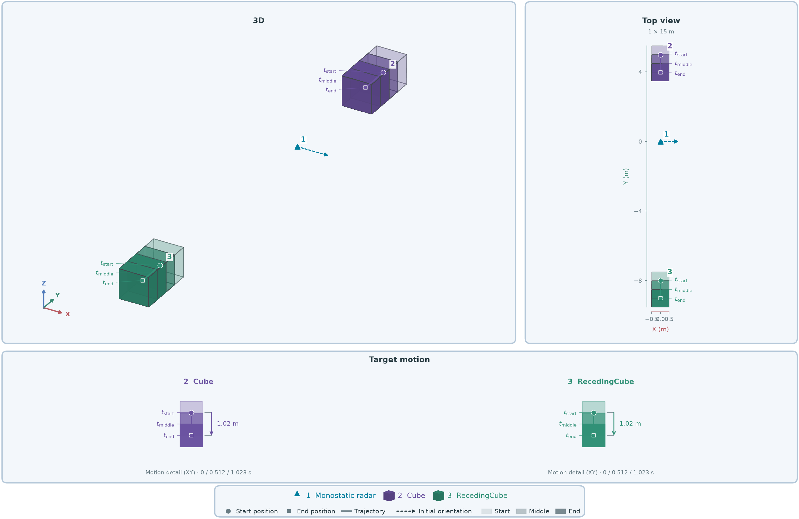
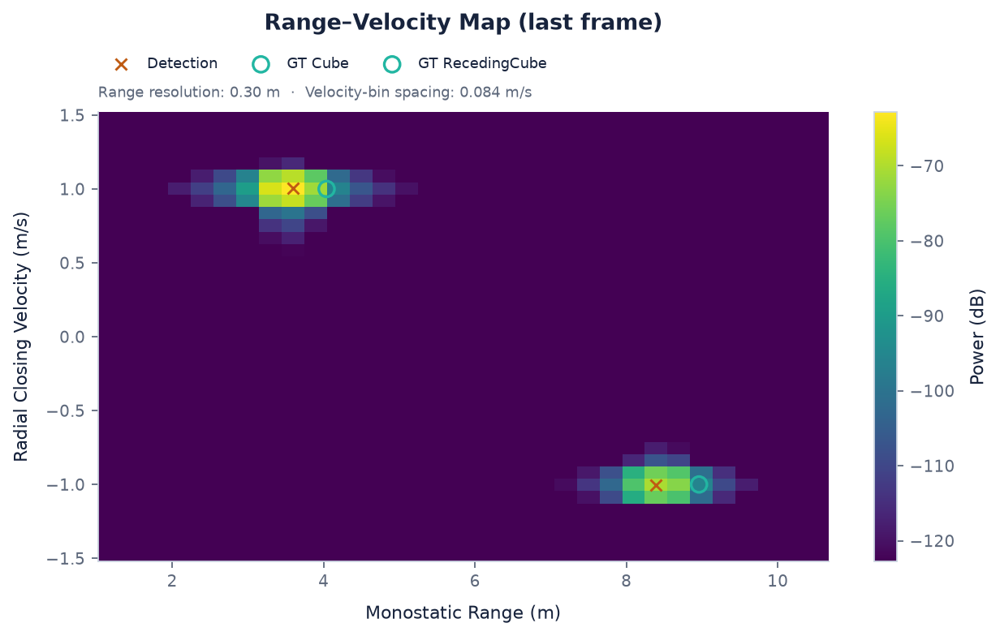
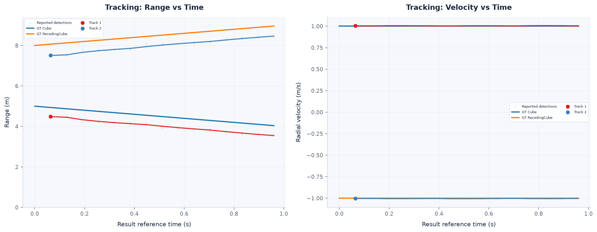

# Two Moving Cubes: Multiple Track Identities

Add a receding cube to the moving-cube acquisition, then apply the same detector
and tracker to both returns. The targets occupy opposite sides of the sensor so
the sensor remains on both face normals and neither cube blocks the other’s path.

To run it, see [Running](#running).

## Scene Layout



A [monostatic sensor](../../../../docs/reference/glossary.md#monostatic),
i.e., collocated transmitter and receiver, is at `(0 m, 0 m, 0.5 m)` in an
empty scene.
`Cube` approaches at 1 m/s, from `(0 m, 5 m, 0.5 m)` to
`(0 m, 3.977 m, 0.5 m)`. `RecedingCube` moves away at 1 m/s, from
`(0 m, −8 m, 0.5 m)` to `(0 m, −9.023 m, 0.5 m)`. Both are one-metre metallic
cubes with fixed orientation. Their nearest faces initially lie at 4.5 m and
7.5 m range.

## Configuration Walkthrough

[scenario.yaml](scenario.yaml) adds a second target and enables radial tracking during generation:

```yaml
- name: RecedingCube
  asset:
    source: directory
    path: libraries/targets/cube
    pattern: cube.ply
    material_type: metal
  mobility:
    type: linear
    start_m: [0.0, -8.0, 0.5]
    end_m: [0.0, -9.023, 0.5]
```

The observation settings remain 28 GHz, 500 MHz bandwidth, 128 frequency
samples/IFFT points, 64 [slow-time samples](../../../../docs/reference/glossary.md#slow-time) per
[CPI](../../../../docs/reference/glossary.md#cpi) at 1 kHz and
[Hann weighting](../../../../docs/reference/glossary.md#hann-window).
The 1,024 sample slots cover 1.024 s and produce 16 results. Noise and clutter
suppression remain off. The sensor is [SISO](../../../../docs/reference/glossary.md#siso):
it reports range and radial velocity,
without estimating which side of the sensor a return occupies.

The remaining sensing settings match the
[stationary cube](../stationary/README.md#configuration-walkthrough).

The YAML enables the same Kalman range/velocity tracker as the radial-tracking example.
It requires two hits in three updates, allows one missed update, and uses
0.5 m range and 0.3 m/s velocity association gates. No truth position or target identity enters detection or
association.


### Sensing settings

| Parameter | Value | Meaning |
|---|---|---|
| `sensing.preset` | coherent_hann | Coherent CPI, CFR/IFFT and Hann frequency/Doppler weighting; YAML fields override the [preset](../../../../docs/sensing/parameters.md#grouped-configuration). |
| `acquisition.bandwidth_hz` | 500 MHz | Frequency span governing the range-resolution scale. |
| `acquisition.frequency_samples` | 128 | Number of acquired frequency observations. |
| `acquisition.samples_per_cpi` / `sample_rate_hz` | 64 / 1000.0 Hz | Samples and rate defining one coherent observation interval. |
| `processing.clutter.coherent_mode` | none | Keep stationary and moving slow-time components. |
| `recording.profile` | maps | Keep numeric maps and reports, without complex phase samples; see [profiles](../../../../docs/sensing/reprocessing.md#choose-a-profile). |
| `tracking.type` | kalman | Associate range and radial velocity over time. |

Acquisition, processing, detection, tracking and recording paths are relative
to `sensing`. A coherent processing interval (CPI) groups pulses for Doppler
estimation. See the [parameter reference](../../../../docs/sensing/parameters.md) for defaults and constraints.

## Running

Run commands from the repository root with the ORCHAV environment active.

Generate the recording:

```bash
orchav-generator scenarios/sensing/cube_radar/two_moving
```

Open the recording:

```bash
orchav-visualizer --scenario scenarios/sensing/cube_radar/two_moving --no-resume
```

Acquisition creates local `frames/` and standard sensing figures in
`summary/sensing/`. The frames already contain detections and tracks.

## What To Inspect

1. Open **Sensing → Result graphs → Current result → Detections** and find
   the approaching and receding returns on opposite sides of zero velocity.
2. Open **Tracking** and step through the 16 results. Each return acquires
   its own persistent ID after confirmation.

## Results

The detector produces **two measurements before tracking in every one of 16 CPIs**, at
**+1.004 m/s and −1.004 m/s**. The final range–Doppler summary shows the separated
approaching and receding responses.



Tracking confirms **two distinct IDs at 0.064 s**; each has 15 confirmed reports
through 0.960 s. In the standard tracking summary, each colored line follows the
Kalman range and velocity estimates for one confirmed identity. The approaching
cube moves to shorter range, while the receding cube moves to longer range.
Ground-truth curves use
the cube centers; their reflecting faces are 0.5 m closer to the sensor.



The identities come from association of the simulated detections, independently
of scene target names. This configuration evaluates two targets separated in
range and velocity. Scene coordinates supply ground truth only for display and
evaluation; they are not inputs to association.

The outputs are `sensing/range_doppler.png` and `sensing/tracking.png`.

## Browse Scenarios

Up: [Cube radar experiments](../README.md) | Previous: [Cartesian tracking](../moving_tracking_3d/README.md) | Continue: [Marching person](../../targets_motion/marching_person/README.md) | Related: [Oscillating cube comparison](../oscillating_comparison/README.md)

## Benchmark

| Invocation | Elapsed |
|---|---:|
| Generation | 16.54 s |
