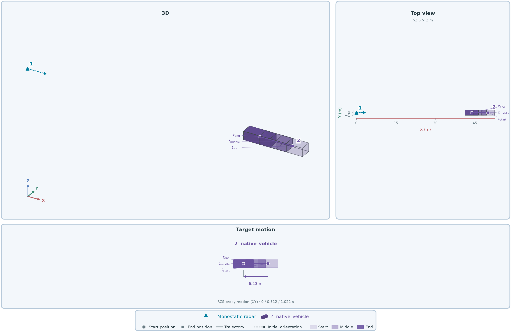
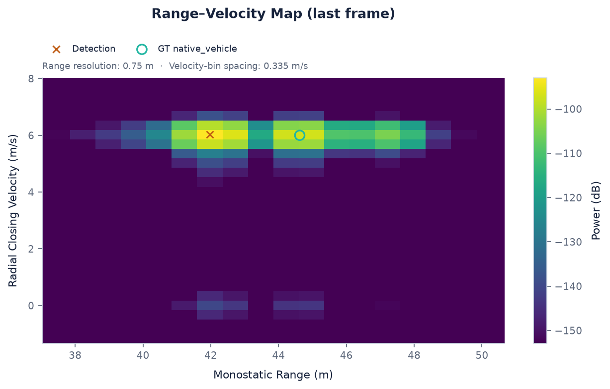
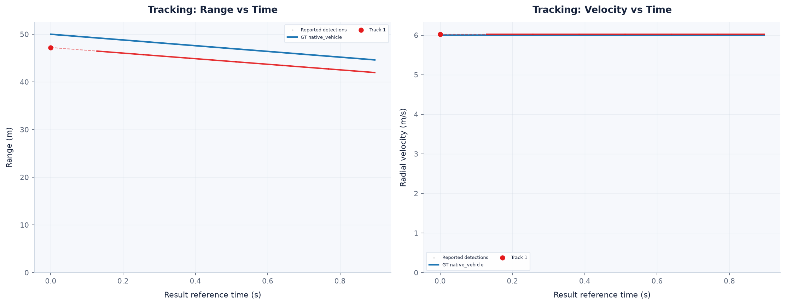
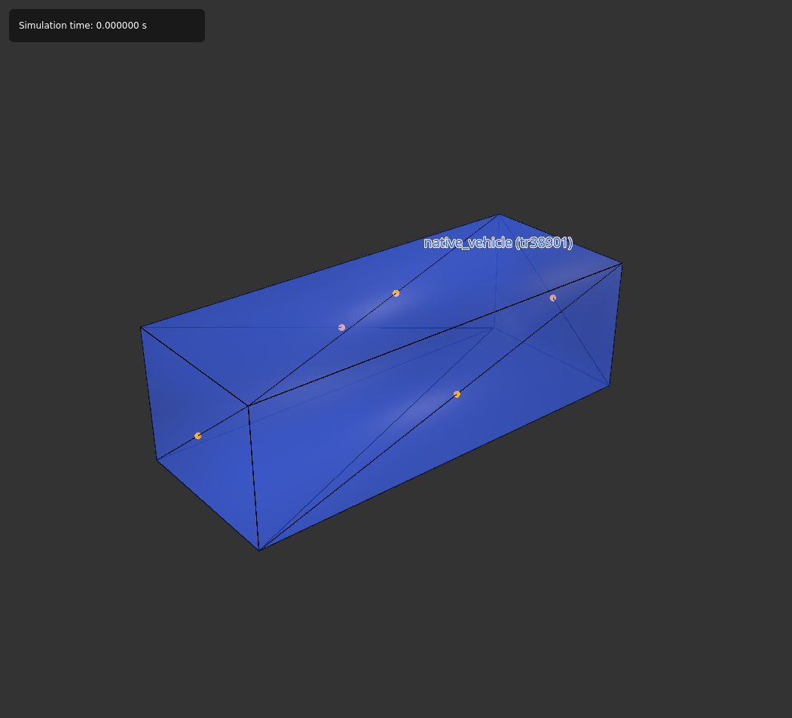

# Vehicle with Five Scattering Points

Use the native 3GPP TR 38.901 vehicle model 2 with five scattering points. Inspect how its coherent return passes through ORCHAV's range–Doppler, detection and tracking pipeline.

To run it, see [Running](#running).

## Scene Layout



A monostatic radar (i.e., collocated transmitter and receiver) is at
(0 m, 0 m, 1 m) in an empty scene. **native_vehicle** moves from (50 m, 0 m, 0.8 m) to (43.868 m, 0 m, 0.8 m). Target positions denote proxy centers.
The absorbing proxy defines blockage; native scattering points supply the RF return.

## Configuration Walkthrough

Relevant target settings from [scenario.yaml](scenario.yaml):

```yaml
actors:
  targets:
  - name: native_vehicle
    representation: tr38901
    geometry: {type: box}
    tr38901: {object_type: vehicle-multi-sp}
    mobility: {end_m: [43.868, 0.0, 0.8], start_m: [50, 0.0, 0.8], type: linear}
    orientation: {type: fixed, yaw_deg: 180.0}
```

The recording uses 3.5 GHz, 200 MHz bandwidth, and eight 64-pulse
[coherent processing intervals](../../../../../docs/reference/glossary.md#cpi)
at 500 Hz. Its range samples are about 0.75 m apart and velocity bins about
0.335 m/s apart. See the [shared acquisition](../README.md#shared-acquisition)
for the common windowing, detector, and tracker settings.


### Sensing settings

| Parameter | Value | Meaning |
|---|---|---|
| `sensing.preset` | coherent_hann | Coherent CPI, CFR/IFFT and Hann frequency/Doppler weighting; YAML fields override the [preset](../../../../../docs/sensing/parameters.md#grouped-configuration). |
| `acquisition.bandwidth_hz` | 200 MHz | Frequency span governing the range-resolution scale. |
| `acquisition.frequency_samples` | 128 | Number of acquired frequency observations. |
| `acquisition.samples_per_cpi` / `sample_rate_hz` | 64 / 500.0 Hz | Samples and rate defining one coherent observation interval. |
| `processing.clutter.coherent_mode` | unweighted_mean | Subtract the ordinary mean for rows with nonzero slow-time variation; see [clutter modes](../../../../../docs/sensing/parameters.md#grouped-configuration). |
| `recording.profile` | maps | Keep numeric maps and reports, without complex phase samples; see [profiles](../../../../../docs/sensing/reprocessing.md#choose-a-profile). |
| `tracking.type` | m_of_n | Associate range and radial velocity over time. |

Acquisition, processing, detection, tracking and recording paths are relative
to `sensing`. A coherent processing interval (CPI) groups pulses for Doppler
estimation. See the [parameter reference](../../../../../docs/sensing/parameters.md) for defaults and constraints.

## Running

Install the [native RCS extra](../../../../../docs/getting_started/installation.md#native-rcs-targets)
with Sionna RT 2.2. Run commands from the repository root.

Generate the recording:

```bash
orchav-generator scenarios/sensing/foundations/RCS/06_vehicle_multi
```

Open the recording:

```bash
orchav-visualizer --scenario scenarios/sensing/foundations/RCS/06_vehicle_multi --no-resume
```

Generation creates reusable HDF5 data in `frames/` and standalone SVG
figures in `summary/sensing/`.

## What To Inspect

1. Open **Sensing → Result graphs**, then **Current result → Detections**.
   Compare the range–Doppler peak with its report in **Results table**.
2. Leave **Play sensing frames only** enabled and use **Previous** and **Next**
   to visit the eight results. Positive closing velocity means approach.
3. Open **Tracking** to follow each ID from its tentative report to confirmation.
   The next section shows the illustrated recording's results.

## Results and interpretation



The map shows the final CPI at 0.896 s. Crosses mark detections and circles
mark target truth. Color is stored power in dB; each figure has its own scale.



Each CPI produces one published report at +6.023 m/s. Its range follows the strongest front-side contribution, decreasing from 47.217 m to 41.971 m, rather than the car center. Several physical scattering points can contribute to one resolved detection. The coherent sum and finite range resolution determine the map; detection and clustering determine the reports.

## Inspect the native target



The blue shape is the absorbing proxy; amber markers are native scattering
points. Select the target under **Objects** to inspect their placement. Hiding
the proxy changes only its display. Close-ups use different camera scales,
so compare the stated dimensions when assessing target size.

## Browse Scenarios

Up: [Native RCS targets](../README.md) ·
[Human model 1](../08_human_model1/README.md) ·
[Model reference](../../../../../docs/sensing/target_models.md)

## Benchmark

| Invocation | Elapsed |
|---|---:|
| Generation | 11.03 s |
