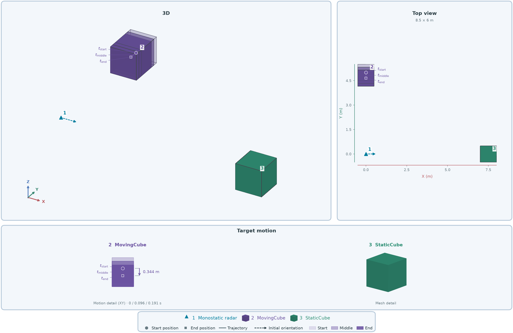
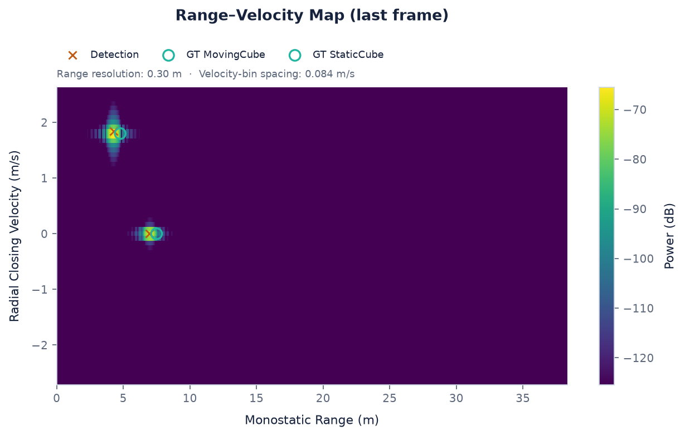
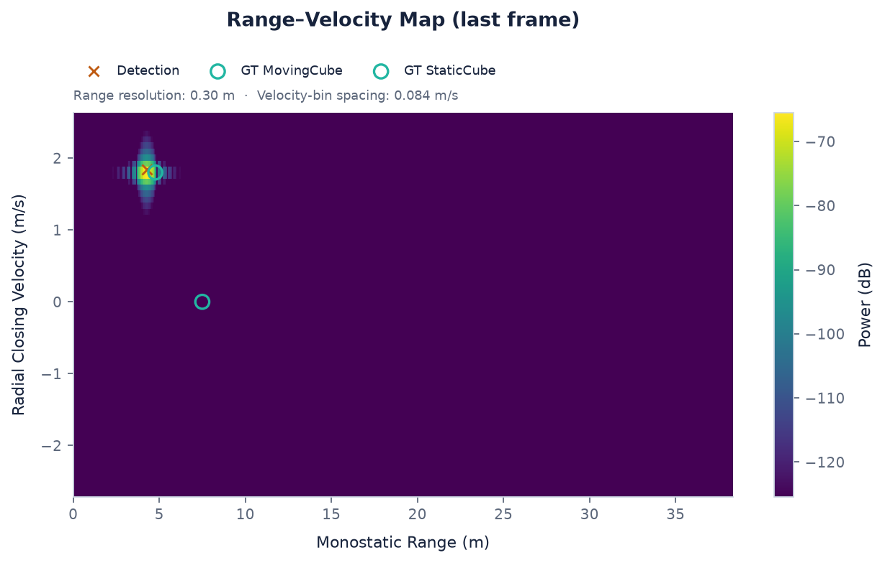

# Separate Static Clutter and Motion

A radar can receive a moving target and an unwanted stationary reflection at the
same time. Compare the same acquisition before and after clutter suppression to
see what is removed.

To run it, see [Running](#running).

## Scene Layout



The radar at **(0 m, 0 m, 0.5 m)** observes an approaching cube on +Y and a stationary
cube on +X. Their near faces start **4.5 m** and **7 m** away. The separate bearings keep
either cube from blocking the other; the stationary return is the clutter to remove.
The moving cube travels only **0.344 m** during the **0.191 s** shown.

## Configuration Walkthrough

Key excerpt from [scenario.yaml](scenario.yaml):

```yaml
sensing:
  processing:
    doppler:
      window: hann
    clutter:
      coherent_mode: none
  recording:
    profile: reprocessing
```

Save both returns first with suppression disabled. Retaining the complex acquisition lets
the Running commands apply `windowed_mean` to the same input. Its weights follow the
Doppler window, removing stationary components while potentially attenuating slow motion.

The `reprocessing` profile saves complex observations for later processing
comparisons without another ray-tracing run. See [recording profiles](../../../../docs/sensing/reprocessing.md#choose-a-profile).


### Sensing settings

| Parameter | Value | Meaning |
|---|---|---|
| `sensing.preset` | coherent_hann | Coherent CPI, CFR/IFFT and Hann frequency/Doppler weighting; YAML fields override the [preset](../../../../docs/sensing/parameters.md#grouped-configuration). |
| `acquisition.bandwidth_hz` | 500 MHz | Frequency span governing the range-resolution scale. |
| `acquisition.frequency_samples` | 128 | Number of acquired frequency observations. |
| `acquisition.samples_per_cpi` / `sample_rate_hz` | 64 / 1000.0 Hz | Samples and rate defining one coherent observation interval. |
| `processing.clutter.coherent_mode` | none | Keep stationary and moving slow-time components. |
| `recording.profile` | reprocessing | Keep maps, reports and canonical complex samples for later processing; see [profiles](../../../../docs/sensing/reprocessing.md#choose-a-profile). |

Acquisition, processing, detection, tracking and recording paths are relative
to `sensing`. A coherent processing interval (CPI) groups pulses for Doppler
estimation. See the [parameter reference](../../../../docs/sensing/parameters.md) for defaults and constraints.

## Running

Run commands from the repository root with the ORCHAV environment active.

Generate the recording:

```bash
orchav-generator scenarios/sensing/foundations/static_and_moving_cubes
```

To visualize the original scene and sensing results:

```bash
orchav-visualizer --scenario scenarios/sensing/foundations/static_and_moving_cubes --no-resume
```

Both range and Doppler use Hann. Inspect the original result, then apply clutter
suppression to the same samples without changing either window.

To reprocess the saved observations with these settings:

```bash
orchav-sensing scenarios/sensing/foundations/static_and_moving_cubes/frames --frequency-window hann --coherent-clutter-mode windowed_mean --cfar-max-dynamic-range 12 --tracker none --output-dir analysis/clutter-weighted
```

To visualize the results after clutter suppression:

```bash
orchav-visualizer --scenario analysis/clutter-weighted --no-resume
```

Use a new output directory for each comparison. The original `frames/` remain
available; `summary/sensing/` contains standard figures from generation.

## What to Observe

Both figures use the saved range and velocity grids. Read their power colorbars when
comparing amplitudes; each summary chooses its display limits from its own map.





Before suppression, the map shows returns near **7 m, 0 m/s** and
**4.5 m, +1.8 m/s**. After suppression, the stationary return disappears while
the approaching return remains. In the derived recording, use **Display settings →
Before clutter suppression / After clutter suppression** to compare the saved spectra.
Detections belong to the saved processing recipe; switching the display does not
run the detector again.

The processor subtracts a weighted mean from each sequence of slow-time samples.
The weights match the Hann window used for Doppler processing. A constant return
therefore cancels, and the zero-Doppler coefficient is zero to numerical precision.
This **null** is an expected consequence of suppression, not a missing solver path.

Slow motion can also be removed. With this CPI, a target closing at about
**0.042 m/s** loses about **7.5 dB** of total windowed energy under weighted-mean
suppression. Use it when stationary returns are unwanted, not as a required step
for every sensing experiment.

The saved range profile precedes slow-time suppression, so it can still show the
stationary reflector when the processed map does not.

## Browse Scenarios

Up: [Processing comparisons](../README.md)

[Understand detection](../../../../docs/sensing/detection_and_tracking.md#detection) ·
[Clutter-processing reference](../../../../docs/sensing/concepts.md) ·
[Learning path](../../../../docs/sensing/README.md#choose-a-task)

## Benchmark

| Invocation | Elapsed |
|---|---:|
| Generation | 7.50 s |
| Separate clutter processing | 1.81 s |
