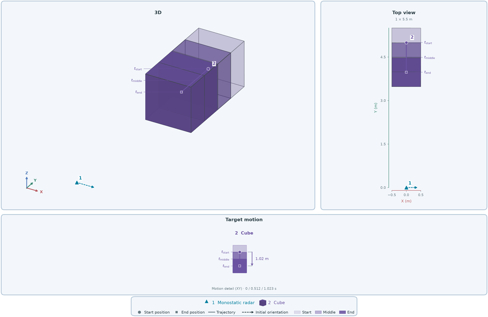
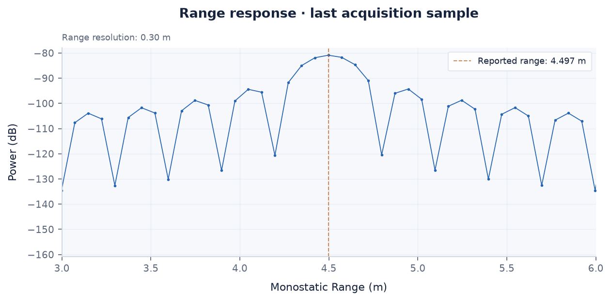
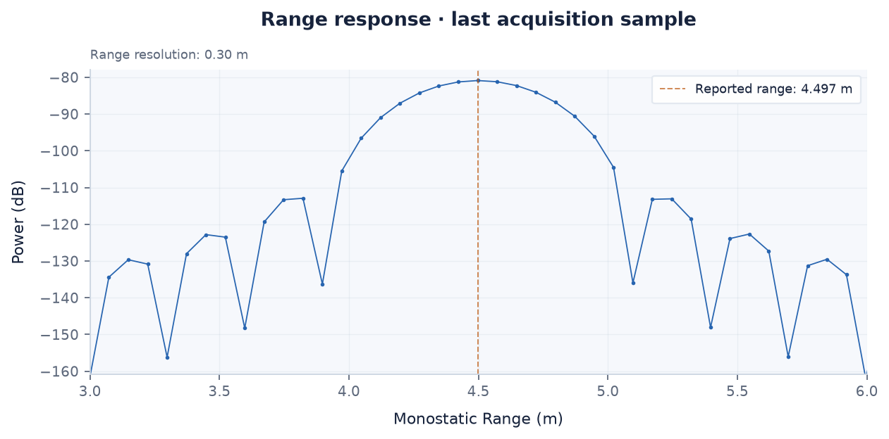

# Range Windowing on Saved Observations

Compare rectangular and Hann frequency weighting on one acquisition. Reprocessing
keeps the channel samples identical, isolating a window's sidelobe/peak-width
tradeoff without tracing rays again.

To run it, see [Running](#running).

## Scene Layout



The collocated sensor is at (0 m, 0 m, 0.5 m). A one-metre cube approaches at
1 m/s from (0 m, 5 m, 0.5 m), so its reflecting face starts 4.5 m away.
The [source YAML](../../cube_radar/moving/scenario.yaml) retains complex
frequency observations through `recording.profile: reprocessing`.

## Configuration Walkthrough

| Parameter | Value | Meaning |
|---|---|---|
| `--frequency-window` | `boxcar` or `hann` | The only difference between the two recipes. |
| `--range-ifft-size` | 512 | Pad 128 frequency observations to sample the response more densely. |
| `--cfar-min-snr` | 3 dB | Minimum candidate power relative to its estimated local background. |
| `--cfar-max-dynamic-range` | 12 dB | Maximum allowed drop below the strongest map cell. |
| `--tracker` | `none` | Inspect detector responses without track association. |

Both use a 28 GHz carrier, 500 MHz bandwidth and 64-sample Hann Doppler windows
at 1 kHz. Padding changes grid spacing, not physical resolution. See the
[range-model reference](../../../../docs/sensing/concepts.md#range-response-models)
and [postprocessor](../../../../docs/sensing/reprocessing.md#run-processing).

## Running

The [moving cube](../../cube_radar/moving/README.md) retains
the complex frequency observations needed to change range weighting without
tracing rays again. From the repository root, generate it once if its frames
are not already available:

```bash
orchav-generator scenarios/sensing/cube_radar/moving
```

Run the two recipes in fresh directories. Both keep the same source, Doppler
settings, 512-point range IFFT, and 3 dB local-ratio / 12 dB peak-relative
detection limits. Only the frequency window differs.

Process the saved observations with a rectangular frequency window:

```bash
orchav-sensing scenarios/sensing/cube_radar/moving/frames \
  --frequency-window boxcar --range-ifft-size 512 \
  --cfar-min-snr 3 --cfar-max-dynamic-range 12 --tracker none \
  -o analysis/range-boxcar
```

Process the same observations with a Hann frequency window:

```bash
orchav-sensing scenarios/sensing/cube_radar/moving/frames \
  --frequency-window hann --range-ifft-size 512 \
  --cfar-min-snr 3 --cfar-max-dynamic-range 12 --tracker none \
  -o analysis/range-hann
```

The derived recordings are in **`analysis/range-boxcar/`** and
**`analysis/range-hann/`** at the repository root. Each contains a loadable
`scenario.yaml` and its own `frames/`; the original recording is unchanged.

Open the rectangular-window result:

```bash
orchav-visualizer --scenario analysis/range-boxcar --no-resume
```

Then close the viewer and open the Hann-window result:

```bash
orchav-visualizer --scenario analysis/range-hann --no-resume
```

In each viewer, open **Sensing → Result graphs → Current result → Detections**.
Select the first sensing result, at reference time **0 s**, and compare the
range-profile plot around **4.5 m** using the same axis limits.

**Rectangular (`boxcar`) weighting:** the main peak is narrow, with visible
sidelobes on both sides. These smaller peaks come from the finite-bandwidth
response of the same reflector; they are not additional cubes.



**Hann weighting:** the sidelobes are lower, but the main peak is wider.
The cube remains at the same range. The wider peak is a processing effect;
the target has not grown.



Both saved figures show the last sample of the first CPI, with identical range
and power axes. The 512-point IFFT samples the response at about 0.075 m intervals;
the bandwidth still sets a resolution scale of about 0.30 m.
[Figure provenance](../../../../docs/assets/finite_bandwidth/moving_cube_windows.json)
records the inputs and export commands.

<details>
<summary>Export these range-profile figures from the saved results</summary>

Render the rectangular-window range profile:

```bash
python -m generator.figures.summary.saved_sensing analysis/range-boxcar -o analysis/range-boxcar-figures --figure range_profile --frame-index 63 --range-limits 3 6
```

Render the Hann-window profile with the same limits:

```bash
python -m generator.figures.summary.saved_sensing analysis/range-hann -o analysis/range-hann-figures --figure range_profile --frame-index 63 --range-limits 3 6
```

Each export writes `sensing/range_profile.png` beneath its output directory.
Frame 63 stores this first complete sensing result, whose reference time is 0 s.
Exporting a figure reads the saved products without repeating processing.

</details>


## Browse Scenarios

Up: [Processing comparisons](../README.md) | Next: [Static clutter](../static_and_moving_cubes/README.md)

## Benchmark

| Invocation | Elapsed |
|---|---:|
| Shared moving acquisition | 23.47 s |
| Separate boxcar processing | 5.05 s |
| Separate Hann processing | 4.32 s |
