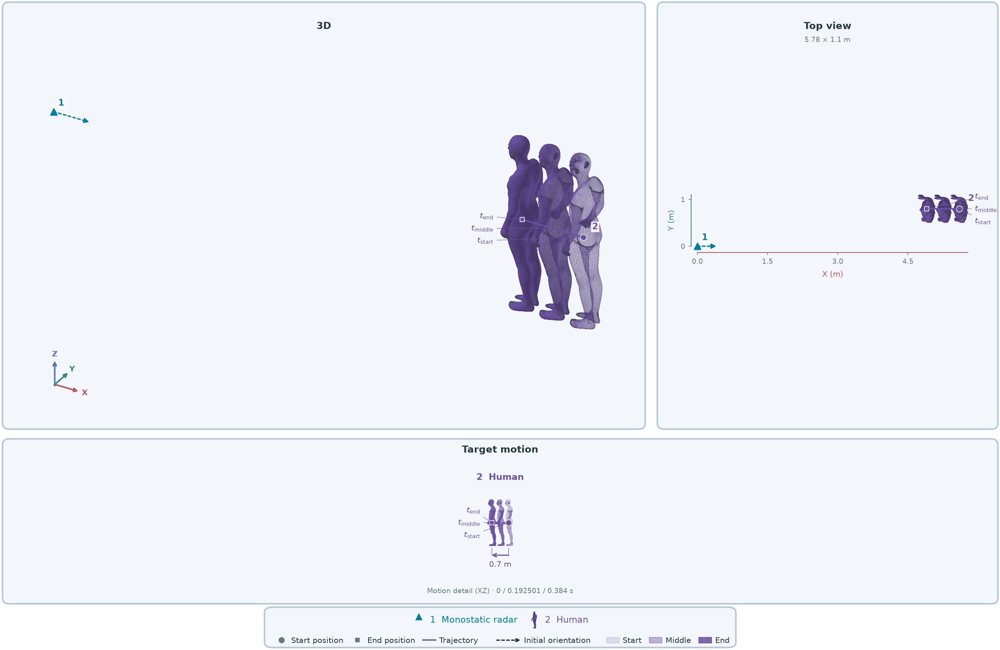
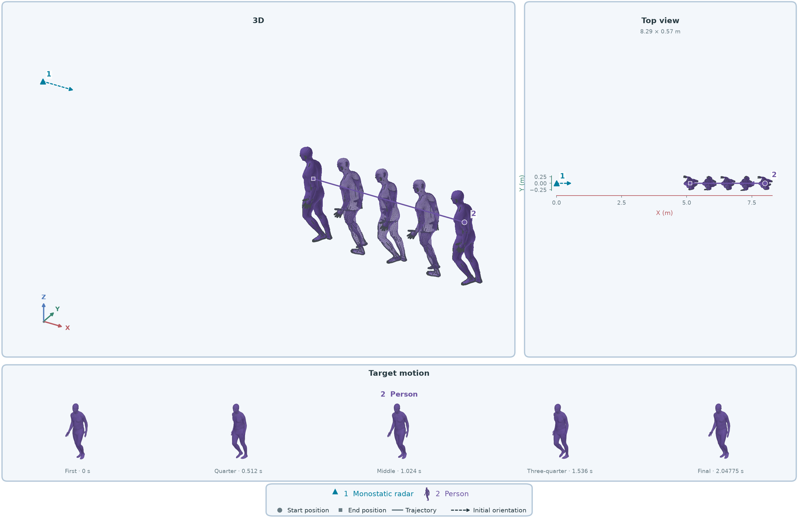
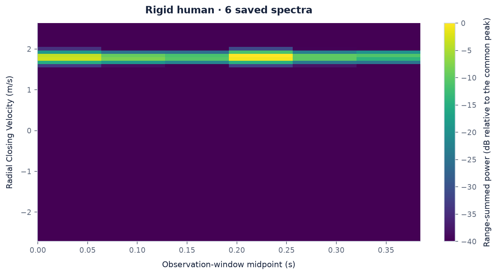
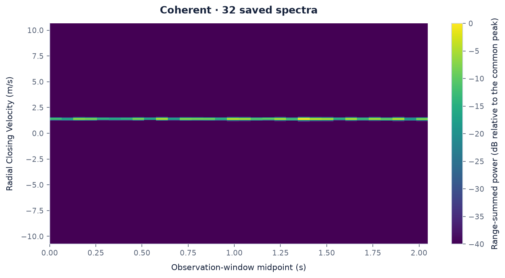
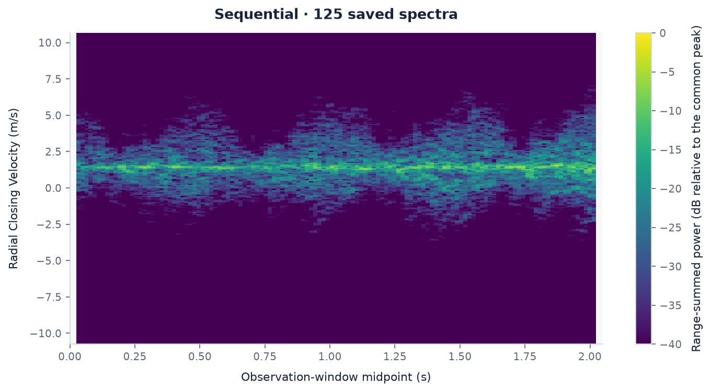

# Human Mesh: Shape, Translation and Articulation

First replace the cube with a **non-animated human mesh** that translates as a
rigid body. This introduces target shape using a bundled asset. Then add
articulation and compare coherent CPIs with sequential pulse acquisition, as in
the [oscillating cube comparison](../../cube_radar/oscillating_comparison/README.md).
A body has many differently oriented surfaces; changing their pose alters path
visibility and scattering while retaining the finite-bandwidth range model.

| Configuration | What it adds | Required asset |
|---|---|---|
| [Rigid mesh](rigid/scenario.yaml) | Extended target shape, bulk motion, detections and radial tracking | Bundled first pose of the NIST walking sequence |
| [Coherent articulated person](coherent/README.md) | A new body pose at each coherent processing interval (CPI) | User-supplied SMPL/AMASS clip |
| [Sequential articulated person](sequential/README.md) | Changing geometry within each analysis window; 125 results at 16 ms intervals | The same prepared clip |

Begin with [the rigid mesh](#1-rigid-mesh-shape-and-bulk-motion), or prepare the
animated asset and follow [Running](#running) for the articulated comparison.

## Scene Layout



The rigid-mesh radar is at (0 m, 0 m, 1.2 m). The body translates from
(5.6 m, 0.8 m, 0.98 m) to (4.9 m, 0.8 m, 0.98 m), facing along its motion.
Its pose is unchanged throughout the recording.



Research illustration using SMPL (Loper et al., 2015) and AMASS
(Mahmood et al., 2019), CMU `08/08_03` motion. See the
[figure attribution](../../../../THIRD_PARTY_NOTICES.md#marching-person-illustration).

For the articulated comparison, a [monostatic radar](../../../../docs/reference/glossary.md#monostatic),
i.e., collocated transmitter and receiver, at `(0 m, 0 m, 1.5 m)` observes the
person approaching along the x-axis in an empty scene. The root moves from
`x = 8 m` to `x = 5.13315 m` over the sampled interval, 0–2.04775 s, while the
person faces the sensor and the joints articulate.

The standard topology summary above shows prepared surfaces at 0, 0.512, 1.024, 1.536 and 2.04775 s.
The quarter-time snapshots expose gait phases between the start, middle and
final samples. The scene has no ground plane.
The metallic surface uses Lambertian diffuse scattering as an uncalibrated
surrogate for studying the simulated channel.

## 1. Rigid Mesh: Shape and Bulk Motion

This configuration uses one reconstructed surface from the
[bundled NIST walking sequence](../../../../libraries/targets/digital_twin_update1/README.md).
It needs no external body model. In [rigid/scenario.yaml](rigid/scenario.yaml),
`switch_meshes: false` selects one pose for the whole trajectory.
The [rigid configuration page](rigid/README.md) links back to this walkthrough.

| Parameter | Value | Meaning |
|---|---|---|
| `actors.targets[].asset.switch_meshes` | `false` | Translate one mesh without changing its shape. |
| `raytracing.carrier_frequency_hz` | 28 GHz | Carrier used for propagation and Doppler conversion. |
| `raytracing.antenna.rx.num_cols` | 16 | Horizontal receive array. |
| `sensing.acquisition.bandwidth_hz` / `frequency_samples` | 500 MHz / 128 | Approximately 0.30 m range-resolution scale. |
| `sensing.acquisition.samples_per_cpi` / `sample_rate_hz` | 64 / 1 kHz | Six 64 ms CPIs in 384 sample slots. |
| `sensing.preset` | `coherent_hann` | Hann frequency and Doppler weighting. |
| `sensing.processing.clutter.coherent_mode` | `none` | Keep the target's return in this empty scene. |
| `sensing.tracking.type` | `kalman` | Associate and filter range and radial velocity. |
| `sensing.recording.profile` | `maps` | Save maps, reports and track states for inspection. |

Each solve uses 120,000 rays and maximum path depth 2. The configured human
material includes Lambertian diffuse scattering with coefficient 0.8. These
settings illustrate an extended reflecting surface; they are not a calibrated
human RCS model. See the [parameter reference](../../../../docs/sensing/parameters.md)
for the detector filters and tracker gates.

Run commands from the repository root.

Generate the rigid-human recording:

```bash
orchav-generator scenarios/sensing/targets_motion/marching_person/rigid
```

Open it to inspect the unarticulated mesh and its return:

```bash
orchav-visualizer --scenario scenarios/sensing/targets_motion/marching_person/rigid --no-resume
```

The recording is written to `rigid/frames/`, with standalone figures in
`rigid/summary/`. Inspect the mesh and interaction points, then open
**Sensing → Result graphs → Tracking**. The surface can spread returns across
range and direction even though every point shares the same rigid translation.
Compare reported range and radial velocity with the target reference; the
strongest return can come from a surface point away from the body's reference
position.



The six coherent spectra form a narrow band around the bulk approach velocity.
All surface points share the rigid translation. The articulated examples below
add changing limb poses. Generate this time–Doppler figure from the saved maps:

```bash
python -m shared.sensing.plotting.doppler_summary --source "Rigid human" scenarios/sensing/targets_motion/marching_person/rigid --output analysis/marching-person-rigid-motion --axis velocity --time-reference midpoint --layout separate
```

The articulated examples below use a different mesh, route, radar height and
sampling rate. They introduce pose changes; they do not isolate articulation
as the only difference from this first step. The coherent and sequential
articulated configurations do share the same prepared motion and scene.

<a id="prepare-the-user-supplied-motion"></a>

## 2. Prepare The User-Supplied Motion

Follow the [SMPL input guide](../../../../docs/generator/motion/smpl_mesh_generation.md#import-amass-with-a-smpl-model)
to install the optional dependencies, prepare the **male** SMPL model and
extract `CMU/08/08_03_poses.npz` from AMASS. If using the original
`SMPL_python_v.1.0.0.zip`, complete the guide's model conversion first:
renaming the original pickle alone leaves its legacy Chumpy dependency intact.

Before continuing, these files must exist relative to the repository root:

```text
inputs/models/smpl/SMPL_MALE.pkl
inputs/CMU/08/08_03_poses.npz
```

`--model-folder inputs/models` names the parent of the `smpl/` directory;
it does not name the model file or the `smpl/` directory itself.

First check the model and motion with a small eight-pose preparation:

```bash
python -m scenarios.sensing.targets_motion.marching_person.prepare --amass-npz inputs/CMU/08/08_03_poses.npz --model-folder inputs/models --output scenarios/sensing/targets_motion/marching_person/assets-smoke --samples 8 --sample-rate 120 --approach-speed 1.4 --start-range 8 --trusted-model
```

Success prints a path ending in `assets-smoke/asset/animated_target.json`.
This short asset checks the inputs; it does not cover the acquisition timeline.
Prepare the full articulated motion sequence separately:

```bash
python -m scenarios.sensing.targets_motion.marching_person.prepare --amass-npz inputs/CMU/08/08_03_poses.npz --model-folder inputs/models --output scenarios/sensing/targets_motion/marching_person/assets --samples 8192 --sample-rate 4000 --approach-speed 1.4 --start-range 8 --trusted-model
```

Both destinations must be new. If a preparation fails, move its incomplete
output aside before retrying at that path, or choose a new output directory.
[prepare.py](prepare.py) writes the animated-target asset and input provenance.
The full command must finish and print
`scenarios/sensing/targets_motion/marching_person/assets/asset/animated_target.json`
before running either acquisition. Both YAML files reference this shared asset.
Keep the completed asset to run either mode again without repeating preparation.
Models, motion and derived meshes remain user-supplied and are excluded from
releases.

The 120 Hz source is interpolated to 4,000 poses/s without adding independent
motion information. The preparation replaces captured root motion with the
explicit approach and uses 8,192 poses without looping or stretching the clip.
Sequential acquisition needs one pose per pulse even though it publishes a
sensing result only every 64 pulses.
Allow about 12 GiB of memory and 10 GiB of disk for the prepared asset. Each
acquisition also loads it at startup; preparation and generation can take
several minutes or more, depending on your machine.
After writing the PLY meshes, preparation exports and checks all native pose
resources; this can take several minutes without another progress message.
The [motion import guide](../../../../docs/generator/motion/smpl_mesh_generation.md)
explains model conversion and coordinate conventions. Preparation records the
source, transforms and resource identities with the exported asset.

<a id="configuration-walkthrough"></a>

## 3. Articulated Acquisition Settings

| Parameter | Value | Meaning |
|---|---|---|
| `timeline.steps` / `sample_rate_hz` | 8,192 / 4 kHz | 2.048 s of sampled body motion. |
| `sensing.acquisition.bandwidth_hz` / `frequency_samples` | 500 MHz / 128 | Range observations at approximately 0.30 m spacing. |
| Coherent `acquisition.samples_per_cpi` | 256 | One fixed body pose per 64 ms interval. |
| Sequential `processing.doppler.fft_size` | 256 | Moving 64 ms analysis window over independently solved poses. |
| Sequential `processing.doppler.hop_samples` | 64 | 75% overlap; 125 results at 16 ms intervals. |
| `sensing.detection.enabled` | `false` | Inspect spectra directly without detector thresholds. |
| `sensing.recording.profile` | `maps` | Save maps, magnitude displays and fixed motion spectra. |

Both [coherent/scenario.yaml](coherent/scenario.yaml) and
[sequential/scenario.yaml](sequential/scenario.yaml) share the settings below;
the acquisition block shown selects the coherent variant:

```yaml
timeline:
  steps: 8192
  sample_rate_hz: 4000.0
sensing:
  preset: coherent_hann
  acquisition:
    mode: coherent_cpi
    samples_per_cpi: 256
    bandwidth_hz: 500000000.0
    frequency_samples: 128
    sample_rate_hz: 4000.0
  processing:
    range:
      interpretation: monostatic
      fft_size: 128
    clutter:
      coherent_mode: none
  detection:
    enabled: false
  recording:
    profile: maps
generator_summary:
  visualization:
    topology_pose_samples: 5
```

The carrier is 28 GHz. The preset supplies
[Hann frequency and Doppler windows](../../../../docs/reference/glossary.md#hann-window).
Each analysis window contains 256 pulses: 64 ms at 4 kHz. The range grid uses
128 frequency observations across 500 MHz and a 128-point
[IFFT](../../../../docs/reference/glossary.md#ifft), giving approximately
0.300 m range-bin spacing. No receiver noise or clutter suppression is added.
Detection is disabled so the figures expose the simulated spectra directly.
Each solve uses 1,000,000 rays, maximum depth 1 and seed 42, with specular and
diffuse reflection enabled. The material selects Lambertian scattering with
coefficient 0.99; the resulting channel also depends on the sampled paths.

| Acquisition | Geometry within one analysis window | Results |
|---|---|---|
| [Coherent](coherent/scenario.yaml) | One surface frozen at the CPI solve start; the root velocity supplies the bulk Doppler model | 32 CPIs, 64 ms cadence |
| [Sequential](sequential/scenario.yaml) | One independent geometry solve for each pulse, including translation and articulation | 125 overlapping windows, 16 ms cadence after 255 warm-up pulses |

Coherent YAML sets `acquisition.mode: coherent_cpi` and
`acquisition.samples_per_cpi: 256`. Sequential YAML sets
`acquisition.mode: sequential_stft`, `processing.doppler.fft_size: 256` and
[`processing.doppler.hop_samples: 64`](../../../../docs/sensing/parameters.md).
Both use `sensing.recording.profile: maps`, the smallest built-in recording
profile that retains range–Doppler power, range profiles and display products
for the documented motion comparisons.
Sequential processing uses each solved channel's phase to compute these products.
The recordings support the saved-spectrum comparison and range selections in
saved maps. To recompute an STFT with a different window or range gate, generate
with `sensing.recording.profile: reprocessing` to retain complex observations.

At 28 GHz, 4 kHz PRF covers ±10.707 m/s, accommodating the prepared motion's
maximum closing speed of 5.612 m/s. Doppler bins are 0.08365 m/s apart. The
64 ms analysis window sets Doppler resolution; extending the recording reveals
more motion.

## Running

Prepare the local asset first, then run commands from the repository root.

To generate the coherent frames:

```bash
orchav-generator scenarios/sensing/targets_motion/marching_person/coherent
```

To generate the sequential frames:

```bash
orchav-generator scenarios/sensing/targets_motion/marching_person/sequential
```

Generation writes each acquisition's `frames/` and standard figures in `summary/sensing/`.
Sequential acquisition solves every pulse and takes substantially longer than
the coherent run. Allow about 12 GiB of memory for the prepared asset and acquisition.

The comparison sums saved range–Doppler power over range without another FFT
or changes to clutter processing. The figures use common time, velocity, and
power limits for one coherent and one sequential figure.

```bash
python -m shared.sensing.plotting.doppler_summary --source Coherent scenarios/sensing/targets_motion/marching_person/coherent --source Sequential scenarios/sensing/targets_motion/marching_person/sequential --output analysis/marching-person-motion --axis velocity --time-reference midpoint --layout separate
```

The comparison displays observation-window midpoints, 0.031875–2.015875 s.
Sequential outputs share 192 of 256 observations; the 16 ms update cadence
does not shorten the 64 ms analysis window. Saved timestamps retain their
coherent solve-start or sequential midpoint convention.

Open the saved motion results:

```bash
orchav-visualizer \
  --scenario scenarios/sensing/targets_motion/marching_person/coherent \
  --sensing-figures motion --sensing-motion saved-stft \
  --sensing-3d off --no-resume

orchav-visualizer \
  --scenario scenarios/sensing/targets_motion/marching_person/sequential \
  --sensing-figures motion --sensing-motion saved-stft \
  --sensing-3d off --no-resume
```

These commands open **Saved micro-Doppler**, reading the authored STFT and the
profiles used by the range–time figure. Select **All ranges**, or launch with
`--sensing-motion all-ranges`, to inspect the range-summed RD history used in the
comparison figures below. That view reads every saved RD map on its first load.

**Motion only** defers other per-result figures and 3D sensing history.
Sequential saves 125 sensing results, compared with 32 coherent CPIs. Generation
still records all 8,192 scene steps; the result hop controls sensing output,
not motion sampling. The first load indexes the recording and reads the selected
products; later launches reuse the cache. For a demonstration, prepare the
selected Motion view beforehand:

```bash
python -m visualizer.sensing_prepare scenarios/sensing/targets_motion/marching_person/sequential \
  --sensing-figures motion --sensing-motion saved-stft --sensing-3d off
```

For a complete inspection, prepare all supported saved figures and 3D sensing
history, then open the prepared recording:

```bash
python -m visualizer.sensing_prepare scenarios/sensing/targets_motion/marching_person/sequential \
  --sensing-figures all --sensing-3d on

orchav-visualizer \
  --scenario scenarios/sensing/targets_motion/marching_person/sequential \
  --sensing-figures prepare --sensing-3d on --no-resume
```

An indicative Linux workstation measurement with only the 125 result frames
retained took about one minute for full preparation. Recordings retaining all
8,192 scene steps need additional indexing; timings depend on hardware and
storage. Preparation is a one-time cost for each recording and selected set of
figures.

Preparation caches the products retained by the recording. This example disables
detection and does not retain complex observations, so preparation does not add
detections, tracks or phase-dependent input views. See
[display preparation](../../../../docs/visualizer/caching.md#sensing-display-cache)
and [loading and playback](../../../../docs/visualizer/sensing_dashboard.md#loading-and-playback)
for cache reuse and memory limits.

Choose coherent CPIs for a less expensive bulk-motion model, or sequential
acquisition when geometry changes within the analysis window matter. The 75%
overlap preserves the 64 ms analysis window and gives smoother motion updates
than non-overlapping windows, while limiting the number of maps to store and
inspect. Acquisition remains expensive because every pulse needs a geometry
solve.

Open **Sensing → Result graphs** to see **Motion**. Select **Current result →
Detections** to load a range–Doppler map when needed. Detection is disabled in
this comparison, so inspect the spectra rather than looking for reports or tracks.

## Results

The standard figures share one relative channel-power reference and matched
time and velocity axes.



The 32 coherent spectra peak between +1.338 and +1.422 m/s, close to the
1.4 m/s root approach. Coherent processing uses that root velocity to model
Doppler within each CPI. It holds one articulated surface fixed for that CPI,
then selects the next pose and root position at the next solve. It describes
bulk motion without within-window articulation.



Sequential processing includes translation and articulation in the independently
solved complex channel at every pulse. It shows a component near the root
approach and a broader, time-varying distribution. Across all saved windows,
the central 95% of range-summed power spans −0.251 to +3.262 m/s. Changing
visibility and sampled diffuse paths also contribute to this spectrum.

Fine spectral detail remains sensitive to ray budget and is not established
as converged. The comparison evaluates the two acquisition models without
identifying individual limb velocities. Keep the saved input provenance with
the results and follow the [phase-consistency guidance](../../../../docs/sensing/concepts.md#motion-and-phase-consistency)
when adapting this experiment.

## Browse Scenarios

Up: [Sensing](../../README.md) ·
[Paris five-target tracking](../../../showcases/paris_opera_multitarget/README.md) ·
[Oscillating cube control](../../cube_radar/oscillating_comparison/README.md) ·
[Animated-target contract](../../../../docs/generator/motion/animated_targets.md)

## Benchmark

| Invocation | Elapsed |
|---|---:|
| Rigid-mesh generation | 19.68 s |
| Coherent generation | 439.78 s |
