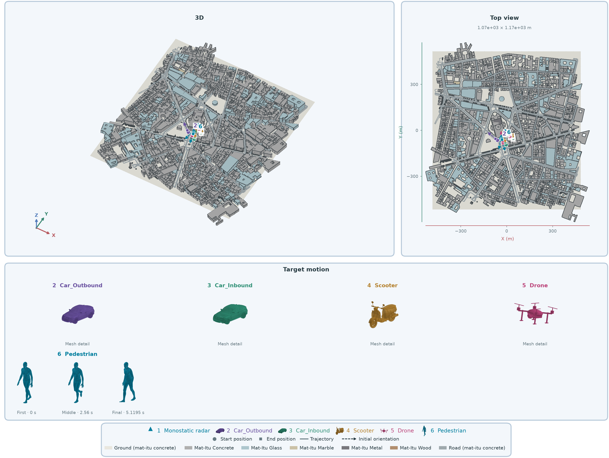
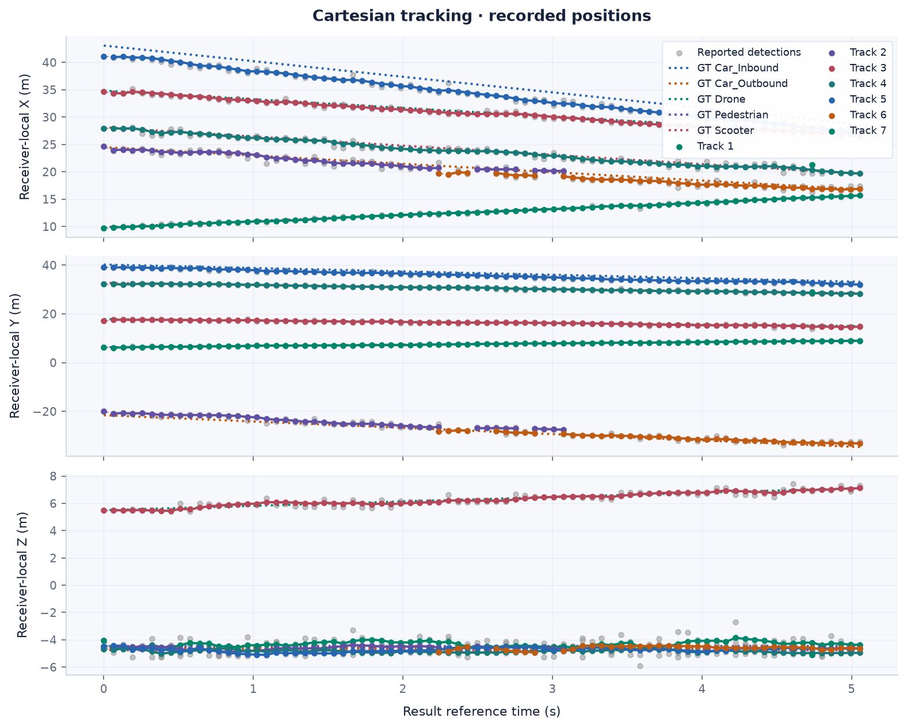

# Paris Opéra: Five Targets, One Planar Array

Track two cars, a scooter, a walking person and a climbing drone around the
Palais Garnier. This example combines mesh targets and an OpenStreetMap scene
with a monostatic radar and a 16 × 16 receive array to estimate range, radial
velocity, azimuth and elevation.

To run it, see [Running](#running).

## Scene Layout



The standard topology summary places the radar and target trajectories in the
city scene. The lower panels show the vehicle and drone meshes and sampled
walking poses from the prepared recording. The [route detail](figures/routes.png)
shows the five trajectories at street scale.

Coordinates are local projected easting, northing and height in metres. The colocated transmitter
and receiver are at **(−36.51 m, −44.61 m, 5.50 m)**, with yaw **−100 deg**.
The road surface is at 0.15 m. Vehicle positions refer to their geometric centres;
the walking route starts at the road height plus any explicitly supplied root
offset. A pelvis-centred source therefore needs a declared vertical offset.

| Actor | Initial position (m) | Velocity (m/s) | Geometry |
|---|---|---|---|
| Outbound BMW | (−62.00, −65.00, 0.909) | (−2.28, 1.95, 0) | 4.50 m long |
| Inbound BMW | (−4.40, −94.00, 0.909) | (−0.88, 3.05, 0) | 4.50 m long |
| Scooter | (−9.20, −78.00, 0.734) | (−0.52, 1.80, 0) | 1.90 m long |
| Walking person | (−32.00, −55.50, 0.15) + chosen offset, root | (0.327, −1.206, 0) | Explicitly supplied poses and timing; 1.25 m/s root speed |
| Climbing drone | (−25.00, −82.00, 11.00) | (−0.28, 1.65, 0.32) | 1.6 m × 1.5 m × 0.7 m rigid quadrotor |

The cars occupy separate street approaches. The scooter and drone approach the
radar at similar radial velocities and occupy different directions and heights.
The walking person and outbound car recede. These trajectories expose useful
range, velocity and angle separation in one view.

The city uses cached OSM footprints and building parts with an authored Opéra
façade, Haussmann-style surrounding façades and limestone paving. Preparation
omits underground building parts and records the changes in
`scene_clean/surface_scene_audit.json`.

## Configuration Walkthrough

The [YAML template](scenario.yaml) combines two cars, a scooter, a walking
pedestrian and a rising drone. Preparation binds the supplied walking asset
and bundled city/vehicle inputs into a portable run directory.

| Parameter | Value | Meaning |
|---|---|---|
| `timeline.steps` / `sample_rate_hz` | 10,240 / 2 kHz | 5.12 s of acquisition slots. |
| `sensing.acquisition.samples_per_cpi` | 128 | 80 coherent results, 64 ms apart. |
| `raytracing.carrier_frequency_hz` | 28 GHz | Carrier used for propagation and velocity conversion. |
| `sensing.acquisition.bandwidth_hz` / `frequency_samples` | 500 MHz / 256 | Frequency-domain observations for range processing. |
| `raytracing.antenna.rx` | 16 × 16 elements | Planar array supplies azimuth and elevation. |
| `raytracing.quality.custom.samples_per_src` | 800,000 | Rays per geometry solve. |
| `raytracing.quality.custom.max_depth` | 1 | First-order reflection paths. |

Detection and Cartesian tracking are configured in YAML. See the
[sensing parameter reference](../../../docs/sensing/parameters.md)
for thresholds, association gates and recording settings. Geometry is frozen
inside each CPI; pedestrian articulation changes between CPIs and the drone's
rotors remain rigid. This example demonstrates multi-target observations and
tracking rather than resolved limb or rotor micro-Doppler.

## Running

Run from the repository root with ORCHAV's `[osm]` dependencies installed.
Supply an existing canonical `animated_target.json` with its pose resources;
the [preparation guide](PREPARATION.md) explains import, duration, placement
and the alternative historical walking-library command.

Prepare a new run, replacing `WALKING_ASSET_JSON` with your supplied manifest:

```bash
python scenarios/showcases/paris_opera_multitarget/prepare.py --walking-asset WALKING_ASSET_JSON --output scenarios/showcases/paris_opera_multitarget/runs/my_run --epochs 80 --rays 800000
```

Generate the prepared recording and its summary figures:

```bash
orchav-generator scenarios/showcases/paris_opera_multitarget/runs/my_run
```

Open the recording in the Visualizer:

```bash
orchav-visualizer --scenario scenarios/showcases/paris_opera_multitarget/runs/my_run --no-resume
```

Preparation needs a new destination; once prepared, keep it and rerun generation
there. Generation
writes reusable `runs/my_run/frames/` and standalone figures in
`runs/my_run/summary/`. Keep the run's scene and asset directories with the frames.

## What To Inspect

Open **Sensing → Result graphs → Current result** for range–Doppler and angular
products, then **Tracking** for the estimated positions. Step through time to
follow targets as their visibility and relative separation change. Compare the
estimated reflected returns with the displayed trajectories; the trajectories
describe object centres, which can lie away from the reflecting surfaces.
Use [the sensing-panel guide](../../../docs/visualizer/sensing_dashboard.md)
for linked tables, plot selection and 3D overlays.



The standard tracking summary compares saved Cartesian track positions with
the authored target-centre trajectories (dotted curves). The axes use
receiver-local X/Y/Z coordinates, while the topology above uses city coordinates.
Track IDs identify estimated tracks and can change when a track is lost and
reconfirmed.

### Optional analysis

Compare the saved reports with the authored trajectories:

```bash
python scenarios/showcases/paris_opera_multitarget/analyze.py scenarios/showcases/paris_opera_multitarget/runs/my_run
```

This compares saved reports with the authored trajectories and writes review
metrics and figures in the run's `review/` directory. It does not acquire
frames or enable the tracker. Counts and errors describe the chosen matching
rules and this recording; inspect the figures alongside the numeric metrics.

The recording requires `prepare.py` and `orchav-generator`; `analyze.py`
reviews saved results without reacquiring data. Optional capture, export and
route-audit scripts are documented in [presentation and asset workflows](PRESENTATION.md).
Source credits are in [ATTRIBUTION.md](ATTRIBUTION.md).

## Browse Scenarios

Up: [Sensing](../../sensing/README.md) | Previous:
[Marching person](../../sensing/targets_motion/marching_person/README.md) |
Next: [Munich drone fusion](../../sensing/applications/drone_tracking/README.md)

## Benchmark

| Invocation | Elapsed |
|---|---:|
| Prepared run generation | 2201.55 s |
| Optional review analysis | 5.44 s |
