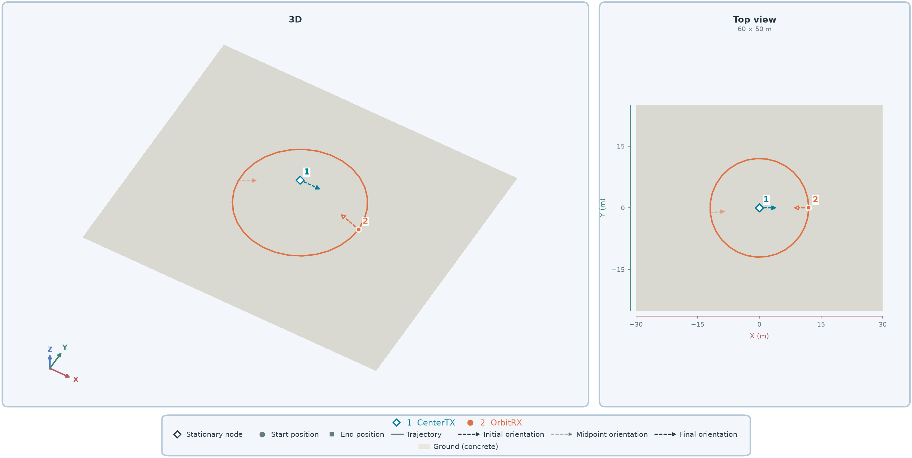

# Circular Receiver Beamforming

[Scenarios](../../../README.md) > [Visualizer](../../README.md) >
[Beamforming](../README.md) > Circular Receiver

This scenario moves one receiver around a stationary transmitter. It provides a
small generated data set for checking antenna overlays, steering choices, and
the way a beam pattern follows the selected TX/RX pair.

To run it, see [Running](#running).

## Scene Layout



- `CenterTX` is fixed at `(0.0 m, 0.0 m, 8.0 m)`.
- `OrbitRX` follows a 12.0 m-radius counter-clockwise circle at `1.5 m`
  height and keeps its orientation pointed at `CenterTX`.
- `CenterTX` uses a 4x8 array with isotropic elements. `OrbitRX` uses a 4x8
  array with dipole elements.
- The scenario uses ORCHAV's 28 GHz carrier and half-wavelength spacing
  defaults.

## Configuration Walkthrough

The [scenario.yaml](scenario.yaml) sets the transmitter array under
`raytracing.antenna`:

```yaml
raytracing:
  antenna:
    tx:
      pattern: iso
      num_rows: 4
      num_cols: 8
```

The receiver also uses a 4 × 8 array, with dipole elements. These settings
initialize the **Antennas** controls. Later panel edits affect only the display.
See [antenna configuration](../../../../docs/generator/configuration.md#antenna-arrays)
for the available settings.

## Running

From the repository root, generate the frames:

```bash
orchav-generator scenarios/visualizer/beamforming/circular_rx
```

Open the scenario in the Visualizer:

```bash
orchav-visualizer --scenario scenarios/visualizer/beamforming/circular_rx --no-resume
```

Generation saves reusable HDF5 frames under `frames/` and standalone layout
and speed figures under `summary/`.
The circular motion has 32 steps over 8 seconds.

## What To Inspect

1. Under **Scene → Nodes → Labels**, set **TX/RX text** to **Device Name**.
2. In **Context → TX/RX Scope**, select TX **CenterTX** and RX **OrbitRX**.
   Leaving either field at **All** disables beam patterns.
3. Open **Antennas → Pattern Source**, select **Standalone**, and enable
   **Show Beam Patterns**.
4. Under **Shared TX/RX Parameters**, choose **LOS Steering** as the
   **Strategy**. Scrub the timeline and watch the patterns follow the pair.
5. Compare **Manual Steering**, using its azimuth and elevation controls, with
   **SVD (Current MPCs)**, which estimates steering from the saved paths.

Paths start hidden to keep the surfaces easy to see. **Frame Data** is
unavailable because these frames do not contain saved beamforming weights.
For steering behavior and limitations, see
[Beam-Pattern Visualization](../../../../docs/visualizer/beam_patterns.md).

## Browse Scenarios

Up: [Beamforming](../README.md) ·
[Multiple Devices](../multi_device/README.md)
